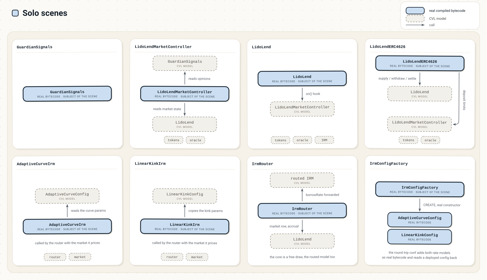
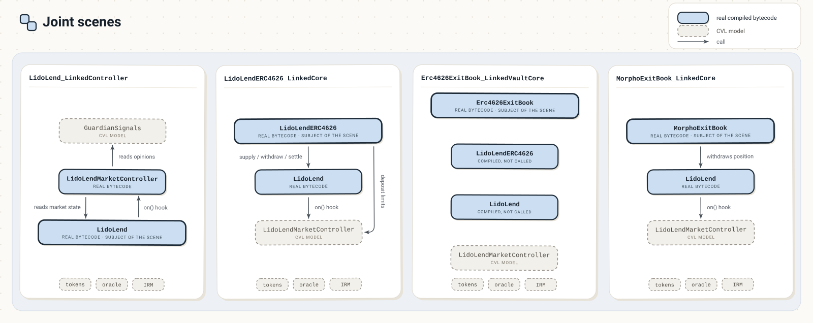

# Formal Verification Report: Lido Lend

> Historical report dated September 15, 2026. See the [handover notes](./HANDOVER.md)
> for the public repository layout, the two dated PDF reports, and the scope of this import.
> The recorded results have not been rerun against the current public source tree.

- Date: September 15th, 2026
- Author: [AlexZoid](https://x.com/alexzoid) ([Cyfrin](https://x.com/cyfrin) formal verification engagement)
- Certora Prover version: 8.16.2

---

## Table of Contents

1. [Verification Scope](#verification-scope)
2. [Methodology](#methodology)
   - [Setup Scenes](#setup-scenes)
   - [Types of Properties](#types-of-properties)
   - [Types of Assumptions](#types-of-assumptions)
3. [Properties](#properties)
   - [Narrowed Scenes](#narrowed-scenes)
   - [GuardianSignals](#guardiansignals)
   - [LidoLendMarketController](#lidolendmarketcontroller)
   - [LidoLend](#lidolend)
   - [LidoLendERC4626](#lidolenderc4626)
   - [LidoLend_LinkedController](#lidolend_linkedcontroller)
   - [LidoLendERC4626_LinkedCore](#lidolenderc4626_linkedcore)
   - [Erc4626ExitBook_LinkedVaultCore](#erc4626exitbook_linkedvaultcore)
   - [MorphoExitBook_LinkedCore](#morphoexitbook_linkedcore)
   - [AdaptiveCurveIrm](#adaptivecurveirm)
   - [LinearKinkIrm](#linearkinkirm)
   - [IrmRouter](#irmrouter)
   - [IrmConfigFactory](#irmconfigfactory)
4. [Mutation Testing](#mutation-testing)
5. [Reproducing the Results](#reproducing-the-results)
   - [Prerequisites](#prerequisites)
   - [Remote Execution](#remote-execution)
   - [Local Execution](#local-execution)
   - [Running the Suites](#running-the-suites)
6. [Resources](#resources)

---

## Verification Scope

Lido Lend is a Morpho Blue fork for isolated, permissionless loop markets. What separates it from the original is a per-market policy layer: a controller hook every core operation must pass, a guardian committee that can slow or block a borrower, and a par-value exit that lets a supplier leave against borrower debt when free liquidity cannot cover the withdrawal. The scope spans three codebases, each read at the commit the follow-up audit reviewed:

| Repository | Commit |
| --- | --- |
| [lido-lend-markets](https://github.com/lidofinance/lend-markets) | `d70a17018453a86b69c218c9a1ebd5a2c1cbf423` |
| [lido-lend](https://github.com/lidofinance/lend) | `490f9d7b3aba2edde9403f90ffa6a69628fdd44f` |
| [lido-lend-irm](https://github.com/lidofinance/lend-irm) | `998de75d94702eee47e37a12b96b7a449052f87c` |

These are the historical, pre-rewrite commit identifiers recorded by the engagement;
they are retained as provenance rather than linked into the rewritten public history.
The repository links above point to the current public repositories.

The contracts in scope:

**Forked core** ([`lido-lend/src/`](https://github.com/lidofinance/lend/tree/422d589f9d098124249b54b55306884165833207/src))

1. **LidoLend** ([`LidoLend.sol`](https://github.com/lidofinance/lend/blob/422d589f9d098124249b54b55306884165833207/src/LidoLend.sol)): the forked Morpho Blue core, which can bind a market to a controller at creation and adds the par-value `settle` exit, burning a supplier's shares to cancel borrower debt and seize the matching collateral.

**Markets layer** ([`lido-lend-markets/src/`](../src/))

2. **GuardianSignals** ([`GuardianSignals.sol`](../src/GuardianSignals.sol)): the guardian registry, a committee shared across markets whose members flag accounts to block their borrowing and suspect them to raise their collateral activation delay.

3. **LidoLendMarketController** ([`controllers/LidoLendMarketController.sol`](../src/controllers/LidoLendMarketController.sol)): the per-market policy controller the core calls on every supply, withdraw, borrow and settle. It caps supply, holds new collateral until it matures, turns away banned borrowers and orders borrowers by risk, so settlement meets the riskiest first.

4. **LidoLendERC4626** ([`LidoLendERC4626.sol`](../src/LidoLendERC4626.sol)): the lender vault, a share token over one core market that supplies deposits into the core, takes its deposit and withdrawal limits from the controller, and settles against borrower debt when liquidity runs short.

5. **Erc4626ExitBook** ([`periphery/Erc4626ExitBook.sol`](../src/periphery/Erc4626ExitBook.sol)): the ERC-4626 exit book, where a lender posts an exit request backed by its vault shares and a filler redeems those shares to pay it, over the vaults governance allows.

6. **MorphoExitBook** ([`periphery/MorphoExitBook.sol`](../src/periphery/MorphoExitBook.sol)): the Morpho exit book, the same order book backed by a lender's supply position instead of vault shares, filled by withdrawing from it on the markets governance allows.

**Rate models** ([`lido-lend-irm/src/`](https://github.com/lidofinance/lend-irm/tree/566d31f7dfdf83d07a6593f641f7474c263a7f89/src))

7. **AdaptiveCurveIrm** ([`adaptive-curve-irm/AdaptiveCurveIrm.sol`](https://github.com/lidofinance/lend-irm/blob/566d31f7dfdf83d07a6593f641f7474c263a7f89/src/adaptive-curve-irm/AdaptiveCurveIrm.sol)): the adaptive rate model, pricing each market's borrow rate from utilization and steering its rate at target through an exponential adaptation bounded by a per-config band.

8. **LinearKinkIrm** ([`linear-kink-irm/LinearKinkIrm.sol`](https://github.com/lidofinance/lend-irm/blob/566d31f7dfdf83d07a6593f641f7474c263a7f89/src/linear-kink-irm/LinearKinkIrm.sol)): the linear kink rate model, quoting a rate that climbs one slope below the optimal utilization and a steeper one above it, capped by a protocol-wide ceiling.

9. **IrmRouter** ([`irm-router/IrmRouter.sol`](https://github.com/lidofinance/lend-irm/blob/566d31f7dfdf83d07a6593f641f7474c263a7f89/src/irm-router/IrmRouter.sol)): the routing facade the core prices through, dispatching each market's rate query to the model configured for that market behind a one-way initialization latch.

10. **IrmConfigFactory** ([`irm-config-factory/IrmConfigFactory.sol`](https://github.com/lidofinance/lend-irm/blob/566d31f7dfdf83d07a6593f641f7474c263a7f89/src/irm-config-factory/IrmConfigFactory.sol)): the deduplicating factory of immutable rate model configs, deploying a fresh instance for new parameters and returning the registered one whenever the same parameters come back.

<div style="page-break-before: always;"></div>

---

## Methodology

Certora Formal Verification (FV) provides mathematical proofs of smart contract correctness by verifying code against a formal specification. Unlike testing and fuzzing which examine specific execution paths, Certora FV examines all possible states and execution paths.

The process involves crafting properties in CVL (Certora Verification Language) and submitting them alongside compiled Solidity smart contracts to the prover. The prover transforms the contract bytecode and rules into a mathematical model and determines the validity of rules.

### Setup Scenes

A scene is the set of contracts the prover compiles for one verification run. Each is **real** bytecode or a **CVL model**, a stand-in written in the specification language.



A **solo** scene verifies one target alone. Its **valid state**, a pack of invariants stated there, is assumed through `requireInvariant` by the rules that need it.

A property spanning two contracts runs on a joint scene `A_LinkedB`, with its own section below. The two exit books have no solo scene, so every property of theirs runs on its joint scene. `LidoLend_LinkedController` and `LidoLendERC4626_LinkedCore` run both contracts' real bytecode and assume both valid states. `MorphoExitBook_LinkedCore` runs the real core but assumes none of its invariants. `Erc4626ExitBook_LinkedVaultCore` compiles the vault and the core for their state only: the book's calls to a vault resolve into the shared ERC4626 model.



The setup also narrows: one symbolic market where a scene has that dimension, bounded sets where a property sums (position holders, token ledgers, guardian sets), every loop unrolled to a fixed count. Each scene below lists its own bounds.

### Types of Properties

The official Certora [methodology](https://github.com/Certora/Tutorials/blob/master/06.Lesson_ThinkingProperties/Categorizing_Properties.pdf) defines several property categories. A **parametric** category is checked against every external function of the scene, including ones added after the specification.

- **Valid State** (parametric): system-wide invariants that hold in every reachable state; once proven, other properties reuse them as preconditions through `requireInvariant`.
- **Variable Transitions** (parametric): the permitted before/after relation on a single state variable across any call: monotonic counters, write-once fields, values that only move within a bound.
- **State Transitions** (parametric): the moves between valid states, how a valid state may change and in what order.
- **High Level**: properties of one or several specific function calls (share conservation, a supply and withdraw round trip).
- **Unit Tests**: the exact effect of one named call on the state it writes.
- **Accrue Interest**: an entry point behaves the same whether or not interest was accrued earlier in the block.
- **ERC4626**: EIP-4626 conformance of the vault's previews, limits and conversions.
- **Config Trust Boundary**: `satisfy` runs showing what a rate model's trust in its config holds back.
- **Reachability**: `satisfy` witnesses that each workflow can execute and take effect.
- **Reverts**: an external call reverts exactly on its documented preconditions.
- **Access Control** (parametric): every privileged entry point enforces its owner or role gate.
- **Reentrancy**: what a contract may do while another contract holds control: no storage touched after an untrusted call, no delegatecall, no hooked action while a hook runs.
- **Oracle Outage**: which calls never read the market's oracle, and which can still complete or always fail while the oracle reverts.

### Types of Assumptions

Each `require` limits which states the prover checks, and its tag says why.

- **SAFE**: excludes no reachable state (`msg.sender != 0`).
- **SCOPE**: pins which flow the rule reasons about; a sibling rule covers what it excludes, or that part is immaterial (a bystander cell, when the cell acted on has its own rule).
- **UNSAFE**: drops reachable, uncovered states, for tractability or a tool limit (the guardian committee bounded to a fixed size).
- **TRUSTED**: guaranteed by a trusted party outside the scene (the initialized proxy state, established at deployment).
- **PROVED**: not an assumption: a fact proven elsewhere, reused as a precondition (an invariant via `requireInvariant`).
- **ASSERT**: not an assumption: inside a CVL model, a `require` standing in for a revert of the real code (the `AccessControlUnauthorizedAccount` check in the role model).

<div style="page-break-before: always;"></div>

---

## Properties

Every verdict below comes from a locally built prover, the version named in the header.

- **Properties**: every invariant and rule the suite states
- **Proved** ✅: verified by the prover
- **Timeout** ⏱️: the prover ran the rule and did not decide it within the solver budget its conf carries
- **Mutations** 🎯: rules with a mutant the prover killed, a deliberately faulted copy of the code on which the rule fails
- **Violations** ❌: rules that fail
- **Narrowed** 🔻: after a verdict or a 🎯, the result was taken in a [narrowed scene](#narrowed-scenes)

| Contract | Properties | Proved ✅ | Timeout ⏱️ | Mutations 🎯 | Violations ❌ |
|---|---|---|---|---|---|
| [GuardianSignals](#guardiansignals) | 206 | 206 | 0 | 206 | 0 |
| [LidoLendMarketController](#lidolendmarketcontroller) | 198 | 194 | 4 | 198 | 0 |
| [LidoLend](#lidolend) | 206 | 190 | 16 | 206 | 0 |
| [LidoLendERC4626](#lidolenderc4626) | 120 | 113 | 7 | 120 | 0 |
| [LidoLend_LinkedController](#lidolend_linkedcontroller) | 48 | 40 | 8 | 48 | 0 |
| [LidoLendERC4626_LinkedCore](#lidolenderc4626_linkedcore) | 20 | 20 | 0 | 20 | 0 |
| [Erc4626ExitBook_LinkedVaultCore](#erc4626exitbook_linkedvaultcore) | 117 | 117 | 0 | 117 | 0 |
| [MorphoExitBook_LinkedCore](#morphoexitbook_linkedcore) | 145 | 144 | 1 | 145 | 0 |
| [AdaptiveCurveIrm](#adaptivecurveirm) | 48 | 45 | 3 | 48 | 0 |
| [LinearKinkIrm](#linearkinkirm) | 40 | 40 | 0 | 40 | 0 |
| [IrmRouter](#irmrouter) | 24 | 24 | 0 | 24 | 0 |
| [IrmConfigFactory](#irmconfigfactory) | 28 | 28 | 0 | 28 | 0 |
| **Total** | **1200** | **1161** | **39** | **1200** | **0** |

### Narrowed Scenes

Some verdicts and kills are taken in a lighter conf beside the rule's own, which simplifies the scene or restates the rule for the prover. The head of that conf's spec names what it simplifies and any pin or restatement it adds.

### GuardianSignals

- Sets holding up to 3 of the contract's 32
- Loops running up to 3 iterations

#### Valid State

| Properties | Status | Mutations |
|---|---|---|
| [GS-VS-01](./specs/GuardianSignals/GuardianSignals_valid_state.spec#L44-L49) `suspectStampImpliesMembership`<br>A guardian's report time is stored only while its suspect report stands. | ✅ | [🎯](./mutations/GuardianSignals/README.md#guardiansignals-145) |
| [GS-VS-02](./specs/GuardianSignals/GuardianSignals_valid_state.spec#L51-L56) `membershipImpliesSuspectStamp`<br>Every live suspect report on an account carries the time it was filed. | ✅ | [🎯](./mutations/GuardianSignals/README.md#guardiansignals-146) |
| [GS-VS-03](./specs/GuardianSignals/GuardianSignals_valid_state.spec#L58-L61) `heartbeatNotInFuture`<br>A guardian's last scanned time never runs ahead of the current time. | ✅ | [🎯](./mutations/GuardianSignals/README.md#guardiansignals-10) |
| [GS-VS-04](./specs/GuardianSignals/GuardianSignals_valid_state.spec#L63-L67) `suspectedAtNotInFuture`<br>A guardian's suspect report is never dated in the future. | ✅ | [🎯](./mutations/GuardianSignals/README.md#guardiansignals-13) |
| [GS-VS-05](./specs/GuardianSignals/GuardianSignals_valid_state.spec#L69-L72) `quorumBoundedByCommittee`<br>The ban quorum never requires more votes than the committee has guardians. | ✅ | [🎯](./mutations/GuardianSignals/README.md#guardiansignals-11) |
| [GS-VS-06](./specs/GuardianSignals/GuardianSignals_valid_state.spec#L74-L77) `suspectWindowBounded`<br>The suspect window never exceeds the contract's hard cap of 30 days. | ✅ | [🎯](./mutations/GuardianSignals/README.md#guardiansignals-12) |
| [GS-VS-07](./specs/GuardianSignals/GuardianSignals_valid_state.spec#L79-L86) `suspectSnapshotNotInFuture`<br>The report date recorded for an account is never in the future. | ✅ | [🎯](./mutations/GuardianSignals/README.md#guardiansignals-14) |
| [GS-VS-08](./specs/GuardianSignals/GuardianSignals_valid_state.spec#L88-L92) `suspectCountBoundedByCommittee`<br>An account's suspect count never exceeds the modeled size of the guardian committee. | ✅ | [🎯](./mutations/GuardianSignals/README.md#guardiansignals-15) |
| [GS-VS-09](./specs/GuardianSignals/GuardianSignals_valid_state.spec#L94-L98) `suspectCountAnchoredBySnapshot`<br>An account with a live suspect count always carries a report date. | ✅ | [🎯](./mutations/GuardianSignals/README.md#guardiansignals-16) |
| [GS-VS-10](./specs/GuardianSignals/GuardianSignals_valid_state.spec#L100-L107) `emptyCountImpliesZeroSnapshot`<br>An account with no suspect count carries no report date either. | ✅ | [🎯](./mutations/GuardianSignals/README.md#guardiansignals-16) |
| [GS-VS-11](./specs/GuardianSignals/GuardianSignals_valid_state.spec#L109-L114) `suspectTimestampBoundedBySnapshot`<br>While an account's suspect count stands, no report on it is dated after the recorded date. | ✅ | [🎯](./mutations/GuardianSignals/README.md#guardiansignals-13) [🎯](./mutations/GuardianSignals/README.md#guardiansignals-4005) |
| [GS-VS-12](./specs/GuardianSignals/GuardianSignals_valid_state.spec#L116-L119) `quorumAtLeastOne`<br>Once the contract is initialized, the ban quorum is at least one guardian. | ✅ | [🎯](./mutations/GuardianSignals/README.md#guardiansignals-2418) |
| [GS-VS-13](./specs/GuardianSignals/GuardianSignals_frontier.spec#L43-L51) `frontierNotInFuture`<br>The guardian scan frontier never runs ahead of the current block time. | ✅ | [🎯](./mutations/GuardianSignals/README.md#guardiansignals-2200) |
| [GS-VS-14](./specs/GuardianSignals/GuardianSignals_valid_state.spec#L127-L131) `suspectCountWithinLiveSet`<br>The stored suspect tally never counts more reports than the account actually carries. | ✅ | [🎯](./mutations/GuardianSignals/README.md#guardiansignals-4001) |
| [GS-VS-15](./specs/GuardianSignals/GuardianSignals_valid_state.spec#L121-L125) `onlyASeatHoldsADelegate`<br>Only an account that holds a committee seat carries an appointed hot key. | ✅ | [🎯](./mutations/GuardianSignals/README.md#guardiansignals-4002) |

#### Variable Transitions

| Properties | Status | Mutations |
|---|---|---|
| [GS-VT-01](./specs/GuardianSignals/GuardianSignals_transitions.spec#L6-L19) `vtGsHeartbeatRisesOrClears`<br>A guardian's last scan time only moves forward or resets to zero. | ✅ | [🎯](./mutations/GuardianSignals/README.md#guardiansignals-18) [🎯](./mutations/GuardianSignals/README.md#guardiansignals-25) |
| [GS-VT-02](./specs/GuardianSignals/GuardianSignals_transitions.spec#L21-L34) `vtGsCommitteeSizeStepsByOne`<br>The committee gains or loses at most one member per call. | ✅ | [🎯](./mutations/GuardianSignals/README.md#guardiansignals-135) |
| [GS-VT-03](./specs/GuardianSignals/GuardianSignals_transitions.spec#L36-L51) `vtGsSuspectStampRisesOrClears`<br>A guardian's suspect report time only moves forward or resets to zero. | ✅ | [🎯](./mutations/GuardianSignals/README.md#guardiansignals-20) |
| [GS-VT-04](./specs/GuardianSignals/GuardianSignals_transitions.spec#L53-L66) `vtGsFlaggerSetGrowsByOne`<br>An account's strike list gains at most one guardian per call. | ✅ | [🎯](./mutations/GuardianSignals/README.md#guardiansignals-111) |
| [GS-VT-05](./specs/GuardianSignals/GuardianSignals_transitions.spec#L68-L81) `vtGsSuspectSetGrowsByOne`<br>An account's suspect list gains at most one guardian per call. | ✅ | [🎯](./mutations/GuardianSignals/README.md#guardiansignals-128) |
| [GS-VT-06](./specs/GuardianSignals/GuardianSignals_frontier.spec#L53-L64) `quorumFrontierNeverRegresses`<br>The guardian scan frontier only ever moves forward, never back to an earlier time. | ✅ | [🎯](./mutations/GuardianSignals/README.md#guardiansignals-2202) |
| [GS-VT-07](./specs/GuardianSignals/GuardianSignals_frontier.spec#L66-L79) `quorumFrontierMovesOnlyInSync`<br>Only the quorum scan changes the guardian frontier, whether it is called directly or reached through a heartbeat. | ✅ | [🎯](./mutations/GuardianSignals/README.md#guardiansignals-2201) |
| [GS-VT-08](./specs/GuardianSignals/GuardianSignals_transitions.spec#L147-L162) `vtGsDelegateNeverBecomesASeat`<br>A call never leaves a seated guardian's hot key sitting on the committee itself. | ✅ | [🎯](./mutations/GuardianSignals/README.md#guardiansignals-4003) |

#### State Transitions

| Properties | Status | Mutations |
|---|---|---|
| [GS-ST-01](./specs/GuardianSignals/GuardianSignals_transitions.spec#L83-L101) `stGsSnapshotRestamped`<br>When an account's suspect tally changes, its date is cleared or set to a report still in force. | ✅ | [🎯](./mutations/GuardianSignals/README.md#guardiansignals-21) [🎯](./mutations/GuardianSignals/README.md#guardiansignals-1105) |
| [GS-ST-02](./specs/GuardianSignals/GuardianSignals_transitions.spec#L103-L116) `stGsFlagLatchNeedsQuorum`<br>A ban latched by a new strike fires only once the strikes reach quorum. | ✅ | [🎯](./mutations/GuardianSignals/README.md#guardiansignals-22) [🎯](./mutations/GuardianSignals/README.md#guardiansignals-1108) |
| [GS-ST-03](./specs/GuardianSignals/GuardianSignals_transitions.spec#L118-L130) `stGsHeartbeatSeatOnly`<br>Only a sitting committee member's scan time can move. | ✅ | [🎯](./mutations/GuardianSignals/README.md#guardiansignals-24) |
| [GS-ST-04](./specs/GuardianSignals/GuardianSignals_transitions.spec#L132-L145) `stGsSuspectAddStampsSeat`<br>A guardian joining an account's suspect set is stamped with the current time. | ✅ | [🎯](./mutations/GuardianSignals/README.md#guardiansignals-26) |

#### High Level

| Properties | Status | Mutations |
|---|---|---|
| [GS-HL-01](./specs/GuardianSignals/GuardianSignals_high_level.spec#L6-L19) `hlGsFlagLeavesOtherAccounts`<br>A guardian flagging one account leaves every other account's strike count untouched. | ✅ | [🎯](./mutations/GuardianSignals/README.md#guardiansignals-28) |
| [GS-HL-02](./specs/GuardianSignals/GuardianSignals_high_level.spec#L21-L33) `hlGsUnbanLeavesOtherAccounts`<br>An unban leaves every other account's ban exactly as it was. | ✅ | [🎯](./mutations/GuardianSignals/README.md#guardiansignals-36) |
| [GS-HL-03](./specs/GuardianSignals/GuardianSignals_high_level.spec#L35-L47) `hlGsPruneKeepsBan`<br>The cleanup never lifts a latched ban and latches one only when the surviving strikes reach quorum. | ✅ | [🎯](./mutations/GuardianSignals/README.md#guardiansignals-33) |
| [GS-HL-04](./specs/GuardianSignals/GuardianSignals_high_level.spec#L49-L63) `hlGsUnflagKeepsBan`<br>A guardian retracting a strike never lifts a ban and imposes one only when the strikes already reached the quorum. | ✅ | [🎯](./mutations/GuardianSignals/README.md#guardiansignals-30) |
| [GS-HL-05](./specs/GuardianSignals/GuardianSignals_high_level.spec#L65-L75) `hlGsBanKeepsFlaggers`<br>A governance ban leaves the guardians' existing strikes on the account untouched. | ✅ | [🎯](./mutations/GuardianSignals/README.md#guardiansignals-7) |
| [GS-HL-06](./specs/GuardianSignals/GuardianSignals_high_level.spec#L93-L103) `hlGsPruneEvictsExGuardianFlag`<br>The cleanup drops strikes cast by anyone no longer on the guardian committee. | ✅ | [🎯](./mutations/GuardianSignals/README.md#guardiansignals-31) |
| [GS-HL-07](./specs/GuardianSignals/GuardianSignals_high_level.spec#L105-L115) `hlGsPruneEvictsExGuardianSuspect`<br>The cleanup drops suspect reports filed by anyone no longer on the guardian committee. | ✅ | [🎯](./mutations/GuardianSignals/README.md#guardiansignals-32) [🎯](./mutations/GuardianSignals/README.md#guardiansignals-1101) |
| [GS-HL-08](./specs/GuardianSignals/GuardianSignals_high_level.spec#L117-L132) `hlGsFlagUnflagRoundTrip`<br>A guardian flagging then retracting leaves the account's strike count as it was. | ✅ | [🎯](./mutations/GuardianSignals/README.md#guardiansignals-29) |
| [GS-HL-09](./specs/GuardianSignals/GuardianSignals_high_level.spec#L134-L145) `hlGsRemoveGuardianLeavesOtherMembers`<br>Removing one guardian leaves every other committee member in place. | ✅ | [🎯](./mutations/GuardianSignals/README.md#guardiansignals-35) |
| [GS-HL-10](./specs/GuardianSignals/GuardianSignals_high_level.spec#L147-L158) `hlGsAddGuardianKeepsStrikes`<br>Adding a guardian changes no account's strike count and leaves the ban threshold where it was. | ✅ | [🎯](./mutations/GuardianSignals/README.md#guardiansignals-138) |
| [GS-HL-11](./specs/GuardianSignals/GuardianSignals_high_level.spec#L160-L171) `hlGsRemoveGuardianKeepsStrikes`<br>Removing a guardian changes no account's strike count and leaves the ban threshold where it was. | ✅ | [🎯](./mutations/GuardianSignals/README.md#guardiansignals-140) |
| [GS-HL-12](./specs/GuardianSignals/GuardianSignals_high_level.spec#L173-L186) `hlGsRotationKeepsBan`<br>Adding a guardian to the committee leaves every account's ban exactly as it was. | ✅ | [🎯](./mutations/GuardianSignals/README.md#guardiansignals-138) |
| [GS-HL-13](./specs/GuardianSignals/GuardianSignals_high_level.spec#L188-L202) `hlGsBanLiftedOnlyByUnban`<br>A latched ban survives every call except an unban. | ✅ | [🎯](./mutations/GuardianSignals/README.md#guardiansignals-30) |
| [GS-HL-14](./specs/GuardianSignals/GuardianSignals_high_level.spec#L204-L220) `hlGsPruneNeverWorsensOpinion`<br>The permissionless cleanup can only relieve an account: never more strikes, no new ban, no later expiry. | ✅ | [🎯](./mutations/GuardianSignals/README.md#guardiansignals-931) |
| [GS-HL-15](./specs/GuardianSignals/GuardianSignals_high_level.spec#L77-L91) `hlGsRepeatFlagLatchesNoBan`<br>A guardian flagging the same account twice leaves its ban exactly as it was. | ✅ | [🎯](./mutations/GuardianSignals/README.md#guardiansignals-137) |
| [GS-HL-16](./specs/GuardianSignals/GuardianSignals_high_level.spec#L222-L238) `hlGsFirstSuspectReportCountsOne`<br>The first suspect report on an account counts as exactly one live suspicion. | ✅ | [🎯](./mutations/GuardianSignals/README.md#guardiansignals-144) [🎯](./mutations/GuardianSignals/README.md#guardiansignals-928) |
| [GS-HL-17](./specs/GuardianSignals/GuardianSignals_high_level.spec#L240-L260) `hlGsSoleReporterDrainsToZero`<br>When the only reporting guardian retracts, the account's suspicion clears completely. | ✅ | [🎯](./mutations/GuardianSignals/README.md#guardiansignals-930) |
| [GS-HL-18](./specs/GuardianSignals/GuardianSignals_high_level.spec#L262-L283) `hlGsExpiredReportNotCounted`<br>A new suspect report sweeps out a lapsed one, which never reaches the tally. | ✅ | [🎯](./mutations/GuardianSignals/README.md#guardiansignals-927) |
| [GS-HL-19](./specs/GuardianSignals/GuardianSignals_high_level.spec#L285-L305) `hlGsBoundaryReportStillCounted`<br>A suspect report sitting exactly at the window edge still counts. | ✅ | [🎯](./mutations/GuardianSignals/README.md#guardiansignals-147) [🎯](./mutations/GuardianSignals/README.md#guardiansignals-148) [🎯](./mutations/GuardianSignals/README.md#guardiansignals-1107) |
| [GS-HL-20](./specs/GuardianSignals/GuardianSignals_high_level.spec#L307-L326) `hlGsRepeatSuspectRefreshesStamp`<br>A guardian reporting the same account again refreshes its report without counting twice. | ✅ | [🎯](./mutations/GuardianSignals/README.md#guardiansignals-929) |
| [GS-HL-21](./specs/GuardianSignals/GuardianSignals_high_level.spec#L328-L348) `hlGsSetQuorumBanCharacterization`<br>Changing the quorum rewrites no signals and scores existing strikes against the new threshold. | ✅ | [🎯](./mutations/GuardianSignals/README.md#guardiansignals-34) [🎯](./mutations/GuardianSignals/README.md#guardiansignals-932) |
| [GS-HL-22](./specs/GuardianSignals/GuardianSignals_high_level.spec#L350-L368) `hlGsFlagKeepsSoftChannel`<br>A guardian's strike never touches the suspect reports standing against the same account. | ✅ | [🎯](./mutations/GuardianSignals/README.md#guardiansignals-934) |
| [GS-HL-23](./specs/GuardianSignals/GuardianSignals_high_level.spec#L370-L388) `hlGsUnflagKeepsSoftChannel`<br>Retracting a strike never touches the suspect reports standing against the same account. | ✅ | [🎯](./mutations/GuardianSignals/README.md#guardiansignals-935) |
| [GS-HL-24](./specs/GuardianSignals/GuardianSignals_high_level.spec#L390-L406) `hlGsSuspectKeepsHardChannel`<br>A suspect report never adds a strike and never bans the account it names. | ✅ | [🎯](./mutations/GuardianSignals/README.md#guardiansignals-936) |
| [GS-HL-25](./specs/GuardianSignals/GuardianSignals_high_level.spec#L408-L424) `hlGsUnsuspectKeepsHardChannel`<br>Retracting a suspect report never changes an account's strikes or its ban. | ✅ | [🎯](./mutations/GuardianSignals/README.md#guardiansignals-937) |
| [GS-HL-26](./specs/GuardianSignals/GuardianSignals_high_level.spec#L426-L435) `hlGsUnbanEndsEffectiveBan`<br>After an unban the account no longer counts as banned, whatever strikes stood against it. | ✅ | [🎯](./mutations/GuardianSignals/README.md#guardiansignals-933) |
| [GS-HL-27](./specs/GuardianSignals/GuardianSignals_high_level.spec#L437-L451) `hlGsBatchFlagFlagsBothTargets`<br>One batch call lands the guardian's strike on every account listed. | ✅ | [🎯](./mutations/GuardianSignals/README.md#guardiansignals-925) |
| [GS-HL-28](./specs/GuardianSignals/GuardianSignals_high_level.spec#L453-L468) `hlGsBatchDuplicateFlagCountsOnce`<br>Listing the same account twice in one call still lands a single strike. | ✅ | [🎯](./mutations/GuardianSignals/README.md#guardiansignals-926) |
| [GS-HL-29](./specs/GuardianSignals/GuardianSignals_high_level.spec#L470-L491) `hlGsSetSuspectWindowExpiryCharacterization`<br>Changing the suspect window rewrites no signals and re-dates every expiry from the stored report time. | ✅ | [🎯](./mutations/GuardianSignals/README.md#guardiansignals-973) |
| [GS-HL-30](./specs/GuardianSignals/GuardianSignals_high_level.spec#L493-L503) `hlGsRemoveGuardianKeepsEffectiveBan`<br>Removing a guardian moves no account's ban, so the strikes that guardian already cast keep counting. | ✅ | [🎯](./mutations/GuardianSignals/README.md#guardiansignals-2400) |
| [GS-HL-31](./specs/GuardianSignals/GuardianSignals_high_level.spec#L505-L534) `hlGsStaleSuspectCountServedAfterExpiry`<br>A suspect report that has lapsed on its own still counts in the account's reported suspicion. | ✅ | [🎯](./mutations/GuardianSignals/README.md#guardiansignals-2401) |
| [GS-HL-32](./specs/GuardianSignals/GuardianSignals_high_level.spec#L536-L561) `hlGsRetractionAnchorsToSurvivor`<br>When one of two reporters retracts, the account's expiry follows the surviving report. | ✅ | [🎯](./mutations/GuardianSignals/README.md#guardiansignals-2402) |
| [GS-HL-33](./specs/GuardianSignals/GuardianSignals_high_level.spec#L563-L588) `hlGsFreshReportExtendsSurvivorExpiry`<br>Another guardian's fresh report extends the expiry an older live report is scored by. | ✅ | [🎯](./mutations/GuardianSignals/README.md#guardiansignals-2403) |
| [GS-HL-34](./specs/GuardianSignals/GuardianSignals_frontier.spec#L156-L173) `quorumRaiseKeepsStaleFrontier`<br>Raising the quorum leaves the frontier where the smaller quorum had already set it. | ✅ | [🎯](./mutations/GuardianSignals/README.md#guardiansignals-2404) |
| [GS-HL-35](./specs/GuardianSignals/GuardianSignals_high_level.spec#L590-L602) `hlGsPruneNeverLiftsLatchedBan`<br>The cleanup ends a ban only by evicting the strikes behind it, never by clearing a latch. | ✅ | [🎯](./mutations/GuardianSignals/README.md#guardiansignals-33) |
| [GS-HL-36](./specs/GuardianSignals/GuardianSignals_high_level.spec#L604-L629) `hlGsRetractionNeverExtendsExpiry`<br>Retracting a suspect report never pushes an account's suspicion expiry later. | ✅ | [🎯](./mutations/GuardianSignals/README.md#guardiansignals-3005) |

#### Unit Tests

| Properties | Status | Mutations |
|---|---|---|
| [GS-UT-01](./specs/GuardianSignals/GuardianSignals_unit_tests.spec#L5-L13) `utGsSetQuorumStoresValue`<br>Setting the ban quorum stores exactly the number governance asked for. | ✅ | [🎯](./mutations/GuardianSignals/README.md#guardiansignals-954) |
| [GS-UT-02](./specs/GuardianSignals/GuardianSignals_unit_tests.spec#L15-L24) `utGsSetQuorumKeepsCommitteeSize`<br>Setting the ban quorum leaves the committee the same size. | ✅ | [🎯](./mutations/GuardianSignals/README.md#guardiansignals-2155) |
| [GS-UT-03](./specs/GuardianSignals/GuardianSignals_unit_tests.spec#L26-L35) `utGsSetSuspectWindowStoresValue`<br>Setting the suspect window stores exactly the length governance asked for. | ✅ | [🎯](./mutations/GuardianSignals/README.md#guardiansignals-957) |
| [GS-UT-04](./specs/GuardianSignals/GuardianSignals_unit_tests.spec#L37-L46) `utGsAddGuardianMakesMember`<br>Adding a guardian seats it on the committee. | ✅ | [🎯](./mutations/GuardianSignals/README.md#guardiansignals-917) |
| [GS-UT-05](./specs/GuardianSignals/GuardianSignals_unit_tests.spec#L48-L59) `utGsAddGuardianGrowsCommitteeByOne`<br>Adding a guardian who is not yet seated grows the committee by exactly one. | ✅ | [🎯](./mutations/GuardianSignals/README.md#guardiansignals-917) |
| [GS-UT-06](./specs/GuardianSignals/GuardianSignals_unit_tests.spec#L61-L70) `utGsRemoveGuardianDropsMember`<br>Removing a guardian takes it off the committee. | ✅ | [🎯](./mutations/GuardianSignals/README.md#guardiansignals-938) |
| [GS-UT-07](./specs/GuardianSignals/GuardianSignals_unit_tests.spec#L72-L83) `utGsRemoveGuardianShrinksCommitteeByOne`<br>Removing a seated guardian shrinks the committee by exactly one. | ✅ | [🎯](./mutations/GuardianSignals/README.md#guardiansignals-938) |
| [GS-UT-08](./specs/GuardianSignals/GuardianSignals_unit_tests.spec#L85-L94) `utGsHeartbeatStoresReportedTimestamp`<br>A guardian's heartbeat stores the scan time the guardian reports, not the current time. | ✅ | [🎯](./mutations/GuardianSignals/README.md#guardiansignals-944) |
| [GS-UT-09](./specs/GuardianSignals/GuardianSignals_unit_tests.spec#L96-L104) `utGsBanSetsLatch`<br>A ban by governance latches on the named account in the named market. | ✅ | [🎯](./mutations/GuardianSignals/README.md#guardiansignals-922) |
| [GS-UT-10](./specs/GuardianSignals/GuardianSignals_unit_tests.spec#L106-L118) `utGsBanLeavesOtherAccounts`<br>Banning one account leaves the ban status of every other account and market unchanged. | ✅ | [🎯](./mutations/GuardianSignals/README.md#guardiansignals-922) |
| [GS-UT-11](./specs/GuardianSignals/GuardianSignals_unit_tests.spec#L120-L128) `utGsUnbanClearsLatch`<br>An unban clears the stored ban on the account in the named market. | ✅ | [🎯](./mutations/GuardianSignals/README.md#guardiansignals-909) |
| [GS-UT-12](./specs/GuardianSignals/GuardianSignals_unit_tests.spec#L130-L138) `utGsUnbanEmptiesFlaggerSet`<br>An unban also clears every strike standing against the account. | ✅ | [🎯](./mutations/GuardianSignals/README.md#guardiansignals-23) [🎯](./mutations/GuardianSignals/README.md#guardiansignals-910) |
| [GS-UT-13](./specs/GuardianSignals/GuardianSignals_unit_tests.spec#L140-L150) `utGsOpinionBannedIsEffectiveBan`<br>The guardians' opinion reports an account banned exactly when a ban is latched or its strikes reach quorum. | ✅ | [🎯](./mutations/GuardianSignals/README.md#guardiansignals-947) [🎯](./mutations/GuardianSignals/README.md#guardiansignals-1106) |
| [GS-UT-14](./specs/GuardianSignals/GuardianSignals_unit_tests.spec#L152-L161) `utGsOpinionStrikeCountIsFlaggerSetSize`<br>The reported strike count is the number of guardians currently flagging the account. | ✅ | [🎯](./mutations/GuardianSignals/README.md#guardiansignals-948) [🎯](./mutations/GuardianSignals/README.md#guardiansignals-1102) |
| [GS-UT-15](./specs/GuardianSignals/GuardianSignals_unit_tests.spec#L163-L172) `utGsOpinionSuspectCountIsSnapshot`<br>The reported suspect count is the stored snapshot, not a fresh scan of the reports. | ✅ | [🎯](./mutations/GuardianSignals/README.md#guardiansignals-949) [🎯](./mutations/GuardianSignals/README.md#guardiansignals-1102) |
| [GS-UT-16](./specs/GuardianSignals/GuardianSignals_unit_tests.spec#L174-L184) `utGsOpinionExpiryIsSnapshotPlusWindow`<br>The reported expiry of a suspicion is its snapshot time plus the window in force when read. | ✅ | [🎯](./mutations/GuardianSignals/README.md#guardiansignals-950) |
| [GS-UT-17](./specs/GuardianSignals/GuardianSignals_unit_tests.spec#L186-L195) `utGsOpinionFrontierIsStored`<br>Every opinion carries the committee's current scan frontier timestamp. | ✅ | [🎯](./mutations/GuardianSignals/README.md#guardiansignals-951) |
| [GS-UT-18](./specs/GuardianSignals/GuardianSignals_unit_tests.spec#L197-L213) `utGsRemoveGuardianKeepsFlagMembership`<br>Only flagging, retracting, the cleanup or an unban can move who flags an account. | ✅ | [🎯](./mutations/GuardianSignals/README.md#guardiansignals-942) |
| [GS-UT-19](./specs/GuardianSignals/GuardianSignals_unit_tests.spec#L215-L230) `utGsRemoveGuardianKeepsSuspectMembership`<br>Only a suspect report, its retraction or the cleanup can move who suspects an account. | ✅ | [🎯](./mutations/GuardianSignals/README.md#guardiansignals-943) |
| [GS-UT-20](./specs/GuardianSignals/GuardianSignals_unit_tests.spec#L232-L243) `utGsRemoveGuardianKeepsBanLatch`<br>Removing a guardian moves neither an account's ban nor the quorum bans are scored against. | ✅ | [🎯](./mutations/GuardianSignals/README.md#guardiansignals-939) |
| [GS-UT-21](./specs/GuardianSignals/GuardianSignals_unit_tests.spec#L245-L259) `utGsRemoveGuardianClearsOwnHeartbeat`<br>Removing a guardian erases only that guardian's last scan time and delegate. | ✅ | [🎯](./mutations/GuardianSignals/README.md#guardiansignals-940) [🎯](./mutations/GuardianSignals/README.md#guardiansignals-2428) |
| [GS-UT-22](./specs/GuardianSignals/GuardianSignals_unit_tests.spec#L261-L271) `utGsRemoveGuardianKeepsFrontier`<br>Removing a guardian leaves the committee's scan frontier exactly where it stood. | ✅ | [🎯](./mutations/GuardianSignals/README.md#guardiansignals-941) |
| [GS-UT-23](./specs/GuardianSignals/GuardianSignals_unit_tests.spec#L273-L290) `utGsAddGuardianKeepsSuspectSnapshot`<br>Only a suspect report, its retraction or the cleanup changes an account's suspicion snapshot and its date. | ✅ | [🎯](./mutations/GuardianSignals/README.md#guardiansignals-3004) |
| [GS-UT-24](./specs/GuardianSignals/GuardianSignals_unit_tests.spec#L292-L302) `utGsAddGuardianKeepsFrontier`<br>Adding a guardian leaves the committee's scan frontier exactly where it stood. | ✅ | [🎯](./mutations/GuardianSignals/README.md#guardiansignals-919) |
| [GS-UT-25](./specs/GuardianSignals/GuardianSignals_unit_tests.spec#L304-L315) `utGsFlagInsertsCaller`<br>A strike is recorded under the guardian that raised it. | ✅ | [🎯](./mutations/GuardianSignals/README.md#guardiansignals-923) |
| [GS-UT-26](./specs/GuardianSignals/GuardianSignals_unit_tests.spec#L317-L329) `utGsUnflagRemovesCallerFlag`<br>A guardian retracting a strike leaves no strike of its own on the account. | ✅ | [🎯](./mutations/GuardianSignals/README.md#guardiansignals-911) |
| [GS-UT-27](./specs/GuardianSignals/GuardianSignals_unit_tests.spec#L331-L345) `utGsUnflagKeepsOtherFlaggers`<br>One guardian's retraction leaves every other guardian's strike on the account standing. | ✅ | [🎯](./mutations/GuardianSignals/README.md#guardiansignals-911) |
| [GS-UT-28](./specs/GuardianSignals/GuardianSignals_unit_tests.spec#L347-L361) `utGsUnflagDropsExactlyCallerStrike`<br>A retraction lowers the strike count by exactly one when that guardian had a strike, otherwise not at all. | ✅ | [🎯](./mutations/GuardianSignals/README.md#guardiansignals-912) |
| [GS-UT-29](./specs/GuardianSignals/GuardianSignals_unit_tests.spec#L363-L375) `utGsSuspectInsertsCaller`<br>A suspect report is filed under the guardian who raised it. | ✅ | [🎯](./mutations/GuardianSignals/README.md#guardiansignals-906) |
| [GS-UT-30](./specs/GuardianSignals/GuardianSignals_unit_tests.spec#L377-L389) `utGsSuspectStampsCallerNow`<br>A suspect report is stamped with the time it is filed, refreshing a repeat report. | ✅ | [🎯](./mutations/GuardianSignals/README.md#guardiansignals-907) |
| [GS-UT-31](./specs/GuardianSignals/GuardianSignals_unit_tests.spec#L391-L406) `utGsSuspectLeavesSiblingSets`<br>Reporting one account leaves the suspicions standing against every other account and market untouched. | ✅ | [🎯](./mutations/GuardianSignals/README.md#guardiansignals-908) |
| [GS-UT-32](./specs/GuardianSignals/GuardianSignals_unit_tests.spec#L408-L420) `utGsUnsuspectRemovesCallerReport`<br>A guardian withdrawing its suspicion leaves no report of its own on the account. | ✅ | [🎯](./mutations/GuardianSignals/README.md#guardiansignals-914) |
| [GS-UT-33](./specs/GuardianSignals/GuardianSignals_unit_tests.spec#L422-L434) `utGsUnsuspectClearsCallerStamp`<br>Withdrawing a suspicion clears the time stamp that report carried. | ✅ | [🎯](./mutations/GuardianSignals/README.md#guardiansignals-915) |
| [GS-UT-34](./specs/GuardianSignals/GuardianSignals_unit_tests.spec#L436-L447) `utGsPruneKeepsLiveGuardianFlag`<br>The permissionless cleanup keeps the strikes of guardians still seated on the committee. | ✅ | [🎯](./mutations/GuardianSignals/README.md#guardiansignals-952) |
| [GS-UT-35](./specs/GuardianSignals/GuardianSignals_unit_tests.spec#L449-L461) `utGsPruneKeepsLiveGuardianSuspect`<br>The permissionless cleanup keeps a seated guardian's suspect report, whether or not it has lapsed. | ✅ | [🎯](./mutations/GuardianSignals/README.md#guardiansignals-953) |
| [GS-UT-36](./specs/GuardianSignals/GuardianSignals_unit_tests.spec#L463-L474) `utGsHeartbeatsRowPerMember`<br>The heartbeat listing has one row per committee member, with the two lists the same length. | ✅ | [🎯](./mutations/GuardianSignals/README.md#guardiansignals-945) |
| [GS-UT-37](./specs/GuardianSignals/GuardianSignals_unit_tests.spec#L476-L490) `utGsHeartbeatsValueMatchesRecord`<br>Each timestamp in the heartbeat listing is that guardian's own recorded scan time. | ✅ | [🎯](./mutations/GuardianSignals/README.md#guardiansignals-946) |
| [GS-UT-38](./specs/GuardianSignals/GuardianSignals_unit_tests.spec#L492-L504) `utGsFlagNeverShrinksFlaggers`<br>Flagging never removes a strike from any account. | ✅ | [🎯](./mutations/GuardianSignals/README.md#guardiansignals-924) |
| [GS-UT-39](./specs/GuardianSignals/GuardianSignals_unit_tests.spec#L506-L518) `utGsUnflagNeverGrowsFlaggers`<br>Retracting a strike never adds one to any account. | ✅ | [🎯](./mutations/GuardianSignals/README.md#guardiansignals-913) |
| [GS-UT-40](./specs/GuardianSignals/GuardianSignals_unit_tests.spec#L520-L532) `utGsUnsuspectNeverGrowsSuspectSet`<br>Withdrawing a suspicion never adds a suspect report to any account. | ✅ | [🎯](./mutations/GuardianSignals/README.md#guardiansignals-916) |
| [GS-UT-41](./specs/GuardianSignals/GuardianSignals_unit_tests.spec#L534-L547) `utGsPruneShrinkOnly`<br>The permissionless cleanup can only remove strikes and suspect reports, never add them. | ✅ | [🎯](./mutations/GuardianSignals/README.md#guardiansignals-2156) |
| [GS-UT-42](./specs/GuardianSignals/GuardianSignals_unit_tests.spec#L549-L557) `utGsGetQuorumIsStored`<br>The reported ban quorum is exactly the threshold governance stored. | ✅ | [🎯](./mutations/GuardianSignals/README.md#guardiansignals-1020) |
| [GS-UT-43](./specs/GuardianSignals/GuardianSignals_unit_tests.spec#L559-L568) `utGsGetSuspectWindowIsStored`<br>The reported suspect window is exactly the window governance stored. | ✅ | [🎯](./mutations/GuardianSignals/README.md#guardiansignals-1021) |
| [GS-UT-44](./specs/GuardianSignals/GuardianSignals_unit_tests.spec#L570-L579) `utGsGetQuorumFrontierIsStored`<br>The reported scan frontier is exactly the one the contract recorded. | ✅ | [🎯](./mutations/GuardianSignals/README.md#guardiansignals-1022) |
| [GS-UT-45](./specs/GuardianSignals/GuardianSignals_unit_tests.spec#L581-L590) `utGsGetGuardianCountIsCommitteeSize`<br>The reported guardian count is the true size of the committee. | ✅ | [🎯](./mutations/GuardianSignals/README.md#guardiansignals-1023) |
| [GS-UT-46](./specs/GuardianSignals/GuardianSignals_unit_tests.spec#L592-L601) `utGsGetHeartbeatIsGuardianStamp`<br>A reported heartbeat belongs to the guardian asked about, not to the caller. | ✅ | [🎯](./mutations/GuardianSignals/README.md#guardiansignals-1024) |
| [GS-UT-47](./specs/GuardianSignals/GuardianSignals_unit_tests.spec#L603-L612) `utGsIsGuardianIsMembership`<br>The membership check answers for the account asked about, not for the caller. | ✅ | [🎯](./mutations/GuardianSignals/README.md#guardiansignals-1025) |
| [GS-UT-48](./specs/GuardianSignals/GuardianSignals_unit_tests.spec#L614-L623) `utGsIsBannedIsEffectiveBan`<br>The ban check answers yes exactly when a ban is latched or the strikes reach quorum. | ✅ | [🎯](./mutations/GuardianSignals/README.md#guardiansignals-918) [🎯](./mutations/GuardianSignals/README.md#guardiansignals-1026) [🎯](./mutations/GuardianSignals/README.md#guardiansignals-1106) |
| [GS-UT-49](./specs/GuardianSignals/GuardianSignals_unit_tests.spec#L625-L634) `utGsFlaggedByRowPerFlagger`<br>The strike listing returns as many addresses as there are guardians flagging the account. | ✅ | [🎯](./mutations/GuardianSignals/README.md#guardiansignals-970) |
| [GS-UT-50](./specs/GuardianSignals/GuardianSignals_unit_tests.spec#L636-L647) `utGsSuspectedByRowPerReporter`<br>The suspect listing returns as many guardians and report times as there are live reports. | ✅ | [🎯](./mutations/GuardianSignals/README.md#guardiansignals-971) |
| [GS-UT-51](./specs/GuardianSignals/GuardianSignals_unit_tests.spec#L649-L661) `utGsSuspectedByStampMatchesRecord`<br>Each listed report time is the one recorded for the guardian beside it. | ✅ | [🎯](./mutations/GuardianSignals/README.md#guardiansignals-972) |
| [GS-UT-52](./specs/GuardianSignals/GuardianSignals_frontier.spec#L81-L92) `syncBelowQuorumLeavesFrontierUntouched`<br>A scan leaves the frontier alone when no quorum is set or the committee is smaller than the quorum. | ✅ | [🎯](./mutations/GuardianSignals/README.md#guardiansignals-2205) |
| [GS-UT-53](./specs/GuardianSignals/GuardianSignals_frontier.spec#L94-L108) `frontierAdvanceIsBackedByQuorum`<br>The frontier advances only as far as a quorum of guardians has already scanned. | ✅ | [🎯](./mutations/GuardianSignals/README.md#guardiansignals-2204) |
| [GS-UT-54](./specs/GuardianSignals/GuardianSignals_frontier.spec#L110-L124) `frontierAdvanceIsNotAboveQuorumthHighest`<br>After an advance, fewer than a quorum of guardians have scanned past the new frontier. | ✅ | [🎯](./mutations/GuardianSignals/README.md#guardiansignals-2203) |
| [GS-UT-55](./specs/GuardianSignals/GuardianSignals_frontier.spec#L126-L139) `syncKeepsFrontierOnlyWhenItAlreadyDominatesTheCommittee`<br>When the committee can reach quorum, a scan leaves the frontier alone only if fewer than a quorum have passed it. | ✅ | [🎯](./mutations/GuardianSignals/README.md#guardiansignals-2203) |
| [GS-UT-56](./specs/GuardianSignals/GuardianSignals_unit_tests.spec#L663-L673) `utGsSetQuorumKeepsFrontier`<br>Changing the quorum never moves the committee's scan frontier. | ✅ | [🎯](./mutations/GuardianSignals/README.md#guardiansignals-2416) |
| [GS-UT-57](./specs/GuardianSignals/GuardianSignals_unit_tests.spec#L675-L686) `utGsSetDelegateStoresValue`<br>Appointing a delegate files it under the appointing guardian and under no other. | ✅ | [🎯](./mutations/GuardianSignals/README.md#guardiansignals-2419) |
| [GS-UT-58](./specs/GuardianSignals/GuardianSignals_unit_tests.spec#L688-L699) `utGsSetDelegateKeepsSeatStanding`<br>Appointing a delegate costs a guardian neither its committee seat nor its last scan time. | ✅ | [🎯](./mutations/GuardianSignals/README.md#guardiansignals-2420) |
| [GS-UT-59](./specs/GuardianSignals/GuardianSignals_unit_tests.spec#L701-L710) `utGsGetDelegateIsStoredDelegate`<br>The delegate reported for a guardian is that guardian's own, not the caller's. | ✅ | [🎯](./mutations/GuardianSignals/README.md#guardiansignals-2421) |
| [GS-UT-60](./specs/GuardianSignals/GuardianSignals_unit_tests.spec#L712-L726) `utGsReplaceGuardianSwapsSeats`<br>Replacing a guardian seats the newcomer, unseats the old one, and moves neither count nor quorum. | ✅ | [🎯](./mutations/GuardianSignals/README.md#guardiansignals-2422) |
| [GS-UT-61](./specs/GuardianSignals/GuardianSignals_frontier.spec#L141-L154) `utGsHeartbeatWithoutCrossingKeepsFrontier`<br>A heartbeat moves the frontier only when it carries its own seat past it. | ✅ | [🎯](./mutations/GuardianSignals/README.md#guardiansignals-2426) |
| [GS-UT-62](./specs/GuardianSignals/GuardianSignals_unit_tests.spec#L728-L743) `utGsHeartbeatMovesOnlyInBeatOrRotation`<br>A guardian's last scan time moves only on a heartbeat and clears only when the seat leaves. | ✅ | [🎯](./mutations/GuardianSignals/README.md#guardiansignals-920) [🎯](./mutations/GuardianSignals/README.md#guardiansignals-2429) |
| [GS-UT-63](./specs/GuardianSignals/GuardianSignals_unit_tests.spec#L745-L754) `utGsReplaceGuardianClearsOutgoingSeat`<br>Replacing a guardian clears the outgoing seat's delegate and last scan time. | ✅ | [🎯](./mutations/GuardianSignals/README.md#guardiansignals-2431) |
| [GS-UT-64](./specs/GuardianSignals/GuardianSignals_unit_tests.spec#L756-L803) `utGsDelegateRecordsUnderSeat`<br>A delegate acting for a guardian records under that guardian, never under itself. | ✅ | [🎯](./mutations/GuardianSignals/README.md#guardiansignals-2433) |

#### Reachability

| Properties | Status | Mutations |
|---|---|---|
| [GS-RC-01](./specs/GuardianSignals/GuardianSignals_reachability.spec#L5-L15) `rcGsAddGuardianIsReachable`<br>A manager can add a new guardian and the committee grows. | ✅ | [🎯](./mutations/GuardianSignals/README.md#guardiansignals-149) |
| [GS-RC-02](./specs/GuardianSignals/GuardianSignals_reachability.spec#L17-L27) `rcGsRemoveGuardianIsReachable`<br>A manager can remove a guardian while the committee stays at or above quorum. | ✅ | [🎯](./mutations/GuardianSignals/README.md#guardiansignals-93) |
| [GS-RC-03](./specs/GuardianSignals/GuardianSignals_reachability.spec#L29-L40) `rcGsHeartbeatIsReachable`<br>A guardian can report a heartbeat that advances its last scanned time. | ✅ | [🎯](./mutations/GuardianSignals/README.md#guardiansignals-83) |
| [GS-RC-04](./specs/GuardianSignals/GuardianSignals_reachability.spec#L42-L57) `rcGsUnflagIsReachable`<br>A guardian can retract its strike and leave the account's strike list. | ✅ | [🎯](./mutations/GuardianSignals/README.md#guardiansignals-88) |
| [GS-RC-05](./specs/GuardianSignals/GuardianSignals_reachability.spec#L59-L76) `rcGsUnsuspectIsReachable`<br>A guardian can retract its suspect report, clearing the time it was filed. | ✅ | [🎯](./mutations/GuardianSignals/README.md#guardiansignals-110) |
| [GS-RC-06](./specs/GuardianSignals/GuardianSignals_reachability.spec#L78-L95) `rcGsPruneIsReachable`<br>Anyone can prune a former guardian's stale strike from an account. | ✅ | [🎯](./mutations/GuardianSignals/README.md#guardiansignals-143) |
| [GS-RC-07](./specs/GuardianSignals/GuardianSignals_reachability.spec#L97-L108) `rcGsBanIsReachable`<br>An access limiter can force a ban on an account. | ✅ | [🎯](./mutations/GuardianSignals/README.md#guardiansignals-84) |
| [GS-RC-08](./specs/GuardianSignals/GuardianSignals_reachability.spec#L110-L122) `rcGsRemoveGuardianDownToQuorumIsReachable`<br>A manager can remove a guardian, leaving the committee exactly at quorum. | ✅ | [🎯](./mutations/GuardianSignals/README.md#guardiansignals-94) |
| [GS-RC-09](./specs/GuardianSignals/GuardianSignals_reachability.spec#L124-L142) `rcGsFlagLatchesBanAtQuorumIsReachable`<br>A strike that brings the count up to quorum can ban the account. | ✅ | [🎯](./mutations/GuardianSignals/README.md#guardiansignals-1) |
| [GS-RC-10](./specs/GuardianSignals/GuardianSignals_reachability.spec#L144-L157) `rcGsUnbanClearsFlaggersIsReachable`<br>An access restorer can lift a ban and clear the strikes behind it. | ✅ | [🎯](./mutations/GuardianSignals/README.md#guardiansignals-85) |
| [GS-RC-11](./specs/GuardianSignals/GuardianSignals_reachability.spec#L159-L174) `rcGsUnflagEmptiesSetIsReachable`<br>The last guardian to retract can clear an account's strikes entirely. | ✅ | [🎯](./mutations/GuardianSignals/README.md#guardiansignals-88) |
| [GS-RC-12](./specs/GuardianSignals/GuardianSignals_reachability.spec#L176-L192) `rcGsPruneDropsStaleSuspectIsReachable`<br>Anyone can prune a former guardian's stale suspect report from an account. | ✅ | [🎯](./mutations/GuardianSignals/README.md#guardiansignals-92) |
| [GS-RC-13](./specs/GuardianSignals/GuardianSignals_reachability.spec#L194-L211) `rcGsSecondDistinctFlaggerIsReachable`<br>A second guardian can add its own strike to the same account. | ✅ | [🎯](./mutations/GuardianSignals/README.md#guardiansignals-87) |
| [GS-RC-14](./specs/GuardianSignals/GuardianSignals_reachability.spec#L213-L230) `rcGsSecondDistinctSuspecterIsReachable`<br>A second guardian can file its own suspect report on the same account. | ✅ | [🎯](./mutations/GuardianSignals/README.md#guardiansignals-90) |
| [GS-RC-15](./specs/GuardianSignals/GuardianSignals_reachability.spec#L232-L248) `rcGsAddThenHeartbeatIsReachable`<br>A newly seated guardian can report a heartbeat in the same block. | ✅ | [🎯](./mutations/GuardianSignals/README.md#guardiansignals-109) |
| [GS-RC-16](./specs/GuardianSignals/GuardianSignals_reachability.spec#L250-L267) `rcGsFlagThenUnflagRoundTripIsReachable`<br>A guardian can flag an account and then retract, restoring the count. | ✅ | [🎯](./mutations/GuardianSignals/README.md#guardiansignals-88) |
| [GS-RC-17](./specs/GuardianSignals/GuardianSignals_reachability.spec#L269-L281) `rcGsQuorumLoweringRetroBansIsReachable`<br>Lowering the quorum can ban an account with no new flag. | ✅ | [🎯](./mutations/GuardianSignals/README.md#guardiansignals-98) |
| [GS-RC-18](./specs/GuardianSignals/GuardianSignals_reachability.spec#L283-L295) `rcGsQuorumRaiseUnbansUnlatchedIsReachable`<br>Raising the quorum can lift a ban that was never written down. | ✅ | [🎯](./mutations/GuardianSignals/README.md#guardiansignals-86) |
| [GS-RC-19](./specs/GuardianSignals/GuardianSignals_reachability.spec#L297-L313) `rcGsUnflagLatchesBeforeDropIsReachable`<br>A retraction can record the ban already in force before the strike count drops. | ✅ | [🎯](./mutations/GuardianSignals/README.md#guardiansignals-86) |
| [GS-RC-20](./specs/GuardianSignals/GuardianSignals_reachability.spec#L315-L340) `rcGsOpinionPopulatedIsReachable`<br>An account can carry one guardian's strike and another guardian's unexpired suspect report. | ✅ | [🎯](./mutations/GuardianSignals/README.md#guardiansignals-91) |
| [GS-RC-21](./specs/GuardianSignals/GuardianSignals_reachability.spec#L342-L357) `rcGsDynamicBanWithoutLatchIsReachable`<br>An account can count as banned on flag count alone, with no ban stored. | ✅ | [🎯](./mutations/GuardianSignals/README.md#guardiansignals-86) |
| [GS-RC-22](./specs/GuardianSignals/GuardianSignals_reachability.spec#L359-L376) `rcGsSuspectThenUnsuspectRoundTripIsReachable`<br>A guardian can file a suspect report and then retract it, restoring the count. | ✅ | [🎯](./mutations/GuardianSignals/README.md#guardiansignals-89) |
| [GS-RC-23](./specs/GuardianSignals/GuardianSignals_reachability.spec#L378-L394) `rcGsRelatchAfterUnbanIsReachable`<br>An unbanned account can be flagged straight back into a ban. | ✅ | [🎯](./mutations/GuardianSignals/README.md#guardiansignals-956) |
| [GS-RC-24](./specs/GuardianSignals/GuardianSignals_reachability.spec#L396-L410) `rcGsWindowCutRetroExpiresIsReachable`<br>Shortening the suspect window alone can expire a live suspicion. | ✅ | [🎯](./mutations/GuardianSignals/README.md#guardiansignals-974) |
| [GS-RC-25](./specs/GuardianSignals/GuardianSignals_frontier.spec#L175-L192) `quorumRaiseStaleFrontierWitness`<br>It is possible for a raised quorum to inherit a frontier only the smaller quorum backed. | ✅ | [🎯](./mutations/GuardianSignals/README.md#guardiansignals-2405) |
| [GS-RC-26](./specs/GuardianSignals/GuardianSignals_frontier.spec#L194-L204) `setQuorumStaleFrontierWitness`<br>Right after the quorum is set, a quorum of guardians can already have scanned past the stored frontier. | ✅ | [🎯](./mutations/GuardianSignals/README.md#guardiansignals-2406) |
| [GS-RC-27](./specs/GuardianSignals/GuardianSignals_frontier.spec#L206-L222) `opinionFrontierStaleUntilSync`<br>A guardian opinion can report a frontier that a permissionless scan advances in the same block. | ✅ | [🎯](./mutations/GuardianSignals/README.md#guardiansignals-2407) |
| [GS-RC-28](./specs/GuardianSignals/GuardianSignals_reachability.spec#L412-L439) `rcGsStaleSuspectCountIsReachable`<br>An account can be shown a suspicion that rests only on a lapsed report. | ✅ | [🎯](./mutations/GuardianSignals/README.md#guardiansignals-2409) |
| [GS-RC-29](./specs/GuardianSignals/GuardianSignals_reachability.spec#L441-L464) `rcGsStaleFlagCompletesQuorumIsReachable`<br>A departed guardian's strike can be the one that tips an account into a ban. | ✅ | [🎯](./mutations/GuardianSignals/README.md#guardiansignals-2410) |
| [GS-RC-30](./specs/GuardianSignals/GuardianSignals_reachability.spec#L466-L486) `rcGsBanQuorumMetByExGuardiansIsReachable`<br>An account can stay banned on strikes cast only by guardians who have left. | ✅ | [🎯](./mutations/GuardianSignals/README.md#guardiansignals-2411) |
| [GS-RC-31](./specs/GuardianSignals/GuardianSignals_reachability.spec#L488-L500) `rcGsHeartbeatUnboundTimestampIsReachable`<br>A guardian's heartbeat can pair a block long past with the current time. | ✅ | [🎯](./mutations/GuardianSignals/README.md#guardiansignals-2412) |
| [GS-RC-32](./specs/GuardianSignals/GuardianSignals_reachability.spec#L502-L517) `rcGsReAddClearsHeartbeatIsReachable`<br>A guardian removed and later re-added can come back with a cleared heartbeat. | ✅ | [🎯](./mutations/GuardianSignals/README.md#guardiansignals-3002) |
| [GS-RC-33](./specs/GuardianSignals/GuardianSignals_reachability.spec#L519-L543) `rcGsPruneClearsStaleSuspectCountIsReachable`<br>Pruning a former guardian's report can stop it counting toward the delay at once. | ✅ | [🎯](./mutations/GuardianSignals/README.md#guardiansignals-3003) |
| [GS-RC-34](./specs/GuardianSignals/GuardianSignals_reachability.spec#L545-L567) `rcGsRetractionCutsExpiryIsReachable`<br>Retracting one of two suspect reports can shorten how long the remaining one counts. | ✅ | [🎯](./mutations/GuardianSignals/README.md#guardiansignals-2415) |
| [GS-RC-35](./specs/GuardianSignals/GuardianSignals_reachability.spec#L569-L586) `rcGsPruneLatchesSurvivorQuorumIsReachable`<br>Pruning stale flags can still ban the account on the flags that survive. | ✅ | [🎯](./mutations/GuardianSignals/README.md#guardiansignals-2427) |
| [GS-RC-36](./specs/GuardianSignals/GuardianSignals_reachability.spec#L588-L617) `rcGsDelegateActsForSeatIsReachable`<br>A guardian's delegate can send every signal and heartbeat on the guardian's behalf. | ✅ | [🎯](./mutations/GuardianSignals/README.md#guardiansignals-2432) |

#### Reverts

| Properties | Status | Mutations |
|---|---|---|
| [GS-RV-01](./specs/GuardianSignals/GuardianSignals_reverts.spec#L5-L20) `rvGsAddGuardianRevertsIff`<br>Governance adding a guardian fails exactly when the address is zero or already sits on the committee. | ✅ | [🎯](./mutations/GuardianSignals/README.md#guardiansignals-65) [🎯](./mutations/GuardianSignals/README.md#guardiansignals-82) |
| [GS-RV-02](./specs/GuardianSignals/GuardianSignals_reverts.spec#L22-L34) `rvGsRemoveGuardianRevertsIff`<br>Governance removing a guardian fails exactly when the guardian is not seated or the committee would fall below quorum. | ✅ | [🎯](./mutations/GuardianSignals/README.md#guardiansignals-6) |
| [GS-RV-03](./specs/GuardianSignals/GuardianSignals_reverts.spec#L36-L47) `rvGsSetQuorumRevertsIff`<br>Governance setting the ban quorum fails exactly when the value is zero or above the committee size. | ✅ | [🎯](./mutations/GuardianSignals/README.md#guardiansignals-78) [🎯](./mutations/GuardianSignals/README.md#guardiansignals-1104) |
| [GS-RV-04](./specs/GuardianSignals/GuardianSignals_reverts.spec#L49-L60) `rvGsSetSuspectWindowRevertsIff`<br>Governance setting the suspect window fails exactly when it exceeds the 30 day cap. | ✅ | [🎯](./mutations/GuardianSignals/README.md#guardiansignals-79) |
| [GS-RV-05](./specs/GuardianSignals/GuardianSignals_reverts.spec#L62-L73) `rvGsHeartbeatRevertsWhenNotGuardian`<br>Only a guardian, or the delegate it appointed, can record a heartbeat for that seat. | ✅ | [🎯](./mutations/GuardianSignals/README.md#guardiansignals-73) |
| [GS-RV-06](./specs/GuardianSignals/GuardianSignals_reverts.spec#L75-L85) `rvGsHeartbeatRevertsOnFutureBlockNumber`<br>A heartbeat naming a block that does not exist yet fails. | ✅ | [🎯](./mutations/GuardianSignals/README.md#guardiansignals-69) |
| [GS-RV-07](./specs/GuardianSignals/GuardianSignals_reverts.spec#L87-L97) `rvGsHeartbeatRevertsOnFutureTimestamp`<br>A heartbeat claiming a time later than the current block fails. | ✅ | [🎯](./mutations/GuardianSignals/README.md#guardiansignals-70) |
| [GS-RV-08](./specs/GuardianSignals/GuardianSignals_reverts.spec#L99-L111) `rvGsHeartbeatRevertsOnRegressedTimestamp`<br>A heartbeat that backdates the named seat's last scan time fails. | ✅ | [🎯](./mutations/GuardianSignals/README.md#guardiansignals-71) |
| [GS-RV-09](./specs/GuardianSignals/GuardianSignals_reverts.spec#L113-L123) `rvGsHeartbeatRevertsOnZeroBlockHash`<br>A heartbeat carrying a zero block hash fails. | ✅ | [🎯](./mutations/GuardianSignals/README.md#guardiansignals-72) |
| [GS-RV-10](./specs/GuardianSignals/GuardianSignals_reverts.spec#L125-L136) `rvGsFlagRevertsWhenNotGuardian`<br>Only a guardian, or the delegate it appointed, can flag an account for that seat. | ✅ | [🎯](./mutations/GuardianSignals/README.md#guardiansignals-68) |
| [GS-RV-11](./specs/GuardianSignals/GuardianSignals_reverts.spec#L138-L148) `rvGsFlagRevertsOnZeroAccount`<br>Flagging the zero address fails, so no strike is recorded against it. | ✅ | [🎯](./mutations/GuardianSignals/README.md#guardiansignals-67) |
| [GS-RV-12](./specs/GuardianSignals/GuardianSignals_reverts.spec#L150-L161) `rvGsUnflagRevertsWhenNotGuardian`<br>Only a guardian, or the delegate it appointed, can withdraw that seat's strike. | ✅ | [🎯](./mutations/GuardianSignals/README.md#guardiansignals-901) |
| [GS-RV-13](./specs/GuardianSignals/GuardianSignals_reverts.spec#L163-L174) `rvGsSuspectRevertsWhenNotGuardian`<br>Only a guardian, or the delegate it appointed, can file a suspect report for that seat. | ✅ | [🎯](./mutations/GuardianSignals/README.md#guardiansignals-903) |
| [GS-RV-14](./specs/GuardianSignals/GuardianSignals_reverts.spec#L176-L186) `rvGsSuspectRevertsOnZeroAccount`<br>Filing a suspect report against the zero address fails. | ✅ | [🎯](./mutations/GuardianSignals/README.md#guardiansignals-80) |
| [GS-RV-15](./specs/GuardianSignals/GuardianSignals_reverts.spec#L188-L199) `rvGsUnsuspectRevertsWhenNotGuardian`<br>Only a guardian, or the delegate it appointed, can retract that seat's suspect report. | ✅ | [🎯](./mutations/GuardianSignals/README.md#guardiansignals-902) |
| [GS-RV-16](./specs/GuardianSignals/GuardianSignals_reverts.spec#L201-L210) `rvGsPruneNeverReverts`<br>The permissionless cleanup of stale flags and reports never fails, whoever calls it. | ✅ | [🎯](./mutations/GuardianSignals/README.md#guardiansignals-77) |
| [GS-RV-17](./specs/GuardianSignals/GuardianSignals_reverts.spec#L212-L222) `rvGsBanRevertsIff`<br>A ban by the access limiter fails exactly when the named account is the zero address. | ✅ | [🎯](./mutations/GuardianSignals/README.md#guardiansignals-66) |
| [GS-RV-18](./specs/GuardianSignals/GuardianSignals_reverts.spec#L224-L233) `rvGsUnbanNeverReverts`<br>Lifting a ban never fails for the restorer, whatever state the account is in. | ✅ | [🎯](./mutations/GuardianSignals/README.md#guardiansignals-81) |
| [GS-RV-19](./specs/GuardianSignals/GuardianSignals_reverts.spec#L235-L244) `rvGsGetGuardiansNeverReverts`<br>Listing the committee together with each member's delegate never fails. | ✅ | [🎯](./mutations/GuardianSignals/README.md#guardiansignals-125) |
| [GS-RV-20](./specs/GuardianSignals/GuardianSignals_reverts.spec#L246-L255) `rvGsGetHeartbeatsNeverReverts`<br>Listing every guardian's last scan time never fails. | ✅ | [🎯](./mutations/GuardianSignals/README.md#guardiansignals-74) |
| [GS-RV-21](./specs/GuardianSignals/GuardianSignals_reverts.spec#L257-L266) `rvGsGetOpinionNeverReverts`<br>Reading the guardians' opinion on an account never fails, whatever reports stand against it. | ✅ | [🎯](./mutations/GuardianSignals/README.md#guardiansignals-75) |
| [GS-RV-22](./specs/GuardianSignals/GuardianSignals_reverts.spec#L268-L277) `rvGsIsBannedNeverReverts`<br>Checking whether an account is banned in a market never fails. | ✅ | [🎯](./mutations/GuardianSignals/README.md#guardiansignals-112) |
| [GS-RV-23](./specs/GuardianSignals/GuardianSignals_reverts.spec#L279-L288) `rvGsGetFlaggedByNeverReverts`<br>Listing the guardians who flagged an account never fails. | ✅ | [🎯](./mutations/GuardianSignals/README.md#guardiansignals-124) |
| [GS-RV-24](./specs/GuardianSignals/GuardianSignals_reverts.spec#L290-L299) `rvGsGetSuspectedByNeverReverts`<br>Listing the guardians who reported an account, with their report times, never fails. | ✅ | [🎯](./mutations/GuardianSignals/README.md#guardiansignals-76) |
| [GS-RV-25](./specs/GuardianSignals/GuardianSignals_reverts_heartbeat.spec#L16-L30) `rvGsHeartbeatRevertsOnAgedOutBlock`<br>A heartbeat naming the current block, or one more than 256 blocks old, fails. | ✅ | [🎯](./mutations/GuardianSignals/README.md#guardiansignals-2417) |
| [GS-RV-26](./specs/GuardianSignals/GuardianSignals_reverts.spec#L301-L316) `rvGsSetDelegateRevertsIff`<br>Appointing or revoking a delegate fails exactly when the caller holds no committee seat or the key already sits on the committee. | ✅ | [🎯](./mutations/GuardianSignals/README.md#guardiansignals-2424) |
| [GS-RV-27](./specs/GuardianSignals/GuardianSignals_reverts.spec#L333-L349) `rvGsReplaceGuardianRevertsIff`<br>Governance swapping a guardian fails exactly when the incoming address is zero or seated, or the outgoing one is absent. | ✅ | [🎯](./mutations/GuardianSignals/README.md#guardiansignals-2425) |
| [GS-RV-28](./specs/GuardianSignals/GuardianSignals_frontier.spec#L224-L233) `rvGsSyncQuorumFrontierNeverReverts`<br>Anyone can run the scan that refreshes the guardian frontier, and the call never fails. | ✅ | [🎯](./mutations/GuardianSignals/README.md#guardiansignals-2430) |
| [GS-RV-29](./specs/GuardianSignals/GuardianSignals_reverts.spec#L318-L331) `rvGsSetDelegateRevertsWhenKeyIsTaken`<br>A hot key another guardian already uses cannot be appointed a second time. | ✅ | [🎯](./mutations/GuardianSignals/README.md#guardiansignals-4004) |
| [GS-RV-30](./specs/GuardianSignals/GuardianSignals_reverts.spec#L351-L364) `rvGsAddGuardianRevertsWhenCandidateIsAKey`<br>An address that already answers as a seat's hot key cannot be seated as a guardian. | ✅ | [🎯](./mutations/GuardianSignals/README.md#guardiansignals-4006) |

#### Access Control

| Properties | Status | Mutations |
|---|---|---|
| [GS-AC-01](./specs/GuardianSignals/GuardianSignals_access_control.spec#L6-L18) `acGsOnlyManagerMovesQuorum`<br>Only a governance manager can change how many guardian flags it takes to ban an account. | ✅ | [🎯](./mutations/GuardianSignals/README.md#guardiansignals-100) |
| [GS-AC-02](./specs/GuardianSignals/GuardianSignals_access_control.spec#L20-L32) `acGsOnlyManagerMovesSuspectWindow`<br>Only a governance manager can change how long a guardian's suspect report keeps counting. | ✅ | [🎯](./mutations/GuardianSignals/README.md#guardiansignals-8) |
| [GS-AC-03](./specs/GuardianSignals/GuardianSignals_access_control.spec#L34-L50) `acGsBanLatchedOnlyByLimiterOrFlagger`<br>An account is banned only by the access limiter or by guardian strikes reaching quorum. | ✅ | [🎯](./mutations/GuardianSignals/README.md#guardiansignals-101) |
| [GS-AC-04](./specs/GuardianSignals/GuardianSignals_access_control.spec#L52-L65) `acGsBanLiftedOnlyByRestorer`<br>Only the access restorer can lift a latched ban. | ✅ | [🎯](./mutations/GuardianSignals/README.md#guardiansignals-102) |
| [GS-AC-05](./specs/GuardianSignals/GuardianSignals_access_control.spec#L67-L79) `acGsOnlyManagerMovesCommitteeMembership`<br>Only a governance manager can add or remove a seat on the guardian committee. | ✅ | [🎯](./mutations/GuardianSignals/README.md#guardiansignals-99) |
| [GS-AC-06](./specs/GuardianSignals/GuardianSignals_access_control.spec#L81-L96) `acGsOnlyGuardianMovesHeartbeat`<br>Only a guardian or its delegate writes that guardian's last scan time, and only a manager clears it. | ✅ | [🎯](./mutations/GuardianSignals/README.md#guardiansignals-1103) |
| [GS-AC-07](./specs/GuardianSignals/GuardianSignals_access_control.spec#L116-L131) `acGsFlaggerEntryIsCallerOnly`<br>A strike is recorded only under the seat the caller acts for, never another guardian's. | ✅ | [🎯](./mutations/GuardianSignals/README.md#guardiansignals-103) [🎯](./mutations/GuardianSignals/README.md#guardiansignals-104) |
| [GS-AC-08](./specs/GuardianSignals/GuardianSignals_access_control.spec#L133-L148) `acGsSuspectEntryIsCallerOnly`<br>A suspect report is filed only under the seat the caller acts for, never another guardian's. | ✅ | [🎯](./mutations/GuardianSignals/README.md#guardiansignals-105) [🎯](./mutations/GuardianSignals/README.md#guardiansignals-107) |
| [GS-AC-09](./specs/GuardianSignals/GuardianSignals_access_control.spec#L150-L165) `acGsSuspectStampWrittenOnlyBySelf`<br>A suspect report's timestamp is set only by the guardian it stands for, or that guardian's delegate. | ✅ | [🎯](./mutations/GuardianSignals/README.md#guardiansignals-105) [🎯](./mutations/GuardianSignals/README.md#guardiansignals-108) |
| [GS-AC-10](./specs/GuardianSignals/GuardianSignals_access_control_roles.spec#L12-L24) `roleGrantedOnlyByItsAdmin`<br>Only a role's admin can grant that role. | ✅ | [🎯](./mutations/GuardianSignals/README.md#guardiansignals-2157) |
| [GS-AC-11](./specs/GuardianSignals/GuardianSignals_access_control_roles.spec#L26-L38) `roleRevokedOnlyByItsAdminOrItsHolder`<br>Only a role's admin can revoke that role, apart from a holder giving up their own. | ✅ | [🎯](./mutations/GuardianSignals/README.md#guardiansignals-2158) |
| [GS-AC-12](./specs/GuardianSignals/GuardianSignals_access_control.spec#L167-L192) `acGsPermissionlessUnbanOnlyByPrune`<br>A caller with no role and no seat can end a ban only through the permissionless cleanup, and never a latched one. | ✅ | [🎯](./mutations/GuardianSignals/README.md#guardiansignals-3001) |
| [GS-AC-13](./specs/GuardianSignals/GuardianSignals_access_control.spec#L98-L114) `acGsDelegateRowMovesOnlyForItsSeat`<br>A guardian's delegate key changes only at that guardian's own hand, or clears when its seat leaves the committee. | ✅ | [🎯](./mutations/GuardianSignals/README.md#guardiansignals-2423) |

### LidoLendMarketController

- GuardianSignals linked as a CVL model
- Core totals read without pending interest, the CVL model of the core not accruing
- Settlement queue holding up to 7 borrowers
- The no-call reentrancy row watching state-changing calls only, STATICCALL not watched
- The controller issuing only read-only calls on clean source, so its no-call row is backed by a killed mutant
- Loops running up to 3 iterations

#### Valid State

| Properties | Status | Mutations |
|---|---|---|
| [MC-VS-01](./specs/LidoLendMarketController/MaxHeap_valid_state.spec#L12-L16) `heapIndexToSlot`<br>Every borrower in the settlement queue is indexed at exactly the position they occupy. | ✅ | [🎯](./mutations/LidoLendMarketController/README.md#lidolendmarketcontroller-9) |
| [MC-VS-02](./specs/LidoLendMarketController/MaxHeap_valid_state.spec#L18-L21) `heapSlotToAccount`<br>The position recorded for a queued borrower really holds that borrower. | ✅ | [🎯](./mutations/LidoLendMarketController/README.md#lidolendmarketcontroller-9) |
| [MC-VS-03](./specs/LidoLendMarketController/MaxHeap_valid_state.spec#L23-L27) `heapSlotBounded`<br>A queued borrower's recorded position always lies inside the queue. | ✅ | [🎯](./mutations/LidoLendMarketController/README.md#lidolendmarketcontroller-10) |
| [MC-VS-04](./specs/LidoLendMarketController/MaxHeap_valid_state.spec#L29-L32) `heapTailKeyZero`<br>No place outside the live settlement queue keeps a leftover risk score. | ✅ | [🎯](./mutations/LidoLendMarketController/README.md#lidolendmarketcontroller-144) |
| [MC-VS-05](./specs/LidoLendMarketController/MaxHeap_valid_state.spec#L34-L40) `heapParentKeyDominatesChild`<br>The settlement queue always holds the borrower with the highest recorded risk at its top. | ✅ | [🎯](./mutations/LidoLendMarketController/README.md#lidolendmarketcontroller-11) [🎯](./mutations/LidoLendMarketController/README.md#lidolendmarketcontroller-1105) |
| [MC-VS-06](./specs/LidoLendMarketController/LidoLendMarketController_valid_state.spec#L45-L51) `activatingRequiresTimerStart`<br>Collateral still waiting to activate always has its activation timer running. | ✅ | [🎯](./mutations/LidoLendMarketController/README.md#lidolendmarketcontroller-12) [🎯](./mutations/LidoLendMarketController/README.md#lidolendmarketcontroller-1108) |
| [MC-VS-07](./specs/LidoLendMarketController/LidoLendMarketController_valid_state.spec#L53-L56) `clearedTimerClearsDelay`<br>Once the activation timer is cleared, no stale waiting period is left behind. | ✅ | [🎯](./mutations/LidoLendMarketController/README.md#lidolendmarketcontroller-13) |
| [MC-VS-08](./specs/LidoLendMarketController/LidoLendMarketController_valid_state.spec#L71-L74) `timerStartNotInFuture`<br>A deposit's activation timer never starts in the future. | ✅ | [🎯](./mutations/LidoLendMarketController/README.md#lidolendmarketcontroller-14) |
| [MC-VS-09](./specs/LidoLendMarketController/LidoLendMarketController_valid_state.spec#L76-L79) `inflowSnapshotNotInFuture`<br>The inflow throttle's last update is never stamped in the future. | ✅ | [🎯](./mutations/LidoLendMarketController/README.md#lidolendmarketcontroller-15) |
| [MC-VS-10](./specs/LidoLendMarketController/LidoLendMarketController_valid_state.spec#L81-L88) `activatingDelayCapped`<br>The wait recorded on a borrower's deposit never exceeds seven days. | ✅ | [🎯](./mutations/LidoLendMarketController/README.md#lidolendmarketcontroller-16) |
| [MC-VS-11](./specs/LidoLendMarketController/LidoLendMarketController_valid_state.spec#L90-L93) `minDelayLeMaxDelay`<br>The activation wait floor never exceeds the activation wait ceiling. | ✅ | [🎯](./mutations/LidoLendMarketController/README.md#lidolendmarketcontroller-17) |
| [MC-VS-12](./specs/LidoLendMarketController/LidoLendMarketController_valid_state.spec#L95-L98) `maxActivationDelayCapped`<br>The activation wait ceiling set by governance never exceeds seven days. | ✅ | [🎯](./mutations/LidoLendMarketController/README.md#lidolendmarketcontroller-18) |
| [MC-VS-13](./specs/LidoLendMarketController/LidoLendMarketController_valid_state.spec#L100-L103) `activatingLockDurationCapped`<br>The withdrawal lock on freshly deposited collateral never lasts more than seven days. | ✅ | [🎯](./mutations/LidoLendMarketController/README.md#lidolendmarketcontroller-19) |
| [MC-VS-14](./specs/LidoLendMarketController/LidoLendMarketController_valid_state.spec#L105-L109) `quorumDelayZeroOrAboveMaxDelay`<br>A guardian quorum fallback delay, when set, always outlasts the activation wait ceiling. | ✅ | [🎯](./mutations/LidoLendMarketController/README.md#lidolendmarketcontroller-20) |
| [MC-VS-15](./specs/LidoLendMarketController/LidoLendMarketController_valid_state.spec#L116-L119) `delayPerStrikeCapped`<br>A single guardian strike never adds more than seven days to a borrower's wait. | ✅ | [🎯](./mutations/LidoLendMarketController/README.md#lidolendmarketcontroller-21) |
| [MC-VS-16](./specs/LidoLendMarketController/LidoLendMarketController_valid_state.spec#L121-L124) `delayPerSuspectCapped`<br>A single suspect report never adds more than seven days to a borrower's wait. | ✅ | [🎯](./mutations/LidoLendMarketController/README.md#lidolendmarketcontroller-3007) |
| [MC-VS-17](./specs/LidoLendMarketController/LidoLendMarketController_valid_state.spec#L126-L129) `sliceFloorBpsCapped`<br>The settlement policy's debt fraction is never configured above 100 percent. | ✅ | [🎯](./mutations/LidoLendMarketController/README.md#lidolendmarketcontroller-22) |
| [MC-VS-18](./specs/LidoLendMarketController/LidoLendMarketController_valid_state.spec#L131-L134) `ltvStepBpsCapped`<br>The settlement policy's loan to value step is never configured above 100 percent. | ✅ | [🎯](./mutations/LidoLendMarketController/README.md#lidolendmarketcontroller-22) |
| [MC-VS-19](./specs/LidoLendMarketController/LidoLendMarketController_valid_state.spec#L136-L139) `settlementLtvBelowWad`<br>A borrower's own settlement target always sits below 100 percent loan to value. | ✅ | [🎯](./mutations/LidoLendMarketController/README.md#lidolendmarketcontroller-23) |
| [MC-VS-20](./specs/LidoLendMarketController/LidoLendMarketController_valid_state.spec#L58-L61) `timerStartRequiresActivating`<br>A running activation timer always has collateral waiting inside it. | ✅ | [🎯](./mutations/LidoLendMarketController/README.md#lidolendmarketcontroller-902) |
| [MC-VS-21](./specs/LidoLendMarketController/LidoLendMarketController_valid_state.spec#L63-L69) `timerStartRequiresDelay`<br>A running activation timer always carries a nonzero waiting period. | ✅ | [🎯](./mutations/LidoLendMarketController/README.md#lidolendmarketcontroller-903) |
| [MC-VS-22](./specs/LidoLendMarketController/LidoLendMarketController_valid_state.spec#L111-L114) `maxGuardiansQuorumDelayCapped`<br>The guardian quorum fallback delay never exceeds seven days. | ✅ | [🎯](./mutations/LidoLendMarketController/README.md#lidolendmarketcontroller-3001) |

#### Variable Transitions

| Properties | Status | Mutations |
|---|---|---|
| [MC-VT-01](./specs/LidoLendMarketController/LidoLendMarketController_transitions.spec#L8-L20) `vtMcMarketIdFrozen`<br>The controller stays bound to one market and can never be repointed at another. | ✅ | [🎯](./mutations/LidoLendMarketController/README.md#lidolendmarketcontroller-148) |
| [MC-VT-02](./specs/LidoLendMarketController/LidoLendMarketController_transitions.spec#L22-L34) `vtMcGuardianRegistryFrozen`<br>The guardian registry the controller consults for bans and strikes can never be replaced. | ✅ | [🎯](./mutations/LidoLendMarketController/README.md#lidolendmarketcontroller-151) |
| [MC-VT-03](./specs/LidoLendMarketController/LidoLendMarketController_transitions.spec#L36-L51) `vtMcHeapLengthStepsByOne`<br>The settlement queue grows or shrinks by at most one borrower per call, and never loses its reserved first slot. | ✅ | [🎯](./mutations/LidoLendMarketController/README.md#lidolendmarketcontroller-26) [🎯](./mutations/LidoLendMarketController/README.md#lidolendmarketcontroller-2617) |
| [MC-VT-04](./specs/LidoLendMarketController/LidoLendMarketController_transitions.spec#L53-L70) `vtMcHeapSentinelUntouched`<br>The settlement queue's reserved first slot never changes. | ✅ | [🎯](./mutations/LidoLendMarketController/README.md#lidolendmarketcontroller-25) |
| [MC-VT-05](./specs/LidoLendMarketController/LidoLendMarketController_transitions.spec#L72-L85) `vtMcInflowClockLandsAtNow`<br>The inflow throttle's decay clock is only ever stamped with the current time. | ✅ | [🎯](./mutations/LidoLendMarketController/README.md#lidolendmarketcontroller-24) |
| [MC-VT-06](./specs/LidoLendMarketController/LidoLendMarketController_transitions.spec#L87-L101) `vtMcTimerStartClearsOrLandsAtNow`<br>A borrower's activation timer is only ever cleared or started at the current time. | ✅ | [🎯](./mutations/LidoLendMarketController/README.md#lidolendmarketcontroller-28) [🎯](./mutations/LidoLendMarketController/README.md#lidolendmarketcontroller-30) |
| [MC-VT-07](./specs/LidoLendMarketController/LidoLendMarketController_transitions.spec#L103-L116) `vtMcResumeStampNeverPast`<br>The time a pause ends is never moved into the past. | ✅ | [🎯](./mutations/LidoLendMarketController/README.md#lidolendmarketcontroller-27) |
| [MC-VT-08](./specs/LidoLendMarketController/LidoLendMarketController_transitions.spec#L118-L129) `vtMcMinActivationDelayNeverZeroed`<br>The activation wait floor is never set back to zero. | ✅ | [🎯](./mutations/LidoLendMarketController/README.md#lidolendmarketcontroller-904) |
| [MC-VT-09](./specs/LidoLendMarketController/LidoLendMarketController_transitions.spec#L131-L142) `vtMcMinActivationAmountNeverZeroed`<br>The threshold a deposit must reach to enter activation is never set back to zero. | ✅ | [🎯](./mutations/LidoLendMarketController/README.md#lidolendmarketcontroller-905) |
| [MC-VT-10](./specs/LidoLendMarketController/LidoLendMarketController_transitions.spec#L144-L155) `vtMcMaxDelayInflowNeverZeroed`<br>The inflow reference the activation wait scales against is never set back to zero. | ✅ | [🎯](./mutations/LidoLendMarketController/README.md#lidolendmarketcontroller-906) |

#### State Transitions

| Properties | Status | Mutations |
|---|---|---|
| [MC-ST-01](./specs/LidoLendMarketController/LidoLendMarketController_transitions.spec#L157-L172) `stMcActivatingDeadlineMonotone`<br>Adding collateral never pulls a borrower's stored unlock deadline earlier. | ✅ | [🎯](./mutations/LidoLendMarketController/README.md#lidolendmarketcontroller-29) |
| [MC-ST-02](./specs/LidoLendMarketController/LidoLendMarketController_transitions.spec#L174-L187) `stMcEnqueueGrowsHeap`<br>A borrower joining the settlement queue adds exactly one entry to it. | ✅ | [🎯](./mutations/LidoLendMarketController/README.md#lidolendmarketcontroller-31) |
| [MC-ST-03](./specs/LidoLendMarketController/LidoLendMarketController_transitions.spec#L189-L202) `stMcDequeueShrinksHeap`<br>A borrower leaving the settlement queue removes exactly one entry from it. | ✅ | [🎯](./mutations/LidoLendMarketController/README.md#lidolendmarketcontroller-32) |
| [MC-ST-04](./specs/LidoLendMarketController/LidoLendMarketController_transitions.spec#L204-L216) `stMcInflowStampsSnapshot`<br>Any rise in the inflow throttle restarts its decay clock at the current time. | ✅ | [🎯](./mutations/LidoLendMarketController/README.md#lidolendmarketcontroller-33) |
| [MC-ST-05](./specs/LidoLendMarketController/LidoLendMarketController_transitions.spec#L218-L229) `stMcSettlementLtvSelfService`<br>Only the borrower themselves can move their own settlement target. | ✅ | [🎯](./mutations/LidoLendMarketController/README.md#lidolendmarketcontroller-34) |
| [MC-ST-06](./specs/LidoLendMarketController/LidoLendMarketController_transitions.spec#L231-L246) `stMcTimerEntryFeedsThrottle`<br>Collateral entering the activation timer is metered into the inflow throttle, up to its ceiling. | ✅ | [🎯](./mutations/LidoLendMarketController/README.md#lidolendmarketcontroller-981) |

#### High Level

| Properties | Status | Mutations |
|---|---|---|
| [MC-HL-01](./specs/LidoLendMarketController/LidoLendMarketController_high_level.spec#L12-L23) `hlMcOnLeavesMinDelay`<br>Market traffic never changes the activation wait floor. | ✅ | [🎯](./mutations/LidoLendMarketController/README.md#lidolendmarketcontroller-36) |
| [MC-HL-02](./specs/LidoLendMarketController/LidoLendMarketController_high_level.spec#L25-L36) `hlMcOnLeavesMaxDelay`<br>Market traffic never changes the activation wait ceiling. | ✅ | [🎯](./mutations/LidoLendMarketController/README.md#lidolendmarketcontroller-37) |
| [MC-HL-03](./specs/LidoLendMarketController/LidoLendMarketController_high_level.spec#L38-L49) `hlMcOnLeavesSupplyCap`<br>Market traffic never changes the market's supply cap. | ✅ | [🎯](./mutations/LidoLendMarketController/README.md#lidolendmarketcontroller-38) |
| [MC-HL-04](./specs/LidoLendMarketController/LidoLendMarketController_high_level.spec#L51-L62) `hlMcOnLeavesSettlementLtv`<br>Market traffic never changes a borrower's settle-down LTV target. | ✅ | [🎯](./mutations/LidoLendMarketController/README.md#lidolendmarketcontroller-39) |
| [MC-HL-05](./specs/LidoLendMarketController/LidoLendMarketController_high_level.spec#L64-L75) `hlMcOnLeavesInstantActivationList`<br>Market traffic never grants or revokes a caller's instant activation. | ✅ | [🎯](./mutations/LidoLendMarketController/README.md#lidolendmarketcontroller-40) |
| [MC-HL-06](./specs/LidoLendMarketController/LidoLendMarketController_high_level.spec#L77-L89) `hlMcActivationDelayMonotoneBanded`<br>A larger deposit is never quoted a shorter activation wait, and every quote stays between the configured floor and ceiling. | ✅ [🔻](#narrowed-scenes) | [🎯](./mutations/LidoLendMarketController/README.md#lidolendmarketcontroller-45) |
| [MC-HL-07](./specs/LidoLendMarketController/LidoLendMarketController_high_level.spec#L91-L113) `hlMcSupplyCollateralTouchesOneBorrower`<br>A collateral deposit changes the activation buckets and timer of at most one borrower. | ✅ | [🎯](./mutations/LidoLendMarketController/README.md#lidolendmarketcontroller-48) |
| [MC-HL-08](./specs/LidoLendMarketController/LidoLendMarketController_high_level.spec#L115-L132) `hlMcSetActivationConfigLeavesPositions`<br>Changing the activation policy never touches any borrower's pending collateral or its timer. | ✅ | [🎯](./mutations/LidoLendMarketController/README.md#lidolendmarketcontroller-149) |
| [MC-HL-09](./specs/LidoLendMarketController/LidoLendMarketController_high_level.spec#L134-L153) `hlMcPauseResumeRoundTrip`<br>Resuming ends the pause at once and leaves the supply cap and the activation delays untouched. | ✅ | [🎯](./mutations/LidoLendMarketController/README.md#lidolendmarketcontroller-42) |
| [MC-HL-10](./specs/LidoLendMarketController/LidoLendMarketController_high_level.spec#L155-L164) `hlMcResumeLeavesFrozen`<br>Resuming a paused market never lifts a freeze. | ✅ | [🎯](./mutations/LidoLendMarketController/README.md#lidolendmarketcontroller-42) |
| [MC-HL-11](./specs/LidoLendMarketController/LidoLendMarketController_high_level.spec#L166-L175) `hlMcPauseForLeavesFrozen`<br>Pausing the market never sets or lifts a freeze. | ✅ | [🎯](./mutations/LidoLendMarketController/README.md#lidolendmarketcontroller-43) |
| [MC-HL-12](./specs/LidoLendMarketController/LidoLendMarketController_high_level.spec#L177-L186) `hlMcFreezeLeavesResumeTimestamp`<br>Freezing the market never changes when a pause ends. | ✅ | [🎯](./mutations/LidoLendMarketController/README.md#lidolendmarketcontroller-5) |
| [MC-HL-13](./specs/LidoLendMarketController/LidoLendMarketController_high_level.spec#L188-L197) `hlMcUnfreezeLeavesResumeTimestamp`<br>Lifting a freeze never changes when a pause ends. | ✅ | [🎯](./mutations/LidoLendMarketController/README.md#lidolendmarketcontroller-44) |
| [MC-HL-14](./specs/LidoLendMarketController/LidoLendMarketController_high_level.spec#L199-L214) `hlMcZeroPriceSizesNoSettlement`<br>When the oracle reports a zero price, no settlement quote cuts anything, and each slice reports the borrower's debt untouched. | ✅ | [🎯](./mutations/LidoLendMarketController/README.md#lidolendmarketcontroller-50) [🎯](./mutations/LidoLendMarketController/README.md#lidolendmarketcontroller-4006) |
| [MC-HL-15](./specs/LidoLendMarketController/LidoLendMarketController_high_level.spec#L216-L226) `hlMcMaxDepositOracleIndependent`<br>The remaining deposit room does not move when the oracle price moves. | ✅ | [🎯](./mutations/LidoLendMarketController/README.md#lidolendmarketcontroller-47) |
| [MC-HL-16](./specs/LidoLendMarketController/LidoLendMarketController_high_level.spec#L228-L238) `hlMcMaxWithdrawableOracleIndependent`<br>A lender's withdrawable amount does not move when the oracle price moves. | ✅ | [🎯](./mutations/LidoLendMarketController/README.md#lidolendmarketcontroller-47) |
| [MC-HL-17](./specs/LidoLendMarketController/LidoLendMarketController_high_level.spec#L240-L254) `hlMcSettlementViewsAgreeSupply`<br>The next-to-settle view reports the lender shares from whichever of the borrower's two settlement quotes is larger. | ✅ [🔻](#narrowed-scenes) | [🎯](./mutations/LidoLendMarketController/README.md#lidolendmarketcontroller-49) [🎯](./mutations/LidoLendMarketController/README.md#lidolendmarketcontroller-4007) [🔻](#narrowed-scenes) |
| [MC-HL-18](./specs/LidoLendMarketController/LidoLendMarketController_high_level.spec#L256-L270) `hlMcSettlementViewsAgreeBorrow`<br>The next-to-settle view reports the debt shares from whichever of the borrower's two settlement quotes is larger. | ✅ [🔻](#narrowed-scenes) | [🎯](./mutations/LidoLendMarketController/README.md#lidolendmarketcontroller-49) |
| [MC-HL-19](./specs/LidoLendMarketController/LidoLendMarketController_high_level.spec#L272-L286) `hlMcSettlementViewsAgreeRemainder`<br>The next-to-settle view reports the debt left over by whichever of the two settlement quotes is larger. | ✅ [🔻](#narrowed-scenes) | [🎯](./mutations/LidoLendMarketController/README.md#lidolendmarketcontroller-49) [🎯](./mutations/LidoLendMarketController/README.md#lidolendmarketcontroller-4007) [🔻](#narrowed-scenes) |
| [MC-HL-20](./specs/LidoLendMarketController/LidoLendMarketController_high_level.spec#L288-L302) `hlMcInflowCapBreaksOnlyViaConfig`<br>Only a governance policy change can leave the inflow throttle above its ceiling. | ✅ | [🎯](./mutations/LidoLendMarketController/README.md#lidolendmarketcontroller-46) |
| [MC-HL-21](./specs/LidoLendMarketController/LidoLendMarketController_high_level.spec#L304-L327) `hlMcBorrowMaturationGateExact`<br>A borrow matures collateral only after the full wait, guardian surcharges included, and an open quorum gate. | ✅ | [🎯](./mutations/LidoLendMarketController/README.md#lidolendmarketcontroller-907) [🎯](./mutations/LidoLendMarketController/README.md#lidolendmarketcontroller-1101) [🎯](./mutations/LidoLendMarketController/README.md#lidolendmarketcontroller-1103) |
| [MC-HL-22](./specs/LidoLendMarketController/LidoLendMarketController_high_level.spec#L329-L342) `hlMcFrozenOrBannedDefersMaturation`<br>While the market is frozen or the borrower is banned, a deposit never matures the waiting collateral. | ✅ | [🎯](./mutations/LidoLendMarketController/README.md#lidolendmarketcontroller-908) |
| [MC-HL-23](./specs/LidoLendMarketController/LidoLendMarketController_high_level.spec#L344-L361) `hlMcNonGrantedDepositEntersActivating`<br>An ordinary caller's deposit that lifts the borrower's dust over the activation threshold enters the timer with it. | ✅ | [🎯](./mutations/LidoLendMarketController/README.md#lidolendmarketcontroller-910) |
| [MC-HL-24](./specs/LidoLendMarketController/LidoLendMarketController_high_level.spec#L363-L383) `hlMcInflowDecayLaws`<br>Without new deposits the inflow throttle only decays, and the wait it quotes never grows. | ✅ [🔻](#narrowed-scenes) | [🎯](./mutations/LidoLendMarketController/README.md#lidolendmarketcontroller-930) |
| [MC-HL-25](./specs/LidoLendMarketController/LidoLendMarketController_high_level.spec#L385-L408) `hlMcTopUpDeadlineIsMaxOfOldAndQuote`<br>A top-up unlocks at the later of the standing deadline and the one its own size earns. | ✅ [🔻](#narrowed-scenes) | [🎯](./mutations/LidoLendMarketController/README.md#lidolendmarketcontroller-911) |
| [MC-HL-26](./specs/LidoLendMarketController/LidoLendMarketController_high_level.spec#L410-L427) `hlMcWithdrawUnderLockKeepsFloor`<br>While the lock holds, a withdrawal that completes leaves both inactive buckets exactly as they were. | ✅ | [🎯](./mutations/LidoLendMarketController/README.md#lidolendmarketcontroller-912) [🎯](./mutations/LidoLendMarketController/README.md#lidolendmarketcontroller-1104) |
| [MC-HL-27](./specs/LidoLendMarketController/LidoLendMarketController_high_level.spec#L429-L446) `hlMcSettlementSliceConservesDebt`<br>A quoted settlement cut never exceeds the borrower's debt, and any nonzero cut plus the remainder equals it. | ✅ [🔻](#narrowed-scenes) | [🎯](./mutations/LidoLendMarketController/README.md#lidolendmarketcontroller-913) |
| [MC-HL-28](./specs/LidoLendMarketController/LidoLendMarketController_high_level.spec#L448-L462) `hlMcTimedPauseHoldsThroughWindow`<br>A timed pause stays in force for its whole window. | ✅ | [🎯](./mutations/LidoLendMarketController/README.md#lidolendmarketcontroller-980) |
| [MC-HL-29](./specs/LidoLendMarketController/LidoLendMarketController_high_level.spec#L464-L474) `hlMcTimedPauseExpiresWithoutResume`<br>A timed pause ends by itself when its window elapses, with no resume call. | ✅ | [🎯](./mutations/LidoLendMarketController/README.md#lidolendmarketcontroller-970) |
| [MC-HL-30](./specs/LidoLendMarketController/LidoLendMarketController_high_level.spec#L476-L494) `hlMcLockLiftsAfterDeadline`<br>Once the lock has elapsed, a covering withdrawal clears the borrower's whole pending collateral. | ✅ | [🎯](./mutations/LidoLendMarketController/README.md#lidolendmarketcontroller-971) [🎯](./mutations/LidoLendMarketController/README.md#lidolendmarketcontroller-1104) |
| [MC-HL-31](./specs/LidoLendMarketController/LidoLendMarketController_high_level.spec#L496-L526) `hlMcVoluntaryDrainIsAllOrNothing`<br>A debt-free borrower's withdrawal either leaves the inactive buckets whole under a live lock, or clears them both. | ✅ | [🎯](./mutations/LidoLendMarketController/README.md#lidolendmarketcontroller-990) |
| [MC-HL-32](./specs/LidoLendMarketController/LidoLendMarketController_high_level.spec#L528-L554) `hlMcRootSliceHonorsPolicyFloors`<br>The queue-root policy quote honors both settlement floors and never exceeds the borrower's debt. | ✅ [🔻](#narrowed-scenes) | [🎯](./mutations/LidoLendMarketController/README.md#lidolendmarketcontroller-991) |
| [MC-HL-33](./specs/LidoLendMarketController/LidoLendMarketController_high_level.spec#L556-L574) `hlMcSlicePartitionsByEligibility`<br>A borrower's personal quote is its settle-down target capped at its debt, and zero without an opt-in. | ✅ | [🎯](./mutations/LidoLendMarketController/README.md#lidolendmarketcontroller-992) |
| [MC-HL-34](./specs/LidoLendMarketController/LidoLendMarketController_high_level.spec#L576-L608) `hlMcSameTxSupplyWithdrawUndoesInflow`<br>A deposit fully withdrawn in the same transaction leaves the inflow throttle exactly where it stood. | ✅ | [🎯](./mutations/LidoLendMarketController/README.md#lidolendmarketcontroller-2455) |
| [MC-HL-35](./specs/LidoLendMarketController/LidoLendMarketController_high_level.spec#L655-L671) `hlMcDustDepositLeavesThrottle`<br>A deposit that leaves the borrower's total under the activation threshold never feeds the inflow throttle or restarts its decay. | ✅ | [🎯](./mutations/LidoLendMarketController/README.md#lidolendmarketcontroller-2454) |
| [MC-HL-36](./specs/LidoLendMarketController/LidoLendMarketController_high_level.spec#L673-L696) `hlMcSupplyGateIgnoresTheClock`<br>Outside a pause, a lender's deposit fares the same at any time and starts no activation timer. | ✅ | [🎯](./mutations/LidoLendMarketController/README.md#lidolendmarketcontroller-2456) |
| [MC-HL-37](./specs/LidoLendMarketController/LidoLendMarketController_high_level.spec#L698-L711) `hlMcNoRestrictionIsTerminal`<br>An unfreeze followed by a resume always reopens the market, whatever call came before. | ✅ | [🎯](./mutations/LidoLendMarketController/README.md#lidolendmarketcontroller-41) |
| [MC-HL-38](./specs/LidoLendMarketController/LidoLendMarketController_high_level.spec#L713-L742) `hlMcFallbackAloneMaturesSurchargedLot`<br>A deposit whose surcharged wait outlasts the quorum window still matures without a quorum scan. | ✅ | [🎯](./mutations/LidoLendMarketController/README.md#lidolendmarketcontroller-2601) |
| [MC-HL-39](./specs/LidoLendMarketController/LidoLendMarketController_high_level.spec#L744-L765) `hlMcSubThresholdDepositStaysDust`<br>An ordinary caller's deposit that keeps the borrower's dust under the activation threshold joins it and starts no timer. | ✅ | [🎯](./mutations/LidoLendMarketController/README.md#lidolendmarketcontroller-2602) |
| [MC-HL-40](./specs/LidoLendMarketController/LidoLendMarketController_high_level.spec#L767-L788) `hlMcBadDebtVerdictMatchesTheRoundedPredicate`<br>The riskiest borrower counts as bad debt exactly when its debt, priced up, exceeds its collateral, priced down. | ✅ | [🎯](./mutations/LidoLendMarketController/README.md#lidolendmarketcontroller-3005) |
| [MC-HL-41](./specs/LidoLendMarketController/LidoLendMarketController_high_level.spec#L790-L846) `hlMcZeroValuedRootClearsByExactShareRepay`<br>Anyone can repay the whole debt of the riskiest borrower when its collateral prices to nothing, clearing it from the queue. | ✅ | [🎯](./mutations/LidoLendMarketController/README.md#lidolendmarketcontroller-3006) |
| [MC-HL-42](./specs/LidoLendMarketController/LidoLendMarketController_high_level.spec#L610-L653) `hlMcCrossTxWithdrawLeavesInflowCharged`<br>A deposit withdrawn in a later transaction leaves the inflow throttle charged. | ✅ | [🎯](./mutations/LidoLendMarketController/README.md#lidolendmarketcontroller-2665) |
| [MC-HL-43](./specs/LidoLendMarketController/LidoLendMarketController_high_level.spec#L848-L863) `hlMcSettlementQuoteFitsBudget`<br>A settlement quote never asks the caller for more supply shares than the budget it was given. | ⏱️ | [🎯](./mutations/LidoLendMarketController/README.md#lidolendmarketcontroller-2667) |
| [MC-HL-44](./specs/LidoLendMarketController/LidoLendMarketController_high_level.spec#L865-L888) `hlMcInstantDepositLandsActiveAndLeavesDust`<br>A trusted caller's deposit is active at once whatever its size, and leaves dust and the inflow throttle untouched. | ✅ | [🎯](./mutations/LidoLendMarketController/README.md#lidolendmarketcontroller-909) [🎯](./mutations/LidoLendMarketController/README.md#lidolendmarketcontroller-2668) |
| [MC-HL-45](./specs/LidoLendMarketController/LidoLendMarketController_high_level.spec#L890-L929) `hlMcInflowUndoIsPerBorrower`<br>A borrower who added nothing to the inflow throttle takes nothing back on exit, so another borrower's charge stands. | ✅ | [🎯](./mutations/LidoLendMarketController/README.md#lidolendmarketcontroller-2669) |
| [MC-HL-46](./specs/LidoLendMarketController/LidoLendMarketController_high_level.spec#L931-L963) `hlMcSameTxSeizureUndoesInflow`<br>A deposit seized back in the same transaction leaves the inflow throttle exactly where it stood. | ✅ | [🎯](./mutations/LidoLendMarketController/README.md#lidolendmarketcontroller-2672) |
| [MC-HL-47](./specs/LidoLendMarketController/LidoLendMarketController_high_level.spec#L965-L1006) `hlMcSeizeTakesActiveThenDustThenActivating`<br>A seizure takes active collateral first, then dust, then the activating lot, and leaves any surviving lot on its own timer. | ✅ | [🎯](./mutations/LidoLendMarketController/README.md#lidolendmarketcontroller-4001) |

#### Unit Tests

| Properties | Status | Mutations |
|---|---|---|
| [MC-UT-01](./specs/LidoLendMarketController/LidoLendMarketController_unit_tests.spec#L7-L20) `utMcMaxDepositMatchesCapHeadroom`<br>The deposit limit the market reports is the room left under the supply cap, and zero while paused. | ✅ | [🎯](./mutations/LidoLendMarketController/README.md#lidolendmarketcontroller-921) |
| [MC-UT-02](./specs/LidoLendMarketController/LidoLendMarketController_unit_tests.spec#L22-L41) `utMcMaxWithdrawableMatchesFormula`<br>A supplier's reported withdrawable amount is their own supply capped by idle liquidity, and zero while paused. | ✅ | [🎯](./mutations/LidoLendMarketController/README.md#lidolendmarketcontroller-922) |
| [MC-UT-03](./specs/LidoLendMarketController/LidoLendMarketController_unit_tests.spec#L43-L57) `utMcHasBadDebtMatchesRootPredicate`<br>The market reports bad debt exactly when the riskiest queued borrower's debt exceeds their collateral value. | ✅ | [🎯](./mutations/LidoLendMarketController/README.md#lidolendmarketcontroller-923) [🎯](./mutations/LidoLendMarketController/README.md#lidolendmarketcontroller-1102) |
| [MC-UT-04](./specs/LidoLendMarketController/LidoLendMarketController_unit_tests.spec#L59-L72) `utMcNextSettlementBorrowerIsHeapRoot`<br>The next borrower to settle is the riskiest one in the queue, and an empty queue offers none. | ✅ | [🎯](./mutations/LidoLendMarketController/README.md#lidolendmarketcontroller-924) |
| [MC-UT-05](./specs/LidoLendMarketController/LidoLendMarketController_unit_tests.spec#L74-L108) `utMcPositionOfUnlockTimeFormula`<br>A borrower's position summary reports their collateral split, debt and unlock time, and a banned borrower's collateral never unlocks. | ✅ | [🎯](./mutations/LidoLendMarketController/README.md#lidolendmarketcontroller-925) [🎯](./mutations/LidoLendMarketController/README.md#lidolendmarketcontroller-1106) [🎯](./mutations/LidoLendMarketController/README.md#lidolendmarketcontroller-2623) |
| [MC-UT-06](./specs/LidoLendMarketController/LidoLendMarketController_unit_tests.spec#L110-L119) `utMcSetSupplyCapStoresValue`<br>The manager's new supply cap is exactly the cap the market then reports. | ✅ | [🎯](./mutations/LidoLendMarketController/README.md#lidolendmarketcontroller-928) |
| [MC-UT-07](./specs/LidoLendMarketController/LidoLendMarketController_unit_tests.spec#L121-L129) `utMcFreezeLatchesFlag`<br>The market reports itself frozen as soon as the freezer freezes it. | ✅ | [🎯](./mutations/LidoLendMarketController/README.md#lidolendmarketcontroller-929) |
| [MC-UT-08](./specs/LidoLendMarketController/SettlementSlice_properties.spec#L50-L68) `utMcRootSliceHonorsLtvStep`<br>The settlement policy's step rule cuts a borrower's loan to value by one step, never more than their debt. | ✅ | [🎯](./mutations/LidoLendMarketController/README.md#lidolendmarketcontroller-2450) [🎯](./mutations/LidoLendMarketController/README.md#lidolendmarketcontroller-2500) |
| [MC-UT-09](./specs/LidoLendMarketController/SettlementSlice_properties.spec#L70-L86) `utMcRootSliceSaturatesToFullDebt`<br>A borrower whose loan to value is within one policy step is quoted their whole debt. | ✅ | [🎯](./mutations/LidoLendMarketController/README.md#lidolendmarketcontroller-2451) |
| [MC-UT-10](./specs/LidoLendMarketController/LidoLendMarketController_unit_tests.spec#L131-L150) `utMcRoleIdsArePairwiseDistinct`<br>The six authorities the controller recognizes are six distinct roles. | ✅ | [🎯](./mutations/LidoLendMarketController/README.md#lidolendmarketcontroller-2670) |
| [MC-UT-11](./specs/LidoLendMarketController/LidoLendMarketController_unit_tests.spec#L152-L159) `utMcGuardianSignalsViewMirrorsStorage`<br>The controller reports the guardian registry it was wired to. | ✅ | [🎯](./mutations/LidoLendMarketController/README.md#lidolendmarketcontroller-2673) |
| [MC-UT-12](./specs/LidoLendMarketController/LidoLendMarketController_unit_tests.spec#L161-L174) `utMcSetInstantActivationStoresFlag`<br>Granting or revoking instant activation lands on the named caller alone. | ✅ | [🎯](./mutations/LidoLendMarketController/README.md#lidolendmarketcontroller-2674) |
| [MC-UT-13](./specs/LidoLendMarketController/SettlementSlice_properties.spec#L88-L107) `utMcRootSliceSweepReadsFullCutFloor`<br>A cut is lifted to a full close by the collateral it would strand, not by the loan amount it takes. | ✅ | [🎯](./mutations/LidoLendMarketController/README.md#lidolendmarketcontroller-1107) |

#### Reachability

| Properties | Status | Mutations |
|---|---|---|
| [MC-RC-01](./specs/LidoLendMarketController/LidoLendMarketController_reachability.spec#L10-L22) `rcMcSetCollateralActivationConfigIsReachable`<br>The manager can move the floor or the ceiling on the activation wait. | ✅ | [🎯](./mutations/LidoLendMarketController/README.md#lidolendmarketcontroller-128) |
| [MC-RC-02](./specs/LidoLendMarketController/LidoLendMarketController_reachability.spec#L24-L35) `rcMcSetSettlementConfigIsReachable`<br>The manager can change how deep a settlement may cut a borrower's debt. | ✅ | [🎯](./mutations/LidoLendMarketController/README.md#lidolendmarketcontroller-129) |
| [MC-RC-03](./specs/LidoLendMarketController/LidoLendMarketController_reachability.spec#L37-L50) `rcMcOnBorrowGrowsHeapIsReachable`<br>A borrow can add a new borrower to the settlement queue. | ✅ | [🎯](./mutations/LidoLendMarketController/README.md#lidolendmarketcontroller-114) |
| [MC-RC-04](./specs/LidoLendMarketController/LidoLendMarketController_reachability.spec#L52-L64) `rcMcOnSupplyCollateralCreditsActivatingIsReachable`<br>A collateral deposit can enter the activation timer. | ✅ | [🎯](./mutations/LidoLendMarketController/README.md#lidolendmarketcontroller-121) |
| [MC-RC-05](./specs/LidoLendMarketController/LidoLendMarketController_reachability.spec#L66-L80) `rcMcOnWithdrawCollateralDebitsBucketsIsReachable`<br>A borrower can withdraw dust or collateral that is still waiting to activate. | ✅ | [🎯](./mutations/LidoLendMarketController/README.md#lidolendmarketcontroller-124) |
| [MC-RC-06](./specs/LidoLendMarketController/LidoLendMarketController_reachability.spec#L82-L97) `rcMcOnRepayShrinksHeapIsReachable`<br>A borrower can repay the whole debt and leave the settlement queue. | ✅ | [🎯](./mutations/LidoLendMarketController/README.md#lidolendmarketcontroller-2) |
| [MC-RC-07](./specs/LidoLendMarketController/LidoLendMarketController_reachability.spec#L99-L114) `rcMcOnSettleShrinksHeapIsReachable`<br>A settled borrower can leave the settlement queue. | ✅ | [🎯](./mutations/LidoLendMarketController/README.md#lidolendmarketcontroller-120) |
| [MC-RC-08](./specs/LidoLendMarketController/LidoLendMarketController_reachability.spec#L116-L129) `rcMcOnLiquidateSeizesBucketsIsReachable`<br>A liquidation can seize dust or collateral still waiting to activate. | ✅ | [🎯](./mutations/LidoLendMarketController/README.md#lidolendmarketcontroller-117) |
| [MC-RC-09](./specs/LidoLendMarketController/LidoLendMarketController_reachability.spec#L131-L148) `rcMcOnSupplyPassesLiveCapIsReachable`<br>A deposit can fill the market exactly to its supply cap and still pass. | ✅ | [🎯](./mutations/LidoLendMarketController/README.md#lidolendmarketcontroller-1) |
| [MC-RC-10](./specs/LidoLendMarketController/LidoLendMarketController_reachability.spec#L150-L166) `rcMcOnNoOpEventsSucceedWithEmptyPayloadIsReachable`<br>A lender withdrawal and an interest accrual can pass the policy hook carrying no data. | ✅ | [🎯](./mutations/LidoLendMarketController/README.md#lidolendmarketcontroller-118) |
| [MC-RC-11](./specs/LidoLendMarketController/LidoLendMarketController_reachability.spec#L168-L179) `rcMcOnFirstEnqueueFromEmptyHeapIsReachable`<br>The first borrower can enter an empty settlement queue. | ✅ | [🎯](./mutations/LidoLendMarketController/README.md#lidolendmarketcontroller-115) |
| [MC-RC-12](./specs/LidoLendMarketController/LidoLendMarketController_reachability.spec#L181-L194) `rcMcOnRekeysNodeAtFullHeapIsReachable`<br>A queued borrower's risk ranking can change while the queue keeps its size. | ✅ | [🎯](./mutations/LidoLendMarketController/README.md#lidolendmarketcontroller-119) |
| [MC-RC-13](./specs/LidoLendMarketController/LidoLendMarketController_reachability.spec#L196-L208) `rcMcFreezeThenUnfreezeIsReachable`<br>The market can be frozen and then unfrozen again. | ✅ | [🎯](./mutations/LidoLendMarketController/README.md#lidolendmarketcontroller-107) [🎯](./mutations/LidoLendMarketController/README.md#lidolendmarketcontroller-108) |
| [MC-RC-14](./specs/LidoLendMarketController/LidoLendMarketController_reachability.spec#L210-L223) `rcMcPauseThenResumeIsReachable`<br>The market can be paused and then resumed before the pause expires. | ✅ | [🎯](./mutations/LidoLendMarketController/README.md#lidolendmarketcontroller-125) [🎯](./mutations/LidoLendMarketController/README.md#lidolendmarketcontroller-126) |
| [MC-RC-15](./specs/LidoLendMarketController/LidoLendMarketController_reachability.spec#L225-L236) `rcMcSetThenReadSettlementLtvIsReachable`<br>A borrower's chosen settlement target can be read back exactly as it was set. | ✅ | [🎯](./mutations/LidoLendMarketController/README.md#lidolendmarketcontroller-130) |
| [MC-RC-16](./specs/LidoLendMarketController/LidoLendMarketController_reachability.spec#L238-L250) `rcMcResumeWhileFrozenIsReachable`<br>The pause can be lifted while the market stays frozen. | ✅ | [🎯](./mutations/LidoLendMarketController/README.md#lidolendmarketcontroller-127) |
| [MC-RC-17](./specs/LidoLendMarketController/LidoLendMarketController_reachability.spec#L252-L262) `rcMcNextSettlementBorrowerRealIsReachable`<br>The settlement queue can name a real borrower to settle next. | ✅ | [🎯](./mutations/LidoLendMarketController/README.md#lidolendmarketcontroller-113) |
| [MC-RC-18](./specs/LidoLendMarketController/LidoLendMarketController_reachability.spec#L264-L273) `rcMcHasBadDebtIsReachable`<br>The market can report bad debt on the borrower first in line to settle. | ✅ | [🎯](./mutations/LidoLendMarketController/README.md#lidolendmarketcontroller-112) |
| [MC-RC-19](./specs/LidoLendMarketController/LidoLendMarketController_reachability.spec#L275-L284) `rcMcSettlementForSizesPositiveCutIsReachable`<br>A borrower can be quoted a positive settlement cut. | ✅ | [🎯](./mutations/LidoLendMarketController/README.md#lidolendmarketcontroller-159) |
| [MC-RC-20](./specs/LidoLendMarketController/LidoLendMarketController_reachability.spec#L286-L295) `rcMcMaxDepositPositiveUnderCapIsReachable`<br>The market can still report room to deposit while a supply cap is set. | ✅ | [🎯](./mutations/LidoLendMarketController/README.md#lidolendmarketcontroller-157) |
| [MC-RC-21](./specs/LidoLendMarketController/LidoLendMarketController_reachability.spec#L297-L306) `rcMcMaxWithdrawableAssetsPositiveIsReachable`<br>A lender can be shown a positive withdrawable amount. | ✅ | [🎯](./mutations/LidoLendMarketController/README.md#lidolendmarketcontroller-158) |
| [MC-RC-22](./specs/LidoLendMarketController/LidoLendMarketController_reachability.spec#L308-L318) `rcMcActivationDelayStrictlyGrowsIsReachable`<br>A bigger deposit can face a strictly longer activation wait. | ✅ | [🎯](./mutations/LidoLendMarketController/README.md#lidolendmarketcontroller-106) |
| [MC-RC-23](./specs/LidoLendMarketController/LidoLendMarketController_reachability.spec#L320-L331) `rcMcOnLastDequeueEmptiesHeapIsReachable`<br>The last borrower leaving can return the settlement queue to empty. | ✅ | [🎯](./mutations/LidoLendMarketController/README.md#lidolendmarketcontroller-116) |
| [MC-RC-24](./specs/LidoLendMarketController/LidoLendMarketController_reachability.spec#L333-L350) `rcMcOnSupplyCollateralInstantActivationIsReachable`<br>A trusted caller's large deposit can count as active at once with no timer. | ✅ | [🎯](./mutations/LidoLendMarketController/README.md#lidolendmarketcontroller-3002) |
| [MC-RC-25](./specs/LidoLendMarketController/LidoLendMarketController_reachability.spec#L352-L366) `rcMcOnSupplyCollateralDustStaysIsReachable`<br>A deposit below the threshold can stay dust and leave the timed lot alone. | ✅ | [🎯](./mutations/LidoLendMarketController/README.md#lidolendmarketcontroller-122) |
| [MC-RC-26](./specs/LidoLendMarketController/LidoLendMarketController_reachability.spec#L368-L384) `rcMcOnBorrowMaturesLotIsReachable`<br>An unflagged borrower's collateral can mature the moment its wait elapses. | ✅ | [🎯](./mutations/LidoLendMarketController/README.md#lidolendmarketcontroller-926) |
| [MC-RC-27](./specs/LidoLendMarketController/LidoLendMarketController_reachability.spec#L386-L396) `rcMcOnSupplyWithCapHeadroomIsReachable`<br>A deposit can pass the cap check with the market total below the cap. | ✅ | [🎯](./mutations/LidoLendMarketController/README.md#lidolendmarketcontroller-927) |
| [MC-RC-28](./specs/LidoLendMarketController/LidoLendMarketController_reachability.spec#L398-L419) `rcMcOnBorrowFallbackMaturesSurchargedLotIsReachable`<br>A flagged deposit can still mature on the fallback when guardians have not scanned it. | ✅ | [🎯](./mutations/LidoLendMarketController/README.md#lidolendmarketcontroller-2606) |
| [MC-RC-29](./specs/LidoLendMarketController/LidoLendMarketController_reachability.spec#L421-L437) `rcMcOnSupplyCollateralInstantDustStaysIsReachable`<br>A trusted caller's deposit can leave a borrower's existing dust exactly where it was. | ✅ | [🎯](./mutations/LidoLendMarketController/README.md#lidolendmarketcontroller-2607) |
| [MC-RC-30](./specs/LidoLendMarketController/LidoLendMarketController_reachability.spec#L439-L459) `rcMcMaturedLotReportedActivatingIsReachable`<br>Collateral past its unlock can still read as waiting until a market action matures it. | ✅ | [🎯](./mutations/LidoLendMarketController/README.md#lidolendmarketcontroller-2608) |
| [MC-RC-31](./specs/LidoLendMarketController/LidoLendMarketController_reachability.spec#L463-L474) `rcMcOnRepayNotBlockedByFreeze`<br>A borrower can still repay while the market is frozen. | ✅ | [🎯](./mutations/LidoLendMarketController/README.md#lidolendmarketcontroller-2503) |
| [MC-RC-32](./specs/LidoLendMarketController/LidoLendMarketController_reachability.spec#L476-L488) `rcMcOnRepayNotBlockedByBan`<br>A banned borrower can still repay their debt. | ✅ | [🎯](./mutations/LidoLendMarketController/README.md#lidolendmarketcontroller-2504) |
| [MC-RC-33](./specs/LidoLendMarketController/LidoLendMarketController_reachability.spec#L490-L505) `rcMcOnWithdrawCollateralDebtFreeExitNotBlocked`<br>A debt-free borrower can still withdraw collateral under both a freeze and a ban. | ✅ | [🎯](./mutations/LidoLendMarketController/README.md#lidolendmarketcontroller-2625) |
| [MC-RC-34](./specs/LidoLendMarketController/LidoLendMarketController_reachability.spec#L507-L519) `rcMcOnSupplyCollateralNotBlockedByBan`<br>A banned address can still deposit collateral into the market. | ✅ | [🎯](./mutations/LidoLendMarketController/README.md#lidolendmarketcontroller-2505) |
| [MC-RC-35](./specs/LidoLendMarketController/LidoLendMarketController_reachability.spec#L521-L538) `rcMcOnWithdrawCollateralClearsWholeHoldingIsReachable`<br>A withdrawal can carry a borrower's whole inactive holding away in one call and leave the timer cleared. | ✅ | [🎯](./mutations/LidoLendMarketController/README.md#lidolendmarketcontroller-4004) |

#### Reverts

| Properties | Status | Mutations |
|---|---|---|
| [MC-RV-01](./specs/LidoLendMarketController/LidoLendMarketController_reverts.spec#L9-L21) `rvMcOnRevertsWhenCallerNotCore`<br>Only the core lending contract can drive this market's policy hook. | ✅ | [🎯](./mutations/LidoLendMarketController/README.md#lidolendmarketcontroller-90) |
| [MC-RV-02](./specs/LidoLendMarketController/LidoLendMarketController_reverts.spec#L23-L34) `rvMcOnRevertsOnForeignMarketId`<br>A hook call for any market other than the bound one fails. | ✅ | [🎯](./mutations/LidoLendMarketController/README.md#lidolendmarketcontroller-89) [🎯](./mutations/LidoLendMarketController/README.md#lidolendmarketcontroller-950) |
| [MC-RV-03](./specs/LidoLendMarketController/LidoLendMarketController_reverts.spec#L36-L47) `rvMcOnRevertsWhenPaused`<br>While the controller is paused, every core action on the market fails. | ✅ | [🎯](./mutations/LidoLendMarketController/README.md#lidolendmarketcontroller-91) |
| [MC-RV-04](./specs/LidoLendMarketController/LidoLendMarketController_reverts.spec#L49-L68) `rvMcOnPassiveEventRevertsIff`<br>The controller blocks a lender withdrawal or interest accrual exactly when the caller, market or pause check rejects it. | ✅ | [🎯](./mutations/LidoLendMarketController/README.md#lidolendmarketcontroller-6) [🎯](./mutations/LidoLendMarketController/README.md#lidolendmarketcontroller-950) |
| [MC-RV-05](./specs/LidoLendMarketController/LidoLendMarketController_reverts.spec#L70-L80) `rvMcOnBorrowRevertsWhenFrozen`<br>While the market is frozen, every new borrow fails. | ✅ | [🎯](./mutations/LidoLendMarketController/README.md#lidolendmarketcontroller-88) |
| [MC-RV-06](./specs/LidoLendMarketController/LidoLendMarketController_reverts.spec#L82-L92) `rvMcOnSettleRevertsOnRootBadDebt`<br>No settlement proceeds while the riskiest queued borrower is underwater. | ✅ | [🎯](./mutations/LidoLendMarketController/README.md#lidolendmarketcontroller-92) |
| [MC-RV-07](./specs/LidoLendMarketController/LidoLendMarketController_reverts.spec#L94-L117) `rvMcSetActivationConfigRevertsIff`<br>Installing an activation config fails exactly when any of its fields falls outside its allowed range. | ✅ | [🎯](./mutations/LidoLendMarketController/README.md#lidolendmarketcontroller-95) |
| [MC-RV-08](./specs/LidoLendMarketController/LidoLendMarketController_reverts.spec#L119-L128) `rvMcSetInstantActivationEnableNeverReverts`<br>The manager can always grant instant activation to a caller, even a banned one. | ✅ | [🎯](./mutations/LidoLendMarketController/README.md#lidolendmarketcontroller-83) |
| [MC-RV-09](./specs/LidoLendMarketController/LidoLendMarketController_reverts.spec#L130-L139) `rvMcSetInstantActivationDisableNeverReverts`<br>The manager can always revoke instant activation, even from a caller that never had it. | ✅ | [🎯](./mutations/LidoLendMarketController/README.md#lidolendmarketcontroller-84) |
| [MC-RV-10](./specs/LidoLendMarketController/LidoLendMarketController_reverts.spec#L141-L150) `rvMcSetSupplyCapNeverReverts`<br>The manager can always set the supply cap, including below the assets already supplied. | ✅ | [🎯](./mutations/LidoLendMarketController/README.md#lidolendmarketcontroller-85) |
| [MC-RV-11](./specs/LidoLendMarketController/LidoLendMarketController_reverts.spec#L152-L164) `rvMcSetSettlementConfigRevertsIff`<br>Installing a settlement policy fails exactly when either of its percentages exceeds 100 percent. | ✅ | [🎯](./mutations/LidoLendMarketController/README.md#lidolendmarketcontroller-96) |
| [MC-RV-12](./specs/LidoLendMarketController/LidoLendMarketController_reverts.spec#L166-L176) `rvMcSetSettlementLtvRevertsIff`<br>Setting a borrower's own settlement target fails exactly when it reaches 100 percent. | ✅ | [🎯](./mutations/LidoLendMarketController/README.md#lidolendmarketcontroller-97) |
| [MC-RV-13](./specs/LidoLendMarketController/LidoLendMarketController_reverts.spec#L178-L187) `rvMcFreezeNeverReverts`<br>The freezer can always freeze the market, even when it is already frozen. | ✅ | [🎯](./mutations/LidoLendMarketController/README.md#lidolendmarketcontroller-81) |
| [MC-RV-14](./specs/LidoLendMarketController/LidoLendMarketController_reverts.spec#L189-L198) `rvMcUnfreezeNeverReverts`<br>The unfreezer can always lift a freeze, even while the controller is paused. | ✅ | [🎯](./mutations/LidoLendMarketController/README.md#lidolendmarketcontroller-82) |
| [MC-RV-15](./specs/LidoLendMarketController/LidoLendMarketController_reverts.spec#L200-L214) `rvMcPauseForRevertsIff`<br>Pausing the market fails exactly when it is already paused, the duration is zero, or the clock overflows. | ✅ | [🎯](./mutations/LidoLendMarketController/README.md#lidolendmarketcontroller-93) |
| [MC-RV-16](./specs/LidoLendMarketController/LidoLendMarketController_reverts.spec#L216-L226) `rvMcResumeRevertsIff`<br>Resuming fails exactly when no pause is in force. | ✅ | [🎯](./mutations/LidoLendMarketController/README.md#lidolendmarketcontroller-94) |
| [MC-RV-17](./specs/LidoLendMarketController/LidoLendMarketController_reverts.spec#L228-L237) `rvMcIsPausedNeverReverts`<br>Reading whether the market is paused never fails. | ✅ | [🎯](./mutations/LidoLendMarketController/README.md#lidolendmarketcontroller-134) |
| [MC-RV-18](./specs/LidoLendMarketController/LidoLendMarketController_reverts.spec#L239-L248) `rvMcCurrentInflowNeverReverts`<br>Reading the current level of the collateral inflow throttle never fails. | ✅ | [🎯](./mutations/LidoLendMarketController/README.md#lidolendmarketcontroller-77) |
| [MC-RV-19](./specs/LidoLendMarketController/LidoLendMarketController_reverts.spec#L250-L259) `rvMcCurrentActivationDelayNeverReverts`<br>Quoting the base activation wait for a collateral inflow of any size never fails. | ✅ [🔻](#narrowed-scenes) | [🎯](./mutations/LidoLendMarketController/README.md#lidolendmarketcontroller-76) |
| [MC-RV-20](./specs/LidoLendMarketController/LidoLendMarketController_reverts.spec#L261-L270) `rvMcMaxDepositNeverReverts`<br>Reading how much room is left under the supply cap never fails. | ✅ | [🎯](./mutations/LidoLendMarketController/README.md#lidolendmarketcontroller-78) |
| [MC-RV-21](./specs/LidoLendMarketController/LidoLendMarketController_reverts.spec#L272-L281) `rvMcMaxWithdrawableAssetsNeverReverts`<br>Reading how much a lender can withdraw right now never fails. | ✅ | [🎯](./mutations/LidoLendMarketController/README.md#lidolendmarketcontroller-78) |
| [MC-RV-22](./specs/LidoLendMarketController/LidoLendMarketController_reverts.spec#L283-L292) `rvMcSettlementLtvViewNeverReverts`<br>Reading a borrower's settlement target and the debt slice it allows never fails while the market oracle answers. | ✅ | [🎯](./mutations/LidoLendMarketController/README.md#lidolendmarketcontroller-80) |
| [MC-RV-23](./specs/LidoLendMarketController/LidoLendMarketController_reverts.spec#L294-L303) `rvMcHasBadDebtNeverReverts`<br>Reading whether the market carries bad debt never fails while the market oracle answers. | ✅ | [🎯](./mutations/LidoLendMarketController/README.md#lidolendmarketcontroller-79) |
| [MC-RV-24](./specs/LidoLendMarketController/LidoLendMarketController_reverts.spec#L305-L316) `rvMcNextSettlementBorrowerNeverReverts`<br>Reading which borrower settles next, and what a given budget could cut, never fails. | ✅ [🔻](#narrowed-scenes) | [🎯](./mutations/LidoLendMarketController/README.md#lidolendmarketcontroller-79) |
| [MC-RV-25](./specs/LidoLendMarketController/LidoLendMarketController_reverts.spec#L318-L329) `rvMcSettlementForNeverReverts`<br>Pricing a settlement cut against a borrower within a spendable supply budget never fails. | ⏱️ | [🎯](./mutations/LidoLendMarketController/README.md#lidolendmarketcontroller-80) [🎯](./mutations/LidoLendMarketController/README.md#lidolendmarketcontroller-2626) |
| [MC-RV-26](./specs/LidoLendMarketController/LidoLendMarketController_reverts.spec#L331-L342) `rvMcSettlementBorrowersNeverReverts`<br>Paging through the settlement queue never fails, even past its end. | ✅ | [🎯](./mutations/LidoLendMarketController/README.md#lidolendmarketcontroller-87) |
| [MC-RV-27](./specs/LidoLendMarketController/LidoLendMarketController_reverts.spec#L344-L355) `rvMcPositionOfNeverReverts`<br>Reading a borrower's full position summary never fails while the market oracle answers. | ✅ | [🎯](./mutations/LidoLendMarketController/README.md#lidolendmarketcontroller-80) |
| [MC-RV-28](./specs/LidoLendMarketController/LidoLendMarketController_reverts.spec#L359-L374) `rvMcOnWithdrawRevertsWhenFrozenWithDebt`<br>A frozen market refuses a collateral withdrawal while the position still carries debt. | ✅ | [🎯](./mutations/LidoLendMarketController/README.md#lidolendmarketcontroller-915) |
| [MC-RV-29](./specs/LidoLendMarketController/LidoLendMarketController_reverts.spec#L376-L392) `rvMcOnBorrowRevertsWhenActorBanned`<br>A borrow fails when the guardian has banned its caller, its receiver, or the borrower. | ✅ | [🎯](./mutations/LidoLendMarketController/README.md#lidolendmarketcontroller-916) [🎯](./mutations/LidoLendMarketController/README.md#lidolendmarketcontroller-1109) |
| [MC-RV-30](./specs/LidoLendMarketController/LidoLendMarketController_reverts.spec#L394-L412) `rvMcOnBorrowRevertsAboveShareRateCeiling`<br>A borrow fails when it would push the market's borrow shares past the rate ceiling or draw zero assets. | ✅ | [🎯](./mutations/LidoLendMarketController/README.md#lidolendmarketcontroller-917) |
| [MC-RV-31](./specs/LidoLendMarketController/LidoLendMarketController_reverts.spec#L414-L437) `rvMcOnBorrowRevertsAboveActiveCapacity`<br>A borrow fails unless the borrower's borrowable collateral clears the activation minimum and covers the resulting debt. | ✅ [🔻](#narrowed-scenes) | [🎯](./mutations/LidoLendMarketController/README.md#lidolendmarketcontroller-931) [🎯](./mutations/LidoLendMarketController/README.md#lidolendmarketcontroller-2624) |
| [MC-RV-32](./specs/LidoLendMarketController/LidoLendMarketController_reverts.spec#L439-L462) `rvMcOnWithdrawRevertsWhenRemainingActiveInsufficient`<br>A borrower cannot withdraw collateral their remaining debt still needs at the market's liquidation threshold. | ⏱️ | [🎯](./mutations/LidoLendMarketController/README.md#lidolendmarketcontroller-932) |
| [MC-RV-33](./specs/LidoLendMarketController/LidoLendMarketController_reverts.spec#L491-L506) `rvMcOnSettleIneligibleBorrowerReverts`<br>A settlement can cut only the riskiest queued borrower or one who opted in. | ✅ | [🎯](./mutations/LidoLendMarketController/README.md#lidolendmarketcontroller-919) |
| [MC-RV-34](./specs/LidoLendMarketController/LidoLendMarketController_reverts.spec#L508-L520) `rvMcOnFullRepayRemovesFromQueue`<br>A borrower who repays in full leaves the settlement queue. | ✅ | [🎯](./mutations/LidoLendMarketController/README.md#lidolendmarketcontroller-918) |
| [MC-RV-35](./specs/LidoLendMarketController/LidoLendMarketController_reverts.spec#L557-L580) `rvMcOnSupplyCollateralInstantSurvivesCallerBan`<br>A banned caller with the instant activation grant can still deposit collateral that is active at once. | ✅ | [🎯](./mutations/LidoLendMarketController/README.md#lidolendmarketcontroller-2612) |
| [MC-RV-36](./specs/LidoLendMarketController/LidoLendMarketController_reverts.spec#L582-L604) `rvMcOnSupplyCollateralInstantSurvivesFreeze`<br>In a frozen market a caller with the instant activation grant can still deposit collateral that is active at once. | ✅ | [🎯](./mutations/LidoLendMarketController/README.md#lidolendmarketcontroller-2613) |
| [MC-RV-37](./specs/LidoLendMarketController/LidoLendMarketController_reverts.spec#L522-L537) `rvMcOnPartialRepayKeepsQueued`<br>After a partial repay the borrower stays queued exactly while collateral remains. | ✅ | [🎯](./mutations/LidoLendMarketController/README.md#lidolendmarketcontroller-2614) |
| [MC-RV-38](./specs/LidoLendMarketController/LidoLendMarketController_reverts.spec#L541-L555) `rvMcOnRepayDustRootStaysNext`<br>A borrower who repays down to one share can still be the next in line for settlement. | ✅ | [🎯](./mutations/LidoLendMarketController/README.md#lidolendmarketcontroller-2615) |
| [MC-RV-39](./specs/LidoLendMarketController/LidoLendMarketController_reverts.spec#L464-L489) `rvMcOnWithdrawCollateralDebtFreeFullExitRevertsUnderLock`<br>A borrower with no debt cannot withdraw their whole collateral while a fresh supply is still locked. | ✅ | [🎯](./mutations/LidoLendMarketController/README.md#lidolendmarketcontroller-2611) [🎯](./mutations/LidoLendMarketController/README.md#lidolendmarketcontroller-2616) |
| [MC-RV-40](./specs/LidoLendMarketController/LidoLendMarketController_reverts.spec#L608-L625) `rvMcOnSupplyRevertsIff`<br>Only the caller, market and pause checks or the supply cap can stop a lender deposit. | ✅ | [🎯](./mutations/LidoLendMarketController/README.md#lidolendmarketcontroller-7) [🎯](./mutations/LidoLendMarketController/README.md#lidolendmarketcontroller-914) [🎯](./mutations/LidoLendMarketController/README.md#lidolendmarketcontroller-2618) |
| [MC-RV-41](./specs/LidoLendMarketController/LidoLendMarketController_reverts.spec#L627-L653) `rvMcOnRepayRevertsIff`<br>Only the caller, market and pause checks, the share rate ceiling or repaying more than is owed can stop a repayment. | ✅ | [🎯](./mutations/LidoLendMarketController/README.md#lidolendmarketcontroller-2619) |
| [MC-RV-42](./specs/LidoLendMarketController/LidoLendMarketController_reverts.spec#L655-L673) `rvMcOnLiquidateRevertsIff`<br>Only the caller, market and pause checks or seizing or repaying more than the borrower holds can stop a liquidation. | ✅ | [🎯](./mutations/LidoLendMarketController/README.md#lidolendmarketcontroller-2620) |
| [MC-RV-43](./specs/LidoLendMarketController/LidoLendMarketController_reverts.spec#L675-L707) `rvMcOnBorrowRevertsIff`<br>Only the caller, market and pause checks, a freeze or ban, the rate ceiling or collateral capacity can stop a borrow. | ✅ [🔻](#narrowed-scenes) | [🎯](./mutations/LidoLendMarketController/README.md#lidolendmarketcontroller-2502) [🎯](./mutations/LidoLendMarketController/README.md#lidolendmarketcontroller-2624) |
| [MC-RV-44](./specs/LidoLendMarketController/LidoLendMarketController_reverts.spec#L709-L740) `rvMcOnSupplyCollateralRevertsIff`<br>Only the usual checks, the deposit floor, unresolved dust or an overfull activating lot can stop a collateral deposit. | ✅ | [🎯](./mutations/LidoLendMarketController/README.md#lidolendmarketcontroller-2621) |
| [MC-RV-45](./specs/LidoLendMarketController/LidoLendMarketController_reverts.spec#L742-L780) `rvMcOnWithdrawCollateralRevertsIff`<br>Only the usual checks, a freeze with open debt, the position size, the lock or uncovered debt can stop a collateral withdrawal. | ✅ [🔻](#narrowed-scenes) | [🎯](./mutations/LidoLendMarketController/README.md#lidolendmarketcontroller-2611) [🎯](./mutations/LidoLendMarketController/README.md#lidolendmarketcontroller-2622) |
| [MC-RV-46](./specs/LidoLendMarketController/LidoLendMarketController_reverts.spec#L782-L814) `rvMcOnSettleRevertsAboveSettleableSupply`<br>Settling the riskiest borrower past their allowed slice fails unless the lender's illiquid supply funds it. | ⏱️ | [🎯](./mutations/LidoLendMarketController/README.md#lidolendmarketcontroller-2666) |
| [MC-RV-47](./specs/LidoLendMarketController/LidoLendMarketController_reverts.spec#L816-L841) `rvMcOnSettleRevertsAcrossShareRateCeiling`<br>Settling fails when the cut would carry a market from under the borrow share rate ceiling to over it. | ✅ | [🎯](./mutations/LidoLendMarketController/README.md#lidolendmarketcontroller-2671) |
| [MC-RV-48](./specs/LidoLendMarketController/LidoLendMarketController_reverts.spec#L843-L872) `rvMcOnWithdrawCollateralRevertsUnderActivatingLock`<br>While the activating lock stands, a withdrawal that reaches past the active collateral is refused. | ✅ | [🎯](./mutations/LidoLendMarketController/README.md#lidolendmarketcontroller-4002) |
| [MC-RV-49](./specs/LidoLendMarketController/LidoLendMarketController_reverts.spec#L874-L901) `rvMcOnWithdrawCollateralRevertsWhenInactiveNotCleared`<br>Once the lock has elapsed, a withdrawal that leaves any of the inactive holding behind is refused. | ✅ | [🎯](./mutations/LidoLendMarketController/README.md#lidolendmarketcontroller-4003) |

#### Access Control

| Properties | Status | Mutations |
|---|---|---|
| [MC-AC-01](./specs/LidoLendMarketController/LidoLendMarketController_access_control.spec#L11-L39) `acMcOnlyManagerMovesActivationConfig`<br>Only a manager can change the collateral activation delays and limits. | ✅ | [🎯](./mutations/LidoLendMarketController/README.md#lidolendmarketcontroller-35) [🎯](./mutations/LidoLendMarketController/README.md#lidolendmarketcontroller-102) |
| [MC-AC-02](./specs/LidoLendMarketController/LidoLendMarketController_access_control.spec#L41-L59) `acMcOnlyManagerMovesSettlementConfig`<br>Only a manager can change the settlement policy that sizes debt cuts. | ✅ | [🎯](./mutations/LidoLendMarketController/README.md#lidolendmarketcontroller-103) |
| [MC-AC-03](./specs/LidoLendMarketController/LidoLendMarketController_access_control.spec#L61-L72) `acMcOnlyManagerMovesSupplyCap`<br>Only a manager can raise or lower the market's supply cap. | ✅ | [🎯](./mutations/LidoLendMarketController/README.md#lidolendmarketcontroller-104) |
| [MC-AC-04](./specs/LidoLendMarketController/LidoLendMarketController_access_control.spec#L74-L86) `acMcOnlyManagerFlipsInstantActivation`<br>Only a manager can grant or revoke a caller's exemption from the collateral activation delay. | ✅ | [🎯](./mutations/LidoLendMarketController/README.md#lidolendmarketcontroller-105) |
| [MC-AC-05](./specs/LidoLendMarketController/LidoLendMarketController_access_control.spec#L88-L99) `acMcOnlyFreezerFreezes`<br>Only a freezer can put the market into the frozen state. | ✅ | [🎯](./mutations/LidoLendMarketController/README.md#lidolendmarketcontroller-99) |
| [MC-AC-06](./specs/LidoLendMarketController/LidoLendMarketController_access_control.spec#L101-L112) `acMcOnlyUnfreezerUnfreezes`<br>Only an unfreezer can lift the market out of the frozen state. | ✅ | [🎯](./mutations/LidoLendMarketController/README.md#lidolendmarketcontroller-100) |
| [MC-AC-07](./specs/LidoLendMarketController/LidoLendMarketController_access_control.spec#L114-L125) `acMcOnlyPauserPauses`<br>Only a pauser can put the controller into a paused state. | ✅ | [🎯](./mutations/LidoLendMarketController/README.md#lidolendmarketcontroller-8) |
| [MC-AC-08](./specs/LidoLendMarketController/LidoLendMarketController_access_control.spec#L127-L138) `acMcOnlyResumerResumes`<br>Only a resumer can lift an active pause before it expires. | ✅ | [🎯](./mutations/LidoLendMarketController/README.md#lidolendmarketcontroller-101) |
| [MC-AC-09](./specs/LidoLendMarketController/LidoLendMarketController_access_control.spec#L155-L174) `acMcOnlyCoreMovesActivationPosition`<br>Only the core can change a borrower's collateral that is not yet active, or its timer. | ✅ | [🎯](./mutations/LidoLendMarketController/README.md#lidolendmarketcontroller-98) |
| [MC-AC-10](./specs/LidoLendMarketController/LidoLendMarketController_access_control.spec#L176-L191) `acMcOnlyCoreMovesInflow`<br>Only the core can change the recorded collateral inflow that sets activation delays. | ✅ | [🎯](./mutations/LidoLendMarketController/README.md#lidolendmarketcontroller-98) |
| [MC-AC-11](./specs/LidoLendMarketController/LidoLendMarketController_access_control.spec#L193-L212) `acMcOnlyCoreMovesSettlementHeap`<br>Only the core can change the settlement queue of borrowers. | ✅ | [🎯](./mutations/LidoLendMarketController/README.md#lidolendmarketcontroller-98) |
| [MC-AC-12](./specs/LidoLendMarketController/LidoLendMarketController_access_control_roles.spec#L15-L37) `acMcOnlyDefaultAdminMovesControllerRoles`<br>Only a role's admin can grant or revoke it, apart from a holder giving up their own. | ✅ | [🎯](./mutations/LidoLendMarketController/README.md#lidolendmarketcontroller-2452) |
| [MC-AC-13](./specs/LidoLendMarketController/LidoLendMarketController_access_control_roles.spec#L39-L49) `acMcRoleAdminNeverMoves`<br>Which role may grant and revoke a controller role never changes. | ✅ | [🎯](./mutations/LidoLendMarketController/README.md#lidolendmarketcontroller-2453) |
| [MC-AC-14](./specs/LidoLendMarketController/LidoLendMarketController_access_control.spec#L140-L153) `acMcOnlyPauseAuthoritiesMoveResumeStamp`<br>Only a pauser or a resumer can move the moment a pause ends. | ✅ | [🎯](./mutations/LidoLendMarketController/README.md#lidolendmarketcontroller-2675) |

#### Reentrancy

| Properties | Status | Mutations |
|---|---|---|
| [MC-RE-01](./specs/LidoLendMarketController/LidoLendMarketController_reentrancy.spec#L38-L50) `reMcIssuesNoStateChangingCall`<br>The controller issues no state changing call and no delegatecall of any kind. | ✅ | [🎯](./mutations/LidoLendMarketController/README.md#lidolendmarketcontroller-3101) |
| [MC-RE-02](./specs/LidoLendMarketController/LidoLendMarketController_reentrancy.spec#L52-L71) `reMcHookReachesTheCoreAndTheGuardian`<br>A collateral hook can read both the core and the guardian registry before it returns. | ✅ | [🎯](./mutations/LidoLendMarketController/README.md#lidolendmarketcontroller-3102) |

### LidoLend

- Every configuration
  - Loops running up to 2 iterations
- Every conf except the three below
  - Controller, oracle, interest model and tokens replaced by CVL models
  - Borrower callbacks summarized away
- Every conf except `accrue_interest.conf` and the three below
  - One symbolic market, the per-market mirrors carrying no market key
  - Position holders up to 7 modeled accounts plus the zero slot
- `reentrancy.conf`
  - Callbacks, token moves and the oracle running unresolved; the interest model and the controller trusted CVL models
  - STATICCALL not watched, so read-only reentrancy is not covered
- `oracle_outage.conf`
  - No valid state and no storage mirrors
  - The oracle a reverting mock; the interest model and the controller hook NONDET
- `create_market.conf`
  - No market pinned and no storage mirrors

#### Valid State

| Properties | Status | Mutations |
|---|---|---|
| [LL-VS-01](./specs/LidoLend/LidoLend_valid_state.spec#L29-L32) `feeCapped`<br>A market's fee on accrued interest can never exceed the protocol's 25 percent cap. | ✅ | [🎯](./mutations/LidoLend/README.md#lidolend-20) |
| [LL-VS-02](./specs/LidoLend/LidoLend_valid_state.spec#L34-L37) `lastUpdateNotInFuture`<br>A market's interest clock never runs ahead of the current block time. | ✅ | [🎯](./mutations/LidoLend/README.md#lidolend-24) |
| [LL-VS-03](./specs/LidoLend/LidoLend_valid_state.spec#L39-L42) `lastUpdateMinBound`<br>A live market's interest clock always holds a plausible block time, never a near zero value. | ✅ | [🎯](./mutations/LidoLend/README.md#lidolend-23) |
| [LL-VS-04](./specs/LidoLend/LidoLend_valid_state.spec#L44-L47) `borrowLeSupplyAssets`<br>A market never has more assets borrowed than supplied, so utilization stays at or below 100 percent. | ✅ | [🎯](./mutations/LidoLend/README.md#lidolend-25) |
| [LL-VS-05](./specs/LidoLend/LidoLend_valid_state.spec#L49-L54) `supplySharesSumCorrect`<br>A market's total supply shares always equal the sum of the lenders' shares. | ✅ | [🎯](./mutations/LidoLend/README.md#lidolend-26) |
| [LL-VS-06](./specs/LidoLend/LidoLend_valid_state.spec#L56-L61) `borrowSharesSumCorrect`<br>A market's total borrow shares always equal the sum of the borrowers' shares. | ✅ | [🎯](./mutations/LidoLend/README.md#lidolend-27) |
| [LL-VS-07](./specs/LidoLend/LidoLend_valid_state.spec#L63-L70) `borrowerCollateralizedUnlessSettlement`<br>In a market without settlement, any borrower carrying debt still holds collateral. | ✅ | [🎯](./mutations/LidoLend/README.md#lidolend-31) |
| [LL-VS-08](./specs/LidoLend/LidoLend_valid_state.spec#L72-L75) `zeroAddressNeverAuthorizes`<br>Nobody is ever authorized to act on behalf of the zero address. | ✅ | [🎯](./mutations/LidoLend/README.md#lidolend-32) |
| [LL-VS-09](./specs/LidoLend/LidoLend_valid_state.spec#L77-L82) `tokenBackingSolvency`<br>The pool always holds enough loan and collateral tokens to cover idle liquidity and the collateral entrusted to it. | ⏱️ | [🎯](./mutations/LidoLend/README.md#lidolend-35) |

#### Variable Transitions

| Properties | Status | Mutations |
|---|---|---|
| [LL-VT-01](./specs/LidoLend/LidoLend_variable_transitions.spec#L7-L22) `vtLlLastUpdateMonotonic`<br>A market's interest clock only ever moves forward. | ✅ | [🎯](./mutations/LidoLend/README.md#lidolend-9) |
| [LL-VT-02](./specs/LidoLend/LidoLend_variable_transitions.spec#L24-L38) `vtLlInitializedLatchesOn`<br>Once initialized, the pool can never be returned to an uninitialized state. | ✅ | [🎯](./mutations/LidoLend/README.md#lidolend-13) |
| [LL-VT-03](./specs/LidoLend/LidoLend_variable_transitions.spec#L40-L54) `vtLlNonceMonotonic`<br>Apart from signature based authorization, no call moves a signer's nonce. | ✅ | [🎯](./mutations/LidoLend/README.md#lidolend-148) |
| [LL-VT-04](./specs/LidoLend/LidoLend_variable_transitions.spec#L56-L76) `vtLlCoreBalanceOutflowOnlyViaExits`<br>Only withdraw, borrow, collateral withdrawal, liquidation, settlement and flash loans can reduce the pool's token balance. | ✅ | [🎯](./mutations/LidoLend/README.md#lidolend-1004) |
| [LL-VT-05](./specs/LidoLend/LidoLend_variable_transitions.spec#L78-L106) `vtLlMarketWiringImmutable`<br>A market's tokens, oracle, rate model, liquidation threshold, controller and settlement switch never change after creation. | ✅ | [🎯](./mutations/LidoLend/README.md#lidolend-1110) |

#### State Transitions

| Properties | Status | Mutations |
|---|---|---|
| [LL-ST-01](./specs/LidoLend/LidoLend_state_transitions.spec#L7-L19) `stLlBorrowGrowthIsFresh`<br>Total debt grows only in a call that leaves interest up to date. | ✅ | [🎯](./mutations/LidoLend/README.md#lidolend-16) |
| [LL-ST-02](./specs/LidoLend/LidoLend_state_transitions.spec#L21-L32) `stLlNewDebtNeedsCollateral`<br>A borrower's debt grows only while that same position holds collateral. | ✅ | [🎯](./mutations/LidoLend/README.md#lidolend-17) [🎯](./mutations/LidoLend/README.md#lidolend-1101) |
| [LL-ST-03](./specs/LidoLend/LidoLend_state_transitions.spec#L34-L46) `stLlFeeChangeIsFresh`<br>A market's fee changes only in a call that leaves interest up to date. | ✅ | [🎯](./mutations/LidoLend/README.md#lidolend-18) |
| [LL-ST-04](./specs/LidoLend/LidoLend_state_transitions.spec#L48-L63) `stLlSupplyShrinkIsAccounted`<br>The supply pool shrinks only when supply shares are burned or debt is written off. | ⏱️ | [🎯](./mutations/LidoLend/README.md#lidolend-19) |
| [LL-ST-05](./specs/LidoLend/LidoLend_state_transitions.spec#L65-L82) `stLlSupplyShareMintAddsAssets`<br>Minting supply shares always adds assets to the supply pool. | ✅ | [🎯](./mutations/LidoLend/README.md#lidolend-959) |
| [LL-ST-06](./specs/LidoLend/LidoLend_state_transitions.spec#L84-L101) `stLlSupplyShareBurnRemovesAssets`<br>Burning supply shares never adds assets to the supply pool. | ✅ | [🎯](./mutations/LidoLend/README.md#lidolend-960) |
| [LL-ST-07](./specs/LidoLend/LidoLend_state_transitions.spec#L103-L120) `stLlBorrowShareMintAddsDebt`<br>Minting debt shares never cancels part of the market's outstanding debt. | ✅ | [🎯](./mutations/LidoLend/README.md#lidolend-961) |
| [LL-ST-08](./specs/LidoLend/LidoLend_state_transitions.spec#L122-L146) `stLlAccrualFavorsSuppliers`<br>Accruing interest credits suppliers at least as much as the outstanding debt grows. | ✅ | [🎯](./mutations/LidoLend/README.md#lidolend-962) |
| [LL-ST-09](./specs/LidoLend/LidoLend_state_transitions.spec#L148-L170) `stLlAccountingRefreshesClock`<br>Once time has passed, any move in the market totals restamps the interest clock. | ✅ | [🎯](./mutations/LidoLend/README.md#lidolend-963) |
| [LL-ST-10](./specs/LidoLend/LidoLend_state_transitions.spec#L172-L191) `stLlSupplyShareMintIsFunded`<br>A supply that mints shares always brings loan tokens into the pool. | ✅ | [🎯](./mutations/LidoLend/README.md#lidolend-965) |
| [LL-ST-11](./specs/LidoLend/LidoLend_state_transitions.spec#L193-L210) `stLlUserSupplyMintGrowsTotal`<br>Crediting shares to a supplier always grows the market's total supply shares. | ✅ | [🎯](./mutations/LidoLend/README.md#lidolend-966) |
| [LL-ST-12](./specs/LidoLend/LidoLend_state_transitions.spec#L212-L229) `stLlUserSupplyBurnShrinksTotal`<br>Burning a supplier's shares always shrinks the market's total supply shares. | ✅ | [🎯](./mutations/LidoLend/README.md#lidolend-967) |
| [LL-ST-13](./specs/LidoLend/LidoLend_state_transitions.spec#L231-L244) `stLlUserDebtMintGrowsTotal`<br>Crediting debt shares to a borrower always grows the market's total debt shares. | ✅ | [🎯](./mutations/LidoLend/README.md#lidolend-968) |
| [LL-ST-14](./specs/LidoLend/LidoLend_state_transitions.spec#L246-L259) `stLlUserDebtBurnShrinksTotal`<br>Burning a borrower's debt shares always shrinks the market's total debt shares. | ✅ | [🎯](./mutations/LidoLend/README.md#lidolend-969) |

#### High Level

| Properties | Status | Mutations |
|---|---|---|
| [LL-HL-01](./specs/LidoLend/LidoLend_high_level.spec#L7-L20) `hlLlSupplyCreditsExactShares`<br>A supplier's position grows by exactly the shares the deposit reports. | ✅ | [🎯](./mutations/LidoLend/README.md#lidolend-36) |
| [LL-HL-02](./specs/LidoLend/LidoLend_high_level.spec#L22-L35) `hlLlWithdrawDebitsExactShares`<br>A supplier's position shrinks by exactly the shares the withdrawal reports. | ✅ | [🎯](./mutations/LidoLend/README.md#lidolend-37) |
| [LL-HL-03](./specs/LidoLend/LidoLend_high_level.spec#L37-L48) `hlLlBorrowCreditsExactDebt`<br>A borrower's debt grows by exactly the debt shares the borrow reports. | ✅ | [🎯](./mutations/LidoLend/README.md#lidolend-38) |
| [LL-HL-04](./specs/LidoLend/LidoLend_high_level.spec#L50-L61) `hlLlRepayDebitsExactDebt`<br>A borrower's debt shrinks by exactly the debt shares the repayment reports. | ✅ | [🎯](./mutations/LidoLend/README.md#lidolend-39) |
| [LL-HL-05](./specs/LidoLend/LidoLend_high_level.spec#L63-L79) `hlLlSupplyCollateralLeavesLoanTotals`<br>Posting collateral leaves the market's supply and borrow totals unchanged. | ✅ | [🎯](./mutations/LidoLend/README.md#lidolend-40) |
| [LL-HL-06](./specs/LidoLend/LidoLend_high_level.spec#L81-L91) `hlLlWithdrawCollateralLeavesBorrowShares`<br>Taking collateral back leaves the market's total debt shares unchanged. | ✅ | [🎯](./mutations/LidoLend/README.md#lidolend-41) |
| [LL-HL-07](./specs/LidoLend/LidoLend_high_level.spec#L93-L105) `hlLlFlashLoanLeavesMarkets`<br>A flash loan returns every borrowed token and leaves the pool's supply total unchanged. | ✅ | [🎯](./mutations/LidoLend/README.md#lidolend-141) |
| [LL-HL-08](./specs/LidoLend/LidoLend_high_level.spec#L107-L115) `hlLlAccrueKeepsBorrowShares`<br>Accruing interest never mints or burns debt shares. | ✅ | [🎯](./mutations/LidoLend/README.md#lidolend-42) |
| [LL-HL-09](./specs/LidoLend/LidoLend_high_level.spec#L117-L134) `hlLlSupplyLeavesOtherPositions`<br>A deposit leaves every other user's shares, debt and collateral untouched. | ✅ | [🎯](./mutations/LidoLend/README.md#lidolend-36) |
| [LL-HL-10](./specs/LidoLend/LidoLend_high_level.spec#L136-L171) `hlLlSettleReturnsExactDeltas`<br>Settlement reports exactly the amounts it removes from the books, with the market's debt floored at zero. | ✅ | [🎯](./mutations/LidoLend/README.md#lidolend-43) [🎯](./mutations/LidoLend/README.md#lidolend-1016) [🎯](./mutations/LidoLend/README.md#lidolend-1102) [🎯](./mutations/LidoLend/README.md#lidolend-1106) |
| [LL-HL-11](./specs/LidoLend/LidoLend_high_level.spec#L173-L191) `hlLlSettleSeizesAtPar`<br>Settlement seizes collateral at par with the debt it cancels, to within one unit. | ✅ | [🎯](./mutations/LidoLend/README.md#lidolend-44) |
| [LL-HL-12](./specs/LidoLend/LidoLend_high_level.spec#L219-L233) `hlLlBorrowLeavesPositionHealthy`<br>A borrow leaves the borrower's position healthy at the current oracle price. | ✅ | [🎯](./mutations/LidoLend/README.md#lidolend-45) [🎯](./mutations/LidoLend/README.md#lidolend-1103) |
| [LL-HL-13](./specs/LidoLend/LidoLend_high_level.spec#L235-L249) `hlLlWithdrawCollateralLeavesPositionHealthy`<br>Pulling collateral out never leaves the borrower's own position under water. | ✅ | [🎯](./mutations/LidoLend/README.md#lidolend-45) [🎯](./mutations/LidoLend/README.md#lidolend-1103) |
| [LL-HL-14](./specs/LidoLend/LidoLend_high_level.spec#L251-L269) `hlLlLiquidateRevertsOnHealthyBorrower`<br>Liquidating a borrower whose collateral still covers their debt always fails. | ⏱️ | [🎯](./mutations/LidoLend/README.md#lidolend-46) |
| [LL-HL-15](./specs/LidoLend/LidoLend_high_level.spec#L271-L287) `hlLlLiquidateDebitsSharesLockstep`<br>A liquidation burns the borrower's debt shares and the market's total in lockstep and seizes what it reports. | ✅ | [🎯](./mutations/LidoLend/README.md#lidolend-47) [🎯](./mutations/LidoLend/README.md#lidolend-957) [🎯](./mutations/LidoLend/README.md#lidolend-979) [🎯](./mutations/LidoLend/README.md#lidolend-1108) |
| [LL-HL-16](./specs/LidoLend/LidoLend_high_level.spec#L289-L307) `hlLlLiquidateLeavesOtherPositions`<br>A liquidation leaves every position other than the borrower's untouched. | ✅ | [🎯](./mutations/LidoLend/README.md#lidolend-48) |
| [LL-HL-17](./specs/LidoLend/LidoLend_high_level.spec#L309-L317) `hlLlAccrueGrowsSupplyAssets`<br>Accruing interest never shrinks the pot the suppliers own. | ✅ | [🎯](./mutations/LidoLend/README.md#lidolend-936) |
| [LL-HL-18](./specs/LidoLend/LidoLend_high_level.spec#L319-L329) `hlLlAccrueAddsEqualValue`<br>Accrued interest credits suppliers exactly what it charges borrowers. | ✅ | [🎯](./mutations/LidoLend/README.md#lidolend-937) [🎯](./mutations/LidoLend/README.md#lidolend-938) |
| [LL-HL-19](./specs/LidoLend/LidoLend_high_level.spec#L331-L345) `hlLlSupplyWithdrawNoProfit`<br>Depositing and immediately withdrawing the same shares never returns more tokens than went in. | ✅ | [🎯](./mutations/LidoLend/README.md#lidolend-939) |
| [LL-HL-20](./specs/LidoLend/LidoLend_high_level.spec#L347-L361) `hlLlBorrowRepayNoProfit`<br>Borrowing and immediately repaying the same debt shares never leaves the borrower ahead. | ✅ [🔻](#narrowed-scenes) | [🎯](./mutations/LidoLend/README.md#lidolend-940) |
| [LL-HL-21](./specs/LidoLend/LidoLend_high_level.spec#L363-L378) `hlLlSupplyPullsExactAssets`<br>A deposit moves exactly the assets it reports from the payer into the pool. | ✅ | [🎯](./mutations/LidoLend/README.md#lidolend-941) |
| [LL-HL-22](./specs/LidoLend/LidoLend_high_level.spec#L380-L397) `hlLlWithdrawLeavesOtherPositions`<br>A withdrawal leaves every other user's shares, debt and collateral untouched. | ✅ | [🎯](./mutations/LidoLend/README.md#lidolend-942) |
| [LL-HL-23](./specs/LidoLend/LidoLend_high_level.spec#L399-L416) `hlLlBorrowLeavesOtherPositions`<br>A borrow leaves every other user's shares, debt and collateral untouched. | ✅ | [🎯](./mutations/LidoLend/README.md#lidolend-943) |
| [LL-HL-24](./specs/LidoLend/LidoLend_high_level.spec#L418-L435) `hlLlRepayLeavesOtherPositions`<br>A repayment leaves every other user's shares, debt and collateral untouched. | ✅ | [🎯](./mutations/LidoLend/README.md#lidolend-944) |
| [LL-HL-25](./specs/LidoLend/LidoLend_high_level.spec#L437-L452) `hlLlSupplyCollateralLeavesOtherPositions`<br>Posting collateral leaves every other user's shares, debt and collateral untouched, the fee recipient included. | ✅ | [🎯](./mutations/LidoLend/README.md#lidolend-945) |
| [LL-HL-26](./specs/LidoLend/LidoLend_high_level.spec#L454-L470) `hlLlWithdrawCollateralLeavesOtherPositions`<br>Taking collateral back leaves every other user's shares, debt and collateral untouched. | ✅ | [🎯](./mutations/LidoLend/README.md#lidolend-946) |
| [LL-HL-27](./specs/LidoLend/LidoLend_high_level.spec#L472-L484) `hlLlAccrueRaisesSupplySharePrice`<br>Accruing interest never makes a supply share cheaper. | ✅ | [🎯](./mutations/LidoLend/README.md#lidolend-947) [🎯](./mutations/LidoLend/README.md#lidolend-1109) |
| [LL-HL-28](./specs/LidoLend/LidoLend_high_level.spec#L486-L505) `hlLlSupplySharePriceOnlyFallsOnSeizure`<br>With interest already up to date, only a liquidation can make a supply share cheaper. | ✅ | [🎯](./mutations/LidoLend/README.md#lidolend-948) [🎯](./mutations/LidoLend/README.md#lidolend-1104) |
| [LL-HL-29](./specs/LidoLend/LidoLend_high_level.spec#L507-L526) `hlLlLiquidateNoBadDebtRaisesSupplySharePrice`<br>A liquidation that leaves the borrower some collateral never makes a supply share cheaper. | ✅ | [🎯](./mutations/LidoLend/README.md#lidolend-949) |
| [LL-HL-30](./specs/LidoLend/LidoLend_high_level.spec#L528-L549) `hlLlBorrowSharePriceOnlyRisesOnAccrual`<br>With interest already up to date, only repayment, liquidation and settlement can make a debt share costlier. | ⏱️ | [🎯](./mutations/LidoLend/README.md#lidolend-940) |
| [LL-HL-31](./specs/LidoLend/LidoLend_high_level.spec#L551-L570) `hlLlRepayNeverRaisesDebtSharePrice`<br>A repayment never makes the remaining debt shares more expensive. | ✅ | [🎯](./mutations/LidoLend/README.md#lidolend-924) |
| [LL-HL-32](./specs/LidoLend/LidoLend_high_level.spec#L572-L592) `hlLlLiquidateNeverRaisesDebtSharePrice`<br>A liquidation that leaves the market carrying debt never raises what a debt share owes. | ⏱️ | [🎯](./mutations/LidoLend/README.md#lidolend-925) |
| [LL-HL-33](./specs/LidoLend/LidoLend_high_level.spec#L601-L636) `hlLlLiquidateSeizureBoundedByIncentive`<br>Liquidating a comfortably collateralized borrower leaves them collateral and takes at most the same fraction of it as of their debt. | ⏱️ | [🎯](./mutations/LidoLend/README.md#lidolend-926) |
| [LL-HL-34](./specs/LidoLend/LidoLend_high_level.spec#L651-L677) `hlLlOthersStayHealthy`<br>No operation other than liquidation or settlement pushes an untouched, healthy borrower under water. | ⏱️ | [🎯](./mutations/LidoLend/README.md#lidolend-927) |
| [LL-HL-35](./specs/LidoLend/LidoLend_high_level.spec#L679-L705) `hlLlLiquidateLeavesOthersHealthy`<br>A liquidation that leaves the borrower collateral cannot push a healthy bystander under water. | ⏱️ | [🎯](./mutations/LidoLend/README.md#lidolend-928) |
| [LL-HL-36](./specs/LidoLend/LidoLend_high_level.spec#L707-L726) `hlLlLastBorrowLiquidationLeavesOthersHealthy`<br>A liquidation clearing the market's last debt still leaves a healthy bystander healthy. | ⏱️ | [🎯](./mutations/LidoLend/README.md#lidolend-929) |
| [LL-HL-37](./specs/LidoLend/LidoLend_high_level.spec#L734-L747) `hlLlSupplyBookValueBounded`<br>A deposit never buys more book value than the assets it pays in. | ⏱️ | [🎯](./mutations/LidoLend/README.md#lidolend-930) |
| [LL-HL-38](./specs/LidoLend/LidoLend_high_level.spec#L749-L762) `hlLlWithdrawBookValueBounded`<br>A withdrawal never pays out more than the position was worth beforehand. | ✅ | [🎯](./mutations/LidoLend/README.md#lidolend-931) |
| [LL-HL-39](./specs/LidoLend/LidoLend_high_level.spec#L764-L778) `hlLlBorrowDebtValueBounded`<br>A borrow always books at least as much debt as the assets it hands out. | ⏱️ | [🎯](./mutations/LidoLend/README.md#lidolend-932) |
| [LL-HL-40](./specs/LidoLend/LidoLend_high_level.spec#L780-L796) `hlLlRepayCostBounded`<br>Clearing a debt costs at least what the position's debt shares were worth. | ⏱️ | [🎯](./mutations/LidoLend/README.md#lidolend-933) |
| [LL-HL-41](./specs/LidoLend/LidoLend_high_level.spec#L798-L825) `hlLlSupplyWithdrawAnyModeNoProfit`<br>Depositing and immediately withdrawing never turns a profit, whether the amount is set in assets or in shares. | ✅ | [🎯](./mutations/LidoLend/README.md#lidolend-930) [🎯](./mutations/LidoLend/README.md#lidolend-1104) |
| [LL-HL-42](./specs/LidoLend/LidoLend_high_level.spec#L827-L849) `hlLlBorrowRepayAnyModeNoProfit`<br>Borrowing and immediately repaying the same debt never leaves the borrower ahead. | ⏱️ | [🎯](./mutations/LidoLend/README.md#lidolend-927) |
| [LL-HL-43](./specs/LidoLend/LidoLend_high_level.spec#L851-L878) `hlLlSettleBorrowAnchoredNeverRaisesDebtSharePrice`<br>A settlement cancels at most one unit of debt beyond the book and otherwise never makes remaining debt shares costlier. | ✅ | [🎯](./mutations/LidoLend/README.md#lidolend-935) |
| [LL-HL-44](./specs/LidoLend/LidoLend_high_level.spec#L880-L903) `hlLlSettleBorrowAnchoredLeavesOthersHealthy`<br>A settlement cannot push a healthy borrower it never touched into liquidation. | ⏱️ | [🎯](./mutations/LidoLend/README.md#lidolend-935) |
| [LL-HL-45](./specs/LidoLend/LidoLend_high_level.spec#L905-L920) `hlLlBorrowDebtValueBoundedAssetsMode`<br>A borrow for a named amount hands over exactly that amount and books at least as much new debt. | ⏱️ | [🎯](./mutations/LidoLend/README.md#lidolend-934) |
| [LL-HL-46](./specs/LidoLend/LidoLend_high_level.spec#L922-L938) `hlLlFreeLiquidityFallsOnlyOnExitOrDraw`<br>Only a lender withdrawal, a borrow or a settlement can reduce the cash a market has free. | ✅ | [🎯](./mutations/LidoLend/README.md#lidolend-1010) |
| [LL-HL-47](./specs/LidoLend/LidoLend_high_level.spec#L964-L978) `hlLlWithdrawPaysAtMostFreeLiquidity`<br>A withdrawal pays out at most the market's free cash and reduces it by exactly the amount paid. | ✅ | [🎯](./mutations/LidoLend/README.md#lidolend-1011) |
| [LL-HL-48](./specs/LidoLend/LidoLend_high_level.spec#L980-L994) `hlLlBorrowDrawsAtMostFreeLiquidity`<br>A borrow draws at most the market's free cash and reduces it by exactly the amount drawn. | ✅ | [🎯](./mutations/LidoLend/README.md#lidolend-1012) |
| [LL-HL-49](./specs/LidoLend/LidoLend_high_level.spec#L996-L1007) `hlLlLiquidateBadDebtTailClearsDebt`<br>A liquidation that seizes all of a borrower's collateral leaves no debt standing against them. | ✅ | [🎯](./mutations/LidoLend/README.md#lidolend-997) |
| [LL-HL-50](./specs/LidoLend/LidoLend_high_level.spec#L1009-L1024) `hlLlLiquidateSocializesAtMostBorrowerDebt`<br>A liquidation never charges lenders more than the liquidated borrower owed. | ⏱️ | [🎯](./mutations/LidoLend/README.md#lidolend-1115) |
| [LL-HL-51](./specs/LidoLend/LidoLend_high_level.spec#L1026-L1054) `hlLlFeeWindowSettlesToRecipientOfRecord`<br>When the fee recipient changes, the next interest accrual pays the whole pending fee to the new recipient. | ✅ | [🎯](./mutations/LidoLend/README.md#lidolend-3002) |
| [LL-HL-52](./specs/LidoLend/LidoLend_high_level.spec#L940-L962) `hlLlSettleFreeLiquidityFallsByAtMostTheClampWei`<br>A settlement gives up at most one unit of free cash, and none when the book covers the cancellation. | ✅ | [🎯](./mutations/LidoLend/README.md#lidolend-2671) |
| [LL-HL-53](./specs/LidoLend/LidoLend_high_level.spec#L193-L217) `hlLlSettleSeizurePricedDownAgainstCancelUp`<br>A settlement rounds the collateral it seizes down and the debt it cancels up. | ✅ | [🎯](./mutations/LidoLend/README.md#lidolend-2672) |
| [LL-HL-54](./specs/LidoLend/LidoLend_high_level.spec#L1056-L1079) `hlLlSettleBurnsSupplySharesAtSupplyRate`<br>A settlement burns the supply shares its canceled debt is worth, rounded up. | ✅ | [🎯](./mutations/LidoLend/README.md#lidolend-3201) [🎯](./mutations/LidoLend/README.md#lidolend-3202) |
| [LL-HL-55](./specs/LidoLend/LidoLend_high_level.spec#L1081-L1107) `hlLlSettleDoesNotRaiseCoveredBorrowerRiskKey`<br>A settlement never raises the risk key of a borrower whose collateral covers the debt. | ✅ | [🎯](./mutations/LidoLend/README.md#lidolend-3203) |

#### Unit Tests

| Properties | Status | Mutations |
|---|---|---|
| [LL-UT-01](./specs/LidoLend/LidoLend_unit_tests.spec#L7-L14) `utLlSetOwnerSetsNewOwner`<br>A transfer of ownership installs exactly the named new owner. | ✅ | [🎯](./mutations/LidoLend/README.md#lidolend-917) [🎯](./mutations/LidoLend/README.md#lidolend-980) |
| [LL-UT-02](./specs/LidoLend/LidoLend_unit_tests.spec#L16-L23) `utLlSetFeeRecipientSetsNewRecipient`<br>The owner installs exactly the named account as the fee recipient. | ✅ | [🎯](./mutations/LidoLend/README.md#lidolend-919) [🎯](./mutations/LidoLend/README.md#lidolend-981) |
| [LL-UT-03](./specs/LidoLend/LidoLend_unit_tests.spec#L25-L32) `utLlSetFeeSetsNewFee`<br>The owner sets a market's fee to exactly the requested value. | ✅ | [🎯](./mutations/LidoLend/README.md#lidolend-921) |
| [LL-UT-04](./specs/LidoLend/LidoLend_unit_tests.spec#L34-L42) `utLlSetAuthorizationSetsFlag`<br>The caller's authorization change records exactly the requested permission for the named account. | ✅ | [🎯](./mutations/LidoLend/README.md#lidolend-922) |
| [LL-UT-05](./specs/LidoLend/LidoLend_unit_tests.spec#L44-L55) `utLlSupplyCollateralCreditsExactCollateral`<br>A collateral deposit credits the beneficiary with exactly the assets supplied. | ✅ | [🎯](./mutations/LidoLend/README.md#lidolend-912) [🎯](./mutations/LidoLend/README.md#lidolend-989) |
| [LL-UT-06](./specs/LidoLend/LidoLend_unit_tests.spec#L57-L68) `utLlWithdrawCollateralDebitsExactCollateral`<br>A collateral withdrawal debits the position by exactly the assets requested. | ✅ | [🎯](./mutations/LidoLend/README.md#lidolend-913) |
| [LL-UT-07](./specs/LidoLend/LidoLend_unit_tests.spec#L70-L81) `utLlLiquidateNeverGrowsBorrowerDebt`<br>Liquidation never increases the borrower's debt, whoever calls it. | ✅ | [🎯](./mutations/LidoLend/README.md#lidolend-956) |
| [LL-UT-08](./specs/LidoLend/LidoLend_unit_tests.spec#L83-L91) `utLlSetOwnerLeavesFeeRecipient`<br>A transfer of ownership leaves the fee recipient unchanged. | ✅ | [🎯](./mutations/LidoLend/README.md#lidolend-918) |
| [LL-UT-09](./specs/LidoLend/LidoLend_unit_tests.spec#L93-L101) `utLlSetFeeRecipientLeavesOwner`<br>Changing the fee recipient leaves the owner unchanged. | ✅ | [🎯](./mutations/LidoLend/README.md#lidolend-920) |
| [LL-UT-10](./specs/LidoLend/LidoLend_unit_tests.spec#L103-L115) `utLlSetAuthorizationLeavesOtherRows`<br>An authorization change leaves every other permission unchanged. | ✅ | [🎯](./mutations/LidoLend/README.md#lidolend-922) |
| [LL-UT-11](./specs/LidoLend/LidoLend_unit_tests.spec#L117-L134) `utLlSupplyGrowsTotalsExactly`<br>A supply grows both supply totals by exactly the shares and assets it reports. | ✅ | [🎯](./mutations/LidoLend/README.md#lidolend-923) |
| [LL-UT-12](./specs/LidoLend/LidoLend_unit_tests.spec#L136-L153) `utLlWithdrawShrinksTotalsExactly`<br>A withdrawal shrinks both supply totals by exactly the shares and assets it reports. | ✅ | [🎯](./mutations/LidoLend/README.md#lidolend-910) |
| [LL-UT-13](./specs/LidoLend/LidoLend_unit_tests.spec#L155-L172) `utLlBorrowGrowsDebtTotalsExactly`<br>A borrow grows both debt totals by exactly the shares and assets it reports. | ✅ | [🎯](./mutations/LidoLend/README.md#lidolend-952) |
| [LL-UT-14](./specs/LidoLend/LidoLend_unit_tests.spec#L174-L194) `utLlRepayShrinksDebtTotalsExactly`<br>Repayment cuts the borrower's and the market's debt by exactly the amounts it reports. | ✅ | [🎯](./mutations/LidoLend/README.md#lidolend-911) |
| [LL-UT-15](./specs/LidoLend/LidoLend_unit_tests.spec#L198-L217) `utLlWithdrawMovesExactTokens`<br>A withdrawal pays the receiver exactly the amount it reports, in full when an amount is requested. | ✅ | [🎯](./mutations/LidoLend/README.md#lidolend-916) |
| [LL-UT-16](./specs/LidoLend/LidoLend_unit_tests.spec#L219-L238) `utLlBorrowMovesExactTokens`<br>A borrow hands the receiver exactly the amount it reports, in full when an amount is requested. | ✅ | [🎯](./mutations/LidoLend/README.md#lidolend-953) |
| [LL-UT-17](./specs/LidoLend/LidoLend_unit_tests.spec#L240-L257) `utLlRepayMovesExactTokens`<br>Repayment pulls exactly the amount it reports from the caller, in full when an amount is requested. | ✅ | [🎯](./mutations/LidoLend/README.md#lidolend-954) |
| [LL-UT-18](./specs/LidoLend/LidoLend_unit_tests.spec#L259-L273) `utLlSupplyCollateralMovesExactTokens`<br>A collateral deposit pulls exactly the deposited collateral from the caller into the pool. | ✅ | [🎯](./mutations/LidoLend/README.md#lidolend-914) |
| [LL-UT-19](./specs/LidoLend/LidoLend_unit_tests.spec#L275-L291) `utLlWithdrawCollateralMovesExactTokens`<br>A collateral withdrawal pays the receiver exactly the requested collateral out of the pool. | ✅ | [🎯](./mutations/LidoLend/README.md#lidolend-915) |
| [LL-UT-20](./specs/LidoLend/LidoLend_unit_tests.spec#L293-L318) `utLlLiquidateMovesExactTokens`<br>Liquidation takes in exactly the repaid loan tokens and hands out exactly the seized collateral. | ✅ | [🎯](./mutations/LidoLend/README.md#lidolend-955) |
| [LL-UT-21](./specs/LidoLend/LidoLend_unit_tests.spec#L320-L344) `utLlSettleMovesExactTokens`<br>Settlement pays the receiver exactly the seized collateral and moves no loan tokens. | ✅ | [🎯](./mutations/LidoLend/README.md#lidolend-1005) |
| [LL-UT-22](./specs/LidoLend/LidoLend_unit_tests.spec#L346-L366) `utLlAccrueIdleMarketMovesOnlyClock`<br>A market with no rate model earns no interest, though accruing still updates its clock. | ✅ | [🎯](./mutations/LidoLend/README.md#lidolend-1111) |
| [LL-UT-23](./specs/LidoLend/LidoLend_unit_tests.spec#L368-L385) `utLlAccrueZeroDebtLeavesTotals`<br>With nothing borrowed, accruing interest changes no total and mints no fee shares. | ✅ | [🎯](./mutations/LidoLend/README.md#lidolend-1112) |
| [LL-UT-24](./specs/LidoLend/LidoLend_create_market.spec#L5-L29) `utLlCreateControlledMarketBindsItsWiring`<br>Creating a controlled market binds its parameters, controller and settlement switch. | ✅ | [🎯](./mutations/LidoLend/README.md#lidolend-3205) |
| [LL-UT-25](./specs/LidoLend/LidoLend_create_market.spec#L31-L51) `utLlCreateUncontrolledMarketBindsNoController`<br>Creating a market without a controller leaves it with no controller and no settlement. | ✅ | [🎯](./mutations/LidoLend/README.md#lidolend-3208) |

#### Accrue Interest

| Properties | Status | Mutations |
|---|---|---|
| [LL-AI-01](./specs/LidoLend/LidoLend_accrue_interest.spec#L6-L22) `aiLlSupplyAccrualIdempotent`<br>Supplying already brings interest current first, so accruing beforehand changes nothing. | ✅ | [🎯](./mutations/LidoLend/README.md#lidolend-970) |
| [LL-AI-02](./specs/LidoLend/LidoLend_accrue_interest.spec#L24-L40) `aiLlWithdrawAccrualIdempotent`<br>Withdrawing already brings interest current first, so accruing beforehand changes nothing. | ✅ | [🎯](./mutations/LidoLend/README.md#lidolend-971) |
| [LL-AI-03](./specs/LidoLend/LidoLend_accrue_interest.spec#L42-L58) `aiLlBorrowAccrualIdempotent`<br>Borrowing already brings interest current first, so accruing beforehand changes nothing. | ✅ | [🎯](./mutations/LidoLend/README.md#lidolend-972) |
| [LL-AI-04](./specs/LidoLend/LidoLend_accrue_interest.spec#L60-L76) `aiLlRepayAccrualIdempotent`<br>Repaying already brings interest current first, so accruing beforehand changes nothing. | ✅ | [🎯](./mutations/LidoLend/README.md#lidolend-973) |
| [LL-AI-05](./specs/LidoLend/LidoLend_accrue_interest.spec#L78-L92) `aiLlSetFeeAccrualIdempotent`<br>Changing a market fee brings interest current at the old fee first, so accruing beforehand changes nothing. | ✅ | [🎯](./mutations/LidoLend/README.md#lidolend-974) |
| [LL-AI-06](./specs/LidoLend/LidoLend_accrue_interest.spec#L94-L110) `aiLlWithdrawCollateralAccrualIdempotent`<br>Withdrawing collateral brings interest current first, so accruing beforehand changes nothing. | ✅ | [🎯](./mutations/LidoLend/README.md#lidolend-975) |
| [LL-AI-07](./specs/LidoLend/LidoLend_accrue_interest.spec#L112-L129) `aiLlSettleAccrualIdempotent`<br>Settling a position already brings interest current first, so accruing beforehand changes nothing. | ✅ | [🎯](./mutations/LidoLend/README.md#lidolend-976) |
| [LL-AI-08](./specs/LidoLend/LidoLend_accrue_interest.spec#L131-L148) `aiLlLiquidateAccrualIdempotent`<br>Liquidating already brings interest current first, so accruing beforehand changes nothing. | ✅ | [🎯](./mutations/LidoLend/README.md#lidolend-977) |
| [LL-AI-09](./specs/LidoLend/LidoLend_accrue_interest.spec#L150-L164) `aiLlAccrueTwiceIdempotent`<br>Interest accrues at most once per block, so a second accrual changes nothing. | ✅ | [🎯](./mutations/LidoLend/README.md#lidolend-1007) |

#### Reachability

| Properties | Status | Mutations |
|---|---|---|
| [LL-RC-01](./specs/LidoLend/LidoLend_reachability.spec#L6-L19) `rcLlSupplyIsReachable`<br>A supplier can deposit assets and be credited freshly minted shares. | ✅ | [🎯](./mutations/LidoLend/README.md#lidolend-115) |
| [LL-RC-02](./specs/LidoLend/LidoLend_reachability.spec#L21-L33) `rcLlSupplySharesAnchoredIsReachable`<br>A supplier can name an exact share amount and be minted exactly that. | ✅ | [🎯](./mutations/LidoLend/README.md#lidolend-115) |
| [LL-RC-03](./specs/LidoLend/LidoLend_reachability.spec#L35-L48) `rcLlSupplyBootstrapIsReachable`<br>A first deposit into an empty market can mint its whole share supply to the depositor. | ✅ | [🎯](./mutations/LidoLend/README.md#lidolend-116) |
| [LL-RC-04](./specs/LidoLend/LidoLend_reachability.spec#L50-L66) `rcLlSupplyControlledWithCallbackIsReachable`<br>A deposit into a market governed by the controller can complete and call the depositor back. | ✅ | [🎯](./mutations/LidoLend/README.md#lidolend-133) |
| [LL-RC-05](./specs/LidoLend/LidoLend_reachability.spec#L68-L82) `rcLlWithdrawIsReachable`<br>A lender can withdraw assets and burn the matching supply shares. | ✅ | [🎯](./mutations/LidoLend/README.md#lidolend-118) |
| [LL-RC-06](./specs/LidoLend/LidoLend_reachability.spec#L84-L98) `rcLlWithdrawByDelegateIsReachable`<br>An authorized delegate can withdraw a lender's supply on their behalf. | ✅ | [🎯](./mutations/LidoLend/README.md#lidolend-119) |
| [LL-RC-07](./specs/LidoLend/LidoLend_reachability.spec#L100-L117) `rcLlWithdrawAllLeavesAssetDustIsReachable`<br>The sole lender can burn every share and still leave asset dust in the market. | ✅ | [🎯](./mutations/LidoLend/README.md#lidolend-120) |
| [LL-RC-08](./specs/LidoLend/LidoLend_reachability.spec#L119-L133) `rcLlBorrowIsReachable`<br>A borrower can draw assets against collateral and take on debt shares. | ✅ | [🎯](./mutations/LidoLend/README.md#lidolend-121) |
| [LL-RC-09](./specs/LidoLend/LidoLend_reachability.spec#L135-L148) `rcLlRepayIsReachable`<br>A borrower can repay assets and shrink the outstanding debt. | ✅ | [🎯](./mutations/LidoLend/README.md#lidolend-122) |
| [LL-RC-10](./specs/LidoLend/LidoLend_reachability.spec#L150-L166) `rcLlRepayAllLeavesAssetResidueIsReachable`<br>A full repayment can zero all debt shares and still leave borrowed assets on the books. | ✅ | [🎯](./mutations/LidoLend/README.md#lidolend-123) |
| [LL-RC-11](./specs/LidoLend/LidoLend_reachability.spec#L168-L180) `rcLlSupplyCollateralIsReachable`<br>A user can post collateral and be credited exactly the amount deposited. | ✅ | [🎯](./mutations/LidoLend/README.md#lidolend-132) |
| [LL-RC-12](./specs/LidoLend/LidoLend_reachability.spec#L182-L196) `rcLlWithdrawCollateralWithLiveDebtIsReachable`<br>A borrower with live debt can still pull out surplus collateral. | ✅ | [🎯](./mutations/LidoLend/README.md#lidolend-124) |
| [LL-RC-13](./specs/LidoLend/LidoLend_reachability.spec#L198-L214) `rcLlWithdrawCollateralFullExitIsReachable`<br>A debt free holder can pull its collateral out down to zero. | ✅ | [🎯](./mutations/LidoLend/README.md#lidolend-125) [🎯](./mutations/LidoLend/README.md#lidolend-905) |
| [LL-RC-14](./specs/LidoLend/LidoLend_reachability.spec#L216-L234) `rcLlSettleBorrowAnchoredIsReachable`<br>A settlement can cancel debt shares of the borrower it names. | ✅ | [🎯](./mutations/LidoLend/README.md#lidolend-126) |
| [LL-RC-15](./specs/LidoLend/LidoLend_reachability.spec#L236-L251) `rcLlLiquidateSeizeAnchoredIsReachable`<br>A liquidator can name the collateral to seize and cut the borrower's debt with it. | ✅ | [🎯](./mutations/LidoLend/README.md#lidolend-127) |
| [LL-RC-16](./specs/LidoLend/LidoLend_reachability.spec#L253-L267) `rcLlLiquidateRepaidAnchoredIsReachable`<br>A liquidator can name the debt shares to repay and seize collateral for them. | ✅ | [🎯](./mutations/LidoLend/README.md#lidolend-127) |
| [LL-RC-17](./specs/LidoLend/LidoLend_reachability.spec#L269-L283) `rcLlLiquidateBadDebtIsReachable`<br>A liquidation can wipe out a hopeless position and push the loss onto lenders. | ✅ | [🎯](./mutations/LidoLend/README.md#lidolend-127) [🎯](./mutations/LidoLend/README.md#lidolend-4001) |
| [LL-RC-18](./specs/LidoLend/LidoLend_reachability.spec#L285-L301) `rcLlAccrueInterestGrowsDebtIsReachable`<br>Accrued interest can grow the outstanding debt and the lenders' assets together. | ✅ | [🎯](./mutations/LidoLend/README.md#lidolend-117) |
| [LL-RC-19](./specs/LidoLend/LidoLend_reachability.spec#L303-L319) `rcLlAccrueInterestMintsFeeSharesIsReachable`<br>Accrual under a fee can mint new shares to the fee recipient. | ✅ | [🎯](./mutations/LidoLend/README.md#lidolend-130) |
| [LL-RC-20](./specs/LidoLend/LidoLend_reachability.spec#L321-L337) `rcLlSupplyWithdrawRoundTripIsReachable`<br>A supplier can enter and fully exit within a single block. | ✅ | [🎯](./mutations/LidoLend/README.md#lidolend-131) |
| [LL-RC-21](./specs/LidoLend/LidoLend_reachability.spec#L339-L352) `rcLlBorrowSharesAnchoredIsReachable`<br>A borrower can name an exact debt share amount and be issued exactly that. | ✅ | [🎯](./mutations/LidoLend/README.md#lidolend-121) |
| [LL-RC-22](./specs/LidoLend/LidoLend_reachability.spec#L354-L378) `rcLlWithdrawAllWithLiveDebtIsReachable`<br>A lender can exit its whole position while debt and other lenders remain in the market. | ✅ | [🎯](./mutations/LidoLend/README.md#lidolend-909) |
| [LL-RC-23](./specs/LidoLend/LidoLend_reachability.spec#L380-L405) `rcLlSettleOnHealthyBorrowerIsReachable`<br>A settlement can cancel debt on a borrower that is still healthy. | ✅ | [🎯](./mutations/LidoLend/README.md#lidolend-1017) |
| [LL-RC-24](./specs/LidoLend/LidoLend_reachability.spec#L407-L431) `rcLlSettleOnUnhealthyBorrowerIsReachable`<br>A settlement can cancel debt on a borrower that is under water. | ✅ | [🎯](./mutations/LidoLend/README.md#lidolend-1018) |
| [LL-RC-25](./specs/LidoLend/LidoLend_reachability.spec#L433-L449) `rcLlRepayByUnauthorizedThirdPartyIsReachable`<br>An account with no authorization can repay another account's debt. | ✅ | [🎯](./mutations/LidoLend/README.md#lidolend-903) |
| [LL-RC-26](./specs/LidoLend/LidoLend_reachability.spec#L451-L470) `rcLlWithdrawToExactZeroLiquidityIsReachable`<br>A withdrawal can take a market's free liquidity down to exactly zero while debt remains. | ✅ | [🎯](./mutations/LidoLend/README.md#lidolend-904) |
| [LL-RC-27](./specs/LidoLend/LidoLend_reachability.spec#L472-L493) `rcLlSettleBurnsWholeSupplyPositionIsReachable`<br>A settlement can burn the entire supply position it is charged against. | ✅ | [🎯](./mutations/LidoLend/README.md#lidolend-2673) |
| [LL-RC-28](./specs/LidoLend/LidoLend_reachability.spec#L495-L516) `rcLlSettleDebtFloorAbsorbsAWeiIsReachable`<br>A settlement can cancel one unit more debt than the market's books record. | ✅ | [🎯](./mutations/LidoLend/README.md#lidolend-2674) |
| [LL-RC-29](./specs/LidoLend/LidoLend_create_market.spec#L73-L83) `rcLlCreateSettleableMarketIsReachable`<br>The owner can create a market bound to a controller with settlement switched on. | ✅ | [🎯](./mutations/LidoLend/README.md#lidolend-3207) |

#### Reverts

| Properties | Status | Mutations |
|---|---|---|
| [LL-RV-01](./specs/LidoLend/LidoLend_reverts.spec#L8-L19) `rvLlSetOwnerRevertsIff`<br>Handing over ownership fails exactly when the caller is not the owner or names the current owner. | ✅ | [🎯](./mutations/LidoLend/README.md#lidolend-79) |
| [LL-RV-02](./specs/LidoLend/LidoLend_reverts.spec#L21-L30) `rvLlSetFeeRevertsWhenNotOwner`<br>Only the owner can change a market's fee. | ✅ | [🎯](./mutations/LidoLend/README.md#lidolend-80) |
| [LL-RV-03](./specs/LidoLend/LidoLend_reverts.spec#L32-L41) `rvLlSetFeeRevertsWhenFeeUnchanged`<br>Setting a market fee to the value it already holds is rejected. | ✅ | [🎯](./mutations/LidoLend/README.md#lidolend-82) |
| [LL-RV-04](./specs/LidoLend/LidoLend_reverts.spec#L43-L52) `rvLlSetFeeRevertsWhenAboveMaxFee`<br>A market fee can never be set above the protocol's hard cap. | ✅ | [🎯](./mutations/LidoLend/README.md#lidolend-83) |
| [LL-RV-05](./specs/LidoLend/LidoLend_reverts.spec#L54-L67) `rvLlSetFeeSucceedsOnValidInput`<br>The owner can always set a different market fee within the cap. | ✅ | [🎯](./mutations/LidoLend/README.md#lidolend-84) |
| [LL-RV-06](./specs/LidoLend/LidoLend_reverts.spec#L69-L80) `rvLlSetFeeRecipientRevertsIff`<br>Changing the fee recipient fails exactly when the caller is not the owner or names the current recipient. | ✅ | [🎯](./mutations/LidoLend/README.md#lidolend-85) |
| [LL-RV-07](./specs/LidoLend/LidoLend_reverts.spec#L82-L93) `rvLlSupplyRevertsWhenInconsistentInput`<br>A supply must name either an asset amount or a share amount, never both or neither. | ✅ | [🎯](./mutations/LidoLend/README.md#lidolend-90) |
| [LL-RV-08](./specs/LidoLend/LidoLend_reverts.spec#L95-L106) `rvLlSupplyRevertsWhenZeroOnBehalf`<br>Nobody can supply on behalf of the zero address. | ✅ | [🎯](./mutations/LidoLend/README.md#lidolend-91) |
| [LL-RV-09](./specs/LidoLend/LidoLend_reverts.spec#L108-L120) `rvLlWithdrawRevertsWhenInconsistentInput`<br>A withdrawal must name either an asset amount or a share amount, never both or neither. | ✅ | [🎯](./mutations/LidoLend/README.md#lidolend-92) |
| [LL-RV-10](./specs/LidoLend/LidoLend_reverts.spec#L122-L134) `rvLlWithdrawRevertsWhenZeroReceiver`<br>A withdrawal can never pay out to the zero address. | ✅ | [🎯](./mutations/LidoLend/README.md#lidolend-155) |
| [LL-RV-11](./specs/LidoLend/LidoLend_reverts.spec#L136-L148) `rvLlWithdrawRevertsWhenUnauthorized`<br>Only the position holder or an account it authorized can withdraw its supply. | ✅ | [🎯](./mutations/LidoLend/README.md#lidolend-97) |
| [LL-RV-12](./specs/LidoLend/LidoLend_reverts.spec#L150-L162) `rvLlBorrowRevertsWhenInconsistentInput`<br>A borrow must name either an asset amount or a share amount, never both or neither. | ✅ | [🎯](./mutations/LidoLend/README.md#lidolend-93) |
| [LL-RV-13](./specs/LidoLend/LidoLend_reverts.spec#L164-L176) `rvLlBorrowRevertsWhenZeroReceiver`<br>A borrow can never pay out to the zero address. | ✅ | [🎯](./mutations/LidoLend/README.md#lidolend-152) |
| [LL-RV-14](./specs/LidoLend/LidoLend_reverts.spec#L178-L190) `rvLlBorrowRevertsWhenUnauthorized`<br>Only the position holder or an account it authorized can borrow against it. | ✅ | [🎯](./mutations/LidoLend/README.md#lidolend-97) |
| [LL-RV-15](./specs/LidoLend/LidoLend_reverts.spec#L192-L203) `rvLlRepayRevertsWhenInconsistentInput`<br>A repayment must name either an asset amount or a share amount, never both or neither. | ✅ | [🎯](./mutations/LidoLend/README.md#lidolend-94) |
| [LL-RV-16](./specs/LidoLend/LidoLend_reverts.spec#L205-L216) `rvLlRepayRevertsWhenZeroOnBehalf`<br>Nobody can repay on behalf of the zero address. | ✅ | [🎯](./mutations/LidoLend/README.md#lidolend-149) |
| [LL-RV-17](./specs/LidoLend/LidoLend_reverts.spec#L218-L229) `rvLlSupplyCollateralRevertsWhenZeroAssets`<br>Posting collateral fails when the amount is zero. | ✅ | [🎯](./mutations/LidoLend/README.md#lidolend-98) |
| [LL-RV-18](./specs/LidoLend/LidoLend_reverts.spec#L231-L242) `rvLlSupplyCollateralRevertsWhenZeroOnBehalf`<br>Nobody can post collateral on behalf of the zero address. | ✅ | [🎯](./mutations/LidoLend/README.md#lidolend-99) |
| [LL-RV-19](./specs/LidoLend/LidoLend_reverts.spec#L244-L255) `rvLlWithdrawCollateralRevertsWhenZeroAssets`<br>Withdrawing collateral fails when the amount is zero. | ✅ | [🎯](./mutations/LidoLend/README.md#lidolend-102) |
| [LL-RV-20](./specs/LidoLend/LidoLend_reverts.spec#L257-L268) `rvLlWithdrawCollateralRevertsWhenZeroReceiver`<br>A collateral withdrawal can never send the collateral to the zero address. | ✅ | [🎯](./mutations/LidoLend/README.md#lidolend-154) |
| [LL-RV-21](./specs/LidoLend/LidoLend_reverts.spec#L270-L281) `rvLlWithdrawCollateralRevertsWhenUnauthorized`<br>Only the position holder or an account it authorized can pull its collateral out. | ✅ | [🎯](./mutations/LidoLend/README.md#lidolend-97) |
| [LL-RV-22](./specs/LidoLend/LidoLend_reverts.spec#L283-L295) `rvLlSettleRevertsWhenSettlementDisabled`<br>A market that has not enabled settlement can never be settled. | ✅ | [🎯](./mutations/LidoLend/README.md#lidolend-103) |
| [LL-RV-23](./specs/LidoLend/LidoLend_reverts.spec#L297-L309) `rvLlSettleRevertsWhenZeroReceiver`<br>A settlement can never send the seized collateral to the zero address. | ✅ | [🎯](./mutations/LidoLend/README.md#lidolend-153) |
| [LL-RV-24](./specs/LidoLend/LidoLend_reverts.spec#L311-L323) `rvLlSettleRevertsWhenUnauthorized`<br>Only the position holder or an account it authorized can settle on its behalf. | ✅ | [🎯](./mutations/LidoLend/README.md#lidolend-97) |
| [LL-RV-25](./specs/LidoLend/LidoLend_reverts.spec#L325-L340) `rvLlSettleRevertsOnBorrowAnchoredNoSupply`<br>Cancelling a borrower's debt fails when the account absorbing the loss holds no supply. | ✅ | [🎯](./mutations/LidoLend/README.md#lidolend-151) [🎯](./mutations/LidoLend/README.md#lidolend-906) |
| [LL-RV-26](./specs/LidoLend/LidoLend_reverts.spec#L342-L355) `rvLlSettleRevertsWhenBorrowAnchoredExceedsDebt`<br>A settlement can never cancel more debt than the borrower actually owes. | ✅ | [🎯](./mutations/LidoLend/README.md#lidolend-135) |
| [LL-RV-27](./specs/LidoLend/LidoLend_reverts.spec#L357-L369) `rvLlLiquidateRevertsWhenInconsistentInput`<br>A liquidation must name either the collateral to seize or the debt shares to repay, never both or neither. | ✅ | [🎯](./mutations/LidoLend/README.md#lidolend-96) |
| [LL-RV-28](./specs/LidoLend/LidoLend_reverts.spec#L371-L380) `rvLlFlashLoanRevertsIff`<br>A flash loan fails exactly when it asks for a zero amount. | ✅ | [🎯](./mutations/LidoLend/README.md#lidolend-104) |
| [LL-RV-29](./specs/LidoLend/LidoLend_reverts.spec#L382-L391) `rvLlSetAuthorizationRevertsIff`<br>Granting or revoking an authorization fails exactly when it would not change the current permission. | ✅ | [🎯](./mutations/LidoLend/README.md#lidolend-105) |
| [LL-RV-30](./specs/LidoLend/LidoLend_reverts.spec#L393-L402) `rvLlAccrueInterestRevertsWhenHookInProgress`<br>Accruing interest fails while one of the market's controller hooks is still running. | ✅ | [🎯](./mutations/LidoLend/README.md#lidolend-101) |
| [LL-RV-31](./specs/LidoLend/LidoLend_reverts.spec#L404-L416) `rvLlSettleRevertsOnZeroSlice`<br>A settlement that cancels no debt shares is refused. | ✅ | [🎯](./mutations/LidoLend/README.md#lidolend-3001) |
| [LL-RV-32](./specs/LidoLend/LidoLend_create_market.spec#L53-L71) `rvLlCreateControlledMarketRevertsIff`<br>Controlled creation fails exactly when the caller, controller, threshold or id is wrong. | ✅ | [🎯](./mutations/LidoLend/README.md#lidolend-3206) |

#### Access Control

| Properties | Status | Mutations |
|---|---|---|
| [LL-AC-01](./specs/LidoLend/LidoLend_access_control.spec#L7-L21) `acLlOnlyOwnerOrInitLatchMovesOwner`<br>Only the current owner can hand over ownership, apart from the one time initial setup. | ✅ | [🎯](./mutations/LidoLend/README.md#lidolend-1) |
| [LL-AC-02](./specs/LidoLend/LidoLend_access_control.spec#L23-L36) `acLlOnlyOwnerMovesFeeRecipient`<br>Only the owner can change the address that receives protocol fees. | ✅ | [🎯](./mutations/LidoLend/README.md#lidolend-2) |
| [LL-AC-03](./specs/LidoLend/LidoLend_access_control.spec#L38-L51) `acLlOnlyOwnerMovesMarketFee`<br>Only the owner can change a market's interest fee. | ✅ | [🎯](./mutations/LidoLend/README.md#lidolend-3) |
| [LL-AC-04](./specs/LidoLend/LidoLend_access_control.spec#L53-L67) `acLlUnauthorizedCannotReduceSupplyShares`<br>Only the lender or an account they authorized can reduce their supply shares. | ✅ | [🎯](./mutations/LidoLend/README.md#lidolend-7) |
| [LL-AC-05](./specs/LidoLend/LidoLend_access_control.spec#L69-L83) `acLlUnauthorizedCannotIncreaseBorrowShares`<br>Only the borrower or an account they authorized can add to their debt. | ✅ | [🎯](./mutations/LidoLend/README.md#lidolend-7) |
| [LL-AC-06](./specs/LidoLend/LidoLend_access_control.spec#L85-L99) `acLlAuthorizationRowMovesOnlyByAuthorizer`<br>Only the account itself grants or revokes permission over its positions. | ✅ | [🎯](./mutations/LidoLend/README.md#lidolend-8) |
| [LL-AC-07](./specs/LidoLend/LidoLend_access_control.spec#L101-L118) `acLlSeizureOnlyByLiquidateOrSettle`<br>Collateral leaves a user without their consent only through liquidation or settlement. | ✅ | [🎯](./mutations/LidoLend/README.md#lidolend-907) |
| [LL-AC-08](./specs/LidoLend/LidoLend_access_control.spec#L120-L135) `acLlDebtFreeCollateralNeverSeized`<br>A user with no debt never loses collateral to a caller they did not authorize. | ✅ | [🎯](./mutations/LidoLend/README.md#lidolend-907) |

#### Reentrancy

| Properties | Status | Mutations |
|---|---|---|
| [LL-RE-01](./specs/LidoLend/LidoLend_reverts.spec#L431-L444) `reLlHookedActionsRevertWhileHookInProgress`<br>A controlled market refuses every hooked action while one of those hooks is running. | ✅ | [🎯](./mutations/LidoLend/README.md#lidolend-3101) |
| [LL-RE-02](./specs/LidoLend/LidoLend_reverts.spec#L446-L460) `reLlHooklessMarketActionRevertsWhileHookInProgress`<br>The gate is read before the market's controller, so a market without one is refused too. | ✅ | [🎯](./mutations/LidoLend/README.md#lidolend-3102) |
| [LL-RE-03](./specs/LidoLend/LidoLend_reverts.spec#L462-L474) `reLlHookLatchClearedByReturn`<br>A call that begins with the hook latch down always returns with it down. | ✅ | [🎯](./mutations/LidoLend/README.md#lidolend-3103) |
| [LL-RE-04](./specs/LidoLend/LidoLend_reachability.spec#L518-L530) `reLlFlashLoanRunsWhileHookInProgress`<br>A flash loan can still complete while one of the controller hooks is running. | ✅ | [🎯](./mutations/LidoLend/README.md#lidolend-3104) |
| [LL-RE-05](./specs/LidoLend/LidoLend_reentrancy.spec#L69-L80) `reLlNoStorageTouchAfterUntrustedCall`<br>The core never touches storage, calls a token or a callback, then touches storage again. | ✅ | [🎯](./mutations/LidoLend/README.md#lidolend-3105) |
| [LL-RE-06](./specs/LidoLend/LidoLend_reentrancy.spec#L82-L95) `reLlSupplyCallsOutAfterWritingItsPosition`<br>A supply carrying callback data can call out twice after touching its own storage. | ✅ | [🎯](./mutations/LidoLend/README.md#lidolend-3106) |
| [LL-RE-07](./specs/LidoLend/LidoLend_reentrancy.spec#L97-L106) `reLlMakesNoDelegateCall`<br>The core executes no delegatecall, so no foreign code runs against its storage. | ✅ | [🎯](./mutations/LidoLend/README.md#lidolend-3107) |

#### Oracle Outage

| Properties | Status | Mutations |
|---|---|---|
| [LL-OO-01](./specs/LidoLend/LidoLend_oracle_outage.spec#L59-L68) `ooLlWithdrawNeverReadsTheOracle`<br>A lender withdrawal never reaches the market oracle on any of the core's own paths. | ✅ | [🎯](./mutations/LidoLend/README.md#lidolend-3301) |
| [LL-OO-02](./specs/LidoLend/LidoLend_oracle_outage.spec#L70-L79) `ooLlRepayNeverReadsTheOracle`<br>A debt repayment never reaches the market oracle on any of the core's own paths. | ✅ | [🎯](./mutations/LidoLend/README.md#lidolend-3302) |
| [LL-OO-03](./specs/LidoLend/LidoLend_oracle_outage.spec#L81-L91) `ooLlDebtFreeWithdrawCollateralNeverReadsTheOracle`<br>A debt free collateral withdrawal never reaches the market oracle. | ✅ | [🎯](./mutations/LidoLend/README.md#lidolend-3303) |
| [LL-OO-04](./specs/LidoLend/LidoLend_oracle_outage.spec#L93-L102) `ooLlSupplyNeverReadsTheOracle`<br>A supply of loan assets never reaches the market oracle on any of the core's own paths. | ✅ | [🎯](./mutations/LidoLend/README.md#lidolend-3304) |
| [LL-OO-05](./specs/LidoLend/LidoLend_oracle_outage.spec#L104-L113) `ooLlSupplyCollateralNeverReadsTheOracle`<br>A collateral supply never reaches the market oracle on any of the core's own paths. | ✅ | [🎯](./mutations/LidoLend/README.md#lidolend-3305) |
| [LL-OO-06](./specs/LidoLend/LidoLend_oracle_outage.spec#L115-L125) `ooLlWithdrawCanLandWhileTheOracleReverts`<br>A lender can withdraw assets while the market oracle reverts on every call. | ✅ | [🎯](./mutations/LidoLend/README.md#lidolend-3306) |
| [LL-OO-07](./specs/LidoLend/LidoLend_oracle_outage.spec#L127-L137) `ooLlRepayCanLandWhileTheOracleReverts`<br>A borrower can repay debt while the market oracle reverts on every call. | ✅ | [🎯](./mutations/LidoLend/README.md#lidolend-3307) |
| [LL-OO-08](./specs/LidoLend/LidoLend_oracle_outage.spec#L139-L150) `ooLlDebtFreeWithdrawCollateralCanLandWhileTheOracleReverts`<br>A debt free borrower can withdraw collateral while the oracle reverts. | ✅ | [🎯](./mutations/LidoLend/README.md#lidolend-3308) |
| [LL-OO-09](./specs/LidoLend/LidoLend_oracle_outage.spec#L152-L161) `ooLlBorrowAlwaysFailsWhileTheOracleReverts`<br>A borrow always fails while the market oracle reverts on every call. | ✅ | [🎯](./mutations/LidoLend/README.md#lidolend-3309) |
| [LL-OO-10](./specs/LidoLend/LidoLend_oracle_outage.spec#L163-L173) `ooLlIndebtedWithdrawCollateralAlwaysFailsWhileTheOracleReverts`<br>A collateral withdrawal that leaves debt fails while the oracle reverts. | ✅ | [🎯](./mutations/LidoLend/README.md#lidolend-3310) |
| [LL-OO-11](./specs/LidoLend/LidoLend_oracle_outage.spec#L175-L184) `ooLlLiquidateAlwaysFailsWhileTheOracleReverts`<br>A liquidation always fails while the market oracle reverts on every call. | ✅ | [🎯](./mutations/LidoLend/README.md#lidolend-3311) |
| [LL-OO-12](./specs/LidoLend/LidoLend_oracle_outage.spec#L186-L195) `ooLlSettleAlwaysFailsWhileTheOracleReverts`<br>A settlement always fails while the market oracle reverts on every call. | ✅ | [🎯](./mutations/LidoLend/README.md#lidolend-3312) |
| [LL-OO-13](./specs/LidoLend/LidoLend_oracle_outage.spec#L197-L210) `ooLlBorrowCanCompleteAndReadTheOracleWhileItAnswers`<br>A borrow can complete while the oracle answers, with the read recorded. | ✅ | [🎯](./mutations/LidoLend/README.md#lidolend-3313) |

### LidoLendERC4626

- The vault running its real bytecode; the core, the oracle, the interest model and the tokens linked as CVL models
- Core reads answered by a stub that does not accrue, so the pending-interest regime is uncovered
- Token ledgers holding up to 7 modeled accounts each, decimals drawn between 6 and 18
- Loops running up to 3 iterations
- The vault taken as deployed and initialized, the wiring step itself out of scene
- The vault's share supply capped at uint128 in the conversion, preview and never-revert laws, so supply above that band is uncovered

#### Valid State

| Properties | Status | Mutations |
|---|---|---|
| [VA-VS-01](./specs/LidoLendERC4626/LidoLendERC4626_valid_state.spec#L18-L21) `assetIsLoanToken`<br>The vault's asset is always the loan token of its market. | ✅ | [🎯](./mutations/LidoLendERC4626/README.md#lidolenderc4626-81) |
| [VA-VS-02](./specs/LidoLendERC4626/LidoLendERC4626_valid_state.spec#L23-L28) `marketIdCanonical`<br>The vault's market id always matches the market parameters it stores. | ✅ | [🎯](./mutations/LidoLendERC4626/README.md#lidolenderc4626-81) [🎯](./mutations/LidoLendERC4626/README.md#lidolenderc4626-82) |
| [VA-VS-03](./specs/LidoLendERC4626/LidoLendERC4626_valid_state.spec#L30-L33) `offsetBounded`<br>The vault's virtual share offset never exceeds eighteen decimals. | ✅ | [🎯](./mutations/LidoLendERC4626/README.md#lidolenderc4626-83) |
| [VA-VS-04](./specs/setup/LidoLendERC4626/LidoLendERC4626_valid_state_cvl.spec#L8-L11) `managedSharesBackedByCorePosition`<br>The vault never counts more managed shares than its supply position in the core actually holds. | ✅ | [🎯](./mutations/LidoLendERC4626/README.md#lidolenderc4626-2415) |

#### Variable Transitions

| Properties | Status | Mutations |
|---|---|---|
| [VA-VT-01](./specs/LidoLendERC4626/LidoLendERC4626_transitions.spec#L8-L30) `vtVaMarketIdentityImmutable`<br>The vault's controller, market and token pair never change after it is set up. | ✅ | [🎯](./mutations/LidoLendERC4626/README.md#lidolenderc4626-86) [🎯](./mutations/LidoLendERC4626/README.md#lidolenderc4626-128) |
| [VA-VT-02](./specs/LidoLendERC4626/LidoLendERC4626_transitions.spec#L32-L54) `vtVaMarketParamsImmutable`<br>The vault's oracle, rate model, loan-to-value limit and decimals offset never change after setup. | ✅ | [🎯](./mutations/LidoLendERC4626/README.md#lidolenderc4626-129) |
| [VA-VT-03](./specs/LidoLendERC4626/LidoLendERC4626_transitions.spec#L56-L78) `vtVaManagedCounterTracksCoreSupplyMoves`<br>Only the vault's own deposits and exits move the core supply it manages, and by exactly the amount they moved. | ✅ | [🎯](./mutations/LidoLendERC4626/README.md#lidolenderc4626-2419) |

#### State Transitions

| Properties | Status | Mutations |
|---|---|---|
| [VA-ST-01](./specs/LidoLendERC4626/LidoLendERC4626_transitions.spec#L80-L91) `stVaAllowanceSpendOnly`<br>An allowance rises only when its own holder is the caller. | ✅ | [🎯](./mutations/LidoLendERC4626/README.md#lidolenderc4626-54) |
| [VA-ST-02](./specs/LidoLendERC4626/LidoLendERC4626_transitions.spec#L93-L106) `stVaThirdPartyDebitIsAuthorized`<br>Shares leave a holder only by the holder's own act or within an allowance covering the whole debit. | ✅ | [🎯](./mutations/LidoLendERC4626/README.md#lidolenderc4626-5) |

#### High Level

| Properties | Status | Mutations |
|---|---|---|
| [VA-HL-01](./specs/LidoLendERC4626/LidoLendERC4626_high_level.spec#L8-L20) `hlVaDepositLeavesOtherBalances`<br>A deposit leaves every share balance other than the receiver's untouched. | ✅ | [🎯](./mutations/LidoLendERC4626/README.md#lidolenderc4626-23) |
| [VA-HL-02](./specs/LidoLendERC4626/LidoLendERC4626_high_level.spec#L22-L34) `hlVaRedeemLeavesOtherBalances`<br>A redeem leaves every share balance other than the owner's untouched. | ✅ | [🎯](./mutations/LidoLendERC4626/README.md#lidolenderc4626-24) |
| [VA-HL-03](./specs/LidoLendERC4626/LidoLendERC4626_high_level.spec#L36-L52) `hlVaSettleSpendsAllowanceExactly`<br>Settling for someone else spends exactly the burned shares of their approval, and unlimited approval stays unlimited. | ✅ | [🎯](./mutations/LidoLendERC4626/README.md#lidolenderc4626-4) |
| [VA-HL-04](./specs/LidoLendERC4626/LidoLendERC4626_high_level.spec#L54-L65) `hlVaPreviewRoundingFavorsVault`<br>An exit quote never costs fewer shares or pays more assets than the matching entry quote. | ✅ | [🎯](./mutations/LidoLendERC4626/README.md#lidolenderc4626-101) |
| [VA-HL-05](./specs/LidoLendERC4626/LidoLendERC4626_high_level.spec#L67-L78) `hlVaWithdrawBurnsAtMostPreview`<br>A withdraw burns exactly the shares its quote advertised, with no repricing during the call. | ✅ | [🎯](./mutations/LidoLendERC4626/README.md#lidolenderc4626-94) [🎯](./mutations/LidoLendERC4626/README.md#lidolenderc4626-132) [🎯](./mutations/LidoLendERC4626/README.md#lidolenderc4626-901) |
| [VA-HL-06](./specs/LidoLendERC4626/LidoLendERC4626_high_level.spec#L80-L94) `hlVaMintRedeemNoProfit`<br>Minting shares and redeeming them straight back never returns more assets than the mint cost. | ⏱️ | [🎯](./mutations/LidoLendERC4626/README.md#lidolenderc4626-92) [🔻](#narrowed-scenes) |
| [VA-HL-07](./specs/LidoLendERC4626/LidoLendERC4626_high_level.spec#L96-L118) `hlVaSupplyMovesOnlyOnFlows`<br>Only deposits and mints create shares, and only the withdraw, redeem and settlement paths burn them. | ✅ | [🎯](./mutations/LidoLendERC4626/README.md#lidolenderc4626-25) |
| [VA-HL-08](./specs/LidoLendERC4626/LidoLendERC4626_high_level.spec#L120-L133) `hlVaSettleBurnsAtMostRequestedShares`<br>A settlement burns at most the shares the caller asked for, all taken from the named owner. | ✅ [🔻](#narrowed-scenes) | [🎯](./mutations/LidoLendERC4626/README.md#lidolenderc4626-25) [🎯](./mutations/LidoLendERC4626/README.md#lidolenderc4626-141) |
| [VA-HL-09](./specs/LidoLendERC4626/LidoLendERC4626_high_level.spec#L135-L152) `hlVaSettleBurnsProRataOfConsumedBudget`<br>A settlement burns the requested shares scaled by the position its cuts actually consumed, rounded up. | ✅ [🔻](#narrowed-scenes) | [🎯](./mutations/LidoLendERC4626/README.md#lidolenderc4626-2251) |
| [VA-HL-10](./specs/LidoLendERC4626/LidoLendERC4626_high_level.spec#L154-L173) `hlVaFallbackExitBurnsProRataOfConsumedBudget`<br>With no free liquidity, a fallback exit burns the request scaled by the position its sweep consumed, rounded up. | ⏱️ | [🎯](./mutations/LidoLendERC4626/README.md#lidolenderc4626-2250) |
| [VA-HL-11](./specs/LidoLendERC4626/LidoLendERC4626_high_level.spec#L175-L188) `hlVaSettleDoesNotDiluteRemainingHolders`<br>A settlement never dilutes the holders who stay, since the backing per remaining share never falls. | ✅ [🔻](#narrowed-scenes) | [🎯](./mutations/LidoLendERC4626/README.md#lidolenderc4626-25) |
| [VA-HL-12](./specs/LidoLendERC4626/LidoLendERC4626_high_level.spec#L190-L208) `hlVaSettlePaysSeizedCollateralToReceiver`<br>A settlement pays every token of seized collateral to the receiver the caller named, and the vault keeps none. | ✅ | [🎯](./mutations/LidoLendERC4626/README.md#lidolenderc4626-2301) |
| [VA-HL-13](./specs/LidoLendERC4626/LidoLendERC4626_high_level.spec#L210-L228) `hlVaFallbackExitPaysSeizedCollateralToReceiver`<br>A fallback exit pays the collateral it seizes to the caller's named receiver, and the vault keeps none. | ✅ | [🎯](./mutations/LidoLendERC4626/README.md#lidolenderc4626-2254) [🔻](#narrowed-scenes) |
| [VA-HL-14](./specs/LidoLendERC4626/LidoLendERC4626_high_level.spec#L230-L246) `hlVaSettleTouchesOnlyNamedBorrowers`<br>A settlement cuts only the borrowers the caller listed, leaving every other borrower's debt and collateral untouched. | ✅ | [🎯](./mutations/LidoLendERC4626/README.md#lidolenderc4626-2302) |
| [VA-HL-15](./specs/LidoLendERC4626/LidoLendERC4626_high_level.spec#L248-L267) `hlVaFallbackExitSettleLegRespectsIterationCap`<br>A fallback exit capped at one round never settles two different borrowers. | ✅ | [🎯](./mutations/LidoLendERC4626/README.md#lidolenderc4626-2255) [🔻](#narrowed-scenes) |
| [VA-HL-16](./specs/LidoLendERC4626/LidoLendERC4626_high_level.spec#L269-L284) `hlVaFallbackExitDoesNotDiluteRemainingHolders`<br>With no free liquidity, a fallback exit still never dilutes the holders who stay. | ✅ [🔻](#narrowed-scenes) | [🎯](./mutations/LidoLendERC4626/README.md#lidolenderc4626-2252) [🔻](#narrowed-scenes) |
| [VA-HL-17](./specs/LidoLendERC4626/LidoLendERC4626_high_level.spec#L286-L299) `hlVaSettleCutsTheNamedBorrower`<br>The collateral a settlement reports as seized comes out of the named borrower's own position. | ✅ | [🎯](./mutations/LidoLendERC4626/README.md#lidolenderc4626-2300) |
| [VA-HL-18](./specs/LidoLendERC4626/LidoLendERC4626_high_level.spec#L301-L312) `hlVaDepositMintsAtLeastPreview`<br>A deposit mints the receiver at least the shares its quote advertised. | ✅ | [🎯](./mutations/LidoLendERC4626/README.md#lidolenderc4626-23) |
| [VA-HL-19](./specs/LidoLendERC4626/LidoLendERC4626_high_level.spec#L314-L325) `hlVaMintChargesAtMostPreview`<br>A mint charges the caller no more assets than its quote advertised. | ✅ | [🎯](./mutations/LidoLendERC4626/README.md#lidolenderc4626-142) |
| [VA-HL-20](./specs/LidoLendERC4626/LidoLendERC4626_high_level.spec#L327-L341) `hlVaRedeemPaysAtLeastPreview`<br>A redeem pays the receiver at least the assets its quote advertised. | ✅ | [🎯](./mutations/LidoLendERC4626/README.md#lidolenderc4626-132) |
| [VA-HL-21](./specs/LidoLendERC4626/LidoLendERC4626_high_level.spec#L343-L356) `hlVaMaxRedeemIsWholeBalanceWhenLiquidityCovers`<br>When positive free liquidity covers an owner's whole position, the vault quotes their exact share balance as redeemable. | ✅ | [🎯](./mutations/LidoLendERC4626/README.md#lidolenderc4626-2350) |
| [VA-HL-22](./specs/LidoLendERC4626/LidoLendERC4626_high_level.spec#L358-L376) `hlVaFallbackExitDeliversPreviewedLoanAssetsWhenLiquidCovers`<br>When free liquidity covers the whole request, a fallback exit reports paying exactly the quoted loan assets. | ✅ | [🎯](./mutations/LidoLendERC4626/README.md#lidolenderc4626-2256) [🔻](#narrowed-scenes) |
| [VA-HL-23](./specs/LidoLendERC4626/LidoLendERC4626_high_level.spec#L378-L394) `hlVaFallbackExitDeliversPreviewedLoanAssetsWhenLiquidPartial`<br>When free liquidity is short of the request, a fallback exit reports paying out exactly the free liquidity. | ✅ | [🎯](./mutations/LidoLendERC4626/README.md#lidolenderc4626-147) [🔻](#narrowed-scenes) |
| [VA-HL-24](./specs/LidoLendERC4626/LidoLendERC4626_high_level.spec#L396-L412) `hlVaFallbackExitBurnsAtMostRequestedSharesWhenLiquidCovers`<br>A fallback exit that free liquidity fully covers burns exactly the shares asked for and reports that burn honestly. | ✅ | [🎯](./mutations/LidoLendERC4626/README.md#lidolenderc4626-146) [🔻](#narrowed-scenes) [🎯](./mutations/LidoLendERC4626/README.md#lidolenderc4626-2423) [🔻](#narrowed-scenes) |
| [VA-HL-25](./specs/LidoLendERC4626/LidoLendERC4626_high_level.spec#L414-L430) `hlVaFallbackExitBurnsAtMostRequestedSharesWhenLiquidPartial`<br>When free liquidity is short, a fallback exit burns at most the requested shares across both legs and reports it honestly. | ⏱️ | [🎯](./mutations/LidoLendERC4626/README.md#lidolenderc4626-145) [🔻](#narrowed-scenes) |
| [VA-HL-26](./specs/LidoLendERC4626/LidoLendERC4626_high_level.spec#L432-L447) `hlVaFallbackExitBurnsAtMostRequestedSharesWhenNoLiquidity`<br>With no free liquidity, a fallback exit's settlement leg alone burns at most the requested shares and reports it honestly. | ✅ [🔻](#narrowed-scenes) | [🎯](./mutations/LidoLendERC4626/README.md#lidolenderc4626-148) [🔻](#narrowed-scenes) |
| [VA-HL-27](./specs/LidoLendERC4626/LidoLendERC4626_high_level.spec#L449-L462) `hlVaMaxRedeemIsConvertedLiquidityWhenShort`<br>When free liquidity falls short, the redeemable quote is that liquidity in shares, not the owner's balance. | ✅ | [🎯](./mutations/LidoLendERC4626/README.md#lidolenderc4626-2405) [🎯](./mutations/LidoLendERC4626/README.md#lidolenderc4626-2414) |
| [VA-HL-28](./specs/LidoLendERC4626/LidoLendERC4626_high_level.spec#L464-L474) `hlVaTotalAssetsPricesTheManagedCounter`<br>The share price counts only the core supply the vault itself made, so outside top ups cannot inflate it. | ✅ | [🎯](./mutations/LidoLendERC4626/README.md#lidolenderc4626-3) [🎯](./mutations/LidoLendERC4626/README.md#lidolenderc4626-2417) |
| [VA-HL-29](./specs/LidoLendERC4626/LidoLendERC4626_high_level.spec#L476-L493) `hlVaFallbackExitSkipsRedeemLegWhenIlliquid`<br>With no free liquidity, a fallback exit pays out no loan tokens at all. | ✅ | [🎯](./mutations/LidoLendERC4626/README.md#lidolenderc4626-2418) |

#### ERC4626

| Properties | Status | Mutations |
|---|---|---|
| [ERC4626-01](./specs/LidoLendERC4626/LidoLendERC4626_erc4626.spec#L9-L19) `assetReturnsConfiguredToken`<br>The vault names the loan token of its own market as its underlying asset. | ✅ | [🎯](./mutations/LidoLendERC4626/README.md#lidolenderc4626-131) |
| [ERC4626-02](./specs/LidoLendERC4626/LidoLendERC4626_erc4626.spec#L21-L30) `assetNeverReverts`<br>Reading the vault's underlying token never fails. | ✅ | [🎯](./mutations/LidoLendERC4626/README.md#lidolenderc4626-130) |
| [ERC4626-03](./specs/LidoLendERC4626/LidoLendERC4626_erc4626.spec#L32-L41) `totalAssetsNeverReverts`<br>Reading the vault's total assets never fails, even with nothing supplied yet. | ✅ | [🎯](./mutations/LidoLendERC4626/README.md#lidolenderc4626-64) [🎯](./mutations/LidoLendERC4626/README.md#lidolenderc4626-69) |
| [ERC4626-04](./specs/LidoLendERC4626/LidoLendERC4626_erc4626.spec#L43-L57) `convertToSharesSameForAnyCaller`<br>Every caller gets the same share quote for the same amount of assets. | ✅ | [🎯](./mutations/LidoLendERC4626/README.md#lidolenderc4626-47) |
| [ERC4626-05](./specs/LidoLendERC4626/LidoLendERC4626_erc4626.spec#L59-L71) `convertToSharesNeverReverts`<br>Quoting shares for a realistic amount of assets never fails. | ✅ | [🎯](./mutations/LidoLendERC4626/README.md#lidolenderc4626-61) |
| [ERC4626-06](./specs/LidoLendERC4626/LidoLendERC4626_erc4626.spec#L73-L86) `sharesToAssetsRoundTripNeverExceeds`<br>Converting assets into shares and back never returns more assets than were put in. | ✅ [🔻](#narrowed-scenes) | [🎯](./mutations/LidoLendERC4626/README.md#lidolenderc4626-99) |
| [ERC4626-07](./specs/LidoLendERC4626/LidoLendERC4626_erc4626.spec#L88-L102) `convertToAssetsSameForAnyCaller`<br>Every caller gets the same asset quote for the same number of shares. | ✅ | [🎯](./mutations/LidoLendERC4626/README.md#lidolenderc4626-47) |
| [ERC4626-08](./specs/LidoLendERC4626/LidoLendERC4626_erc4626.spec#L104-L114) `convertToAssetsNeverReverts`<br>Quoting assets for a realistic number of shares never fails. | ✅ | [🎯](./mutations/LidoLendERC4626/README.md#lidolenderc4626-60) |
| [ERC4626-09](./specs/LidoLendERC4626/LidoLendERC4626_erc4626.spec#L116-L129) `assetsToSharesRoundTripNeverExceeds`<br>Converting shares into assets and back never returns more shares than were converted. | ✅ | [🎯](./mutations/LidoLendERC4626/README.md#lidolenderc4626-98) |
| [ERC4626-10](./specs/LidoLendERC4626/LidoLendERC4626_erc4626.spec#L131-L144) `depositAboveMaxLimitReverts`<br>A deposit larger than the advertised deposit limit always fails. | ✅ | [🎯](./mutations/LidoLendERC4626/README.md#lidolenderc4626-104) |
| [ERC4626-11](./specs/LidoLendERC4626/LidoLendERC4626_erc4626.spec#L146-L155) `maxDepositNeverReverts`<br>The vault adds no failure of its own when it reports the deposit limit. | ✅ | [🎯](./mutations/LidoLendERC4626/README.md#lidolenderc4626-40) |
| [ERC4626-12](./specs/LidoLendERC4626/LidoLendERC4626_erc4626.spec#L157-L170) `mintAboveMaxLimitReverts`<br>A mint of more shares than the advertised mint limit always fails. | ✅ | [🎯](./mutations/LidoLendERC4626/README.md#lidolenderc4626-105) |
| [ERC4626-13](./specs/LidoLendERC4626/LidoLendERC4626_erc4626.spec#L172-L183) `maxMintNeverReverts`<br>Reading the vault's advertised mint limit never fails. | ✅ | [🎯](./mutations/LidoLendERC4626/README.md#lidolenderc4626-39) [🎯](./mutations/LidoLendERC4626/README.md#lidolenderc4626-40) |
| [ERC4626-14](./specs/LidoLendERC4626/LidoLendERC4626_erc4626.spec#L185-L198) `withdrawAboveMaxLimitReverts`<br>A withdrawal of more assets than the advertised withdraw limit always fails. | ✅ | [🎯](./mutations/LidoLendERC4626/README.md#lidolenderc4626-106) |
| [ERC4626-15](./specs/LidoLendERC4626/LidoLendERC4626_erc4626.spec#L200-L209) `maxWithdrawNeverReverts`<br>Reading how much a holder may withdraw never fails. | ✅ | [🎯](./mutations/LidoLendERC4626/README.md#lidolenderc4626-63) |
| [ERC4626-16](./specs/LidoLendERC4626/LidoLendERC4626_erc4626.spec#L211-L222) `maxRedeemNeverReverts`<br>Reading how many shares a holder may redeem never fails. | ✅ [🔻](#narrowed-scenes) | [🎯](./mutations/LidoLendERC4626/README.md#lidolenderc4626-62) |
| [ERC4626-17](./specs/LidoLendERC4626/LidoLendERC4626_erc4626.spec#L224-L237) `redeemAboveMaxLimitReverts`<br>A redemption of more shares than the advertised redeem limit always fails. | ✅ | [🎯](./mutations/LidoLendERC4626/README.md#lidolenderc4626-107) |
| [ERC4626-18](./specs/LidoLendERC4626/LidoLendERC4626_erc4626.spec#L239-L252) `previewDepositIncludesFees`<br>A deposit quote never promises more shares than the ideal conversion would give. | ✅ | [🎯](./mutations/LidoLendERC4626/README.md#lidolenderc4626-55) |
| [ERC4626-19](./specs/LidoLendERC4626/LidoLendERC4626_erc4626.spec#L254-L267) `previewMintSameForAnyCaller`<br>Every caller gets the same quote for the assets a mint costs. | ✅ | [🎯](./mutations/LidoLendERC4626/README.md#lidolenderc4626-47) |
| [ERC4626-20](./specs/LidoLendERC4626/LidoLendERC4626_erc4626.spec#L269-L282) `previewMintIncludesFees`<br>A mint quote never understates the assets the minter must pay. | ✅ | [🎯](./mutations/LidoLendERC4626/README.md#lidolenderc4626-56) |
| [ERC4626-21](./specs/LidoLendERC4626/LidoLendERC4626_erc4626.spec#L284-L297) `previewWithdrawSameForAnyCaller`<br>Every caller gets the same quote for the shares a withdrawal burns. | ✅ | [🎯](./mutations/LidoLendERC4626/README.md#lidolenderc4626-47) |
| [ERC4626-22](./specs/LidoLendERC4626/LidoLendERC4626_erc4626.spec#L299-L312) `previewRedeemIncludesFees`<br>A redemption quote never overstates the assets an exiting holder receives. | ✅ | [🎯](./mutations/LidoLendERC4626/README.md#lidolenderc4626-57) |
| [ERC4626-23](./specs/LidoLendERC4626/LidoLendERC4626_erc4626.spec#L314-L332) `depositTransfersAndMintsCorrectly`<br>A deposit charges the caller the named assets and mints the receiver the reported shares. | ✅ | [🎯](./mutations/LidoLendERC4626/README.md#lidolenderc4626-41) [🎯](./mutations/LidoLendERC4626/README.md#lidolenderc4626-121) |
| [ERC4626-24](./specs/LidoLendERC4626/LidoLendERC4626_erc4626.spec#L334-L352) `mintTransfersAndMintsCorrectly`<br>A mint gives the receiver the requested shares and charges the caller the reported assets. | ✅ | [🎯](./mutations/LidoLendERC4626/README.md#lidolenderc4626-42) [🎯](./mutations/LidoLendERC4626/README.md#lidolenderc4626-121) |
| [ERC4626-25](./specs/LidoLendERC4626/LidoLendERC4626_erc4626.spec#L354-L368) `mintDecreasesAllowanceByAssetsSpent`<br>A mint spends exactly the charged assets from the caller's token allowance. | ✅ | [🎯](./mutations/LidoLendERC4626/README.md#lidolenderc4626-41) |
| [ERC4626-26](./specs/LidoLendERC4626/LidoLendERC4626_erc4626.spec#L370-L390) `withdrawBurnsAndTransfersCorrectly`<br>A withdrawal burns the reported shares from the owner and pays the receiver the named assets. | ✅ | [🎯](./mutations/LidoLendERC4626/README.md#lidolenderc4626-43) [🎯](./mutations/LidoLendERC4626/README.md#lidolenderc4626-125) |
| [ERC4626-27](./specs/LidoLendERC4626/LidoLendERC4626_erc4626.spec#L392-L412) `redeemBurnsAndTransfersCorrectly`<br>A redemption burns the named shares from the owner and pays the receiver the reported assets. | ✅ | [🎯](./mutations/LidoLendERC4626/README.md#lidolenderc4626-44) |
| [ERC4626-28](./specs/LidoLendERC4626/LidoLendERC4626_erc4626.spec#L414-L432) `withdrawDecrementsShareAllowanceCorrectly`<br>A third party's withdrawal spends exactly the shares burned from its allowance, and never an unlimited one. | ✅ | [🎯](./mutations/LidoLendERC4626/README.md#lidolenderc4626-44) [🎯](./mutations/LidoLendERC4626/README.md#lidolenderc4626-45) |
| [ERC4626-29](./specs/LidoLendERC4626/LidoLendERC4626_erc4626.spec#L434-L452) `redeemDecrementsShareAllowanceCorrectly`<br>A third party's redemption spends exactly the shares redeemed from its allowance, and never an unlimited one. | ✅ | [🎯](./mutations/LidoLendERC4626/README.md#lidolenderc4626-44) [🎯](./mutations/LidoLendERC4626/README.md#lidolenderc4626-45) |
| [ERC4626-30](./specs/LidoLendERC4626/LidoLendERC4626_erc4626.spec#L454-L471) `donationCannotMoveSharePrice`<br>Sending tokens straight to the vault cannot move the price of its shares. | ✅ | [🎯](./mutations/LidoLendERC4626/README.md#lidolenderc4626-46) |
| [ERC4626-31](./specs/LidoLendERC4626/LidoLendERC4626_erc4626.spec#L473-L501) `depositAtAdvertisedMaxDoesNotRevert`<br>A deposit of exactly the advertised deposit limit is never refused, provided it buys at least one share. | ⏱️ | [🎯](./mutations/LidoLendERC4626/README.md#lidolenderc4626-143) [🎯](./mutations/LidoLendERC4626/README.md#lidolenderc4626-2306) |
| [ERC4626-32](./specs/LidoLendERC4626/LidoLendERC4626_erc4626.spec#L503-L525) `mintAtAdvertisedMaxDoesNotRevert`<br>A mint of exactly the advertised mint limit is never refused, provided its assets buy a share. | ✅ | [🎯](./mutations/LidoLendERC4626/README.md#lidolenderc4626-144) |
| [ERC4626-33](./specs/LidoLendERC4626/LidoLendERC4626_erc4626.spec#L527-L542) `withdrawAtAdvertisedMaxDoesNotRevert`<br>A withdrawal of exactly the advertised withdrawable amount is never refused. | ⏱️ | [🎯](./mutations/LidoLendERC4626/README.md#lidolenderc4626-43) |
| [ERC4626-34](./specs/LidoLendERC4626/LidoLendERC4626_erc4626.spec#L544-L559) `redeemAtAdvertisedMaxDoesNotRevert`<br>A redemption of exactly the advertised redeemable share count is never refused. | ⏱️ | [🎯](./mutations/LidoLendERC4626/README.md#lidolenderc4626-44) |

#### Reachability

| Properties | Status | Mutations |
|---|---|---|
| [VA-RC-01](./specs/LidoLendERC4626/LidoLendERC4626_reachability.spec#L7-L19) `rcVaDepositIsReachable`<br>A deposit can mint shares to the receiver and charge the depositor its loan tokens. | ✅ | [🎯](./mutations/LidoLendERC4626/README.md#lidolenderc4626-2406) |
| [VA-RC-02](./specs/LidoLendERC4626/LidoLendERC4626_reachability.spec#L21-L33) `rcVaWithdrawIsReachable`<br>A lender can withdraw loan tokens to a receiver, burning their own shares. | ✅ | [🎯](./mutations/LidoLendERC4626/README.md#lidolenderc4626-122) |
| [VA-RC-03](./specs/LidoLendERC4626/LidoLendERC4626_reachability.spec#L35-L47) `rcVaRedeemIsReachable`<br>A lender can redeem shares for a positive payout of loan tokens. | ✅ | [🎯](./mutations/LidoLendERC4626/README.md#lidolenderc4626-122) |
| [VA-RC-04](./specs/LidoLendERC4626/LidoLendERC4626_reachability.spec#L49-L60) `rcVaSettleIsReachable`<br>A lender can settle against chosen borrowers, burning exactly the shares the call reports. | ✅ | [🎯](./mutations/LidoLendERC4626/README.md#lidolenderc4626-8) |
| [VA-RC-05](./specs/LidoLendERC4626/LidoLendERC4626_reachability.spec#L62-L73) `rcVaFallbackExitIsReachable`<br>A fallback exit can burn exactly the shares it reports from the owner's balance. | ✅ | [🎯](./mutations/LidoLendERC4626/README.md#lidolenderc4626-124) |
| [VA-RC-06](./specs/LidoLendERC4626/LidoLendERC4626_reachability.spec#L75-L86) `rcVaFirstDepositIsReachable`<br>The first deposit into an empty vault can create the whole initial share supply. | ✅ | [🎯](./mutations/LidoLendERC4626/README.md#lidolenderc4626-48) |
| [VA-RC-07](./specs/LidoLendERC4626/LidoLendERC4626_reachability.spec#L88-L99) `rcVaFirstMintIsReachable`<br>The first entry through mint can also seed an empty vault, charging assets for the shares. | ✅ | [🎯](./mutations/LidoLendERC4626/README.md#lidolenderc4626-48) |
| [VA-RC-08](./specs/LidoLendERC4626/LidoLendERC4626_reachability.spec#L101-L113) `rcVaDepositWithExistingSharesIsReachable`<br>A deposit into a vault that already has shareholders can credit the receiver new shares. | ✅ | [🎯](./mutations/LidoLendERC4626/README.md#lidolenderc4626-123) |
| [VA-RC-09](./specs/LidoLendERC4626/LidoLendERC4626_reachability.spec#L115-L127) `rcVaDepositOneWeiIsReachable`<br>A deposit of a single unit can still mint shares and charge the depositor exactly that unit. | ✅ | [🎯](./mutations/LidoLendERC4626/README.md#lidolenderc4626-2406) |
| [VA-RC-10](./specs/LidoLendERC4626/LidoLendERC4626_reachability.spec#L129-L140) `rcVaWithdrawMaxIsReachable`<br>A lender can withdraw the full amount the vault advertises as withdrawable. | ✅ | [🎯](./mutations/LidoLendERC4626/README.md#lidolenderc4626-126) |
| [VA-RC-11](./specs/LidoLendERC4626/LidoLendERC4626_reachability.spec#L142-L153) `rcVaRedeemFullBalanceIsReachable`<br>A lender can redeem their entire share balance and receive a positive payout. | ✅ | [🎯](./mutations/LidoLendERC4626/README.md#lidolenderc4626-122) |
| [VA-RC-12](./specs/LidoLendERC4626/LidoLendERC4626_reachability.spec#L155-L166) `rcVaFallbackExitFullBalanceIsReachable`<br>A lender can exit their entire share balance through the fallback exit. | ✅ | [🎯](./mutations/LidoLendERC4626/README.md#lidolenderc4626-52) |
| [VA-RC-13](./specs/LidoLendERC4626/LidoLendERC4626_reachability.spec#L168-L179) `rcVaSettleSingleBorrowerIsReachable`<br>A lender can settle against a single named borrower and still burn shares. | ✅ | [🎯](./mutations/LidoLendERC4626/README.md#lidolenderc4626-8) |
| [VA-RC-14](./specs/LidoLendERC4626/LidoLendERC4626_reachability.spec#L181-L192) `rcVaSettleMultipleBorrowersIsReachable`<br>A lender can name several borrowers in one settle and still burn shares. | ✅ | [🎯](./mutations/LidoLendERC4626/README.md#lidolenderc4626-8) |
| [VA-RC-15](./specs/LidoLendERC4626/LidoLendERC4626_reachability.spec#L194-L206) `rcVaFallbackExitLiquidLegIsReachable`<br>The fallback exit can pay the receiver loan tokens out of the market's free liquidity. | ✅ | [🎯](./mutations/LidoLendERC4626/README.md#lidolenderc4626-122) |
| [VA-RC-16](./specs/LidoLendERC4626/LidoLendERC4626_reachability.spec#L208-L220) `rcVaFallbackExitSingleIterationIsReachable`<br>A fallback exit limited to one settlement round can still seize collateral or cancel debt. | ✅ | [🎯](./mutations/LidoLendERC4626/README.md#lidolenderc4626-7) |
| [VA-RC-17](./specs/LidoLendERC4626/LidoLendERC4626_reachability.spec#L222-L232) `rcVaDepositThenRedeemIsReachable`<br>A lender can deposit for shares and redeem them back for assets in the same transaction. | ✅ | [🎯](./mutations/LidoLendERC4626/README.md#lidolenderc4626-122) |
| [VA-RC-18](./specs/LidoLendERC4626/LidoLendERC4626_reachability.spec#L234-L245) `rcVaDepositThenSettleIsReachable`<br>Shares just deposited can immediately fund a settle cut against borrowers. | ✅ | [🎯](./mutations/LidoLendERC4626/README.md#lidolenderc4626-8) |
| [VA-RC-19](./specs/LidoLendERC4626/LidoLendERC4626_reachability.spec#L247-L258) `rcVaWithdrawOnBehalfIsReachable`<br>An approved third party can withdraw for the owner, spending the owner's allowance. | ✅ | [🎯](./mutations/LidoLendERC4626/README.md#lidolenderc4626-49) |
| [VA-RC-20](./specs/LidoLendERC4626/LidoLendERC4626_reachability.spec#L260-L271) `rcVaRedeemOnBehalfIsReachable`<br>An approved third party can redeem for the owner, spending the owner's allowance. | ✅ | [🎯](./mutations/LidoLendERC4626/README.md#lidolenderc4626-49) |
| [VA-RC-21](./specs/LidoLendERC4626/LidoLendERC4626_reachability.spec#L273-L285) `rcVaSettleOnBehalfIsReachable`<br>An approved third party can settle the owner's shares, spending the owner's allowance. | ✅ | [🎯](./mutations/LidoLendERC4626/README.md#lidolenderc4626-50) |
| [VA-RC-22](./specs/LidoLendERC4626/LidoLendERC4626_reachability.spec#L287-L299) `rcVaMintWithExistingSharesIsReachable`<br>A mint into a vault that already has shareholders can charge assets and credit the requested shares. | ✅ | [🎯](./mutations/LidoLendERC4626/README.md#lidolenderc4626-123) |
| [VA-RC-23](./specs/LidoLendERC4626/LidoLendERC4626_reachability.spec#L301-L311) `rcVaFallbackExitPartialFillIsReachable`<br>A fallback exit can burn fewer shares than requested instead of reverting. | ✅ | [🎯](./mutations/LidoLendERC4626/README.md#lidolenderc4626-2305) [🔻](#narrowed-scenes) |
| [VA-RC-24](./specs/LidoLendERC4626/LidoLendERC4626_reachability.spec#L331-L344) `rcVaFallbackExitDefaultIterationCapSettles`<br>A fallback exit that asks for zero settlement rounds can still cut a borrower. | ✅ | [🎯](./mutations/LidoLendERC4626/README.md#lidolenderc4626-2303) |
| [VA-RC-25](./specs/LidoLendERC4626/LidoLendERC4626_reachability.spec#L313-L329) `rcVaFallbackExitEmptySweepKeepsLiquidPayout`<br>A fallback exit can keep its liquid payout when the settlement sweep cuts nobody. | ✅ | [🎯](./mutations/LidoLendERC4626/README.md#lidolenderc4626-2307) |

#### Reverts

| Properties | Status | Mutations |
|---|---|---|
| [VA-RV-01](./specs/LidoLendERC4626/LidoLendERC4626_reverts.spec#L7-L18) `rvVaSettleRevertsOnEmptyBorrowers`<br>Settling against an empty borrower list fails rather than doing nothing. | ✅ | [🎯](./mutations/LidoLendERC4626/README.md#lidolenderc4626-3003) |
| [VA-RV-02](./specs/LidoLendERC4626/LidoLendERC4626_reverts.spec#L20-L31) `rvVaSettleRevertsOnZeroShares`<br>A settle of zero shares fails instead of returning an empty result. | ✅ | [🎯](./mutations/LidoLendERC4626/README.md#lidolenderc4626-27) |
| [VA-RV-03](./specs/LidoLendERC4626/LidoLendERC4626_reverts.spec#L33-L44) `rvVaSettleRevertsOnZeroReceiver`<br>A settle paying the zero address fails, so seized collateral is never sent into the void. | ✅ | [🎯](./mutations/LidoLendERC4626/README.md#lidolenderc4626-28) |
| [VA-RV-04](./specs/LidoLendERC4626/LidoLendERC4626_reverts.spec#L46-L57) `rvVaSettleRevertsAboveOwnerBalance`<br>Nobody can settle more shares than the share owner actually holds. | ✅ | [🎯](./mutations/LidoLendERC4626/README.md#lidolenderc4626-29) |
| [VA-RV-05](./specs/LidoLendERC4626/LidoLendERC4626_reverts.spec#L74-L85) `rvVaSettleRevertsOnZeroSettlingShares`<br>A settle whose slice is too small to fund any cut fails. | ✅ | [🎯](./mutations/LidoLendERC4626/README.md#lidolenderc4626-30) |
| [VA-RV-06](./specs/LidoLendERC4626/LidoLendERC4626_reverts.spec#L87-L104) `rvVaSettleRevertsOnMissingAllowance`<br>A third party settling for an owner fails when its allowance does not cover the burned shares. | ✅ | [🎯](./mutations/LidoLendERC4626/README.md#lidolenderc4626-31) |
| [VA-RV-07](./specs/LidoLendERC4626/LidoLendERC4626_reverts.spec#L106-L117) `rvVaFallbackExitRevertsOnZeroShares`<br>A fallback exit of zero shares fails instead of returning an empty result. | ✅ | [🎯](./mutations/LidoLendERC4626/README.md#lidolenderc4626-32) |
| [VA-RV-08](./specs/LidoLendERC4626/LidoLendERC4626_reverts.spec#L119-L130) `rvVaFallbackExitRevertsOnZeroReceiver`<br>A fallback exit paying the zero address fails, so the exiting assets are never sent into the void. | ✅ | [🎯](./mutations/LidoLendERC4626/README.md#lidolenderc4626-33) |
| [VA-RV-09](./specs/LidoLendERC4626/LidoLendERC4626_reverts.spec#L132-L144) `rvVaFallbackExitRevertsAboveOwnerBalance`<br>Nobody can fallback exit more shares than the share owner actually holds. | ✅ | [🎯](./mutations/LidoLendERC4626/README.md#lidolenderc4626-34) |
| [VA-RV-10](./specs/LidoLendERC4626/LidoLendERC4626_reverts.spec#L146-L161) `rvVaWithdrawRevertsOnMissingAllowance`<br>A third party withdrawing for an owner fails when its allowance does not cover the shares charged. | ✅ | [🎯](./mutations/LidoLendERC4626/README.md#lidolenderc4626-36) |
| [VA-RV-11](./specs/LidoLendERC4626/LidoLendERC4626_reverts.spec#L163-L176) `rvVaRedeemRevertsAboveOwnerBalance`<br>Redeeming more shares than the owner holds fails, and a redeem that goes through debits exactly those shares. | ✅ | [🎯](./mutations/LidoLendERC4626/README.md#lidolenderc4626-96) |
| [VA-RV-12](./specs/LidoLendERC4626/LidoLendERC4626_reverts.spec#L178-L189) `rvVaDecimalsNeverReverts`<br>Reading the number of decimals the vault's shares use never fails. | ✅ | [🎯](./mutations/LidoLendERC4626/README.md#lidolenderc4626-37) |
| [VA-RV-13](./specs/LidoLendERC4626/LidoLendERC4626_reverts.spec#L191-L204) `rvVaPreviewDepositNeverReverts`<br>Quoting a deposit never fails for asset amounts in the supported range. | ✅ | [🎯](./mutations/LidoLendERC4626/README.md#lidolenderc4626-66) |
| [VA-RV-14](./specs/LidoLendERC4626/LidoLendERC4626_reverts.spec#L206-L217) `rvVaPreviewMintNeverReverts`<br>Quoting a mint never fails for share amounts in the supported range. | ✅ | [🎯](./mutations/LidoLendERC4626/README.md#lidolenderc4626-65) |
| [VA-RV-15](./specs/LidoLendERC4626/LidoLendERC4626_reverts.spec#L219-L232) `rvVaPreviewWithdrawNeverReverts`<br>Quoting a withdrawal never fails for asset amounts in the supported range. | ✅ | [🎯](./mutations/LidoLendERC4626/README.md#lidolenderc4626-66) |
| [VA-RV-16](./specs/LidoLendERC4626/LidoLendERC4626_reverts.spec#L234-L245) `rvVaPreviewRedeemNeverReverts`<br>Quoting a redemption never fails for share amounts in the supported range. | ✅ | [🎯](./mutations/LidoLendERC4626/README.md#lidolenderc4626-65) |
| [VA-RV-17](./specs/LidoLendERC4626/LidoLendERC4626_reverts.spec#L247-L267) `rvVaFallbackExitDoesNotRevertWhenLiquidityCovers`<br>An authorized exit of shares the market's free liquidity fully covers is never refused. | ⏱️ | [🎯](./mutations/LidoLendERC4626/README.md#lidolenderc4626-3002) |
| [VA-RV-18](./specs/LidoLendERC4626/LidoLendERC4626_reverts.spec#L59-L72) `rvVaFallbackExitRevertsOnZeroSettlingShares`<br>A fallback exit whose slice funds no settlement budget fails when free liquidity is gone. | ✅ | [🎯](./mutations/LidoLendERC4626/README.md#lidolenderc4626-2404) |
| [VA-RV-19](./specs/LidoLendERC4626/LidoLendERC4626_reverts.spec#L269-L280) `rvVaDepositRevertsWhenItWouldMintNothing`<br>A deposit that pays assets but would mint no shares fails, so nobody pays for nothing. | ✅ | [🎯](./mutations/LidoLendERC4626/README.md#lidolenderc4626-2416) |
| [VA-RV-20](./specs/LidoLendERC4626/LidoLendERC4626_reverts.spec#L282-L295) `rvVaSettleRevertsWhenNothingIsSettled`<br>Every settle that goes through burns shares and consumes the core supply the vault manages, never a silent no-op. | ✅ [🔻](#narrowed-scenes) | [🎯](./mutations/LidoLendERC4626/README.md#lidolenderc4626-2420) |
| [VA-RV-21](./specs/LidoLendERC4626/LidoLendERC4626_reverts.spec#L297-L310) `rvVaFallbackExitRevertsWhenNothingIsSettled`<br>Every fallback exit that goes through burns shares from the owner, never a silent no-op. | ✅ | [🎯](./mutations/LidoLendERC4626/README.md#lidolenderc4626-2421) |
| [VA-RV-22](./specs/LidoLendERC4626/LidoLendERC4626_reverts.spec#L312-L322) `rvVaDepositRevertsWhenCoreMintsNothing`<br>A funded deposit that goes through always buys core supply, so no share is backed by nothing. | ✅ | [🎯](./mutations/LidoLendERC4626/README.md#lidolenderc4626-2422) |

#### Access Control

| Properties | Status | Mutations |
|---|---|---|
| [VA-AC-01](./specs/LidoLendERC4626/LidoLendERC4626_high_level.spec#L495-L508) `acVaAllowanceMovesOnlyByOwnerOrSpender`<br>A share allowance changes only when the caller is its owner or its spender. | ✅ | [🎯](./mutations/LidoLendERC4626/README.md#lidolenderc4626-53) |

### LidoLend_LinkedController

- The core and the controller running their real bytecode, linked; GuardianSignals, the oracle, the interest model and the tokens linked as CVL models
- Settlement queue narrowed to 7 live nodes plus its sentinel
- Core positions holding up to 7 modeled accounts, an eighth holder deleted rather than analyzed
- The core's borrower callbacks summarized away
- Reentrancy rows watching the core's call into the controller only, STATICCALL not watched
- Loops running up to 3 iterations

#### Valid State

| Properties | Status | Mutations |
|---|---|---|
| [CL-VS-01](./specs/LidoLend_LinkedController/LidoLend_LinkedController_valid_state.spec#L31-L42) `heapKeyFreshCoreBacked`<br>Every queued borrower's stored risk score matches its current debt per unit of collateral. | ✅ | [🎯](./mutations/LidoLendMarketController/README.md#lidolendmarketcontroller-146) [🎯](./mutations/LidoLendMarketController/README.md#lidolendmarketcontroller-944) |
| [CL-VS-02](./specs/LidoLend_LinkedController/LidoLend_LinkedController_valid_state.spec#L44-L54) `heapMembershipMatchesCoreLifecycle`<br>The settlement queue holds exactly those borrowers who carry both debt and collateral. | ✅ | [🎯](./mutations/LidoLend/README.md#lidolend-998) |
| [CL-VS-03](./specs/LidoLend_LinkedController/LidoLend_LinkedController_valid_state.spec#L56-L65) `activationBucketsBackedByCoreCollateral`<br>A borrower's inactive collateral never exceeds the collateral the market holds for that borrower. | ⏱️ | [🎯](./mutations/LidoLendMarketController/README.md#lidolendmarketcontroller-945) |

#### High Level

| Properties | Status | Mutations |
|---|---|---|
| [CL-HL-01](./specs/LidoLend_LinkedController/LidoLend_LinkedController_properties.spec#L7-L33) `hlLwcSupplyCollateralCreditMatchesCoreDelta`<br>A collateral deposit is credited in full and stays inactive unless the depositor is trusted. | ✅ | [🎯](./mutations/LidoLendMarketController/README.md#lidolendmarketcontroller-938) |
| [CL-HL-02](./specs/LidoLend_LinkedController/LidoLend_LinkedController_properties.spec#L35-L54) `hlLwcLiquidateSeizureDrainsBucketsExactly`<br>A liquidation spends a borrower's active collateral first, and drains the inactive buckets only by what the active balance could not cover. | ✅ | [🎯](./mutations/LidoLendMarketController/README.md#lidolendmarketcontroller-939) |
| [CL-HL-03](./specs/LidoLend_LinkedController/LidoLend_LinkedController_properties.spec#L56-L74) `hlLwcSettleSeizureDrainsBucketsExactly`<br>A settlement spends a borrower's active collateral first, and drains the inactive buckets only by what the active balance could not cover. | ✅ [🔻](#narrowed-scenes) | [🎯](./mutations/LidoLendMarketController/README.md#lidolendmarketcontroller-940) [🔻](#narrowed-scenes) |
| [CL-HL-04](./specs/LidoLend_LinkedController/LidoLend_LinkedController_properties.spec#L76-L102) `hlLwcBorrowLeavesDebtCoveredByActiveCollateral`<br>A borrow leaves the debt covered by matured collateral at the market's liquidation threshold. | ⏱️ | [🎯](./mutations/LidoLend/README.md#lidolend-991) |
| [CL-HL-05](./specs/LidoLend_LinkedController/LidoLend_LinkedController_properties.spec#L104-L124) `hlLwcMaxDepositQuoteMatchesCoreHeadroom`<br>The quoted deposit headroom is the real room left under the supply cap, zero while paused. | ✅ | [🎯](./mutations/LidoLendMarketController/README.md#lidolendmarketcontroller-933) |
| [CL-HL-06](./specs/LidoLend_LinkedController/LidoLend_LinkedController_properties.spec#L126-L157) `hlLwcMaxDepositIsSuppliableEndToEnd`<br>The market never refuses a deposit of exactly the headroom it quotes. | ✅ | [🎯](./mutations/LidoLendMarketController/README.md#lidolendmarketcontroller-934) |
| [CL-HL-07](./specs/LidoLend_LinkedController/LidoLend_LinkedController_properties.spec#L159-L180) `hlLwcMaxWithdrawableQuoteMatchesCoreFormula`<br>The quoted withdrawable amount is the lender's own assets capped by idle liquidity, zero while paused. | ✅ | [🎯](./mutations/LidoLendMarketController/README.md#lidolendmarketcontroller-935) |
| [CL-HL-08](./specs/LidoLend_LinkedController/LidoLend_LinkedController_properties.spec#L182-L208) `hlLwcMaxWithdrawableIsWithdrawableEndToEnd`<br>The market pays out a withdrawal of exactly the amount it quotes as withdrawable. | ⏱️ | [🎯](./mutations/LidoLend/README.md#lidolend-2654) |
| [CL-HL-09](./specs/LidoLend_LinkedController/LidoLend_LinkedController_properties.spec#L210-L225) `hlLwcWithdrawCollateralDebitsCoreAndHoldsActiveFloor`<br>A collateral withdrawal takes exactly the amount asked and keeps an indebted position at the activation minimum or above. | ✅ | [🎯](./mutations/LidoLendMarketController/README.md#lidolendmarketcontroller-2656) |
| [CL-HL-10](./specs/LidoLend_LinkedController/LidoLend_LinkedController_properties.spec#L227-L239) `hlLwcWithdrawCollateralLeavesDebtCoveredByActiveCollateral`<br>A collateral withdrawal leaves the remaining debt covered by matured collateral at the liquidation threshold. | ⏱️ | [🎯](./mutations/LidoLendMarketController/README.md#lidolendmarketcontroller-2657) |
| [CL-HL-11](./specs/LidoLend_LinkedController/LidoLend_LinkedController_properties.spec#L241-L264) `hlLwcSettleStrandsAtMostSubWeiDebt`<br>A settlement that takes all the collateral leaves behind less than one loan asset of debt. | ⏱️ | [🎯](./mutations/LidoLendMarketController/README.md#lidolendmarketcontroller-2663) [🔻](#narrowed-scenes) |
| [CL-HL-12](./specs/LidoLend_LinkedController/LidoLend_LinkedController_properties.spec#L266-L281) `hlLwcMaxWithdrawableQuoteAccrualInvariant`<br>Booking interest does not move a lender's withdrawable quote, which already prices the pending interest. | ✅ | [🎯](./mutations/LidoLend/README.md#lidolend-2670) [🎯](./mutations/LidoLend/README.md#lidolend-4002) [🔻](#narrowed-scenes) |

#### Reachability

| Properties | Status | Mutations |
|---|---|---|
| [CL-RC-01](./specs/LidoLend_LinkedController/LidoLend_LinkedController_properties.spec#L285-L298) `rcLwcSupplyCollateralReachesActivation`<br>A collateral deposit can land in the activation pipeline that holds it before it counts. | ✅ | [🎯](./mutations/LidoLend/README.md#lidolend-999) |
| [CL-RC-02](./specs/LidoLend_LinkedController/LidoLend_LinkedController_properties.spec#L300-L317) `rcLwcBorrowInsertsBorrowerIntoHeap`<br>A borrow can enroll the borrower in the settlement queue. | ✅ | [🎯](./mutations/LidoLend/README.md#lidolend-991) [🎯](./mutations/LidoLendMarketController/README.md#lidolendmarketcontroller-951) |
| [CL-RC-03](./specs/LidoLend_LinkedController/LidoLend_LinkedController_properties.spec#L319-L331) `rcLwcFullRepayRemovesBorrowerFromHeap`<br>A borrower who repays in full can drop out of the settlement queue. | ✅ | [🎯](./mutations/LidoLendMarketController/README.md#lidolendmarketcontroller-946) |
| [CL-RC-04](./specs/LidoLend_LinkedController/LidoLend_LinkedController_properties.spec#L333-L346) `rcLwcFullSeizureLiquidationClearsHeapAndDebt`<br>A liquidation can clear a borrower's collateral, debt and queue entry in one call. | ✅ | [🎯](./mutations/LidoLend/README.md#lidolend-1001) |
| [CL-RC-05](./specs/LidoLend_LinkedController/LidoLend_LinkedController_properties.spec#L348-L361) `rcLwcSettleAtRootCutsDebt`<br>A settlement aimed at the riskiest queued borrower can pass the policy gates and cut debt. | ⏱️ | [🎯](./mutations/LidoLendMarketController/README.md#lidolendmarketcontroller-947) |
| [CL-RC-06](./specs/LidoLend_LinkedController/LidoLend_LinkedController_properties.spec#L363-L378) `rcLwcWithdrawCollateralReKeysHeap`<br>Pulling collateral can change the borrower's risk score without dropping it from the settlement queue. | ✅ | [🎯](./mutations/LidoLendMarketController/README.md#lidolendmarketcontroller-948) |
| [CL-RC-07](./specs/LidoLend_LinkedController/LidoLend_LinkedController_properties.spec#L380-L391) `rcLwcSupplyUnderCapSucceeds`<br>A deposit that fits under a live supply cap can go through. | ✅ | [🎯](./mutations/LidoLendMarketController/README.md#lidolendmarketcontroller-949) |
| [CL-RC-08](./specs/LidoLend_LinkedController/LidoLend_LinkedController_properties.spec#L393-L405) `rcLwcLiveQueueMemberFeasible`<br>A borrower can sit in the settlement queue with a live risk score against real collateral. | ✅ | [🎯](./mutations/LidoLendMarketController/README.md#lidolendmarketcontroller-954) |
| [CL-RC-09](./specs/LidoLend_LinkedController/LidoLend_LinkedController_properties.spec#L407-L420) `rcLwcBorrowAtHeapCap`<br>A borrower already queued can still borrow when the settlement queue holds the scene's seven live nodes. | ✅ | [🎯](./mutations/LidoLendMarketController/README.md#lidolendmarketcontroller-951) |
| [CL-RC-10](./specs/LidoLend_LinkedController/LidoLend_LinkedController_properties.spec#L422-L438) `rcLwcBorrowMintsDebtFeasible`<br>A borrower can take on new debt in this market. | ✅ | [🎯](./mutations/LidoLendMarketController/README.md#lidolendmarketcontroller-952) |
| [CL-RC-11](./specs/LidoLend_LinkedController/LidoLend_LinkedController_properties.spec#L440-L468) `rcLwcSupplyMaxDepositFeasible`<br>A lender can deposit exactly the headroom the market quotes. | ✅ | [🎯](./mutations/LidoLendMarketController/README.md#lidolendmarketcontroller-934) |
| [CL-RC-12](./specs/LidoLend_LinkedController/LidoLend_LinkedController_properties.spec#L470-L481) `rcLwcMaxWithdrawableQuoteLiveUnderProjection`<br>A lender can be quoted a positive withdrawable amount while interest is still pending. | ✅ | [🎯](./mutations/LidoLendMarketController/README.md#lidolendmarketcontroller-2655) |
| [CL-RC-13](./specs/LidoLend_LinkedController/LidoLend_LinkedController_properties.spec#L483-L499) `rcLwcWithdrawPaysOutThroughNoOpHook`<br>A lender can withdraw and be paid out while the market is running. | ✅ | [🎯](./mutations/LidoLendMarketController/README.md#lidolendmarketcontroller-2660) |
| [CL-RC-14](./specs/LidoLend_LinkedController/LidoLend_LinkedController_properties.spec#L501-L513) `rcLwcAccrueInterestStampsClockThroughNoOpHook`<br>Interest can be booked on the market while it is running. | ✅ | [🎯](./mutations/LidoLendMarketController/README.md#lidolendmarketcontroller-2661) |
| [CL-RC-15](./specs/LidoLend_LinkedController/LidoLend_LinkedController_properties.spec#L515-L542) `rcLwcMaturationUnblocksCoreBorrow`<br>Once its waiting period ends, freshly matured collateral can back a new borrow. | ✅ | [🎯](./mutations/LidoLendMarketController/README.md#lidolendmarketcontroller-2662) |
| [CL-RC-16](./specs/LidoLend_LinkedController/LidoLend_LinkedController_properties.spec#L544-L566) `rcLwcSettleCutsDebtWithIdleLiquidityPresent`<br>A settlement can cut debt even while the market still holds idle liquidity. | ⏱️ | [🎯](./mutations/LidoLend/README.md#lidolend-2668) |
| [CL-RC-17](./specs/LidoLend_LinkedController/LidoLend_LinkedController_properties.spec#L568-L585) `rcLwcAccrualLiftsFeeRecipientQuote`<br>Booking interest can raise the withdrawable quote of the account that collects the protocol fee. | ⏱️ | [🎯](./mutations/LidoLend/README.md#lidolend-2667) |

#### Reverts

| Properties | Status | Mutations |
|---|---|---|
| [CL-RV-01](./specs/LidoLend_LinkedController/LidoLend_LinkedController_properties.spec#L589-L621) `rvLwcPausedBlocksAllHookedCoreMutators`<br>A paused market blocks every deposit, withdrawal, borrow, repay, collateral move, liquidation, settlement and interest accrual. | ✅ | [🎯](./mutations/LidoLend/README.md#lidolend-995) |
| [CL-RV-02](./specs/LidoLend_LinkedController/LidoLend_LinkedController_properties.spec#L623-L635) `rvLwcFrozenBlocksCoreBorrow`<br>A frozen market lets nobody take on new debt. | ✅ | [🎯](./mutations/LidoLendMarketController/README.md#lidolendmarketcontroller-942) |
| [CL-RV-03](./specs/LidoLend_LinkedController/LidoLend_LinkedController_properties.spec#L637-L651) `rvLwcFrozenBlocksDebtBearingCoreWithdrawCollateral`<br>A frozen market blocks a borrower carrying debt from pulling collateral out. | ✅ | [🎯](./mutations/LidoLend/README.md#lidolend-992) |
| [CL-RV-04](./specs/LidoLend_LinkedController/LidoLend_LinkedController_properties.spec#L653-L669) `rvLwcCoreSupplyRevertsOverCap`<br>A deposit that would push supplied assets past the cap fails. | ✅ | [🎯](./mutations/LidoLendMarketController/README.md#lidolendmarketcontroller-943) |
| [CL-RV-05](./specs/LidoLend_LinkedController/LidoLend_LinkedController_properties.spec#L671-L687) `rvLwcCoreSettleRevertsWhileRootBadDebt`<br>No settlement goes through while the riskiest queued borrower carries bad debt. | ✅ | [🎯](./mutations/LidoLend/README.md#lidolend-993) |
| [CL-RV-06](./specs/LidoLend_LinkedController/LidoLend_LinkedController_properties.spec#L689-L703) `rvLwcBannedCannotBorrowEndToEnd`<br>A ban on the caller, the borrower or the receiver blocks the borrow. | ✅ | [🎯](./mutations/LidoLend/README.md#lidolend-1003) |
| [CL-RV-07](./specs/LidoLend_LinkedController/LidoLend_LinkedController_properties.spec#L705-L722) `rvLwcShareAnchoredBorrowRoundingToZeroReverts`<br>A borrow priced in shares that rounds down to zero assets is refused. | ✅ | [🎯](./mutations/LidoLend/README.md#lidolend-2659) |
| [CL-RV-08](./specs/LidoLend_LinkedController/LidoLend_LinkedController_properties.spec#L724-L742) `rvLwcCoreSettleRevertsForIneligibleBorrower`<br>A settlement of a borrower the controller bars unwinds the core call entirely. | ✅ | [🎯](./mutations/LidoLendMarketController/README.md#lidolendmarketcontroller-3201) |

#### Reentrancy

| Properties | Status | Mutations |
|---|---|---|
| [CL-RE-01](./specs/LidoLend_LinkedController/LidoLend_LinkedController_reentrancy.spec#L21-L34) `reLwcLatchIsRaisedWhenTheCoreCallsTheController`<br>A collateral deposit can hand control to the real controller with the hook latch raised. | ✅ | [🎯](./mutations/LidoLend/README.md#lidolend-3109) [🎯](./mutations/LidoLend/README.md#lidolend-3110) |
| [CL-RE-02](./specs/LidoLend_LinkedController/LidoLend_LinkedController_reentrancy.spec#L36-L49) `reLwcControllerNeverGetsControlWithTheLatchDown`<br>A collateral deposit never hands control to the controller with the hook latch down. | ✅ | [🎯](./mutations/LidoLend/README.md#lidolend-3109) |

#### Oracle Outage

| Properties | Status | Mutations |
|---|---|---|
| [CL-OO-01](./specs/LidoLend_LinkedController/LidoLend_LinkedController_oracle_outage.spec#L27-L37) `ooLwcWithdrawReadsNoOracle`<br>A lender withdrawal through the real controller never reads the market oracle. | ✅ | [🎯](./mutations/LidoLendMarketController/README.md#lidolendmarketcontroller-3301) |
| [CL-OO-02](./specs/LidoLend_LinkedController/LidoLend_LinkedController_oracle_outage.spec#L39-L50) `ooLwcRepayReadsNoOracle`<br>A repay with no callback through the real controller never reads the market oracle. | ✅ | [🎯](./mutations/LidoLendMarketController/README.md#lidolendmarketcontroller-3302) |
| [CL-OO-03](./specs/LidoLend_LinkedController/LidoLend_LinkedController_oracle_outage.spec#L52-L63) `ooLwcDebtFreeCollateralExitReadsNoOracle`<br>A debt free collateral exit through the real controller reads no oracle. | ✅ | [🎯](./mutations/LidoLendMarketController/README.md#lidolendmarketcontroller-3303) |
| [CL-OO-04](./specs/LidoLend_LinkedController/LidoLend_LinkedController_oracle_outage.spec#L65-L76) `ooLwcDebtBearingCollateralExitReadsTheOracleTwice`<br>A collateral exit with debt can read the oracle in the controller and in the core. | ✅ | [🎯](./mutations/LidoLendMarketController/README.md#lidolendmarketcontroller-3304) |
| [CL-OO-05](./specs/LidoLend_LinkedController/LidoLend_LinkedController_oracle_outage.spec#L78-L87) `ooLwcMaxWithdrawableQuoteReadsNoOracle`<br>The quoted withdrawable amount is produced without reading the market oracle. | ✅ | [🎯](./mutations/LidoLendMarketController/README.md#lidolendmarketcontroller-3305) |
| [CL-OO-06](./specs/LidoLend_LinkedController/LidoLend_LinkedController_oracle_outage.spec#L89-L98) `ooLwcMaxDepositQuoteReadsNoOracle`<br>The quoted deposit room is produced without reading the market oracle. | ✅ | [🎯](./mutations/LidoLendMarketController/README.md#lidolendmarketcontroller-3306) |

### LidoLendERC4626_LinkedCore

- The vault and the core running their real bytecode; the controller, oracle, interest model and tokens linked as CVL models
- One symbolic market, the per-market mirrors carrying no market key
- Core positions holding up to 7 modeled accounts plus the zero slot, vault share balances up to 7
- Fresh accrual pinned in the rate laws, the deposit delta law and the witnesses that move the vault's position, so pending interest is uncovered there; the frame, token, liquidity, totalAssets and oracle outage rows run unpinned
- The core's borrower callbacks and EIP-712 grant path summarized away, so reentrancy is unanalyzed
- Loops running up to 3 iterations

#### High Level

| Properties | Status | Mutations |
|---|---|---|
| [VC-HL-01](./specs/LidoLendERC4626_LinkedCore/LidoLendERC4626_LinkedCore_properties.spec#L9-L21) `hlVcVaultNeverAuthorizesInCore`<br>No ordinary vault call changes who may act for the vault inside the market. | ✅ | [🎯](./mutations/LidoLendERC4626/README.md#lidolenderc4626-2400) |
| [VC-HL-02](./specs/LidoLendERC4626_LinkedCore/LidoLendERC4626_LinkedCore_properties.spec#L23-L36) `hlVcDepositSuppliesExactAssetsToCore`<br>A deposit adds exactly its assets to the market's supply side. | ✅ | [🎯](./mutations/LidoLendERC4626/README.md#lidolenderc4626-2407) |
| [VC-HL-03](./specs/LidoLendERC4626_LinkedCore/LidoLendERC4626_LinkedCore_properties.spec#L38-L54) `hlVcVaultMovesOnlyItsOwnCorePosition`<br>No ordinary vault call moves a supply position in the market other than the vault's own and the fee recipient's. | ✅ | [🎯](./mutations/LidoLendERC4626/README.md#lidolenderc4626-2409) [🎯](./mutations/LidoLendERC4626/README.md#lidolenderc4626-2410) |
| [VC-HL-04](./specs/LidoLendERC4626_LinkedCore/LidoLendERC4626_LinkedCore_properties.spec#L56-L74) `hlVcDepositCreditCappedByPreDepositRate`<br>A deposit buys no more market shares than the price before it allows. | ✅ | [🎯](./mutations/LidoLend/README.md#lidolend-2663) |
| [VC-HL-05](./specs/LidoLendERC4626_LinkedCore/LidoLendERC4626_LinkedCore_properties.spec#L76-L94) `hlVcDepositCreditReachesPreDepositRateFloor`<br>A deposit is credited every whole market share the pre-deposit price pays for. | ✅ | [🎯](./mutations/LidoLend/README.md#lidolend-2660) |
| [VC-HL-06](./specs/LidoLendERC4626_LinkedCore/LidoLendERC4626_LinkedCore_properties.spec#L96-L114) `hlVcWithdrawBurnCoversPreWithdrawRate`<br>A withdrawal burns at least the market shares the pre-withdrawal price charges, so leaving never dilutes the holders who stay. | ✅ | [🎯](./mutations/LidoLend/README.md#lidolend-2664) |
| [VC-HL-07](./specs/LidoLendERC4626_LinkedCore/LidoLendERC4626_LinkedCore_properties.spec#L116-L134) `hlVcWithdrawBurnCappedByPreWithdrawRateCeiling`<br>A withdrawal burns no more market shares than the pre-withdrawal price rounded up, so the leaver is not overcharged. | ✅ [🔻](#narrowed-scenes) | [🎯](./mutations/LidoLend/README.md#lidolend-2661) |
| [VC-HL-08](./specs/LidoLendERC4626_LinkedCore/LidoLendERC4626_LinkedCore_properties.spec#L136-L153) `hlVcDepositPassesAssetsThroughToCore`<br>A deposit moves the loan token from the depositor straight to the market, with none kept by the vault. | ✅ | [🎯](./mutations/LidoLendERC4626/README.md#lidolenderc4626-2412) |
| [VC-HL-09](./specs/LidoLendERC4626_LinkedCore/LidoLendERC4626_LinkedCore_properties.spec#L155-L168) `hlVcTotalAssetsAccrualInvariant`<br>The vault's reported assets already include pending interest, so booking that interest moves nothing. | ✅ | [🎯](./mutations/LidoLend/README.md#lidolend-2665) |
| [VC-HL-10](./specs/LidoLendERC4626_LinkedCore/LidoLendERC4626_LinkedCore_properties.spec#L170-L183) `hlVcTotalAssetsStableAcrossOwnFeeCredit`<br>The vault's reported assets hold steady across an accrual even when the vault is the market's fee recipient. | ✅ | [🎯](./mutations/LidoLendERC4626/README.md#lidolenderc4626-3004) |

#### Reachability

| Properties | Status | Mutations |
|---|---|---|
| [VC-RC-01](./specs/LidoLendERC4626_LinkedCore/LidoLendERC4626_LinkedCore_properties.spec#L187-L199) `rcVcDepositReachesCorePosition`<br>A lender can deposit into the vault and have it land on the vault's own market position. | ✅ | [🎯](./mutations/LidoLendERC4626/README.md#lidolenderc4626-2401) |
| [VC-RC-02](./specs/LidoLendERC4626_LinkedCore/LidoLendERC4626_LinkedCore_properties.spec#L201-L218) `rcVcCoreSideDonationMovesSharePrice`<br>A supply made into the market on the vault's behalf can lift its share price. | ✅ | [🎯](./mutations/LidoLend/README.md#lidolend-1008) [🎯](./mutations/LidoLendERC4626/README.md#lidolenderc4626-2403) |
| [VC-RC-03](./specs/LidoLendERC4626_LinkedCore/LidoLendERC4626_LinkedCore_properties.spec#L220-L232) `rcVcWithdrawDebitsCorePosition`<br>A lender can exit the vault by drawing on its position in the market. | ✅ | [🎯](./mutations/LidoLendERC4626/README.md#lidolenderc4626-2402) |
| [VC-RC-04](./specs/LidoLendERC4626_LinkedCore/LidoLendERC4626_LinkedCore_properties.spec#L234-L248) `rcVcVaultExitsWithoutCoreGrant`<br>The vault can exit its own market position while holding no permission grant in the market. | ✅ | [🎯](./mutations/LidoLend/README.md#lidolend-2662) |
| [VC-RC-05](./specs/LidoLendERC4626_LinkedCore/LidoLendERC4626_LinkedCore_properties.spec#L250-L267) `rcVcAccrualLandsInterestAndFeeCredit`<br>A market accrual can add interest to the supply side and credit the fee recipient. | ✅ | [🎯](./mutations/LidoLend/README.md#lidolend-2666) |

#### Reverts

| Properties | Status | Mutations |
|---|---|---|
| [VC-RV-01](./specs/LidoLendERC4626_LinkedCore/LidoLendERC4626_LinkedCore_properties.spec#L271-L283) `rvVcWithdrawAboveCoreLiquidityReverts`<br>A withdrawal larger than the market's free liquidity fails. | ✅ | [🎯](./mutations/LidoLend/README.md#lidolend-2404) [🎯](./mutations/LidoLendERC4626/README.md#lidolenderc4626-2411) [🎯](./mutations/LidoLendERC4626/README.md#lidolenderc4626-2413) |

#### Oracle Outage

| Properties | Status | Mutations |
|---|---|---|
| [VC-OO-01](./specs/LidoLendERC4626_LinkedCore/LidoLendERC4626_LinkedCore_oracle_outage.spec#L29-L38) `ooVcWithdrawNeverReadsTheOracle`<br>A vault withdraw never reads the market oracle on its way through the core. | ✅ | [🎯](./mutations/LidoLendERC4626/README.md#lidolenderc4626-3301) |
| [VC-OO-02](./specs/LidoLendERC4626_LinkedCore/LidoLendERC4626_LinkedCore_oracle_outage.spec#L40-L49) `ooVcRedeemNeverReadsTheOracle`<br>A vault redeem never reads the market oracle on its way through the core. | ✅ | [🎯](./mutations/LidoLendERC4626/README.md#lidolenderc4626-3302) |
| [VC-OO-03](./specs/LidoLendERC4626_LinkedCore/LidoLendERC4626_LinkedCore_oracle_outage.spec#L51-L66) `ooVcLiquidFallbackExitNeverReadsTheOracle`<br>A fallback exit covered by free liquidity never reads the market oracle. | ✅ | [🎯](./mutations/LidoLendERC4626/README.md#lidolenderc4626-3303) |
| [VC-OO-04](./specs/LidoLendERC4626_LinkedCore/LidoLendERC4626_LinkedCore_oracle_outage.spec#L68-L79) `ooVcSettleCanReadTheOracle`<br>A vault settlement can read the market oracle, as its design requires. | ✅ | [🎯](./mutations/LidoLendERC4626/README.md#lidolenderc4626-3304) |

### Erc4626ExitBook_LinkedVaultCore

- The book running its real bytecode; the vault and the core compiled in beside it for their state, and the controller and the tokens linked as CVL models
- Every vault call the book makes resolving into a CVL ERC4626 model: previews and redeemed amounts are frozen draws, and a redemption moves the vault's asset over the shared token ledger
- One vault anchored to its real storage; any other allow-listed vault is a free model row
- Token ledgers and the vault's share ledger holding up to 7 accounts each
- Loops running up to 3 iterations

#### Valid State

| Properties | Status | Mutations |
|---|---|---|
| [EE-VS-01](./specs/Erc4626ExitBook_LinkedVaultCore/Erc4626ExitBook_LinkedVaultCore_valid_state.spec#L62-L65) `eeServiceFeeCapped`<br>The protocol's cut of a fill's priority fee never exceeds 25 percent of it. | ✅ | [🎯](./mutations/Erc4626ExitBook/README.md#erc4626exitbook-11) |
| [EE-VS-02](./specs/Erc4626ExitBook_LinkedVaultCore/Erc4626ExitBook_LinkedVaultCore_valid_state.spec#L67-L70) `eeServiceFeeHasRecipient`<br>A nonzero service fee always has an address on file to collect it. | ✅ | [🎯](./mutations/Erc4626ExitBook/README.md#erc4626exitbook-12) |
| [EE-VS-03](./specs/Erc4626ExitBook_LinkedVaultCore/Erc4626ExitBook_LinkedVaultCore_valid_state.spec#L72-L75) `eeZeroIdNeverCreated`<br>Id zero never belongs to a request, so it cannot be mistaken for one. | ✅ | [🎯](./mutations/Erc4626ExitBook/README.md#erc4626exitbook-13) |
| [EE-VS-04](./specs/Erc4626ExitBook_LinkedVaultCore/Erc4626ExitBook_LinkedVaultCore_valid_state.spec#L77-L80) `eeForwardIdsNeverCreated`<br>No request is stored past the last id the book has issued. | ✅ | [🎯](./mutations/Erc4626ExitBook/README.md#erc4626exitbook-14) |
| [EE-VS-05](./specs/Erc4626ExitBook_LinkedVaultCore/Erc4626ExitBook_LinkedVaultCore_valid_state.spec#L82-L86) `eeIssuedIdsDense`<br>Every id the book has issued still resolves to a request, with no gaps. | ✅ | [🎯](./mutations/Erc4626ExitBook/README.md#erc4626exitbook-13) |
| [EE-VS-06](./specs/Erc4626ExitBook_LinkedVaultCore/Erc4626ExitBook_LinkedVaultCore_valid_state.spec#L88-L91) `eeUncreatedAssetZero`<br>An id the book never issued carries no payout token. | ✅ | [🎯](./mutations/Erc4626ExitBook/README.md#erc4626exitbook-3002) |
| [EE-VS-07](./specs/Erc4626ExitBook_LinkedVaultCore/Erc4626ExitBook_LinkedVaultCore_valid_state.spec#L93-L96) `eeUncreatedAssetsTotalZero`<br>An id the book never issued carries no requested amount. | ✅ | [🎯](./mutations/Erc4626ExitBook/README.md#erc4626exitbook-3002) |
| [EE-VS-08](./specs/Erc4626ExitBook_LinkedVaultCore/Erc4626ExitBook_LinkedVaultCore_valid_state.spec#L98-L101) `eeUncreatedMinFillAssetsZero`<br>An id the book never issued carries no minimum fill size. | ✅ | [🎯](./mutations/Erc4626ExitBook/README.md#erc4626exitbook-3001) [🎯](./mutations/Erc4626ExitBook/README.md#erc4626exitbook-3004) [🎯](./mutations/Erc4626ExitBook/README.md#erc4626exitbook-3005) |
| [EE-VS-09](./specs/Erc4626ExitBook_LinkedVaultCore/Erc4626ExitBook_LinkedVaultCore_valid_state.spec#L103-L106) `eeUncreatedStartRateZero`<br>An id the book never issued carries no opening priority fee rate. | ✅ | [🎯](./mutations/Erc4626ExitBook/README.md#erc4626exitbook-3002) |
| [EE-VS-10](./specs/Erc4626ExitBook_LinkedVaultCore/Erc4626ExitBook_LinkedVaultCore_valid_state.spec#L108-L111) `eeUncreatedEndRateZero`<br>An id the book never issued carries no final priority fee rate. | ✅ | [🎯](./mutations/Erc4626ExitBook/README.md#erc4626exitbook-3002) |
| [EE-VS-11](./specs/Erc4626ExitBook_LinkedVaultCore/Erc4626ExitBook_LinkedVaultCore_valid_state.spec#L113-L116) `eeUncreatedRampStartZero`<br>An id the book never issued carries no fee ramp start time. | ✅ | [🎯](./mutations/Erc4626ExitBook/README.md#erc4626exitbook-3002) |
| [EE-VS-12](./specs/Erc4626ExitBook_LinkedVaultCore/Erc4626ExitBook_LinkedVaultCore_valid_state.spec#L118-L121) `eeUncreatedRampEndZero`<br>An id the book never issued carries no fee ramp end time. | ✅ | [🎯](./mutations/Erc4626ExitBook/README.md#erc4626exitbook-3002) |
| [EE-VS-13](./specs/Erc4626ExitBook_LinkedVaultCore/Erc4626ExitBook_LinkedVaultCore_valid_state.spec#L123-L126) `eeUncreatedCreatedAtZero`<br>An id the book never issued carries no creation time. | ✅ | [🎯](./mutations/Erc4626ExitBook/README.md#erc4626exitbook-3002) |
| [EE-VS-14](./specs/Erc4626ExitBook_LinkedVaultCore/Erc4626ExitBook_LinkedVaultCore_valid_state.spec#L128-L131) `eeUncreatedDeadlineZero`<br>An id the book never issued carries no deadline. | ✅ | [🎯](./mutations/Erc4626ExitBook/README.md#erc4626exitbook-3002) |
| [EE-VS-15](./specs/Erc4626ExitBook_LinkedVaultCore/Erc4626ExitBook_LinkedVaultCore_valid_state.spec#L133-L136) `eeUncreatedMaxShareBurnZero`<br>An id the book never issued carries no share burn budget. | ✅ | [🎯](./mutations/Erc4626ExitBook/README.md#erc4626exitbook-3001) [🎯](./mutations/Erc4626ExitBook/README.md#erc4626exitbook-3004) |
| [EE-VS-16](./specs/Erc4626ExitBook_LinkedVaultCore/Erc4626ExitBook_LinkedVaultCore_valid_state.spec#L138-L142) `eeUncreatedStatusNotCreated`<br>An id the book never issued reads as unknown, never as open, filled or cancelled. | ✅ | [🎯](./mutations/Erc4626ExitBook/README.md#erc4626exitbook-3001) [🎯](./mutations/Erc4626ExitBook/README.md#erc4626exitbook-3004) |
| [EE-VS-17](./specs/Erc4626ExitBook_LinkedVaultCore/Erc4626ExitBook_LinkedVaultCore_valid_state.spec#L144-L148) `eeRemainingImpliesOpen`<br>Only an open request still has assets waiting to exit. | ✅ | [🎯](./mutations/Erc4626ExitBook/README.md#erc4626exitbook-19) |
| [EE-VS-18](./specs/Erc4626ExitBook_LinkedVaultCore/Erc4626ExitBook_LinkedVaultCore_valid_state.spec#L150-L155) `eeOpenImpliesRemaining`<br>An open request always has assets still waiting to be filled. | ✅ | [🎯](./mutations/Erc4626ExitBook/README.md#erc4626exitbook-20) [🎯](./mutations/Erc4626ExitBook/README.md#erc4626exitbook-22) |
| [EE-VS-19](./specs/Erc4626ExitBook_LinkedVaultCore/Erc4626ExitBook_LinkedVaultCore_valid_state.spec#L157-L160) `eeRemainingLeTotal`<br>A request never has more left to fill than the lender asked to exit. | ✅ | [🎯](./mutations/Erc4626ExitBook/README.md#erc4626exitbook-18) [🎯](./mutations/Erc4626ExitBook/README.md#erc4626exitbook-21) |
| [EE-VS-20](./specs/Erc4626ExitBook_LinkedVaultCore/Erc4626ExitBook_LinkedVaultCore_valid_state.spec#L162-L165) `eeCreatedAssetsTotalPositive`<br>Every request in the book asks to exit at least one unit of assets. | ✅ | [🎯](./mutations/Erc4626ExitBook/README.md#erc4626exitbook-18) |
| [EE-VS-21](./specs/Erc4626ExitBook_LinkedVaultCore/Erc4626ExitBook_LinkedVaultCore_valid_state.spec#L167-L170) `eeUncreatedReceiverZero`<br>An id the book never issued carries no payee. | ✅ | [🎯](./mutations/Erc4626ExitBook/README.md#erc4626exitbook-3001) |
| [EE-VS-22](./specs/Erc4626ExitBook_LinkedVaultCore/Erc4626ExitBook_LinkedVaultCore_valid_state.spec#L172-L175) `eeStartRateLeEndRate`<br>A request's priority fee starts no higher than the ceiling it climbs to. | ✅ | [🎯](./mutations/Erc4626ExitBook/README.md#erc4626exitbook-23) |
| [EE-VS-23](./specs/Erc4626ExitBook_LinkedVaultCore/Erc4626ExitBook_LinkedVaultCore_valid_state.spec#L177-L180) `eeEndRateCapped`<br>A request's peak priority fee never exceeds 10 percent of the amount filled. | ✅ | [🎯](./mutations/Erc4626ExitBook/README.md#erc4626exitbook-24) |
| [EE-VS-24](./specs/Erc4626ExitBook_LinkedVaultCore/Erc4626ExitBook_LinkedVaultCore_valid_state.spec#L182-L185) `eeRampStartLeRampEnd`<br>A request's fee ramp never ends before it begins. | ✅ | [🎯](./mutations/Erc4626ExitBook/README.md#erc4626exitbook-25) |
| [EE-VS-25](./specs/Erc4626ExitBook_LinkedVaultCore/Erc4626ExitBook_LinkedVaultCore_valid_state.spec#L187-L191) `eeRampEndsByDeadline`<br>A request's fee ramp finishes climbing by its deadline, while it can still be filled. | ✅ | [🎯](./mutations/Erc4626ExitBook/README.md#erc4626exitbook-26) |
| [EE-VS-26](./specs/Erc4626ExitBook_LinkedVaultCore/Erc4626ExitBook_LinkedVaultCore_valid_state.spec#L193-L197) `eeDeadlineAfterCreation`<br>A request's deadline always falls after its creation, so none is born already expired. | ✅ | [🎯](./mutations/Erc4626ExitBook/README.md#erc4626exitbook-27) |
| [EE-VS-27](./specs/Erc4626ExitBook_LinkedVaultCore/Erc4626ExitBook_LinkedVaultCore_valid_state.spec#L199-L203) `eeDeadlineWithinLifetime`<br>A request never stays fillable longer than the maximum lifetime allowed from its creation. | ✅ | [🎯](./mutations/Erc4626ExitBook/README.md#erc4626exitbook-28) |
| [EE-VS-28](./specs/Erc4626ExitBook_LinkedVaultCore/Erc4626ExitBook_LinkedVaultCore_valid_state.spec#L205-L208) `eeCreatedAtNotInFuture`<br>A request's creation time is never in the future. | ✅ | [🎯](./mutations/Erc4626ExitBook/README.md#erc4626exitbook-29) |
| [EE-VS-29](./specs/Erc4626ExitBook_LinkedVaultCore/Erc4626ExitBook_LinkedVaultCore_valid_state.spec#L210-L213) `eeZeroOwnerNoIds`<br>The empty address never accumulates a request history of its own. | ✅ | [🎯](./mutations/Erc4626ExitBook/README.md#erc4626exitbook-125) |
| [EE-VS-30](./specs/Erc4626ExitBook_LinkedVaultCore/Erc4626ExitBook_LinkedVaultCore_valid_state.spec#L215-L219) `eeOwnerIndexIssued`<br>A lender's request history names only ids the book actually issued. | ✅ | [🎯](./mutations/Erc4626ExitBook/README.md#erc4626exitbook-15) |
| [EE-VS-31](./specs/Erc4626ExitBook_LinkedVaultCore/Erc4626ExitBook_LinkedVaultCore_valid_state.spec#L221-L230) `eeOwnerIndexOwnership`<br>A lender's request history lists only requests they own. | ✅ | [🎯](./mutations/Erc4626ExitBook/README.md#erc4626exitbook-15) |
| [EE-VS-32](./specs/Erc4626ExitBook_LinkedVaultCore/Erc4626ExitBook_LinkedVaultCore_valid_state.spec#L232-L240) `eeOwnerIndexStrictlyIncreasing`<br>A lender's request history reads in placement order and never repeats an id. | ✅ | [🎯](./mutations/Erc4626ExitBook/README.md#erc4626exitbook-16) |
| [EE-VS-33](./specs/Erc4626ExitBook_LinkedVaultCore/Erc4626ExitBook_LinkedVaultCore_valid_state.spec#L242-L245) `eeZeroVaultNeverAllowed`<br>The empty address is never allow-listed as a vault. | ✅ | [🎯](./mutations/Erc4626ExitBook/README.md#erc4626exitbook-30) |
| [EE-VS-34](./specs/Erc4626ExitBook_LinkedVaultCore/Erc4626ExitBook_LinkedVaultCore_valid_state.spec#L247-L253) `eeCreatedIffVaultBound`<br>A request exists exactly when a vault is bound to redeem it. | ✅ | [🎯](./mutations/Erc4626ExitBook/README.md#erc4626exitbook-7) |
| [EE-VS-35](./specs/Erc4626ExitBook_LinkedVaultCore/Erc4626ExitBook_LinkedVaultCore_valid_state.spec#L255-L261) `eeVaultAssetBinding`<br>A request pays out in the underlying asset of the vault backing it. | ✅ | [🎯](./mutations/Erc4626ExitBook/README.md#erc4626exitbook-31) |
| [EE-VS-36](./specs/Erc4626ExitBook_LinkedVaultCore/Erc4626ExitBook_LinkedVaultCore_valid_state.spec#L263-L266) `eeCreatedReceiverSet`<br>Every request names a payee, so a fill never pays into the void. | ✅ | [🎯](./mutations/Erc4626ExitBook/README.md#erc4626exitbook-3003) |
| [EE-VS-37](./specs/Erc4626ExitBook_LinkedVaultCore/Erc4626ExitBook_LinkedVaultCore_valid_state.spec#L268-L271) `eeOwnerIndexLenLeNextId`<br>A lender's history never lists more requests than the book has issued. | ✅ | [🎯](./mutations/Erc4626ExitBook/README.md#erc4626exitbook-16) |

#### Variable Transitions

| Properties | Status | Mutations |
|---|---|---|
| [EE-VT-01](./specs/Erc4626ExitBook_LinkedVaultCore/Erc4626ExitBook_LinkedVaultCore_properties.spec#L8-L20) `vtEeNextIdStepsByOne`<br>The request id counter never moves backward and issues at most one new id per call. | ✅ | [🎯](./mutations/Erc4626ExitBook/README.md#erc4626exitbook-33) [🎯](./mutations/Erc4626ExitBook/README.md#erc4626exitbook-43) |
| [EE-VT-02](./specs/Erc4626ExitBook_LinkedVaultCore/Erc4626ExitBook_LinkedVaultCore_properties.spec#L22-L35) `vtEeReqOwnerFrozenOnceSet`<br>A request's owner is fixed at placement and never changes. | ✅ | [🎯](./mutations/Erc4626ExitBook/README.md#erc4626exitbook-34) |
| [EE-VT-03](./specs/Erc4626ExitBook_LinkedVaultCore/Erc4626ExitBook_LinkedVaultCore_properties.spec#L37-L52) `vtEeClosedStatusTerminal`<br>A request that has been filled or cancelled never changes status again. | ✅ | [🎯](./mutations/Erc4626ExitBook/README.md#erc4626exitbook-35) |
| [EE-VT-04](./specs/Erc4626ExitBook_LinkedVaultCore/Erc4626ExitBook_LinkedVaultCore_properties.spec#L54-L68) `vtEeAssetsRemainingNeverGrows`<br>A request's outstanding amount never grows once the request is placed. | ✅ | [🎯](./mutations/Erc4626ExitBook/README.md#erc4626exitbook-36) [🎯](./mutations/Erc4626ExitBook/README.md#erc4626exitbook-47) |
| [EE-VT-05](./specs/Erc4626ExitBook_LinkedVaultCore/Erc4626ExitBook_LinkedVaultCore_properties.spec#L70-L104) `vtEeTermsFrozenOnceCreated`<br>A request's asset, size, minimum fill, share budget and fee rates are fixed at placement. | ✅ | [🎯](./mutations/Erc4626ExitBook/README.md#erc4626exitbook-34) |
| [EE-VT-06](./specs/Erc4626ExitBook_LinkedVaultCore/Erc4626ExitBook_LinkedVaultCore_properties.spec#L106-L136) `vtEeScheduleFrozenOnceCreated`<br>A request's fee ramp timing, creation time, deadline and payee are fixed at placement. | ✅ | [🎯](./mutations/Erc4626ExitBook/README.md#erc4626exitbook-34) |
| [EE-VT-07](./specs/Erc4626ExitBook_LinkedVaultCore/Erc4626ExitBook_LinkedVaultCore_properties.spec#L138-L152) `vtEeVaultFrozenOnceCreated`<br>The vault a request draws from is fixed at placement and never switches. | ✅ | [🎯](./mutations/Erc4626ExitBook/README.md#erc4626exitbook-37) [🎯](./mutations/Erc4626ExitBook/README.md#erc4626exitbook-40) |
| [EE-VT-08](./specs/Erc4626ExitBook_LinkedVaultCore/Erc4626ExitBook_LinkedVaultCore_properties.spec#L154-L171) `vtEeOwnerIndexAppendOnly`<br>An owner's request list only gains entries, and entries already in it are never rewritten. | ✅ | [🎯](./mutations/Erc4626ExitBook/README.md#erc4626exitbook-38) |
| [EE-VT-09](./specs/Erc4626ExitBook_LinkedVaultCore/Erc4626ExitBook_LinkedVaultCore_properties.spec#L173-L195) `vtEeOwnerIndexAppendsFreshId`<br>An owner's list only grows by appending a newly placed request, and every new request is listed under its owner. | ✅ | [🎯](./mutations/Erc4626ExitBook/README.md#erc4626exitbook-45) [🎯](./mutations/Erc4626ExitBook/README.md#erc4626exitbook-135) |

#### State Transitions

| Properties | Status | Mutations |
|---|---|---|
| [EE-ST-01](./specs/Erc4626ExitBook_LinkedVaultCore/Erc4626ExitBook_LinkedVaultCore_properties.spec#L199-L212) `stEeFilledClosesAtZero`<br>A request is marked filled only when nothing is left to exit on it. | ✅ | [🎯](./mutations/Erc4626ExitBook/README.md#erc4626exitbook-41) |
| [EE-ST-02](./specs/Erc4626ExitBook_LinkedVaultCore/Erc4626ExitBook_LinkedVaultCore_properties.spec#L214-L227) `stEeCancelZeroesRemaining`<br>Cancelling a request leaves nothing outstanding on it. | ✅ | [🎯](./mutations/Erc4626ExitBook/README.md#erc4626exitbook-42) |
| [EE-ST-03](./specs/Erc4626ExitBook_LinkedVaultCore/Erc4626ExitBook_LinkedVaultCore_properties.spec#L229-L241) `stEeMintOwnsNewId`<br>A newly placed request belongs to the caller who placed it. | ✅ | [🎯](./mutations/Erc4626ExitBook/README.md#erc4626exitbook-44) |

#### High Level

| Properties | Status | Mutations |
|---|---|---|
| [EE-HL-01](./specs/Erc4626ExitBook_LinkedVaultCore/Erc4626ExitBook_LinkedVaultCore_properties.spec#L245-L258) `hlEeFillLeavesOtherRequests`<br>Filling one request leaves every other request's outstanding amount untouched. | ✅ | [🎯](./mutations/Erc4626ExitBook/README.md#erc4626exitbook-46) |
| [EE-HL-02](./specs/Erc4626ExitBook_LinkedVaultCore/Erc4626ExitBook_LinkedVaultCore_properties.spec#L260-L274) `hlEePlaceLeavesExistingRequests`<br>Placing a request leaves every already issued request's outstanding amount untouched. | ✅ | [🎯](./mutations/Erc4626ExitBook/README.md#erc4626exitbook-48) |
| [EE-HL-03](./specs/Erc4626ExitBook_LinkedVaultCore/Erc4626ExitBook_LinkedVaultCore_properties.spec#L276-L288) `hlEeCancelLeavesOtherRequests`<br>Cancelling a request leaves every other request's status untouched. | ✅ | [🎯](./mutations/Erc4626ExitBook/README.md#erc4626exitbook-49) |
| [EE-HL-04](./specs/Erc4626ExitBook_LinkedVaultCore/Erc4626ExitBook_LinkedVaultCore_properties.spec#L290-L301) `hlEeRampRateWithinBand`<br>The fee rate a fill charges stays inside the request's own band and under the 10 percent cap. | ✅ | [🎯](./mutations/Erc4626ExitBook/README.md#erc4626exitbook-2000) |
| [EE-HL-05](./specs/Erc4626ExitBook_LinkedVaultCore/Erc4626ExitBook_LinkedVaultCore_properties.spec#L303-L316) `hlEeRampRateMonotoneInTime`<br>A request's priority fee rate never falls as the request ages. | ✅ | [🎯](./mutations/Erc4626ExitBook/README.md#erc4626exitbook-2001) |
| [EE-HL-06](./specs/Erc4626ExitBook_LinkedVaultCore/Erc4626ExitBook_LinkedVaultCore_properties.spec#L318-L331) `hlEeFillKeepsNoRemainder`<br>A fill pays out everything it withdrew and leaves no assets stuck in the exit book. | ✅ | [🎯](./mutations/Erc4626ExitBook/README.md#erc4626exitbook-2002) |
| [EE-HL-07](./specs/Erc4626ExitBook_LinkedVaultCore/Erc4626ExitBook_LinkedVaultCore_properties.spec#L333-L349) `hlEeFillTakesAssetsOutOfItsVault`<br>A fill draws the assets it pays out from the vault the request named. | ✅ | [🎯](./mutations/Erc4626ExitBook/README.md#erc4626exitbook-128) |
| [EE-HL-08](./specs/Erc4626ExitBook_LinkedVaultCore/Erc4626ExitBook_LinkedVaultCore_properties.spec#L351-L364) `hlEePlaceBindsItsNamedVault`<br>A placement books the full amount asked for against exactly the vault the lender named. | ✅ | [🎯](./mutations/Erc4626ExitBook/README.md#erc4626exitbook-39) [🎯](./mutations/Erc4626ExitBook/README.md#erc4626exitbook-130) |

#### Unit Tests

| Properties | Status | Mutations |
|---|---|---|
| [EE-UT-01](./specs/Erc4626ExitBook_LinkedVaultCore/Erc4626ExitBook_LinkedVaultCore_properties.spec#L368-L379) `utEeRampRateHoldsAtStartRate`<br>Before a request's fee ramp begins, its priority fee rate stays at the starting rate. | ✅ | [🎯](./mutations/Erc4626ExitBook/README.md#erc4626exitbook-2050) |
| [EE-UT-02](./specs/Erc4626ExitBook_LinkedVaultCore/Erc4626ExitBook_LinkedVaultCore_properties.spec#L381-L396) `utEeRampRateInterpolatesLinearly`<br>Once the ramp begins, a request's priority fee rate rises in a straight line to its end rate. | ✅ | [🎯](./mutations/Erc4626ExitBook/README.md#erc4626exitbook-2051) |
| [EE-UT-03](./specs/Erc4626ExitBook_LinkedVaultCore/Erc4626ExitBook_LinkedVaultCore_properties.spec#L398-L409) `utEeRampRatePlateausAtEndRate`<br>Once the ramp is over, a request's priority fee rate stays at its end rate. | ✅ | [🎯](./mutations/Erc4626ExitBook/README.md#erc4626exitbook-2001) |
| [EE-UT-04](./specs/Erc4626ExitBook_LinkedVaultCore/Erc4626ExitBook_LinkedVaultCore_properties.spec#L411-L436) `utEeFillPaysReceiverFillAssetsMinusPriorityFee`<br>A fill pays the receiver the amount filled minus the current priority fee. | ✅ | [🎯](./mutations/Erc4626ExitBook/README.md#erc4626exitbook-77) |
| [EE-UT-05](./specs/Erc4626ExitBook_LinkedVaultCore/Erc4626ExitBook_LinkedVaultCore_properties.spec#L438-L469) `utEeFillSplitsFillerRewardAndServiceCut`<br>A fill pays the filler the priority fee less the service cut, and the fee recipient exactly that cut. | ✅ | [🎯](./mutations/Erc4626ExitBook/README.md#erc4626exitbook-78) |
| [EE-UT-06](./specs/Erc4626ExitBook_LinkedVaultCore/Erc4626ExitBook_LinkedVaultCore_properties.spec#L471-L495) `utEeOwnerRequestIdsReadsTheRequestedWindow`<br>Reading an owner's request ids returns the window asked for, starting at the offset given. | ✅ | [🎯](./mutations/Erc4626ExitBook/README.md#erc4626exitbook-129) |

#### Reachability

| Properties | Status | Mutations |
|---|---|---|
| [EE-RC-01](./specs/Erc4626ExitBook_LinkedVaultCore/Erc4626ExitBook_LinkedVaultCore_properties.spec#L499-L509) `rcEePlaceExitRequestIsReachable`<br>A lender can open a new exit request that belongs to them and awaits filling. | ✅ | [🎯](./mutations/Erc4626ExitBook/README.md#erc4626exitbook-68) |
| [EE-RC-02](./specs/Erc4626ExitBook_LinkedVaultCore/Erc4626ExitBook_LinkedVaultCore_properties.spec#L511-L522) `rcEePlaceMinFillAtFullSizeIsReachable`<br>A lender can require their request be filled in one go, all or nothing. | ✅ | [🎯](./mutations/Erc4626ExitBook/README.md#erc4626exitbook-68) [🎯](./mutations/Erc4626ExitBook/README.md#erc4626exitbook-76) |
| [EE-RC-03](./specs/Erc4626ExitBook_LinkedVaultCore/Erc4626ExitBook_LinkedVaultCore_properties.spec#L524-L534) `rcEePlaceOnLinkedVaultIsReachable`<br>A lender can place an exit request backed by the protocol's own lending vault. | ✅ | [🎯](./mutations/Erc4626ExitBook/README.md#erc4626exitbook-68) |
| [EE-RC-04](./specs/Erc4626ExitBook_LinkedVaultCore/Erc4626ExitBook_LinkedVaultCore_properties.spec#L536-L548) `rcEePlaceOnUnlinkedVaultIsReachable`<br>A lender can place an exit request backed by another allow-listed vault. | ✅ | [🎯](./mutations/Erc4626ExitBook/README.md#erc4626exitbook-68) |
| [EE-RC-05](./specs/Erc4626ExitBook_LinkedVaultCore/Erc4626ExitBook_LinkedVaultCore_properties.spec#L550-L559) `rcEePlaceOneAssetIsReachable`<br>A lender can place an exit request for a single unit of the asset. | ✅ | [🎯](./mutations/Erc4626ExitBook/README.md#erc4626exitbook-70) |
| [EE-RC-06](./specs/Erc4626ExitBook_LinkedVaultCore/Erc4626ExitBook_LinkedVaultCore_properties.spec#L561-L571) `rcEePlaceMaxAssetsIsReachable`<br>A lender can place a request for the largest amount a request record can hold. | ✅ | [🎯](./mutations/Erc4626ExitBook/README.md#erc4626exitbook-71) |
| [EE-RC-07](./specs/Erc4626ExitBook_LinkedVaultCore/Erc4626ExitBook_LinkedVaultCore_properties.spec#L573-L584) `rcEePlaceZeroRampIsReachable`<br>A lender can place a request that offers fillers no priority fee at all. | ✅ | [🎯](./mutations/Erc4626ExitBook/README.md#erc4626exitbook-72) |
| [EE-RC-08](./specs/Erc4626ExitBook_LinkedVaultCore/Erc4626ExitBook_LinkedVaultCore_properties.spec#L586-L597) `rcEePlaceDeadlineAtLifetimeCapIsReachable`<br>A lender can set a request's deadline exactly at the maximum allowed lifetime. | ✅ | [🎯](./mutations/Erc4626ExitBook/README.md#erc4626exitbook-73) |
| [EE-RC-09](./specs/Erc4626ExitBook_LinkedVaultCore/Erc4626ExitBook_LinkedVaultCore_properties.spec#L599-L609) `rcEeFillExitRequestIsReachable`<br>A filler can partly fill an open request and leave the rest outstanding. | ✅ | [🎯](./mutations/Erc4626ExitBook/README.md#erc4626exitbook-9) |
| [EE-RC-10](./specs/Erc4626ExitBook_LinkedVaultCore/Erc4626ExitBook_LinkedVaultCore_properties.spec#L611-L625) `rcEeFillMinFillAtFullSizeIsReachable`<br>An all-or-nothing request can be closed by one fill covering its whole size. | ✅ | [🎯](./mutations/Erc4626ExitBook/README.md#erc4626exitbook-76) [🎯](./mutations/Erc4626ExitBook/README.md#erc4626exitbook-4001) |
| [EE-RC-11](./specs/Erc4626ExitBook_LinkedVaultCore/Erc4626ExitBook_LinkedVaultCore_properties.spec#L627-L640) `rcEeFillOneAssetStepIsReachable`<br>A fill can take a single unit and leave the request open. | ✅ | [🎯](./mutations/Erc4626ExitBook/README.md#erc4626exitbook-75) |
| [EE-RC-12](./specs/Erc4626ExitBook_LinkedVaultCore/Erc4626ExitBook_LinkedVaultCore_properties.spec#L642-L662) `rcEeFillPaysRequestReceiverIsReachable`<br>Someone other than the owner can fill a request and pay its named receiver. | ✅ | [🎯](./mutations/Erc4626ExitBook/README.md#erc4626exitbook-77) [🎯](./mutations/Erc4626ExitBook/README.md#erc4626exitbook-79) |
| [EE-RC-13](./specs/Erc4626ExitBook_LinkedVaultCore/Erc4626ExitBook_LinkedVaultCore_properties.spec#L664-L683) `rcEeFillPaysServiceFeeIsReachable`<br>A fill under a positive service fee credits the fee recipient. | ✅ | [🎯](./mutations/Erc4626ExitBook/README.md#erc4626exitbook-78) [🎯](./mutations/Erc4626ExitBook/README.md#erc4626exitbook-4002) |
| [EE-RC-14](./specs/Erc4626ExitBook_LinkedVaultCore/Erc4626ExitBook_LinkedVaultCore_properties.spec#L685-L696) `rcEeCancelExitRequestIsReachable`<br>An owner can cancel an open request, leaving nothing outstanding on it. | ✅ | [🎯](./mutations/Erc4626ExitBook/README.md#erc4626exitbook-74) |
| [EE-RC-15](./specs/Erc4626ExitBook_LinkedVaultCore/Erc4626ExitBook_LinkedVaultCore_properties.spec#L698-L715) `rcEeCancelPartiallyFilledIsReachable`<br>An owner can still cancel a request a filler has already partly consumed. | ✅ | [🎯](./mutations/Erc4626ExitBook/README.md#erc4626exitbook-74) |
| [EE-RC-16](./specs/Erc4626ExitBook_LinkedVaultCore/Erc4626ExitBook_LinkedVaultCore_properties.spec#L717-L727) `rcEeSetServiceFeeAtCapIsReachable`<br>The fee manager can set the service fee to its 25 percent cap, naming a live recipient. | ✅ | [🎯](./mutations/Erc4626ExitBook/README.md#erc4626exitbook-81) |
| [EE-RC-17](./specs/Erc4626ExitBook_LinkedVaultCore/Erc4626ExitBook_LinkedVaultCore_properties.spec#L729-L739) `rcEeSetServiceFeeDisableIsReachable`<br>The fee manager can switch a positive service fee back off. | ✅ | [🎯](./mutations/Erc4626ExitBook/README.md#erc4626exitbook-82) |
| [EE-RC-18](./specs/Erc4626ExitBook_LinkedVaultCore/Erc4626ExitBook_LinkedVaultCore_properties.spec#L741-L751) `rcEeSetVaultAllowedIsReachable`<br>The allow-list manager can add a vault that was not allowed before. | ✅ | [🎯](./mutations/Erc4626ExitBook/README.md#erc4626exitbook-83) |
| [EE-RC-19](./specs/Erc4626ExitBook_LinkedVaultCore/Erc4626ExitBook_LinkedVaultCore_properties.spec#L753-L763) `rcEeSetVaultDelistIsReachable`<br>The allow-list manager can take a vault off the allowed list. | ✅ | [🎯](./mutations/Erc4626ExitBook/README.md#erc4626exitbook-10) |
| [EE-RC-20](./specs/Erc4626ExitBook_LinkedVaultCore/Erc4626ExitBook_LinkedVaultCore_properties.spec#L765-L777) `rcEePlaceThenCancelIsReachable`<br>A lender can place an exit request and immediately cancel it, leaving nothing to fill. | ✅ | [🎯](./mutations/Erc4626ExitBook/README.md#erc4626exitbook-74) |
| [EE-RC-21](./specs/Erc4626ExitBook_LinkedVaultCore/Erc4626ExitBook_LinkedVaultCore_properties.spec#L779-L792) `rcEePlaceThenFillIsReachable`<br>A request can be filled immediately after a lender places it. | ✅ | [🎯](./mutations/Erc4626ExitBook/README.md#erc4626exitbook-69) |
| [EE-RC-22](./specs/Erc4626ExitBook_LinkedVaultCore/Erc4626ExitBook_LinkedVaultCore_properties.spec#L794-L806) `rcEeAllowThenPlaceIsReachable`<br>A vault allowed a moment ago can immediately back a new exit request. | ✅ | [🎯](./mutations/Erc4626ExitBook/README.md#erc4626exitbook-69) |
| [EE-RC-23](./specs/Erc4626ExitBook_LinkedVaultCore/Erc4626ExitBook_LinkedVaultCore_properties.spec#L808-L818) `rcEeRecoverErc20IsReachable`<br>The recoverer can move stray tokens out of the book to a recipient. | ✅ | [🎯](./mutations/Erc4626ExitBook/README.md#erc4626exitbook-84) |
| [EE-RC-24](./specs/Erc4626ExitBook_LinkedVaultCore/Erc4626ExitBook_LinkedVaultCore_properties.spec#L820-L830) `rcEeRecoverEtherIsReachable`<br>The recoverer can sweep the book's whole ether balance to a recipient. | ✅ | [🎯](./mutations/Erc4626ExitBook/README.md#erc4626exitbook-85) |
| [EE-RC-25](./specs/Erc4626ExitBook_LinkedVaultCore/Erc4626ExitBook_LinkedVaultCore_properties.spec#L832-L845) `rcEeCancelWhilePausedIsReachable`<br>A lender can still cancel an open request while the book is paused. | ✅ | [🎯](./mutations/Erc4626ExitBook/README.md#erc4626exitbook-137) |
| [EE-RC-26](./specs/Erc4626ExitBook_LinkedVaultCore/Erc4626ExitBook_LinkedVaultCore_properties.spec#L847-L861) `rcEeLastRequestIdPositiveIsReachable`<br>A lender's placement can raise the last issued request id by one. | ✅ | [🎯](./mutations/Erc4626ExitBook/README.md#erc4626exitbook-127) |
| [EE-RC-27](./specs/Erc4626ExitBook_LinkedVaultCore/Erc4626ExitBook_LinkedVaultCore_properties.spec#L863-L878) `rcEeOwnerRequestIndexViewsIsReachable`<br>A lender can read a freshly placed request back as the last entry of their own list. | ✅ | [🎯](./mutations/Erc4626ExitBook/README.md#erc4626exitbook-87) |
| [EE-RC-28](./specs/Erc4626ExitBook_LinkedVaultCore/Erc4626ExitBook_LinkedVaultCore_properties.spec#L880-L892) `rcEePlaceRampedRatesIsReachable`<br>A lender can place a request whose priority fee rate climbs over time. | ✅ | [🎯](./mutations/Erc4626ExitBook/README.md#erc4626exitbook-132) |
| [EE-RC-29](./specs/Erc4626ExitBook_LinkedVaultCore/Erc4626ExitBook_LinkedVaultCore_properties.spec#L894-L907) `rcEeFillFullCloseIsReachable`<br>A single fill can take the whole remainder and close the request as filled. | ✅ | [🎯](./mutations/Erc4626ExitBook/README.md#erc4626exitbook-108) [🎯](./mutations/Erc4626ExitBook/README.md#erc4626exitbook-133) |
| [EE-RC-30](./specs/Erc4626ExitBook_LinkedVaultCore/Erc4626ExitBook_LinkedVaultCore_properties.spec#L909-L919) `rcEeSetServiceFeeClearsRecipientIsReachable`<br>The fee manager can clear the fee recipient and leave the fee at zero. | ✅ | [🎯](./mutations/Erc4626ExitBook/README.md#erc4626exitbook-134) |
| [EE-RC-31](./specs/Erc4626ExitBook_LinkedVaultCore/Erc4626ExitBook_LinkedVaultCore_properties.spec#L921-L941) `rcEePauseResumeIsReachable`<br>A paused book can be started again, and its record reads answer while paused. | ✅ | [🎯](./mutations/Erc4626ExitBook/README.md#erc4626exitbook-136) |

#### Reverts

| Properties | Status | Mutations |
|---|---|---|
| [EE-RV-01](./specs/Erc4626ExitBook_LinkedVaultCore/Erc4626ExitBook_LinkedVaultCore_properties.spec#L945-L957) `rvEeSetVaultAllowedRevertsIff`<br>Setting a vault's allow-list flag fails exactly when the caller lacks the role or the vault is zero. | ✅ | [🎯](./mutations/Erc4626ExitBook/README.md#erc4626exitbook-88) |
| [EE-RV-02](./specs/Erc4626ExitBook_LinkedVaultCore/Erc4626ExitBook_LinkedVaultCore_properties.spec#L959-L972) `rvEeSetServiceFeeRevertsIff`<br>Setting the service fee fails exactly for an unauthorized caller, a fee above its cap, or a nonzero fee with no recipient. | ✅ | [🎯](./mutations/Erc4626ExitBook/README.md#erc4626exitbook-89) |
| [EE-RV-03](./specs/Erc4626ExitBook_LinkedVaultCore/Erc4626ExitBook_LinkedVaultCore_properties.spec#L974-L1017) `rvEePlaceExitRequestRevertsIff`<br>Placing an exit request fails exactly when a pause, allow-list, backing, deadline or size check rejects it. | ✅ | [🎯](./mutations/Erc4626ExitBook/README.md#erc4626exitbook-1) |
| [EE-RV-04](./specs/Erc4626ExitBook_LinkedVaultCore/Erc4626ExitBook_LinkedVaultCore_properties.spec#L1019-L1032) `rvEeFillRevertsWhenExpired`<br>Filling an exit request after its deadline has passed always fails. | ✅ | [🎯](./mutations/Erc4626ExitBook/README.md#erc4626exitbook-91) |
| [EE-RV-05](./specs/Erc4626ExitBook_LinkedVaultCore/Erc4626ExitBook_LinkedVaultCore_properties.spec#L1034-L1051) `rvEeFillRevertsOnAmountGuards`<br>A fill fails when the book is paused, the reward recipient is empty, or its size sits outside the request's window. | ✅ | [🎯](./mutations/Erc4626ExitBook/README.md#erc4626exitbook-5) [🎯](./mutations/Erc4626ExitBook/README.md#erc4626exitbook-92) |
| [EE-RV-06](./specs/Erc4626ExitBook_LinkedVaultCore/Erc4626ExitBook_LinkedVaultCore_properties.spec#L1053-L1065) `rvEeCancelExitRequestRevertsIff`<br>Cancelling an exit request fails exactly when the caller is not its owner or it is not open. | ✅ | [🎯](./mutations/Erc4626ExitBook/README.md#erc4626exitbook-90) |
| [EE-RV-07](./specs/Erc4626ExitBook_LinkedVaultCore/Erc4626ExitBook_LinkedVaultCore_properties.spec#L1067-L1079) `rvEeRecoverEtherRevertsOnGuards`<br>Sweeping the book's ether fails when the caller is not the recoverer or the recipient is zero. | ✅ | [🎯](./mutations/Erc4626ExitBook/README.md#erc4626exitbook-102) |
| [EE-RV-08](./specs/Erc4626ExitBook_LinkedVaultCore/Erc4626ExitBook_LinkedVaultCore_properties.spec#L1081-L1093) `rvEeRecoverErc20RevertsIff`<br>Recovering a stray ERC-20 balance fails exactly when the caller is not the recoverer or the recipient is zero. | ✅ | [🎯](./mutations/Erc4626ExitBook/README.md#erc4626exitbook-99) |
| [EE-RV-09](./specs/Erc4626ExitBook_LinkedVaultCore/Erc4626ExitBook_LinkedVaultCore_properties.spec#L1095-L1107) `rvEeRecoverErc721RevertsIff`<br>Recovering a stray NFT fails exactly when the caller is not the recoverer or the recipient is zero. | ✅ | [🎯](./mutations/Erc4626ExitBook/README.md#erc4626exitbook-100) |
| [EE-RV-10](./specs/Erc4626ExitBook_LinkedVaultCore/Erc4626ExitBook_LinkedVaultCore_properties.spec#L1109-L1121) `rvEeRecoverErc1155RevertsIff`<br>Recovering a stray ERC-1155 balance fails exactly when the caller is not the recoverer or the recipient is zero. | ✅ | [🎯](./mutations/Erc4626ExitBook/README.md#erc4626exitbook-101) |
| [EE-RV-11](./specs/Erc4626ExitBook_LinkedVaultCore/Erc4626ExitBook_LinkedVaultCore_properties.spec#L1123-L1140) `rvEeFeeRecipientNeverReverts`<br>Reading the fee recipient always answers, and reports the address the fee manager last set. | ✅ | [🎯](./mutations/Erc4626ExitBook/README.md#erc4626exitbook-112) |
| [EE-RV-12](./specs/Erc4626ExitBook_LinkedVaultCore/Erc4626ExitBook_LinkedVaultCore_properties.spec#L1142-L1159) `rvEeServiceFeeNeverReverts`<br>Reading the service fee always answers, and reports the rate the fee manager last set. | ✅ | [🎯](./mutations/Erc4626ExitBook/README.md#erc4626exitbook-113) |
| [EE-RV-13](./specs/Erc4626ExitBook_LinkedVaultCore/Erc4626ExitBook_LinkedVaultCore_properties.spec#L1161-L1178) `rvEeIsVaultAllowedNeverReverts`<br>Reading a vault's allow flag always answers, and reports what the allow-list manager last set. | ✅ | [🎯](./mutations/Erc4626ExitBook/README.md#erc4626exitbook-114) |
| [EE-RV-14](./specs/Erc4626ExitBook_LinkedVaultCore/Erc4626ExitBook_LinkedVaultCore_properties.spec#L1180-L1198) `rvEeVaultOfNeverReverts`<br>Reading a request's vault always answers, and reports the vault the placement named. | ✅ | [🎯](./mutations/Erc4626ExitBook/README.md#erc4626exitbook-115) |
| [EE-RV-15](./specs/Erc4626ExitBook_LinkedVaultCore/Erc4626ExitBook_LinkedVaultCore_properties.spec#L1200-L1209) `rvEeGetExitRequestNeverReverts`<br>Reading a single request record by id never fails. | ✅ | [🎯](./mutations/Erc4626ExitBook/README.md#erc4626exitbook-94) |
| [EE-RV-16](./specs/Erc4626ExitBook_LinkedVaultCore/Erc4626ExitBook_LinkedVaultCore_properties.spec#L1211-L1221) `rvEeGetRequestsNeverReverts`<br>Reading a batch of request records never fails. | ✅ | [🎯](./mutations/Erc4626ExitBook/README.md#erc4626exitbook-97) [🎯](./mutations/Erc4626ExitBook/README.md#erc4626exitbook-98) |
| [EE-RV-17](./specs/Erc4626ExitBook_LinkedVaultCore/Erc4626ExitBook_LinkedVaultCore_properties.spec#L1223-L1233) `rvEeGetOwnerRequestIdsNeverReverts`<br>Reading a page of one lender's request ids never fails. | ✅ | [🎯](./mutations/Erc4626ExitBook/README.md#erc4626exitbook-96) |

#### Access Control

| Properties | Status | Mutations |
|---|---|---|
| [EE-AC-01](./specs/Erc4626ExitBook_LinkedVaultCore/Erc4626ExitBook_LinkedVaultCore_properties.spec#L1239-L1253) `acEeOnlyRequestOwnerCancels`<br>An exit request is cancelled only by the lender who owns it. | ✅ | [🎯](./mutations/Erc4626ExitBook/README.md#erc4626exitbook-17) [🎯](./mutations/Erc4626ExitBook/README.md#erc4626exitbook-105) |
| [EE-AC-02](./specs/Erc4626ExitBook_LinkedVaultCore/Erc4626ExitBook_LinkedVaultCore_properties.spec#L1255-L1266) `acEeOwnerIndexMovesOnlyBySelf`<br>An owner's list of request ids changes only when that owner is the caller. | ✅ | [🎯](./mutations/Erc4626ExitBook/README.md#erc4626exitbook-106) |
| [EE-AC-03](./specs/Erc4626ExitBook_LinkedVaultCore/Erc4626ExitBook_LinkedVaultCore_properties.spec#L1268-L1282) `acEeOnlyFeeManagerSetsFeeConfig`<br>Only the fee manager can change the service fee or its recipient. | ✅ | [🎯](./mutations/Erc4626ExitBook/README.md#erc4626exitbook-103) |
| [EE-AC-04](./specs/Erc4626ExitBook_LinkedVaultCore/Erc4626ExitBook_LinkedVaultCore_properties.spec#L1284-L1297) `acEeOnlyAllowlistManagerSetsVaultAllowlist`<br>Only the allow-list manager can change which vaults may back exit requests. | ✅ | [🎯](./mutations/Erc4626ExitBook/README.md#erc4626exitbook-104) |
| [EE-AC-05](./specs/Erc4626ExitBook_LinkedVaultCore/Erc4626ExitBook_LinkedVaultCore_properties.spec#L1299-L1312) `acEeOnlyRoleAdminMovesRoles`<br>Only a role's admin can grant or revoke it, apart from a holder giving up their own. | ✅ | [🎯](./mutations/Erc4626ExitBook/README.md#erc4626exitbook-124) [🎯](./mutations/Erc4626ExitBook/README.md#erc4626exitbook-126) |
| [EE-AC-06](./specs/Erc4626ExitBook_LinkedVaultCore/Erc4626ExitBook_LinkedVaultCore_properties.spec#L1314-L1326) `acEeOnlyRecovererSweepsEther`<br>The book's ether balance falls only when the recoverer sweeps it. | ✅ | [🎯](./mutations/Erc4626ExitBook/README.md#erc4626exitbook-107) |

### MorphoExitBook_LinkedCore

- The core running its real bytecode; the controller, oracle, interest model and tokens linked as CVL models
- Fresh accrual pinned in the pricing, preview and fill-success rules, so the pending-interest regime is uncovered there
- Token layer a CVL model whose transfers succeed, each token ledger holding up to 7 accounts
- Loops running up to 3 iterations

#### Valid State

| Properties | Status | Mutations |
|---|---|---|
| [ME-VS-01](./specs/MorphoExitBook_LinkedCore/MorphoExitBook_LinkedCore_valid_state.spec#L63-L66) `meServiceFeeCapped`<br>The protocol's cut of a fill's priority fee never exceeds 25 percent of it. | ✅ | [🎯](./mutations/MorphoExitBook/README.md#morphoexitbook-11) |
| [ME-VS-02](./specs/MorphoExitBook_LinkedCore/MorphoExitBook_LinkedCore_valid_state.spec#L68-L71) `meServiceFeeHasRecipient`<br>Whenever a service fee is charged, someone is named to receive it. | ✅ | [🎯](./mutations/MorphoExitBook/README.md#morphoexitbook-12) [🎯](./mutations/MorphoExitBook/README.md#morphoexitbook-903) |
| [ME-VS-03](./specs/MorphoExitBook_LinkedCore/MorphoExitBook_LinkedCore_valid_state.spec#L73-L76) `meZeroIdNeverCreated`<br>Id zero never belongs to a request, so it cannot be mistaken for one. | ✅ | [🎯](./mutations/MorphoExitBook/README.md#morphoexitbook-13) |
| [ME-VS-04](./specs/MorphoExitBook_LinkedCore/MorphoExitBook_LinkedCore_valid_state.spec#L78-L81) `meForwardIdsNeverCreated`<br>No request exists beyond the last id the book has issued. | ✅ | [🎯](./mutations/MorphoExitBook/README.md#morphoexitbook-14) |
| [ME-VS-05](./specs/MorphoExitBook_LinkedCore/MorphoExitBook_LinkedCore_valid_state.spec#L83-L87) `meIssuedIdsDense`<br>Every id the book has issued resolves to a real request, with no gaps. | ✅ | [🎯](./mutations/MorphoExitBook/README.md#morphoexitbook-13) |
| [ME-VS-06](./specs/MorphoExitBook_LinkedCore/MorphoExitBook_LinkedCore_valid_state.spec#L89-L92) `meUncreatedAssetZero`<br>An id the book never issued carries no payout token. | ✅ | [🎯](./mutations/MorphoExitBook/README.md#morphoexitbook-15) |
| [ME-VS-07](./specs/MorphoExitBook_LinkedCore/MorphoExitBook_LinkedCore_valid_state.spec#L94-L97) `meUncreatedAssetsRemainingZero`<br>An id the book never issued carries nothing left to fill. | ✅ | [🎯](./mutations/MorphoExitBook/README.md#morphoexitbook-15) |
| [ME-VS-08](./specs/MorphoExitBook_LinkedCore/MorphoExitBook_LinkedCore_valid_state.spec#L99-L102) `meUncreatedAssetsTotalZero`<br>An id the book never issued carries no requested amount. | ✅ | [🎯](./mutations/MorphoExitBook/README.md#morphoexitbook-15) |
| [ME-VS-09](./specs/MorphoExitBook_LinkedCore/MorphoExitBook_LinkedCore_valid_state.spec#L104-L107) `meUncreatedMinFillZero`<br>An id the book never issued carries no minimum fill size. | ✅ | [🎯](./mutations/MorphoExitBook/README.md#morphoexitbook-16) |
| [ME-VS-10](./specs/MorphoExitBook_LinkedCore/MorphoExitBook_LinkedCore_valid_state.spec#L109-L112) `meUncreatedStartRateZero`<br>An id the book never issued carries no opening priority fee rate. | ✅ | [🎯](./mutations/MorphoExitBook/README.md#morphoexitbook-16) |
| [ME-VS-11](./specs/MorphoExitBook_LinkedCore/MorphoExitBook_LinkedCore_valid_state.spec#L114-L117) `meUncreatedEndRateZero`<br>An id the book never issued carries no final priority fee rate. | ✅ | [🎯](./mutations/MorphoExitBook/README.md#morphoexitbook-16) |
| [ME-VS-12](./specs/MorphoExitBook_LinkedCore/MorphoExitBook_LinkedCore_valid_state.spec#L119-L122) `meUncreatedRampStartZero`<br>An id the book never issued carries no fee ramp start time. | ✅ | [🎯](./mutations/MorphoExitBook/README.md#morphoexitbook-16) |
| [ME-VS-13](./specs/MorphoExitBook_LinkedCore/MorphoExitBook_LinkedCore_valid_state.spec#L124-L127) `meUncreatedRampEndZero`<br>An id the book never issued carries no fee ramp end time. | ✅ | [🎯](./mutations/MorphoExitBook/README.md#morphoexitbook-16) |
| [ME-VS-14](./specs/MorphoExitBook_LinkedCore/MorphoExitBook_LinkedCore_valid_state.spec#L129-L132) `meUncreatedCreatedAtZero`<br>An id the book never issued carries no creation time. | ✅ | [🎯](./mutations/MorphoExitBook/README.md#morphoexitbook-16) |
| [ME-VS-15](./specs/MorphoExitBook_LinkedCore/MorphoExitBook_LinkedCore_valid_state.spec#L134-L137) `meUncreatedDeadlineZero`<br>An id the book never issued carries no deadline. | ✅ | [🎯](./mutations/MorphoExitBook/README.md#morphoexitbook-16) |
| [ME-VS-16](./specs/MorphoExitBook_LinkedCore/MorphoExitBook_LinkedCore_valid_state.spec#L139-L142) `meUncreatedMaxShareBurnZero`<br>An id the book never issued carries no share burn budget. | ✅ | [🎯](./mutations/MorphoExitBook/README.md#morphoexitbook-16) |
| [ME-VS-17](./specs/MorphoExitBook_LinkedCore/MorphoExitBook_LinkedCore_valid_state.spec#L144-L148) `meUncreatedStatusNotCreated`<br>An id the book never issued reads as unknown, never as open, filled or cancelled. | ✅ | [🎯](./mutations/MorphoExitBook/README.md#morphoexitbook-15) |
| [ME-VS-18](./specs/MorphoExitBook_LinkedCore/MorphoExitBook_LinkedCore_valid_state.spec#L150-L154) `meRemainingImpliesOpen`<br>Only an open request still has assets waiting to exit. | ✅ | [🎯](./mutations/MorphoExitBook/README.md#morphoexitbook-17) [🎯](./mutations/MorphoExitBook/README.md#morphoexitbook-42) [🎯](./mutations/MorphoExitBook/README.md#morphoexitbook-43) |
| [ME-VS-19](./specs/MorphoExitBook_LinkedCore/MorphoExitBook_LinkedCore_valid_state.spec#L156-L161) `meOpenImpliesRemaining`<br>An open request always has assets still waiting to be filled. | ✅ | [🎯](./mutations/MorphoExitBook/README.md#morphoexitbook-19) |
| [ME-VS-20](./specs/MorphoExitBook_LinkedCore/MorphoExitBook_LinkedCore_valid_state.spec#L163-L166) `meRemainingLeTotal`<br>A request never has more left to fill than the lender asked to exit. | ✅ | [🎯](./mutations/MorphoExitBook/README.md#morphoexitbook-18) |
| [ME-VS-21](./specs/MorphoExitBook_LinkedCore/MorphoExitBook_LinkedCore_valid_state.spec#L168-L171) `meCreatedAssetsTotalPositive`<br>Every request in the book asks to exit at least one unit of assets. | ✅ | [🎯](./mutations/MorphoExitBook/README.md#morphoexitbook-3001) |
| [ME-VS-22](./specs/MorphoExitBook_LinkedCore/MorphoExitBook_LinkedCore_valid_state.spec#L173-L176) `meStartRateLeEndRate`<br>A request's priority fee never starts above the rate its ramp ends at. | ✅ | [🎯](./mutations/MorphoExitBook/README.md#morphoexitbook-20) |
| [ME-VS-23](./specs/MorphoExitBook_LinkedCore/MorphoExitBook_LinkedCore_valid_state.spec#L178-L181) `meEndRateCapped`<br>A request's peak priority fee never exceeds 10 percent of the amount filled. | ✅ | [🎯](./mutations/MorphoExitBook/README.md#morphoexitbook-21) |
| [ME-VS-24](./specs/MorphoExitBook_LinkedCore/MorphoExitBook_LinkedCore_valid_state.spec#L183-L186) `meRampStartLeRampEnd`<br>A request's fee ramp never ends before it begins. | ✅ | [🎯](./mutations/MorphoExitBook/README.md#morphoexitbook-22) |
| [ME-VS-25](./specs/MorphoExitBook_LinkedCore/MorphoExitBook_LinkedCore_valid_state.spec#L188-L192) `meRampEndsByDeadline`<br>A request's fee ramp finishes climbing by its deadline, while it can still be filled. | ✅ | [🎯](./mutations/MorphoExitBook/README.md#morphoexitbook-23) |
| [ME-VS-26](./specs/MorphoExitBook_LinkedCore/MorphoExitBook_LinkedCore_valid_state.spec#L194-L198) `meDeadlineAfterCreation`<br>A request's deadline always falls after its creation, so none is born already expired. | ✅ | [🎯](./mutations/MorphoExitBook/README.md#morphoexitbook-25) |
| [ME-VS-27](./specs/MorphoExitBook_LinkedCore/MorphoExitBook_LinkedCore_valid_state.spec#L200-L204) `meDeadlineWithinLifetime`<br>A request stays fillable for at most the book's configured maximum lifetime. | ✅ | [🎯](./mutations/MorphoExitBook/README.md#morphoexitbook-24) |
| [ME-VS-28](./specs/MorphoExitBook_LinkedCore/MorphoExitBook_LinkedCore_valid_state.spec#L206-L209) `meCreatedAtNotInFuture`<br>A request's creation time is never in the future. | ✅ | [🎯](./mutations/MorphoExitBook/README.md#morphoexitbook-25) |
| [ME-VS-29](./specs/MorphoExitBook_LinkedCore/MorphoExitBook_LinkedCore_valid_state.spec#L211-L214) `meZeroOwnerNoIds`<br>The zero address never accumulates a request listing of its own. | ✅ | [🎯](./mutations/MorphoExitBook/README.md#morphoexitbook-26) |
| [ME-VS-30](./specs/MorphoExitBook_LinkedCore/MorphoExitBook_LinkedCore_valid_state.spec#L216-L220) `meOwnerIndexIssued`<br>An owner's listing only points at request ids the book actually issued. | ✅ | [🎯](./mutations/MorphoExitBook/README.md#morphoexitbook-14) |
| [ME-VS-31](./specs/MorphoExitBook_LinkedCore/MorphoExitBook_LinkedCore_valid_state.spec#L222-L231) `meOwnerIndexOwnership`<br>An owner's listing never shows anyone else's request. | ✅ | [🎯](./mutations/MorphoExitBook/README.md#morphoexitbook-31) |
| [ME-VS-32](./specs/MorphoExitBook_LinkedCore/MorphoExitBook_LinkedCore_valid_state.spec#L233-L241) `meOwnerIndexStrictlyIncreasing`<br>An owner's listing keeps placement order and never repeats a request. | ✅ | [🎯](./mutations/MorphoExitBook/README.md#morphoexitbook-31) |
| [ME-VS-33](./specs/MorphoExitBook_LinkedCore/MorphoExitBook_LinkedCore_valid_state.spec#L243-L246) `meZeroMarketIdNeverAllowed`<br>The empty market id is never on the allow-list. | ✅ | [🎯](./mutations/MorphoExitBook/README.md#morphoexitbook-901) |
| [ME-VS-34](./specs/MorphoExitBook_LinkedCore/MorphoExitBook_LinkedCore_valid_state.spec#L248-L255) `meCreatedIffMarketBound`<br>A request exists exactly when it is bound to a market. | ✅ | [🎯](./mutations/MorphoExitBook/README.md#morphoexitbook-27) |
| [ME-VS-35](./specs/MorphoExitBook_LinkedCore/MorphoExitBook_LinkedCore_valid_state.spec#L257-L260) `meAllowedMarketHasParamsRow`<br>A market is never allow-listed without its full description recorded. | ✅ | [🎯](./mutations/MorphoExitBook/README.md#morphoexitbook-10) |
| [ME-VS-36](./specs/MorphoExitBook_LinkedCore/MorphoExitBook_LinkedCore_valid_state.spec#L262-L269) `meBoundMarketHasParamsRow`<br>Every request still resolves to its market's description, even after that market is delisted. | ✅ | [🎯](./mutations/MorphoExitBook/README.md#morphoexitbook-27) |
| [ME-VS-37](./specs/MorphoExitBook_LinkedCore/MorphoExitBook_LinkedCore_valid_state.spec#L271-L288) `meCreatedAssetIsMarketLoanToken`<br>A request always pays out in the loan token of its own market. | ✅ | [🎯](./mutations/MorphoExitBook/README.md#morphoexitbook-28) |
| [ME-VS-38](./specs/MorphoExitBook_LinkedCore/MorphoExitBook_LinkedCore_valid_state.spec#L290-L293) `meParamsRowMarketExistsOnCore`<br>Every market the book registers really exists on the lending core. | ✅ | [🎯](./mutations/MorphoExitBook/README.md#morphoexitbook-29) |
| [ME-VS-39](./specs/MorphoExitBook_LinkedCore/MorphoExitBook_LinkedCore_valid_state.spec#L295-L298) `meMinFillWithinTotal`<br>A request's minimum fill never exceeds the total amount it asks to exit. | ✅ | [🎯](./mutations/MorphoExitBook/README.md#morphoexitbook-3002) |
| [ME-VS-40](./specs/MorphoExitBook_LinkedCore/MorphoExitBook_LinkedCore_valid_state.spec#L300-L303) `meOwnerIndexLenLeNextId`<br>No owner's listing holds more requests than the book has ever issued. | ✅ | [🎯](./mutations/MorphoExitBook/README.md#morphoexitbook-14) |
| [ME-VS-41](./specs/MorphoExitBook_LinkedCore/MorphoExitBook_LinkedCore_valid_state.spec#L305-L310) `meParamsRowCanonical`<br>A stored market description always matches the id it is filed under. | ✅ | [🎯](./mutations/MorphoExitBook/README.md#morphoexitbook-901) |
| [ME-VS-42](./specs/MorphoExitBook_LinkedCore/MorphoExitBook_LinkedCore_valid_state.spec#L312-L315) `meUncreatedReceiverZero`<br>An id the book never issued carries no payee. | ✅ | [🎯](./mutations/MorphoExitBook/README.md#morphoexitbook-16) |
| [ME-VS-43](./specs/MorphoExitBook_LinkedCore/MorphoExitBook_LinkedCore_valid_state.spec#L317-L320) `meCreatedReceiverSet`<br>Every request names a payee, so a fill never pays into the zero address. | ✅ | [🎯](./mutations/MorphoExitBook/README.md#morphoexitbook-149) |

#### Variable Transitions

| Properties | Status | Mutations |
|---|---|---|
| [ME-VT-01](./specs/MorphoExitBook_LinkedCore/MorphoExitBook_LinkedCore_properties.spec#L8-L21) `vtMeNextIdIncrementsByOne`<br>The request id counter never moves backward and issues at most one new id per call. | ✅ | [🎯](./mutations/MorphoExitBook/README.md#morphoexitbook-32) [🎯](./mutations/MorphoExitBook/README.md#morphoexitbook-44) |
| [ME-VT-02](./specs/MorphoExitBook_LinkedCore/MorphoExitBook_LinkedCore_properties.spec#L23-L37) `vtMeRequestOwnerImmutable`<br>A request's owner is fixed at placement and never changes. | ✅ | [🎯](./mutations/MorphoExitBook/README.md#morphoexitbook-33) [🎯](./mutations/MorphoExitBook/README.md#morphoexitbook-40) |
| [ME-VT-03](./specs/MorphoExitBook_LinkedCore/MorphoExitBook_LinkedCore_properties.spec#L39-L55) `vtMeClosedStatusTerminal`<br>A request that has been filled or cancelled never changes status again. | ✅ | [🎯](./mutations/MorphoExitBook/README.md#morphoexitbook-34) |
| [ME-VT-04](./specs/MorphoExitBook_LinkedCore/MorphoExitBook_LinkedCore_properties.spec#L57-L72) `vtMeAssetsRemainingNonIncreasing`<br>A request's outstanding amount never grows once the request is placed. | ✅ | [🎯](./mutations/MorphoExitBook/README.md#morphoexitbook-35) [🎯](./mutations/MorphoExitBook/README.md#morphoexitbook-71) |
| [ME-VT-05](./specs/MorphoExitBook_LinkedCore/MorphoExitBook_LinkedCore_properties.spec#L74-L109) `vtMeRequestTermsFrozen`<br>A request's asset, size, minimum fill, share budget and fee rates are fixed at placement. | ✅ | [🎯](./mutations/MorphoExitBook/README.md#morphoexitbook-38) [🎯](./mutations/MorphoExitBook/README.md#morphoexitbook-40) [🎯](./mutations/MorphoExitBook/README.md#morphoexitbook-41) |
| [ME-VT-06](./specs/MorphoExitBook_LinkedCore/MorphoExitBook_LinkedCore_properties.spec#L111-L146) `vtMeRequestScheduleFrozen`<br>A request's schedule, payee and backing market are fixed at placement. | ✅ | [🎯](./mutations/MorphoExitBook/README.md#morphoexitbook-7) [🎯](./mutations/MorphoExitBook/README.md#morphoexitbook-39) [🎯](./mutations/MorphoExitBook/README.md#morphoexitbook-40) [🎯](./mutations/MorphoExitBook/README.md#morphoexitbook-41) |
| [ME-VT-07](./specs/MorphoExitBook_LinkedCore/MorphoExitBook_LinkedCore_properties.spec#L148-L166) `vtMeOwnerIndexAppendOnly`<br>An owner's request list only grows by one entry at a time and never rewrites earlier entries. | ✅ | [🎯](./mutations/MorphoExitBook/README.md#morphoexitbook-36) |
| [ME-VT-08](./specs/MorphoExitBook_LinkedCore/MorphoExitBook_LinkedCore_properties.spec#L168-L190) `vtMeOwnerIndexAppendsFreshId`<br>An owner's list grows only by appending a freshly placed id, and every new request is listed under its owner. | ✅ | [🎯](./mutations/MorphoExitBook/README.md#morphoexitbook-37) |
| [ME-VT-09](./specs/MorphoExitBook_LinkedCore/MorphoExitBook_LinkedCore_properties.spec#L192-L209) `vtMeParamsRowLatches`<br>A market registered with the exit book keeps its record forever, even after it is de-listed. | ✅ | [🎯](./mutations/MorphoExitBook/README.md#morphoexitbook-143) |
| [ME-VT-10](./specs/MorphoExitBook_LinkedCore/MorphoExitBook_LinkedCore_properties.spec#L211-L242) `vtMeParamsRowValuesFrozen`<br>A registered market's recorded parameters never change, so one market id always means one market. | ✅ | [🎯](./mutations/MorphoExitBook/README.md#morphoexitbook-4) |
| [ME-VT-11](./specs/MorphoExitBook_LinkedCore/MorphoExitBook_LinkedCore_properties.spec#L244-L257) `vtMeCoreMarketStaysCreated`<br>No exit book call makes the lending core forget that a market was created. | ✅ | [🎯](./mutations/MorphoExitBook/README.md#morphoexitbook-132) |

#### State Transitions

| Properties | Status | Mutations |
|---|---|---|
| [ME-ST-01](./specs/MorphoExitBook_LinkedCore/MorphoExitBook_LinkedCore_properties.spec#L261-L275) `stMeRemainingMovesOnlyOpen`<br>Only an open request can have its outstanding amount move. | ✅ | [🎯](./mutations/MorphoExitBook/README.md#morphoexitbook-46) |
| [ME-ST-02](./specs/MorphoExitBook_LinkedCore/MorphoExitBook_LinkedCore_properties.spec#L277-L289) `stMeMintOwnsNewId`<br>A newly placed request belongs to the caller who placed it. | ✅ | [🎯](./mutations/MorphoExitBook/README.md#morphoexitbook-45) |
| [ME-ST-03](./specs/MorphoExitBook_LinkedCore/MorphoExitBook_LinkedCore_properties.spec#L291-L304) `stMeMintIndexesOwner`<br>Placing a request adds exactly one entry to the caller's own request list. | ✅ | [🎯](./mutations/MorphoExitBook/README.md#morphoexitbook-45) |

#### High Level

| Properties | Status | Mutations |
|---|---|---|
| [ME-HL-01](./specs/MorphoExitBook_LinkedCore/MorphoExitBook_LinkedCore_properties.spec#L308-L321) `hlMeFillLeavesOtherRequests`<br>Filling one request leaves every other request's outstanding amount untouched. | ✅ | [🎯](./mutations/MorphoExitBook/README.md#morphoexitbook-70) |
| [ME-HL-02](./specs/MorphoExitBook_LinkedCore/MorphoExitBook_LinkedCore_properties.spec#L323-L337) `hlMePlaceLeavesExistingRequests`<br>Placing a request leaves every already issued request's outstanding amount untouched. | ✅ | [🎯](./mutations/MorphoExitBook/README.md#morphoexitbook-72) |
| [ME-HL-03](./specs/MorphoExitBook_LinkedCore/MorphoExitBook_LinkedCore_properties.spec#L339-L351) `hlMeCancelLeavesOtherRequests`<br>Cancelling a request leaves every other request's status untouched. | ✅ | [🎯](./mutations/MorphoExitBook/README.md#morphoexitbook-73) |
| [ME-HL-04](./specs/MorphoExitBook_LinkedCore/MorphoExitBook_LinkedCore_properties.spec#L353-L364) `hlMeRampRateWithinBand`<br>The fee rate a fill charges stays inside the request's own band and under the 10 percent cap. | ✅ | [🎯](./mutations/MorphoExitBook/README.md#morphoexitbook-2600) |
| [ME-HL-05](./specs/MorphoExitBook_LinkedCore/MorphoExitBook_LinkedCore_properties.spec#L366-L379) `hlMeRampRateMonotoneInTime`<br>A request's priority fee rate never falls as the request ages. | ✅ | [🎯](./mutations/MorphoExitBook/README.md#morphoexitbook-2601) |
| [ME-HL-06](./specs/MorphoExitBook_LinkedCore/MorphoExitBook_LinkedCore_properties.spec#L381-L394) `hlMeFillKeepsNoRemainder`<br>A fill pays out everything it withdrew and leaves no assets stuck in the exit book. | ✅ | [🎯](./mutations/MorphoExitBook/README.md#morphoexitbook-2602) |
| [ME-HL-07](./specs/MorphoExitBook_LinkedCore/MorphoExitBook_LinkedCore_properties.spec#L396-L424) `hlMeFillTouchesOnlyItsOwnMarket`<br>A fill touches only the market its request was placed against, leaving other markets and their positions alone. | ✅ | [🎯](./mutations/MorphoExitBook/README.md#morphoexitbook-141) |
| [ME-HL-08](./specs/MorphoExitBook_LinkedCore/MorphoExitBook_LinkedCore_properties.spec#L426-L454) `hlMeFillDebitsExactlyWithinShareBudget`<br>A fill debits the request by exactly the amount filled and burns no more of the lender's supply than budgeted. | ✅ | [🎯](./mutations/MorphoExitBook/README.md#morphoexitbook-71) |
| [ME-HL-09](./specs/MorphoExitBook_LinkedCore/MorphoExitBook_LinkedCore_properties.spec#L456-L473) `hlMePlaceBindsItsOwnMarket`<br>Placing a request binds it to the market named, in that market's loan token, for the full amount asked. | ✅ | [🎯](./mutations/MorphoExitBook/README.md#morphoexitbook-7) |
| [ME-HL-10](./specs/MorphoExitBook_LinkedCore/MorphoExitBook_LinkedCore_properties.spec#L475-L493) `hlMeFillTakesAssetsOutOfItsMarket`<br>A fill draws the assets it pays out from the market the request was placed against. | ✅ | [🎯](./mutations/MorphoExitBook/README.md#morphoexitbook-145) |

#### Unit Tests

| Properties | Status | Mutations |
|---|---|---|
| [ME-UT-01](./specs/MorphoExitBook_LinkedCore/MorphoExitBook_LinkedCore_properties.spec#L497-L508) `utMeRampRateHoldsAtStartRate`<br>Before a request's fee ramp begins, its priority fee rate stays at the starting rate. | ✅ | [🎯](./mutations/MorphoExitBook/README.md#morphoexitbook-2650) |
| [ME-UT-02](./specs/MorphoExitBook_LinkedCore/MorphoExitBook_LinkedCore_properties.spec#L510-L525) `utMeRampRateInterpolatesLinearly`<br>Once the ramp begins, a request's priority fee rate rises in a straight line to its end rate. | ✅ | [🎯](./mutations/MorphoExitBook/README.md#morphoexitbook-2651) |
| [ME-UT-03](./specs/MorphoExitBook_LinkedCore/MorphoExitBook_LinkedCore_properties.spec#L527-L538) `utMeRampRatePlateausAtEndRate`<br>Once the ramp is over, a request's priority fee rate stays at its end rate. | ✅ | [🎯](./mutations/MorphoExitBook/README.md#morphoexitbook-2652) |
| [ME-UT-04](./specs/MorphoExitBook_LinkedCore/MorphoExitBook_LinkedCore_properties.spec#L540-L564) `utMeFillPaysReceiverFillLessPriorityFee`<br>A fill pays the receiver the amount filled minus the current priority fee. | ✅ | [🎯](./mutations/MorphoExitBook/README.md#morphoexitbook-2653) |
| [ME-UT-05](./specs/MorphoExitBook_LinkedCore/MorphoExitBook_LinkedCore_properties.spec#L566-L595) `utMeFillSplitsFillerRewardAndServiceCut`<br>A fill pays the filler the priority fee less the service cut, and the fee recipient exactly that cut. | ✅ | [🎯](./mutations/MorphoExitBook/README.md#morphoexitbook-110) |
| [ME-UT-06](./specs/MorphoExitBook_LinkedCore/MorphoExitBook_LinkedCore_properties.spec#L597-L617) `utMeFillLeavesTheBookWithoutACorePosition`<br>A fill never changes the exit book's own supply position in the lending market. | ✅ | [🎯](./mutations/MorphoExitBook/README.md#morphoexitbook-3005) |
| [ME-UT-07](./specs/MorphoExitBook_LinkedCore/MorphoExitBook_LinkedCore_properties.spec#L619-L635) `utMeOwnerRequestIdsReadsTheRequestedWindow`<br>Reading an owner's request ids returns the window asked for, starting at the offset given. | ✅ | [🎯](./mutations/MorphoExitBook/README.md#morphoexitbook-147) |
| [ME-UT-08](./specs/MorphoExitBook_LinkedCore/MorphoExitBook_LinkedCore_properties.spec#L637-L655) `utMeSupplyQuoteRoundsUpAtTheLivePrice`<br>The backing a placement demands is the amount asked for, converted to shares at the live price and rounded up. | ✅ | [🎯](./mutations/MorphoExitBook/README.md#morphoexitbook-148) |

#### Reachability

| Properties | Status | Mutations |
|---|---|---|
| [ME-RC-01](./specs/MorphoExitBook_LinkedCore/MorphoExitBook_LinkedCore_properties.spec#L659-L672) `rcMePlaceExitRequestIsReachable`<br>A lender can open a request on an allow-listed market and own it. | ✅ | [🎯](./mutations/MorphoExitBook/README.md#morphoexitbook-116) |
| [ME-RC-02](./specs/MorphoExitBook_LinkedCore/MorphoExitBook_LinkedCore_properties.spec#L674-L688) `rcMePlaceWithMinFillIsReachable`<br>A lender can place a request that sets a floor under every partial fill. | ✅ | [🎯](./mutations/MorphoExitBook/README.md#morphoexitbook-117) |
| [ME-RC-03](./specs/MorphoExitBook_LinkedCore/MorphoExitBook_LinkedCore_properties.spec#L690-L702) `rcMePlaceOneWeiAssetIsReachable`<br>A lender can place a request for a single unit of assets. | ✅ | [🎯](./mutations/MorphoExitBook/README.md#morphoexitbook-119) |
| [ME-RC-04](./specs/MorphoExitBook_LinkedCore/MorphoExitBook_LinkedCore_properties.spec#L704-L716) `rcMePlaceMaxUint128AssetsIsReachable`<br>A lender can place a request as large as the request record can hold. | ✅ | [🎯](./mutations/MorphoExitBook/README.md#morphoexitbook-118) |
| [ME-RC-05](./specs/MorphoExitBook_LinkedCore/MorphoExitBook_LinkedCore_properties.spec#L718-L732) `rcMePlaceRampedRatesIsReachable`<br>A lender can place a request whose priority fee rate climbs strictly over time. | ✅ | [🎯](./mutations/MorphoExitBook/README.md#morphoexitbook-120) |
| [ME-RC-06](./specs/MorphoExitBook_LinkedCore/MorphoExitBook_LinkedCore_properties.spec#L734-L746) `rcMePlaceZeroRampIsReachable`<br>A lender can place a request that offers fillers no priority fee at all. | ✅ | [🎯](./mutations/MorphoExitBook/README.md#morphoexitbook-121) |
| [ME-RC-07](./specs/MorphoExitBook_LinkedCore/MorphoExitBook_LinkedCore_properties.spec#L748-L760) `rcMePlaceDeadlineAtLifetimeCapIsReachable`<br>A lender can set a deadline exactly at the maximum request lifetime. | ✅ | [🎯](./mutations/MorphoExitBook/README.md#morphoexitbook-115) |
| [ME-RC-08](./specs/MorphoExitBook_LinkedCore/MorphoExitBook_LinkedCore_properties.spec#L762-L774) `rcMeFillPartialIsReachable`<br>A filler can fill part of a request and leave it open for more. | ✅ | [🎯](./mutations/MorphoExitBook/README.md#morphoexitbook-109) |
| [ME-RC-09](./specs/MorphoExitBook_LinkedCore/MorphoExitBook_LinkedCore_properties.spec#L776-L789) `rcMeFillFullCloseIsReachable`<br>A filler can take the whole remaining amount and close the request as filled. | ✅ | [🎯](./mutations/MorphoExitBook/README.md#morphoexitbook-108) |
| [ME-RC-10](./specs/MorphoExitBook_LinkedCore/MorphoExitBook_LinkedCore_properties.spec#L791-L809) `rcMeFillPaysReceiverIsReachable`<br>A fill can credit the exit proceeds to the receiver the lender named. | ✅ | [🎯](./mutations/MorphoExitBook/README.md#morphoexitbook-6) |
| [ME-RC-11](./specs/MorphoExitBook_LinkedCore/MorphoExitBook_LinkedCore_properties.spec#L811-L831) `rcMeFillPaysServiceFeeIsReachable`<br>A fill under a positive service fee can credit the fee recipient its cut. | ✅ | [🎯](./mutations/MorphoExitBook/README.md#morphoexitbook-110) [🎯](./mutations/MorphoExitBook/README.md#morphoexitbook-4001) |
| [ME-RC-12](./specs/MorphoExitBook_LinkedCore/MorphoExitBook_LinkedCore_properties.spec#L833-L844) `rcMeCancelExitRequestIsReachable`<br>An owner can cancel an open request, leaving nothing outstanding on it. | ✅ | [🎯](./mutations/MorphoExitBook/README.md#morphoexitbook-107) |
| [ME-RC-13](./specs/MorphoExitBook_LinkedCore/MorphoExitBook_LinkedCore_properties.spec#L846-L857) `rcMeCancelLastWeiIsReachable`<br>An owner can still cancel a partly filled request with one unit left. | ✅ | [🎯](./mutations/MorphoExitBook/README.md#morphoexitbook-106) |
| [ME-RC-14](./specs/MorphoExitBook_LinkedCore/MorphoExitBook_LinkedCore_properties.spec#L859-L869) `rcMeSetServiceFeeIsReachable`<br>The fee manager can set a positive service fee and its recipient. | ✅ | [🎯](./mutations/MorphoExitBook/README.md#morphoexitbook-128) |
| [ME-RC-15](./specs/MorphoExitBook_LinkedCore/MorphoExitBook_LinkedCore_properties.spec#L871-L880) `rcMeSetServiceFeeAtCapIsReachable`<br>The fee manager can set the service fee to its 25 percent cap. | ✅ | [🎯](./mutations/MorphoExitBook/README.md#morphoexitbook-126) |
| [ME-RC-16](./specs/MorphoExitBook_LinkedCore/MorphoExitBook_LinkedCore_properties.spec#L882-L892) `rcMeSetServiceFeeDisableIsReachable`<br>The fee manager can switch a positive service fee back off. | ✅ | [🎯](./mutations/MorphoExitBook/README.md#morphoexitbook-127) |
| [ME-RC-17](./specs/MorphoExitBook_LinkedCore/MorphoExitBook_LinkedCore_properties.spec#L894-L907) `rcMeSetMarketAllowedIsReachable`<br>The allow-list manager can open a market for exits and record its parameters. | ✅ | [🎯](./mutations/MorphoExitBook/README.md#morphoexitbook-5) |
| [ME-RC-18](./specs/MorphoExitBook_LinkedCore/MorphoExitBook_LinkedCore_properties.spec#L909-L921) `rcMeSetMarketDelistIsReachable`<br>The allow-list manager can remove a market from the allow list. | ✅ | [🎯](./mutations/MorphoExitBook/README.md#morphoexitbook-125) |
| [ME-RC-19](./specs/MorphoExitBook_LinkedCore/MorphoExitBook_LinkedCore_properties.spec#L923-L934) `rcMeRecoverERC20IsReachable`<br>The recoverer can send stray tokens held by the book to a recipient. | ✅ | [🎯](./mutations/MorphoExitBook/README.md#morphoexitbook-123) |
| [ME-RC-20](./specs/MorphoExitBook_LinkedCore/MorphoExitBook_LinkedCore_properties.spec#L936-L946) `rcMeRecoverEtherIsReachable`<br>The recoverer can empty the book's entire ether balance in one sweep. | ✅ | [🎯](./mutations/MorphoExitBook/README.md#morphoexitbook-124) |
| [ME-RC-21](./specs/MorphoExitBook_LinkedCore/MorphoExitBook_LinkedCore_properties.spec#L948-L962) `rcMePlaceThenCancelIsReachable`<br>A lender can cancel a request in the same block it was placed. | ✅ | [🎯](./mutations/MorphoExitBook/README.md#morphoexitbook-122) |
| [ME-RC-22](./specs/MorphoExitBook_LinkedCore/MorphoExitBook_LinkedCore_properties.spec#L964-L979) `rcMeAllowThenPlaceIsReachable`<br>A market just added to the allow list can immediately back a new request. | ✅ | [🎯](./mutations/MorphoExitBook/README.md#morphoexitbook-5) |
| [ME-RC-23](./specs/MorphoExitBook_LinkedCore/MorphoExitBook_LinkedCore_properties.spec#L981-L994) `rcMeTwoOwnersCoexistIsReachable`<br>Requests from two different owners can stand in the book at the same time. | ✅ | [🎯](./mutations/MorphoExitBook/README.md#morphoexitbook-129) |
| [ME-RC-24](./specs/MorphoExitBook_LinkedCore/MorphoExitBook_LinkedCore_properties.spec#L996-L1005) `rcMeLastRequestIdPositiveIsReachable`<br>The book can report a positive last request id, taken from its own id counter. | ✅ | [🎯](./mutations/MorphoExitBook/README.md#morphoexitbook-112) |
| [ME-RC-25](./specs/MorphoExitBook_LinkedCore/MorphoExitBook_LinkedCore_properties.spec#L1007-L1016) `rcMeOwnerRequestCountPositiveIsReachable`<br>The book can report a positive request count for an owner, matching that owner's stored list. | ✅ | [🎯](./mutations/MorphoExitBook/README.md#morphoexitbook-113) |
| [ME-RC-26](./specs/MorphoExitBook_LinkedCore/MorphoExitBook_LinkedCore_properties.spec#L1018-L1032) `rcMeMarketParamsOfResolvesIsReachable`<br>A newly placed request can resolve to the parameters of the market it named. | ✅ | [🎯](./mutations/MorphoExitBook/README.md#morphoexitbook-140) |
| [ME-RC-27](./specs/MorphoExitBook_LinkedCore/MorphoExitBook_LinkedCore_properties.spec#L1034-L1047) `rcMeCancelWhilePausedIsReachable`<br>A lender can still cancel an open request while the book is paused. | ✅ | [🎯](./mutations/MorphoExitBook/README.md#morphoexitbook-152) |
| [ME-RC-28](./specs/MorphoExitBook_LinkedCore/MorphoExitBook_LinkedCore_properties.spec#L1049-L1063) `rcMeFillBelowMinFillClosesRequestIsReachable`<br>A fill below the request's minimum can still go through when it closes the whole remainder. | ✅ | [🎯](./mutations/MorphoExitBook/README.md#morphoexitbook-3004) |
| [ME-RC-29](./specs/MorphoExitBook_LinkedCore/MorphoExitBook_LinkedCore_properties.spec#L1065-L1088) `rcMeFillLeavesTheOtherMarketIsReachable`<br>A fill can go through while a second funded market stands untouched. | ✅ | [🎯](./mutations/MorphoExitBook/README.md#morphoexitbook-70) |
| [ME-RC-30](./specs/MorphoExitBook_LinkedCore/MorphoExitBook_LinkedCore_properties.spec#L1090-L1100) `rcMeSetServiceFeeClearsRecipientIsReachable`<br>The fee manager can clear the fee recipient and leave the fee at zero. | ✅ | [🎯](./mutations/MorphoExitBook/README.md#morphoexitbook-902) |
| [ME-RC-31](./specs/MorphoExitBook_LinkedCore/MorphoExitBook_LinkedCore_properties.spec#L1102-L1127) `rcMeFillAtExactShareBudgetIsReachable`<br>A fill can go through when its share burn exactly meets the request's own limit. | ✅ | [🎯](./mutations/MorphoExitBook/README.md#morphoexitbook-97) |
| [ME-RC-32](./specs/MorphoExitBook_LinkedCore/MorphoExitBook_LinkedCore_properties.spec#L1129-L1149) `rcMePauseResumeIsReachable`<br>The book can be stopped and started again, and its reads answer while stopped. | ✅ | [🎯](./mutations/MorphoExitBook/README.md#morphoexitbook-151) |

#### Reverts

| Properties | Status | Mutations |
|---|---|---|
| [ME-RV-01](./specs/MorphoExitBook_LinkedCore/MorphoExitBook_LinkedCore_properties.spec#L1153-L1167) `rvMeSetMarketAllowedRevertsIff`<br>Changing a market's allow-list status fails exactly when the caller lacks the role or the market does not exist. | ✅ | [🎯](./mutations/MorphoExitBook/README.md#morphoexitbook-1) |
| [ME-RV-02](./specs/MorphoExitBook_LinkedCore/MorphoExitBook_LinkedCore_properties.spec#L1169-L1182) `rvMeSetServiceFeeRevertsIff`<br>Setting the service fee fails exactly when the caller lacks the role, the fee exceeds its cap, or no recipient is named. | ✅ | [🎯](./mutations/MorphoExitBook/README.md#morphoexitbook-92) |
| [ME-RV-03](./specs/MorphoExitBook_LinkedCore/MorphoExitBook_LinkedCore_properties.spec#L1184-L1197) `rvMePlaceExitRequestRevertsWhenMarketNotAllowed`<br>Placing an exit request against a market off the allow list fails. | ✅ | [🎯](./mutations/MorphoExitBook/README.md#morphoexitbook-85) |
| [ME-RV-04](./specs/MorphoExitBook_LinkedCore/MorphoExitBook_LinkedCore_properties.spec#L1199-L1213) `rvMePlaceExitRequestRevertsWhenNotAuthorizedOnCore`<br>Placing an exit request fails when the lender has not authorized the book over their position. | ✅ | [🎯](./mutations/MorphoExitBook/README.md#morphoexitbook-86) |
| [ME-RV-05](./specs/MorphoExitBook_LinkedCore/MorphoExitBook_LinkedCore_properties.spec#L1215-L1232) `rvMePlaceExitRequestRevertsOnInsufficientBacking`<br>Placing an exit request fails when the lender's supply position does not cover the amount. | ⏱️ | [🎯](./mutations/MorphoExitBook/README.md#morphoexitbook-2) |
| [ME-RV-06](./specs/MorphoExitBook_LinkedCore/MorphoExitBook_LinkedCore_properties.spec#L1234-L1247) `rvMePlaceExitRequestRevertsOnZeroAssets`<br>Placing an exit request for a zero amount always fails. | ✅ | [🎯](./mutations/MorphoExitBook/README.md#morphoexitbook-3003) |
| [ME-RV-07](./specs/MorphoExitBook_LinkedCore/MorphoExitBook_LinkedCore_properties.spec#L1249-L1263) `rvMePlaceExitRequestRevertsOnHighPriorityFee`<br>Placing a request whose end fee rate exceeds the 10 percent cap fails. | ✅ | [🎯](./mutations/MorphoExitBook/README.md#morphoexitbook-79) |
| [ME-RV-08](./specs/MorphoExitBook_LinkedCore/MorphoExitBook_LinkedCore_properties.spec#L1265-L1279) `rvMePlaceExitRequestRevertsOnStartAboveEnd`<br>Placing a request whose fee ramp starts above where it ends fails. | ✅ | [🎯](./mutations/MorphoExitBook/README.md#morphoexitbook-80) |
| [ME-RV-09](./specs/MorphoExitBook_LinkedCore/MorphoExitBook_LinkedCore_properties.spec#L1281-L1295) `rvMePlaceExitRequestRevertsOnRampStartAfterEnd`<br>Placing a request whose ramp start time is after its ramp end fails. | ✅ | [🎯](./mutations/MorphoExitBook/README.md#morphoexitbook-81) |
| [ME-RV-10](./specs/MorphoExitBook_LinkedCore/MorphoExitBook_LinkedCore_properties.spec#L1297-L1310) `rvMePlaceExitRequestRevertsOnDeadlineInPast`<br>Placing a request with a deadline not in the future fails. | ✅ | [🎯](./mutations/MorphoExitBook/README.md#morphoexitbook-82) |
| [ME-RV-11](./specs/MorphoExitBook_LinkedCore/MorphoExitBook_LinkedCore_properties.spec#L1312-L1327) `rvMePlaceExitRequestRevertsOnDeadlineTooFar`<br>Placing a request with a deadline past the maximum request lifetime fails. | ✅ | [🎯](./mutations/MorphoExitBook/README.md#morphoexitbook-83) |
| [ME-RV-12](./specs/MorphoExitBook_LinkedCore/MorphoExitBook_LinkedCore_properties.spec#L1329-L1344) `rvMePlaceExitRequestRevertsOnRampPastDeadline`<br>Placing a request whose fee ramp ends after its deadline fails. | ✅ | [🎯](./mutations/MorphoExitBook/README.md#morphoexitbook-84) |
| [ME-RV-13](./specs/MorphoExitBook_LinkedCore/MorphoExitBook_LinkedCore_properties.spec#L1346-L1360) `rvMePlaceExitRequestRevertsOnAssetsCastOverflow`<br>Placing a request bigger than the stored amount field can hold fails. | ✅ | [🎯](./mutations/MorphoExitBook/README.md#morphoexitbook-87) |
| [ME-RV-14](./specs/MorphoExitBook_LinkedCore/MorphoExitBook_LinkedCore_properties.spec#L1362-L1376) `rvMePlaceExitRequestRevertsOnDeadlineCastOverflow`<br>Placing a request with a deadline beyond the stored deadline field's range fails. | ✅ | [🎯](./mutations/MorphoExitBook/README.md#morphoexitbook-88) |
| [ME-RV-15](./specs/MorphoExitBook_LinkedCore/MorphoExitBook_LinkedCore_properties.spec#L1378-L1393) `rvMePlaceExitRequestRevertsOnRampCastOverflow`<br>Placing a request with ramp offsets beyond their stored fields' range fails. | ✅ | [🎯](./mutations/MorphoExitBook/README.md#morphoexitbook-89) |
| [ME-RV-16](./specs/MorphoExitBook_LinkedCore/MorphoExitBook_LinkedCore_properties.spec#L1395-L1437) `rvMePlaceValidRequestSucceeds`<br>A request that meets every placement condition is always accepted. | ✅ | [🎯](./mutations/MorphoExitBook/README.md#morphoexitbook-3) |
| [ME-RV-17](./specs/MorphoExitBook_LinkedCore/MorphoExitBook_LinkedCore_properties.spec#L1439-L1450) `rvMeFillExitRequestRevertsWhenExpired`<br>Filling an exit request after its deadline has passed always fails. | ✅ | [🎯](./mutations/MorphoExitBook/README.md#morphoexitbook-90) |
| [ME-RV-18](./specs/MorphoExitBook_LinkedCore/MorphoExitBook_LinkedCore_properties.spec#L1452-L1465) `rvMeFillExitRequestRevertsWhenAuthorizationRevoked`<br>Filling fails once the request's owner revokes the book's permission over their position. | ✅ | [🎯](./mutations/MorphoExitBook/README.md#morphoexitbook-130) |
| [ME-RV-19](./specs/MorphoExitBook_LinkedCore/MorphoExitBook_LinkedCore_properties.spec#L1467-L1487) `rvMeFillExitRequestRevertsOnZeroBacking`<br>Filling a request fails when its owner, unless it is the market's fee recipient, holds no supply position left. | ✅ | [🎯](./mutations/MorphoExitBook/README.md#morphoexitbook-141) |
| [ME-RV-20](./specs/MorphoExitBook_LinkedCore/MorphoExitBook_LinkedCore_properties.spec#L1489-L1535) `rvMeFillValidRequestSucceeds`<br>A backed, unexpired fill of an open request succeeds while the market carries no debt. | ✅ | [🎯](./mutations/MorphoExitBook/README.md#morphoexitbook-2603) |
| [ME-RV-21](./specs/MorphoExitBook_LinkedCore/MorphoExitBook_LinkedCore_properties.spec#L1537-L1549) `rvMeCancelExitRequestRevertsIff`<br>Cancelling an exit request fails exactly when the caller is not its owner or it is not open. | ✅ | [🎯](./mutations/MorphoExitBook/README.md#morphoexitbook-91) |
| [ME-RV-22](./specs/MorphoExitBook_LinkedCore/MorphoExitBook_LinkedCore_properties.spec#L1551-L1563) `rvMeRecoverEtherRevertsOnNotRecovererOrZeroRecipient`<br>Sweeping the book's ether fails when the caller is not the recoverer or the recipient is zero. | ✅ | [🎯](./mutations/MorphoExitBook/README.md#morphoexitbook-96) |
| [ME-RV-23](./specs/MorphoExitBook_LinkedCore/MorphoExitBook_LinkedCore_properties.spec#L1565-L1577) `rvMeRecoverTokenRevertsIff`<br>Recovering a stray ERC-20 balance fails exactly when the caller is not the recoverer or the recipient is zero. | ✅ | [🎯](./mutations/MorphoExitBook/README.md#morphoexitbook-93) |
| [ME-RV-24](./specs/MorphoExitBook_LinkedCore/MorphoExitBook_LinkedCore_properties.spec#L1579-L1591) `rvMeRecoverNftRevertsIff`<br>Recovering a stray NFT fails exactly when the caller is not the recoverer or the recipient is zero. | ✅ | [🎯](./mutations/MorphoExitBook/README.md#morphoexitbook-94) |
| [ME-RV-25](./specs/MorphoExitBook_LinkedCore/MorphoExitBook_LinkedCore_properties.spec#L1593-L1605) `rvMeRecoverMultiTokenRevertsIff`<br>Recovering a stray ERC-1155 balance fails exactly when the caller is not the recoverer or the recipient is zero. | ✅ | [🎯](./mutations/MorphoExitBook/README.md#morphoexitbook-95) |
| [ME-RV-26](./specs/MorphoExitBook_LinkedCore/MorphoExitBook_LinkedCore_properties.spec#L1607-L1618) `rvMeGetRequestsNeverReverts`<br>Reading several exit requests in one call never fails. | ✅ | [🎯](./mutations/MorphoExitBook/README.md#morphoexitbook-101) [🎯](./mutations/MorphoExitBook/README.md#morphoexitbook-105) |
| [ME-RV-27](./specs/MorphoExitBook_LinkedCore/MorphoExitBook_LinkedCore_properties.spec#L1620-L1631) `rvMeGetOwnerRequestIdsNeverReverts`<br>Reading a page of an owner's request ids never fails, an out-of-range start included. | ✅ | [🎯](./mutations/MorphoExitBook/README.md#morphoexitbook-102) |
| [ME-RV-28](./specs/MorphoExitBook_LinkedCore/MorphoExitBook_LinkedCore_properties.spec#L1633-L1647) `rvMePlaceExitRequestRevertsWhenPaused`<br>A lender cannot place a new exit request while the book is stopped. | ✅ | [🎯](./mutations/MorphoExitBook/README.md#morphoexitbook-153) |
| [ME-RV-29](./specs/MorphoExitBook_LinkedCore/MorphoExitBook_LinkedCore_properties.spec#L1649-L1661) `rvMeFillExitRequestRevertsWhenPaused`<br>No one can fill an exit request while the book is stopped. | ✅ | [🎯](./mutations/MorphoExitBook/README.md#morphoexitbook-154) |
| [ME-RV-30](./specs/MorphoExitBook_LinkedCore/MorphoExitBook_LinkedCore_properties.spec#L1663-L1676) `rvMeFillExitRequestRevertsOnPartialAtWholeTotalFloor`<br>A request whose floor is its whole amount takes only a fill of the whole remainder. | ✅ | [🎯](./mutations/MorphoExitBook/README.md#morphoexitbook-155) |

#### Access Control

| Properties | Status | Mutations |
|---|---|---|
| [ME-AC-01](./specs/MorphoExitBook_LinkedCore/MorphoExitBook_LinkedCore_properties.spec#L1680-L1694) `acMeOnlyRequestOwnerCancels`<br>An exit request is cancelled only by the lender who owns it. | ✅ | [🎯](./mutations/MorphoExitBook/README.md#morphoexitbook-76) |
| [ME-AC-02](./specs/MorphoExitBook_LinkedCore/MorphoExitBook_LinkedCore_properties.spec#L1696-L1707) `acMeOwnerIndexMovesOnlyForCaller`<br>An owner's list of request ids changes only when that owner is the caller. | ✅ | [🎯](./mutations/MorphoExitBook/README.md#morphoexitbook-77) |
| [ME-AC-03](./specs/MorphoExitBook_LinkedCore/MorphoExitBook_LinkedCore_properties.spec#L1709-L1723) `acMeOnlyFeeManagerSetsFeeConfig`<br>Only the fee manager can change the service fee or its recipient. | ✅ | [🎯](./mutations/MorphoExitBook/README.md#morphoexitbook-74) |
| [ME-AC-04](./specs/MorphoExitBook_LinkedCore/MorphoExitBook_LinkedCore_properties.spec#L1725-L1737) `acMeOnlyManagerMovesMarketAllowlist`<br>Only the allow-list manager can add or remove a market from the allow-list. | ✅ | [🎯](./mutations/MorphoExitBook/README.md#morphoexitbook-9) |
| [ME-AC-05](./specs/MorphoExitBook_LinkedCore/MorphoExitBook_LinkedCore_properties.spec#L1739-L1762) `acMeOnlyManagerWritesParamsRow`<br>Only the allow-list manager can write a market's registered parameters. | ✅ | [🎯](./mutations/MorphoExitBook/README.md#morphoexitbook-9) |
| [ME-AC-06](./specs/MorphoExitBook_LinkedCore/MorphoExitBook_LinkedCore_properties.spec#L1764-L1778) `acMeOnlyRoleAdminMovesRoles`<br>Only a role's admin can grant or revoke it, apart from a holder giving up their own. | ✅ | [🎯](./mutations/MorphoExitBook/README.md#morphoexitbook-142) |
| [ME-AC-07](./specs/MorphoExitBook_LinkedCore/MorphoExitBook_LinkedCore_properties.spec#L1780-L1792) `acMeOnlyRecovererSweepsEther`<br>The book's ether balance falls only when the recoverer sweeps it. | ✅ | [🎯](./mutations/MorphoExitBook/README.md#morphoexitbook-75) |

#### Oracle Outage

| Properties | Status | Mutations |
|---|---|---|
| [ME-OO-01](./specs/MorphoExitBook_LinkedCore/MorphoExitBook_LinkedCore_oracle_outage.spec#L18-L39) `ooMeFillNeverReadsTheOracle`<br>Filling an exit request never reads the oracle of its own market. | ✅ | [🎯](./mutations/MorphoExitBook/README.md#morphoexitbook-3301) |

### AdaptiveCurveIrm

- The rate model running its real bytecode; the router, the core behind it and every curve config linked as CVL models
- Curve configs answered by a model held inside the bands the config constructor enforces, so an applied config is assumed to be one its constructor validated
- `ExpLib.wExp` replaced by a bounded deterministic function, not assumed monotone
- WAD multiply and divide computed over unbounded integers, so their overflow reverts are uncovered
- The forwarded market pinned to borrowed at most supplied and a last update no later than now, except in the permissionless view rules

#### Valid State

| Properties | Status | Mutations |
|---|---|---|
| [ACI-VS-01](./specs/AdaptiveCurveIrm/AdaptiveCurveIrm_valid_state.spec#L34-L40) `vsAciRateWithinItsConfigBand`<br>A priced market's rate always sits inside the bounds of the config it points at. | ✅ | [🎯](./mutations/AdaptiveCurveIrm/README.md#adaptivecurveirm-3010) [🎯](./mutations/AdaptiveCurveMathLib/README.md#adaptivecurvemathlib-12) |
| [ACI-VS-02](./specs/AdaptiveCurveIrm/AdaptiveCurveIrm_valid_state.spec#L42-L46) `vsAciPricedMarketHasConfig`<br>A market that carries a rate always has a config attached. | ✅ | [🎯](./mutations/AdaptiveCurveIrm/README.md#adaptivecurveirm-3009) |
| [ACI-VS-03](./specs/AdaptiveCurveIrm/AdaptiveCurveIrm_valid_state.spec#L48-L51) `vsAciRolesNeverZero`<br>The rate model always has a live owner and a live manager. | ✅ | [🎯](./mutations/OwnerManagerBase/README.md#ownermanagerbase-16) [🎯](./mutations/OwnerManagerBase/README.md#ownermanagerbase-17) |
| [ACI-VS-04](./specs/AdaptiveCurveIrm/AdaptiveCurveIrm_valid_state.spec#L53-L57) `vsAciZeroIdNeverConfigured`<br>The zero market id never carries a rate or a config. | ✅ | [🎯](./mutations/AdaptiveCurveIrm/README.md#adaptivecurveirm-19) |

#### Variable Transitions

| Properties | Status | Mutations |
|---|---|---|
| [ACI-VT-01](./specs/AdaptiveCurveIrm/AdaptiveCurveIrm_properties.spec#L9-L21) `vtAciConfiguredMarketNeverUnconfigures`<br>A market that has a rate configuration never loses it, though the configuration can be switched. | ✅ | [🎯](./mutations/AdaptiveCurveIrm/README.md#adaptivecurveirm-18) |
| [ACI-VT-02](./specs/AdaptiveCurveIrm/AdaptiveCurveIrm_properties.spec#L23-L34) `vtAciPricedMarketNeverUnprices`<br>Once a market has a target rate, it never falls back to being unpriced. | ✅ | [🎯](./mutations/AdaptiveCurveMathLib/README.md#adaptivecurvemathlib-14) |

#### State Transitions

| Properties | Status | Mutations |
|---|---|---|
| [ACI-ST-01](./specs/AdaptiveCurveIrm/AdaptiveCurveIrm_properties.spec#L36-L47) `stAciFreshConfigNeverPricesMarket`<br>Giving a market its first configuration leaves it unpriced until the first rate call. | ✅ | [🎯](./mutations/AdaptiveCurveIrm/README.md#adaptivecurveirm-2) |
| [ACI-ST-02](./specs/AdaptiveCurveIrm/AdaptiveCurveIrm_properties.spec#L49-L67) `stAciConfigRenewalReclampsRateIntoNewBand`<br>Applying a configuration to a priced market pulls its target rate into that configuration's band. | ✅ | [🎯](./mutations/AdaptiveCurveIrm/README.md#adaptivecurveirm-2) |
| [ACI-ST-03](./specs/AdaptiveCurveIrm/AdaptiveCurveIrm_properties.spec#L69-L84) `stAciReclampBandComesFromTheNewConfig`<br>The new target rate comes from the band of the configuration being applied, not the one replaced. | ✅ | [🎯](./mutations/AdaptiveCurveIrm/README.md#adaptivecurveirm-27) |

#### High Level

| Properties | Status | Mutations |
|---|---|---|
| [ACI-HL-01](./specs/AdaptiveCurveIrm/AdaptiveCurveIrm_properties.spec#L88-L104) `hlAciBorrowRateWithinAmplifiedConfigBand`<br>The quoted borrow rate stays inside the band the market's configuration allows, widened by its curve steepness. | ⏱️ | [🎯](./mutations/AdaptiveCurveMathLib/README.md#adaptivecurvemathlib-7) |
| [ACI-HL-02](./specs/AdaptiveCurveIrm/AdaptiveCurveIrm_properties.spec#L106-L118) `hlAciBorrowRateCappedByMaxBorrowRate`<br>When a configuration sets a borrow rate ceiling, the quoted rate never exceeds it. | ✅ | [🎯](./mutations/AdaptiveCurveMathLib/README.md#adaptivecurvemathlib-15) |
| [ACI-HL-03](./specs/AdaptiveCurveIrm/AdaptiveCurveIrm_properties.spec#L120-L143) `hlAciBorrowRateMonotoneInUtilization`<br>The quoted borrow rate never falls when more of a market's supply is borrowed. | ⏱️ | [🎯](./mutations/AdaptiveCurveMathLib/README.md#adaptivecurvemathlib-5) |
| [ACI-HL-04](./specs/AdaptiveCurveIrm/AdaptiveCurveIrm_properties.spec#L145-L156) `hlAciBorrowRateMatchesView`<br>The previewed borrow rate equals the rate the writing call charges on the same state. | ✅ | [🎯](./mutations/AdaptiveCurveIrm/README.md#adaptivecurveirm-11) |
| [ACI-HL-05](./specs/AdaptiveCurveIrm/AdaptiveCurveIrm_properties.spec#L158-L177) `hlAciBorrowRateWithinAmplifiedBandOnFirstInteraction`<br>On a market's very first pricing, the quoted rate stays inside its configuration's steepness widened band. | ✅ | [🎯](./mutations/AdaptiveCurveMathLib/README.md#adaptivecurvemathlib-7) |
| [ACI-HL-06](./specs/AdaptiveCurveIrm/AdaptiveCurveIrm_properties.spec#L179-L201) `hlAciBorrowRateMonotoneInUtilizationWithoutAdaptation`<br>With no time elapsed, the quoted rate still never falls as more is borrowed. | ⏱️ | [🎯](./mutations/AdaptiveCurveMathLib/README.md#adaptivecurvemathlib-5) |

#### Unit Tests

| Properties | Status | Mutations |
|---|---|---|
| [ACI-UT-01](./specs/AdaptiveCurveIrm/AdaptiveCurveIrm_properties.spec#L205-L215) `utAciTransferOwnershipInstallsOwner`<br>Handing over ownership installs the new owner and leaves the manager in place. | ✅ | [🎯](./mutations/OwnerManagerBase/README.md#ownermanagerbase-14) [🎯](./mutations/OwnerManagerBase/README.md#ownermanagerbase-19) |
| [ACI-UT-02](./specs/AdaptiveCurveIrm/AdaptiveCurveIrm_properties.spec#L217-L227) `utAciSetManagerInstallsManager`<br>Appointing a new manager installs that manager and leaves ownership unchanged. | ✅ | [🎯](./mutations/OwnerManagerBase/README.md#ownermanagerbase-15) [🎯](./mutations/OwnerManagerBase/README.md#ownermanagerbase-20) |
| [ACI-UT-03](./specs/AdaptiveCurveIrm/AdaptiveCurveIrm_properties.spec#L229-L247) `utAciApplyIrmConfigBindsMarket`<br>Applying a config leaves the market with a config attached and any existing rate at or above the new floor. | ✅ | [🎯](./mutations/AdaptiveCurveIrm/README.md#adaptivecurveirm-8) |
| [ACI-UT-04](./specs/AdaptiveCurveIrm/AdaptiveCurveIrm_properties.spec#L249-L264) `utAciApplyIrmConfigTouchesOnlyTargetMarket`<br>Applying a config to one market leaves every other market's rate and config untouched. | ✅ | [🎯](./mutations/AdaptiveCurveIrm/README.md#adaptivecurveirm-23) |
| [ACI-UT-05](./specs/AdaptiveCurveIrm/AdaptiveCurveIrm_properties.spec#L266-L287) `utAciBorrowRateLeavesMarketPricedAndCapped`<br>Pricing a market leaves it priced under the same config and never returns a rate above its ceiling. | ✅ | [🎯](./mutations/AdaptiveCurveIrm/README.md#adaptivecurveirm-10) [🎯](./mutations/AdaptiveCurveMathLib/README.md#adaptivecurvemathlib-6) |
| [ACI-UT-06](./specs/AdaptiveCurveIrm/AdaptiveCurveIrm_properties.spec#L289-L302) `utAciBorrowRateTouchesOnlyTargetMarket`<br>Pricing one market leaves every other market's stored rate untouched. | ✅ | [🎯](./mutations/AdaptiveCurveIrm/README.md#adaptivecurveirm-20) |
| [ACI-UT-07](./specs/AdaptiveCurveIrm/AdaptiveCurveIrm_properties.spec#L304-L317) `utAciBorrowRateViewIsCallerAgnostic`<br>The quoted borrow rate is the same for every caller at the same moment. | ✅ | [🎯](./mutations/AdaptiveCurveIrm/README.md#adaptivecurveirm-21) [🎯](./mutations/AdaptiveCurveIrm/README.md#adaptivecurveirm-26) |
| [ACI-UT-08](./specs/AdaptiveCurveIrm/AdaptiveCurveIrm_properties.spec#L319-L330) `utAciApplyIrmConfigStoresSuppliedConfigAddress`<br>A market ends up pointing at exactly the config address that was applied. | ✅ | [🎯](./mutations/AdaptiveCurveIrm/README.md#adaptivecurveirm-8) [🎯](./mutations/AdaptiveCurveIrm/README.md#adaptivecurveirm-3001) |
| [ACI-UT-09](./specs/AdaptiveCurveIrm/AdaptiveCurveIrm_properties.spec#L332-L348) `utAciApplyIrmConfigKeepsAnInBandRateUnchanged`<br>A rate already inside the new bounds survives a config swap unchanged. | ✅ | [🎯](./mutations/AdaptiveCurveIrm/README.md#adaptivecurveirm-28) |

#### Config Trust Boundary

| Properties | Status | Mutations |
|---|---|---|
| [ACI-TB-01](./specs/AdaptiveCurveIrm/AdaptiveCurveIrm_config_trust_boundary.spec#L26-L48) `tbAciUnvalidatedConfigLiftsRateAboveTheSharedCeiling`<br>A config the constructor would have rejected can push a live market's target rate above the shared ceiling. | ✅ | [🎯](./mutations/AdaptiveCurveIrm/README.md#adaptivecurveirm-3008) |

#### Reachability

| Properties | Status | Mutations |
|---|---|---|
| [ACI-RC-01](./specs/AdaptiveCurveIrm/AdaptiveCurveIrm_properties.spec#L352-L368) `rcAciBorrowRateFirstInteractionIsReachable`<br>The router can price a newly configured market and give it a first target rate. | ✅ | [🎯](./mutations/AdaptiveCurveIrm/README.md#adaptivecurveirm-4) |
| [ACI-RC-02](./specs/AdaptiveCurveIrm/AdaptiveCurveIrm_properties.spec#L370-L393) `rcAciBorrowRateAdaptsUpwardIsReachable`<br>Pricing can carry a market's target rate upward when borrowing sits above target. | ✅ | [🎯](./mutations/AdaptiveCurveMathLib/README.md#adaptivecurvemathlib-3002) |
| [ACI-RC-03](./specs/AdaptiveCurveIrm/AdaptiveCurveIrm_properties.spec#L395-L417) `rcAciBorrowRateAdaptsDownwardIsReachable`<br>Pricing can carry a market's target rate downward when borrowing sits below target. | ✅ | [🎯](./mutations/AdaptiveCurveMathLib/README.md#adaptivecurvemathlib-3001) |
| [ACI-RC-04](./specs/AdaptiveCurveIrm/AdaptiveCurveIrm_properties.spec#L419-L444) `rcAciBorrowRateReachesMaxClampIsReachable`<br>A target rate below its ceiling can rise all the way onto that ceiling. | ✅ | [🎯](./mutations/AdaptiveCurveIrm/README.md#adaptivecurveirm-3004) |
| [ACI-RC-05](./specs/AdaptiveCurveIrm/AdaptiveCurveIrm_properties.spec#L446-L470) `rcAciBorrowRateReachesMinClampIsReachable`<br>A target rate above its floor can fall all the way onto that floor. | ✅ | [🎯](./mutations/AdaptiveCurveMathLib/README.md#adaptivecurvemathlib-3005) |
| [ACI-RC-06](./specs/AdaptiveCurveIrm/AdaptiveCurveIrm_properties.spec#L472-L488) `rcAciBorrowRateAtZeroUtilizationIsReachable`<br>A market with nothing borrowed can still be quoted a positive interest rate. | ✅ | [🎯](./mutations/AdaptiveCurveMathLib/README.md#adaptivecurvemathlib-3004) |
| [ACI-RC-07](./specs/AdaptiveCurveIrm/AdaptiveCurveIrm_properties.spec#L490-L508) `rcAciBorrowRateAtFullUtilizationIsReachable`<br>A fully borrowed market can still be quoted a positive interest rate. | ✅ | [🎯](./mutations/AdaptiveCurveMathLib/README.md#adaptivecurvemathlib-3003) |
| [ACI-RC-08](./specs/AdaptiveCurveIrm/AdaptiveCurveIrm_properties.spec#L510-L523) `rcAciBorrowRateViewIsReachable`<br>Anyone can preview a positive borrow rate for a configured market. | ✅ | [🎯](./mutations/AdaptiveCurveIrm/README.md#adaptivecurveirm-4) |
| [ACI-RC-09](./specs/AdaptiveCurveIrm/AdaptiveCurveIrm_properties.spec#L525-L540) `rcAciBorrowRateViewAboveWadUtilizationIsReachable`<br>It is possible to preview a rate for a market that borrowed more than it holds. | ✅ | [🎯](./mutations/AdaptiveCurveIrm/README.md#adaptivecurveirm-3005) |
| [ACI-RC-10](./specs/AdaptiveCurveIrm/AdaptiveCurveIrm_properties.spec#L542-L556) `rcAciApplyIrmConfigOnFreshMarketIsReachable`<br>The owner or the manager can give a market its first rate configuration. | ✅ | [🎯](./mutations/AdaptiveCurveIrm/README.md#adaptivecurveirm-3002) |
| [ACI-RC-11](./specs/AdaptiveCurveIrm/AdaptiveCurveIrm_properties.spec#L558-L575) `rcAciApplyIrmConfigReconfigureIsReachable`<br>The owner or the manager can move a live market onto a different configuration, and it stays priced. | ✅ | [🎯](./mutations/AdaptiveCurveIrm/README.md#adaptivecurveirm-3003) |

#### Reverts

| Properties | Status | Mutations |
|---|---|---|
| [ACI-RV-01](./specs/AdaptiveCurveIrm/AdaptiveCurveIrm_properties.spec#L579-L591) `rvAciTransferOwnershipRevertsIff`<br>Handing over ownership fails exactly when the caller is not the owner or the new owner is zero. | ✅ | [🎯](./mutations/OwnerManagerBase/README.md#ownermanagerbase-3006) |
| [ACI-RV-02](./specs/AdaptiveCurveIrm/AdaptiveCurveIrm_properties.spec#L593-L605) `rvAciSetManagerRevertsIff`<br>Replacing the manager fails exactly when the caller is not the owner or the new manager is zero. | ✅ | [🎯](./mutations/OwnerManagerBase/README.md#ownermanagerbase-3005) |
| [ACI-RV-03](./specs/AdaptiveCurveIrm/AdaptiveCurveIrm_properties.spec#L607-L619) `rvAciApplyIrmConfigRevertsWhenNotAuthorized`<br>Applying a rate configuration to a market fails for anyone but the owner or the manager. | ✅ | [🎯](./mutations/AdaptiveCurveIrm/README.md#adaptivecurveirm-24) [🎯](./mutations/OwnerManagerBase/README.md#ownermanagerbase-18) |
| [ACI-RV-04](./specs/AdaptiveCurveIrm/AdaptiveCurveIrm_properties.spec#L621-L632) `rvAciBorrowRateRevertsWhenNotRouter`<br>Pricing a market and storing its new rate fails for any caller but the router. | ✅ | [🎯](./mutations/AdaptiveCurveIrm/README.md#adaptivecurveirm-3) |
| [ACI-RV-05](./specs/AdaptiveCurveIrm/AdaptiveCurveIrm_properties.spec#L634-L645) `rvAciBorrowRateRevertsWhenConfigNotSet`<br>Pricing a market that has no rate configuration fails. | ✅ | [🎯](./mutations/AdaptiveCurveIrm/README.md#adaptivecurveirm-3006) |
| [ACI-RV-06](./specs/AdaptiveCurveIrm/AdaptiveCurveIrm_properties.spec#L647-L658) `rvAciBorrowRateViewRevertsWhenConfigNotSet`<br>Previewing a rate for a market that has no configuration fails. | ✅ | [🎯](./mutations/AdaptiveCurveIrm/README.md#adaptivecurveirm-3007) |
| [ACI-RV-07](./specs/AdaptiveCurveIrm/AdaptiveCurveIrm_properties.spec#L660-L675) `rvAciBorrowRateViewRevertsOnFutureLastUpdate`<br>Previewing a rate for a priced market dated in the future fails. | ✅ | [🎯](./mutations/AdaptiveCurveMathLib/README.md#adaptivecurvemathlib-17) |

#### Access Control

| Properties | Status | Mutations |
|---|---|---|
| [ACI-AC-01](./specs/AdaptiveCurveIrm/AdaptiveCurveIrm_properties.spec#L679-L690) `acAciOnlyOwnerMovesOwner`<br>Only the current owner can hand over ownership. | ✅ | [🎯](./mutations/OwnerManagerBase/README.md#ownermanagerbase-3001) |
| [ACI-AC-02](./specs/AdaptiveCurveIrm/AdaptiveCurveIrm_properties.spec#L692-L704) `acAciOnlyOwnerMovesManager`<br>Only the owner can replace the rate model's manager. | ✅ | [🎯](./mutations/OwnerManagerBase/README.md#ownermanagerbase-3002) |
| [ACI-AC-03](./specs/AdaptiveCurveIrm/AdaptiveCurveIrm_properties.spec#L706-L721) `acAciOnlyAuthorizedMovesMarketConfig`<br>Only the owner or the manager can change a market's rate configuration. | ✅ | [🎯](./mutations/AdaptiveCurveIrm/README.md#adaptivecurveirm-9) |
| [ACI-AC-04](./specs/AdaptiveCurveIrm/AdaptiveCurveIrm_properties.spec#L723-L740) `acAciOnlyRouterOrAuthorizedMovesRateAtTarget`<br>Only the router, the owner or the manager can change a market's target rate. | ✅ | [🎯](./mutations/AdaptiveCurveIrm/README.md#adaptivecurveirm-9) |
| [ACI-AC-05](./specs/AdaptiveCurveIrm/AdaptiveCurveIrm_properties.spec#L742-L752) `acAciRouterImmutable`<br>The router address the rate model was deployed with never changes. | ✅ | [🎯](./mutations/AdaptiveCurveIrm/README.md#adaptivecurveirm-3012) |

### LinearKinkIrm

- The rate model running its real bytecode; every kink config linked as a CVL model
- Kink configs answered by a model held inside the conditions the config constructor enforces, so an applied config is assumed to be one its constructor validated
- WAD multiply and divide computed over unbounded integers, so their overflow reverts are uncovered

#### Valid State

| Properties | Status | Mutations |
|---|---|---|
| [LKI-VS-01](./specs/LinearKinkIrm/LinearKinkIrm_valid_state.spec#L30-L33) `vsLkiKinkBelowFullUtilization`<br>A market's kink always sits strictly below full utilization. | ✅ | [🎯](./mutations/LinearKinkIrm/README.md#linearkinkirm-3013) |
| [LKI-VS-02](./specs/LinearKinkIrm/LinearKinkIrm_valid_state.spec#L35-L40) `vsLkiPeakRateWithinCap`<br>A market's peak rate, charged at full utilization, never exceeds 800 percent per year. | ✅ | [🎯](./mutations/LinearKinkIrm/README.md#linearkinkirm-3014) |
| [LKI-VS-03](./specs/LinearKinkIrm/LinearKinkIrm_valid_state.spec#L42-L48) `vsLkiUnsetRowCarriesNoParams`<br>A market with no curve set carries no rate parameters at all. | ✅ | [🎯](./mutations/LinearKinkIrm/README.md#linearkinkirm-3015) |
| [LKI-VS-04](./specs/LinearKinkIrm/LinearKinkIrm_valid_state.spec#L50-L53) `vsLkiRolesAreLive`<br>The rate model always has a live owner and a live manager. | ✅ | [🎯](./mutations/LinearKinkIrm/README.md#linearkinkirm-14) |
| [LKI-VS-05](./specs/LinearKinkIrm/LinearKinkIrm_valid_state.spec#L55-L62) `vsLkiZeroIdRowStaysEmpty`<br>The zero market id never carries curve parameters. | ✅ | [🎯](./mutations/LinearKinkIrm/README.md#linearkinkirm-13) |

#### Variable Transitions

| Properties | Status | Mutations |
|---|---|---|
| [LKI-VT-01](./specs/LinearKinkIrm/LinearKinkIrm_properties.spec#L9-L22) `vtLkiRolesNeverClear`<br>An owner or manager address, once set, is never cleared, though it can be rotated. | ✅ | [🎯](./mutations/OwnerManagerBase/README.md#ownermanagerbase-9) |
| [LKI-VT-02](./specs/LinearKinkIrm/LinearKinkIrm_properties.spec#L24-L35) `vtLkiConfiguredKinkNeverClears`<br>A market keeps its curve as long as every config reports a positive kink. | ✅ | [🎯](./mutations/LinearKinkIrm/README.md#linearkinkirm-3016) |

#### State Transitions

| Properties | Status | Mutations |
|---|---|---|
| [LKI-ST-01](./specs/LinearKinkIrm/LinearKinkIrm_properties.spec#L37-L56) `stLkiKinkRowWriteIsAConfiguredTuple`<br>Any change to a market's curve leaves that market configured, never cleared in place. | ✅ | [🎯](./mutations/LinearKinkIrm/README.md#linearkinkirm-3011) |

#### High Level

| Properties | Status | Mutations |
|---|---|---|
| [LKI-HL-01](./specs/LinearKinkIrm/LinearKinkIrm_properties.spec#L60-L74) `hlLkiRateMonotoneInUtilization`<br>A market borrowed more heavily is never charged a lower interest rate. | ✅ | [🎯](./mutations/LinearKinkIrm/README.md#linearkinkirm-3002) |
| [LKI-HL-02](./specs/LinearKinkIrm/LinearKinkIrm_properties.spec#L76-L86) `hlLkiRateWithinBaseAndPeak`<br>The charged rate never falls below a market's base rate nor passes the 800 percent per year cap. | ✅ | [🎯](./mutations/LinearKinkIrm/README.md#linearkinkirm-4) |
| [LKI-HL-03](./specs/LinearKinkIrm/LinearKinkIrm_properties.spec#L88-L114) `hlLkiRateContinuousAtKink`<br>The interest curve has no jump where its flat and steep legs meet. | ✅ | [🎯](./mutations/LinearKinkIrm/README.md#linearkinkirm-3) [🎯](./mutations/LinearKinkIrm/README.md#linearkinkirm-3003) |
| [LKI-HL-04](./specs/LinearKinkIrm/LinearKinkIrm_properties.spec#L116-L125) `hlLkiRateEqualsView`<br>A market is charged exactly the rate the public view quotes for it. | ✅ | [🎯](./mutations/LinearKinkIrm/README.md#linearkinkirm-15) |
| [LKI-HL-05](./specs/LinearKinkIrm/LinearKinkIrm_properties.spec#L127-L144) `hlLkiRateDependsOnlyOnTheStoredRow`<br>Two markets carrying the same stored curve are charged the same rate for the same state. | ✅ | [🎯](./mutations/LinearKinkIrm/README.md#linearkinkirm-3001) |

#### Unit Tests

| Properties | Status | Mutations |
|---|---|---|
| [LKI-UT-01](./specs/LinearKinkIrm/LinearKinkIrm_properties.spec#L148-L158) `utLkiTransferOwnershipInstallsOwner`<br>Handing over ownership installs the named successor and leaves the manager seat alone. | ✅ | [🎯](./mutations/OwnerManagerBase/README.md#ownermanagerbase-12) |
| [LKI-UT-02](./specs/LinearKinkIrm/LinearKinkIrm_properties.spec#L160-L170) `utLkiSetManagerInstallsManager`<br>Rotating the manager installs the named manager and leaves ownership alone. | ✅ | [🎯](./mutations/OwnerManagerBase/README.md#ownermanagerbase-11) |
| [LKI-UT-03](./specs/LinearKinkIrm/LinearKinkIrm_properties.spec#L172-L183) `utLkiApplyIrmConfigLeavesRolesUntouched`<br>Applying a curve to a market moves neither the owner seat nor the manager seat. | ✅ | [🎯](./mutations/LinearKinkIrm/README.md#linearkinkirm-3012) |
| [LKI-UT-04](./specs/LinearKinkIrm/LinearKinkIrm_properties.spec#L185-L203) `utLkiApplyIrmConfigTouchesOnlyItsOwnMarket`<br>Applying a curve to one market leaves every other market's curve untouched. | ✅ | [🎯](./mutations/LinearKinkIrm/README.md#linearkinkirm-12) |
| [LKI-UT-05](./specs/LinearKinkIrm/LinearKinkIrm_properties.spec#L205-L217) `utLkiBorrowRateViewIsCallerAgnostic`<br>The quoted borrow rate is the same for every caller at the same moment. | ✅ | [🎯](./mutations/LinearKinkIrm/README.md#linearkinkirm-16) |
| [LKI-UT-06](./specs/LinearKinkIrm/LinearKinkIrm_properties.spec#L219-L235) `utLkiRateSaturatesAtBothEndsOfTheCurve`<br>An idle market is charged its base rate and a fully borrowed one the peak rate. | ✅ | [🎯](./mutations/LinearKinkIrm/README.md#linearkinkirm-5) |
| [LKI-UT-07](./specs/LinearKinkIrm/LinearKinkIrm_properties.spec#L237-L251) `utLkiApplyIrmConfigCopiesAllFourFields`<br>Configuring a fresh market copies all four rate parameters from the curve it was given. | ✅ | [🎯](./mutations/LinearKinkIrm/README.md#linearkinkirm-12) [🎯](./mutations/LinearKinkIrm/README.md#linearkinkirm-17) [🎯](./mutations/LinearKinkIrm/README.md#linearkinkirm-18) |
| [LKI-UT-08](./specs/LinearKinkIrm/LinearKinkIrm_properties.spec#L253-L267) `utLkiApplyIrmConfigOverwritesEveryField`<br>Reconfiguring a live market replaces all four curve parameters, leaving nothing of the old curve. | ✅ | [🎯](./mutations/LinearKinkIrm/README.md#linearkinkirm-17) [🎯](./mutations/LinearKinkIrm/README.md#linearkinkirm-18) |

#### Config Trust Boundary

| Properties | Status | Mutations |
|---|---|---|
| [LKI-TB-01](./specs/LinearKinkIrm/LinearKinkIrm_config_trust_boundary.spec#L7-L24) `rcLkiZeroKinkConfigDeconfiguresALiveMarket`<br>Applying a curve whose kink is zero can strip a live market of its rate and stop its interest. | ✅ | [🎯](./mutations/LinearKinkIrm/README.md#linearkinkirm-3009) |
| [LKI-TB-02](./specs/LinearKinkIrm/LinearKinkIrm_config_trust_boundary.spec#L26-L45) `rcLkiOverCapPeakRateIsStorable`<br>Applying a curve can give a market a peak rate above the 800 percent per year cap. | ✅ | [🎯](./mutations/LinearKinkIrm/README.md#linearkinkirm-3018) |

#### Reachability

| Properties | Status | Mutations |
|---|---|---|
| [LKI-RC-01](./specs/LinearKinkIrm/LinearKinkIrm_properties.spec#L271-L284) `rcLkiBelowKinkRateIsReachable`<br>It is possible to price an idle configured market at exactly its base rate. | ✅ | [🎯](./mutations/LinearKinkIrm/README.md#linearkinkirm-3007) |
| [LKI-RC-02](./specs/LinearKinkIrm/LinearKinkIrm_properties.spec#L286-L302) `rcLkiPeakRateReachesTheCap`<br>It is possible for a fully borrowed market to be charged exactly the rate cap. | ✅ | [🎯](./mutations/LinearKinkIrm/README.md#linearkinkirm-3019) |
| [LKI-RC-03](./specs/LinearKinkIrm/LinearKinkIrm_properties.spec#L304-L317) `rcLkiBorrowRateViewIsReachable`<br>It is possible to quote a configured market through the public view and get a positive rate. | ✅ | [🎯](./mutations/LinearKinkIrm/README.md#linearkinkirm-3008) |
| [LKI-RC-04](./specs/LinearKinkIrm/LinearKinkIrm_properties.spec#L319-L335) `rcLkiAboveWadUtilizationIsClamped`<br>A market claiming more borrowed than supplied can still be priced, at the curve's peak. | ✅ | [🎯](./mutations/LinearKinkIrm/README.md#linearkinkirm-3004) |
| [LKI-RC-05](./specs/LinearKinkIrm/LinearKinkIrm_properties.spec#L337-L350) `rcLkiApplyIrmConfigOnFreshMarketIsReachable`<br>The owner or the manager can give a curve to a market that has none. | ✅ | [🎯](./mutations/LinearKinkIrm/README.md#linearkinkirm-3005) |
| [LKI-RC-06](./specs/LinearKinkIrm/LinearKinkIrm_properties.spec#L352-L369) `rcLkiApplyIrmConfigReconfiguresIsReachable`<br>The owner or the manager can move a configured market onto a different curve. | ✅ | [🎯](./mutations/LinearKinkIrm/README.md#linearkinkirm-3006) |

#### Reverts

| Properties | Status | Mutations |
|---|---|---|
| [LKI-RV-01](./specs/LinearKinkIrm/LinearKinkIrm_properties.spec#L373-L384) `rvLkiTransferOwnershipRevertsIff`<br>Handing over ownership fails exactly when the caller is not the owner or the new owner is zero. | ✅ | [🎯](./mutations/OwnerManagerBase/README.md#ownermanagerbase-10) |
| [LKI-RV-02](./specs/LinearKinkIrm/LinearKinkIrm_properties.spec#L386-L397) `rvLkiSetManagerRevertsIff`<br>Rotating the manager fails exactly when the caller is not the owner or the new manager is zero. | ✅ | [🎯](./mutations/OwnerManagerBase/README.md#ownermanagerbase-8) |
| [LKI-RV-03](./specs/LinearKinkIrm/LinearKinkIrm_properties.spec#L399-L410) `rvLkiApplyIrmConfigRevertsWhenNotAuthorized`<br>Applying a curve to a market fails for a caller who is neither the owner nor the manager. | ✅ | [🎯](./mutations/LinearKinkIrm/README.md#linearkinkirm-3010) |
| [LKI-RV-04](./specs/LinearKinkIrm/LinearKinkIrm_properties.spec#L412-L423) `rvLkiBorrowRateRevertsIffConfigNotSet`<br>Pricing a market for interest accrual fails exactly when that market has no curve set. | ✅ | [🎯](./mutations/LinearKinkIrm/README.md#linearkinkirm-2) |
| [LKI-RV-05](./specs/LinearKinkIrm/LinearKinkIrm_properties.spec#L425-L436) `rvLkiBorrowRateViewRevertsIffConfigNotSet`<br>The public rate quote fails exactly when a market has no curve set. | ✅ | [🎯](./mutations/LinearKinkIrm/README.md#linearkinkirm-2) |

#### Access Control

| Properties | Status | Mutations |
|---|---|---|
| [LKI-AC-01](./specs/LinearKinkIrm/LinearKinkIrm_properties.spec#L440-L451) `acLkiOnlyOwnerModifiesOwner`<br>Only the current owner can hand over ownership. | ✅ | [🎯](./mutations/OwnerManagerBase/README.md#ownermanagerbase-3007) |
| [LKI-AC-02](./specs/LinearKinkIrm/LinearKinkIrm_properties.spec#L453-L465) `acLkiOnlyOwnerModifiesManager`<br>Only the owner can replace the rate model's manager. | ✅ | [🎯](./mutations/OwnerManagerBase/README.md#ownermanagerbase-3008) |
| [LKI-AC-03](./specs/LinearKinkIrm/LinearKinkIrm_properties.spec#L467-L481) `acLkiOnlyAuthorizedModifiesOptimalUtilization`<br>Only the owner or the manager can move a market's kink, where its rate curve steepens. | ✅ | [🎯](./mutations/LinearKinkIrm/README.md#linearkinkirm-7) |
| [LKI-AC-04](./specs/LinearKinkIrm/LinearKinkIrm_properties.spec#L483-L497) `acLkiOnlyAuthorizedModifiesBaseRate`<br>Only the owner or the manager can change a market's base rate. | ✅ | [🎯](./mutations/OwnerManagerBase/README.md#ownermanagerbase-13) |
| [LKI-AC-05](./specs/LinearKinkIrm/LinearKinkIrm_properties.spec#L499-L513) `acLkiOnlyAuthorizedModifiesSlope1`<br>Only the owner or the manager can change a market's slope below the kink. | ✅ | [🎯](./mutations/OwnerManagerBase/README.md#ownermanagerbase-13) |
| [LKI-AC-06](./specs/LinearKinkIrm/LinearKinkIrm_properties.spec#L515-L529) `acLkiOnlyAuthorizedModifiesSlope2`<br>Only the owner or the manager can change a market's steeper slope above the kink. | ✅ | [🎯](./mutations/OwnerManagerBase/README.md#ownermanagerbase-13) |

### IrmRouter

- The router running its real bytecode; the core and the routed rate model answered by free draws

#### Valid State

| Properties | Status | Mutations |
|---|---|---|
| [IRR-VS-01](./specs/IrmRouter/IrmRouter_valid_state.spec#L34-L37) `vsIrrZeroIdNeverRouted`<br>The zero market id never carries a rate model. | ✅ | [🎯](./mutations/IrmRouter/README.md#irmrouter-10) |

#### Variable Transitions

| Properties | Status | Mutations |
|---|---|---|
| [IRR-VT-01](./specs/IrmRouter/IrmRouter_properties.spec#L8-L19) `vtIrrRoutedMarketNeverUnroutes`<br>A market that has a rate model never loses it, though the model can be switched. | ✅ | [🎯](./mutations/IrmRouter/README.md#irmrouter-3) |
| [IRR-VT-02](./specs/IrmRouter/IrmRouter_properties.spec#L21-L36) `vtIrrRolesNeverClear`<br>An owner or manager address, once set, is never cleared, though it can be rotated. | ✅ | [🎯](./mutations/OwnerManagerBase/README.md#ownermanagerbase-7) |
| [IRR-VT-03](./specs/IrmRouter/IrmRouter_properties.spec#L38-L50) `vtIrrInitializationLatchIsOneWay`<br>Once the router is initialized, nothing can turn that state back off. | ✅ | [🎯](./mutations/IrmRouter/README.md#irmrouter-12) [🎯](./mutations/IrmRouter/README.md#irmrouter-13) |

#### Unit Tests

| Properties | Status | Mutations |
|---|---|---|
| [IRR-UT-01](./specs/IrmRouter/IrmRouter_properties.spec#L54-L64) `utIrrTransferOwnershipInstallsOwner`<br>Handing over ownership installs the named successor and leaves the manager untouched. | ✅ | [🎯](./mutations/OwnerManagerBase/README.md#ownermanagerbase-3) |
| [IRR-UT-02](./specs/IrmRouter/IrmRouter_properties.spec#L66-L76) `utIrrSetManagerInstallsManager`<br>Replacing the manager installs the named address and leaves ownership untouched. | ✅ | [🎯](./mutations/OwnerManagerBase/README.md#ownermanagerbase-4) |
| [IRR-UT-03](./specs/IrmRouter/IrmRouter_properties.spec#L78-L93) `utIrrSetMarketIrmRoutesTheMarket`<br>Routing a market records exactly the rate model supplied and changes neither role. | ✅ | [🎯](./mutations/IrmRouter/README.md#irmrouter-8) [🎯](./mutations/IrmRouter/README.md#irmrouter-9) |
| [IRR-UT-04](./specs/IrmRouter/IrmRouter_properties.spec#L95-L108) `utIrrSetMarketIrmTouchesOnlyItsOwnMarket`<br>Routing one market leaves every other market's rate model untouched. | ✅ | [🎯](./mutations/IrmRouter/README.md#irmrouter-9) |
| [IRR-UT-05](./specs/IrmRouter/IrmRouter_properties.spec#L110-L129) `utIrrBorrowRateRoutesAndWritesNothing`<br>Pricing a market through the router changes nothing in the router. | ✅ | [🎯](./mutations/IrmRouter/README.md#irmrouter-5) [🎯](./mutations/IrmRouter/README.md#irmrouter-11) |

#### Reachability

| Properties | Status | Mutations |
|---|---|---|
| [IRR-RC-01](./specs/IrmRouter/IrmRouter_properties.spec#L133-L145) `rcIrrBorrowRateIsReachable`<br>Morpho can get a live borrow rate for a market that has a rate model. | ✅ | [🎯](./mutations/IrmRouter/README.md#irmrouter-3001) |
| [IRR-RC-02](./specs/IrmRouter/IrmRouter_properties.spec#L147-L161) `rcIrrBorrowRateViewIsReachable`<br>An outsider holding no role can quote the borrow rate of a routed market. | ✅ | [🎯](./mutations/IrmRouter/README.md#irmrouter-3002) |
| [IRR-RC-03](./specs/IrmRouter/IrmRouter_properties.spec#L163-L180) `rcIrrSetMarketIrmFreshIsReachable`<br>The owner or the manager can give a market its first rate model. | ✅ | [🎯](./mutations/IrmRouter/README.md#irmrouter-3004) |
| [IRR-RC-04](./specs/IrmRouter/IrmRouter_properties.spec#L182-L202) `rcIrrSetMarketIrmRoutingChainIsReachable`<br>Two different markets can be routed one after the other, each to its own rate model. | ✅ | [🎯](./mutations/IrmRouter/README.md#irmrouter-3005) |
| [IRR-RC-05](./specs/IrmRouter/IrmRouter_properties.spec#L204-L218) `rcIrrInitializeIsReachable`<br>It is possible to initialize a fresh router, installing the owner and the manager and locking initialization. | ✅ | [🎯](./mutations/IrmRouter/README.md#irmrouter-3003) |

#### Reverts

| Properties | Status | Mutations |
|---|---|---|
| [IRR-RV-01](./specs/IrmRouter/IrmRouter_properties.spec#L222-L230) `rvIrrInitializeAlwaysReverts`<br>The router can be initialized only once. | ✅ | [🎯](./mutations/IrmRouter/README.md#irmrouter-1) |
| [IRR-RV-02](./specs/IrmRouter/IrmRouter_properties.spec#L232-L244) `rvIrrSetMarketIrmRevertsOnGuardFailure`<br>Routing a market fails for an unauthorized caller, a zero rate model, or a market that names another router. | ✅ | [🎯](./mutations/IrmRouter/README.md#irmrouter-2) [🎯](./mutations/OwnerManagerBase/README.md#ownermanagerbase-21) |
| [IRR-RV-03](./specs/IrmRouter/IrmRouter_properties.spec#L246-L259) `rvIrrBorrowRateRevertsOnGuardFailure`<br>Asking for a live rate fails for any caller other than Morpho and for a market with no rate model. | ✅ | [🎯](./mutations/IrmRouter/README.md#irmrouter-4) |
| [IRR-RV-04](./specs/IrmRouter/IrmRouter_properties.spec#L261-L272) `rvIrrBorrowRateViewRevertsWhenIrmNotSet`<br>Quoting a market that has no rate model fails. | ✅ | [🎯](./mutations/IrmRouter/README.md#irmrouter-6) [🎯](./mutations/IrmRouter/README.md#irmrouter-7) |
| [IRR-RV-05](./specs/IrmRouter/IrmRouter_properties.spec#L274-L285) `rvIrrTransferOwnershipRevertsIff`<br>Handing over ownership fails exactly when the caller is not the owner or the new owner is zero. | ✅ | [🎯](./mutations/OwnerManagerBase/README.md#ownermanagerbase-5) |
| [IRR-RV-06](./specs/IrmRouter/IrmRouter_properties.spec#L287-L298) `rvIrrSetManagerRevertsIff`<br>Replacing the manager fails exactly when the caller is not the owner or the new manager is zero. | ✅ | [🎯](./mutations/OwnerManagerBase/README.md#ownermanagerbase-6) |

#### Access Control

| Properties | Status | Mutations |
|---|---|---|
| [IRR-AC-01](./specs/IrmRouter/IrmRouter_properties.spec#L302-L315) `acIrrOnlyOwnerModifiesOwner`<br>Only the current owner can hand over ownership. | ✅ | [🎯](./mutations/OwnerManagerBase/README.md#ownermanagerbase-1) |
| [IRR-AC-02](./specs/IrmRouter/IrmRouter_properties.spec#L317-L331) `acIrrOnlyOwnerModifiesManager`<br>Only the owner can replace the router's manager. | ✅ | [🎯](./mutations/OwnerManagerBase/README.md#ownermanagerbase-1) |
| [IRR-AC-03](./specs/IrmRouter/IrmRouter_properties.spec#L333-L349) `acIrrOnlyAuthorizedModifiesMarketIrm`<br>Only the owner or the manager can point a market at a rate model. | ✅ | [🎯](./mutations/OwnerManagerBase/README.md#ownermanagerbase-2) |
| [IRR-AC-04](./specs/IrmRouter/IrmRouter_properties.spec#L351-L363) `acIrrMorphoImmutable`<br>The Morpho address the router trusts is fixed at deployment and never changes. | ✅ | [🎯](./mutations/IrmRouter/README.md#irmrouter-3006) |

### IrmConfigFactory

- The factory running its real bytecode with both config templates compiled in beside it
- Config deployment unrolled once per run, twice where a rule compares a fresh deploy with a repeat
- The three trust boundary rules running over the two rate model scenes with the constructor bands dropped: witnesses of what an unvalidated config buys, not defects

#### Valid State

| Properties | Status | Mutations |
|---|---|---|
| [ICF-VS-01](./specs/IrmConfigFactory/IrmConfigFactory_valid_state.spec#L22-L25) `vsIcfZeroHashNeverResolvesToAnAdaptiveConfig`<br>The empty parameter key never maps to an adaptive config. | ✅ | [🎯](./mutations/IrmConfigFactory/README.md#irmconfigfactory-22) [🎯](./mutations/IrmConfigFactory/README.md#irmconfigfactory-25) |
| [ICF-VS-02](./specs/IrmConfigFactory/IrmConfigFactory_valid_state.spec#L27-L30) `vsIcfZeroHashNeverResolvesToALinearConfig`<br>The empty parameter key never maps to a linear kink config. | ✅ | [🎯](./mutations/IrmConfigFactory/README.md#irmconfigfactory-3015) |

#### Variable Transitions

| Properties | Status | Mutations |
|---|---|---|
| [ICF-VT-01](./specs/IrmConfigFactory/IrmConfigFactory_properties.spec#L10-L23) `vtIcfAdaptiveRegistryIsWriteOnce`<br>A registered adaptive config is never replaced and never cleared. | ✅ | [🎯](./mutations/IrmConfigFactory/README.md#irmconfigfactory-1) |
| [ICF-VT-02](./specs/IrmConfigFactory/IrmConfigFactory_properties.spec#L25-L38) `vtIcfLinearRegistryIsWriteOnce`<br>A registered linear kink config is never replaced and never cleared. | ✅ | [🎯](./mutations/IrmConfigFactory/README.md#irmconfigfactory-29) |

#### High Level

| Properties | Status | Mutations |
|---|---|---|
| [ICF-HL-01](./specs/IrmConfigFactory/IrmConfigFactory_properties.spec#L53-L67) `hlIcfSameParamsResolveToOneAdaptiveConfig`<br>Requesting the same adaptive parameters twice returns the same config and deploys nothing new. | ✅ | [🎯](./mutations/IrmConfigFactory/README.md#irmconfigfactory-16) [🎯](./mutations/IrmConfigFactory/README.md#irmconfigfactory-3001) |
| [ICF-HL-02](./specs/IrmConfigFactory/IrmConfigFactory_properties.spec#L69-L83) `hlIcfSameParamsResolveToOneLinearConfig`<br>Requesting the same linear kink parameters twice returns the same config and deploys nothing new. | ✅ | [🎯](./mutations/IrmConfigFactory/README.md#irmconfigfactory-28) |
| [ICF-HL-03](./specs/IrmConfigFactory/IrmConfigFactory_properties.spec#L85-L98) `hlIcfDistinctParamsResolveToDistinctConfigs`<br>Adaptive parameter sets that differ in any field always resolve to different configs. | ✅ | [🎯](./mutations/IrmConfigFactory/README.md#irmconfigfactory-27) |

#### Unit Tests

| Properties | Status | Mutations |
|---|---|---|
| [ICF-UT-01](./specs/IrmConfigFactory/IrmConfigFactory_properties.spec#L102-L111) `utIcfGetOrDeployAdaptiveRegistersTheReturnedConfig`<br>Requesting an adaptive config returns a real address that the registry then holds for those parameters. | ✅ | [🎯](./mutations/IrmConfigFactory/README.md#irmconfigfactory-3012) |
| [ICF-UT-02](./specs/IrmConfigFactory/IrmConfigFactory_properties.spec#L113-L122) `utIcfGetOrDeployLinearRegistersTheReturnedConfig`<br>Requesting a linear kink config returns a real address that the registry then holds for those parameters. | ✅ | [🎯](./mutations/IrmConfigFactory/README.md#irmconfigfactory-3013) |
| [ICF-UT-03](./specs/IrmConfigFactory/IrmConfigFactory_properties.spec#L124-L134) `utIcfGetAdaptiveConfigMatchesTheRegistry`<br>Looking up a registered adaptive config reports the same address a new request would return. | ✅ | [🎯](./mutations/IrmConfigFactory/README.md#irmconfigfactory-3010) |
| [ICF-UT-04](./specs/IrmConfigFactory/IrmConfigFactory_properties.spec#L136-L146) `utIcfGetLinearConfigMatchesTheRegistry`<br>Looking up a registered linear kink config reports the same address a new request would return. | ✅ | [🎯](./mutations/IrmConfigFactory/README.md#irmconfigfactory-3011) |
| [ICF-UT-05](./specs/IrmConfigFactory/IrmConfigFactory_properties.spec#L148-L159) `utIcfAdaptiveDeployLeavesTheLinearRegistryUntouched`<br>Deploying an adaptive config changes nothing in the linear kink registry. | ✅ | [🎯](./mutations/IrmConfigFactory/README.md#irmconfigfactory-26) |
| [ICF-UT-06](./specs/IrmConfigFactory/IrmConfigFactory_round_trip.spec#L78-L101) `utIcfDeployedAdaptiveConfigClampsToTheRequestedBand`<br>Applying a fresh adaptive config points the market at it and pulls its target rate into the requested band. | ✅ | [🎯](./mutations/AdaptiveCurveConfig/README.md#adaptivecurveconfig-3004) |
| [ICF-UT-07](./specs/IrmConfigFactory/IrmConfigFactory_round_trip.spec#L51-L76) `utIcfDeployedLinearConfigCopiesTheRequestedParams`<br>The linear kink curve a market prices with is exactly the one the factory was asked for. | ✅ | [🎯](./mutations/LinearKinkConfig/README.md#linearkinkconfig-3001) |
| [ICF-UT-08](./specs/IrmConfigFactory/IrmConfigFactory_properties.spec#L174-L187) `utIcfAdaptiveConfigGetterMirrorsItsImmutables`<br>The adaptive config reports every curve parameter in the field it belongs to. | ✅ | [🎯](./mutations/AdaptiveCurveConfig/README.md#adaptivecurveconfig-3003) |
| [ICF-UT-09](./specs/IrmConfigFactory/IrmConfigFactory_properties.spec#L189-L199) `utIcfLinearConfigGetterMirrorsItsImmutables`<br>The linear kink config reports every parameter in the field it belongs to. | ✅ | [🎯](./mutations/LinearKinkConfig/README.md#linearkinkconfig-12) |
| [ICF-UT-10](./specs/IrmConfigFactory/IrmConfigFactory_properties.spec#L161-L172) `utIcfLinearDeployLeavesTheAdaptiveRegistryUntouched`<br>Deploying a linear kink config changes nothing in the adaptive registry. | ✅ | [🎯](./mutations/IrmConfigFactory/README.md#irmconfigfactory-3014) |

#### Config Trust Boundary

| Properties | Status | Mutations |
|---|---|---|
| [ICF-TB-01](./specs/IrmConfigFactory/config_trust_boundary.spec#L47-L64) `tbIcfUnvalidatedConfigDeconfiguresALiveKinkMarket`<br>The owner can apply an unvalidated config that unsets a live market and stops its rate quotes. | ✅ | [🎯](./mutations/LinearKinkIrm/README.md#linearkinkirm-3017) |
| [ICF-TB-02](./specs/IrmConfigFactory/config_trust_boundary.spec#L66-L80) `tbIcfUnvalidatedConfigStoresAPeakRateAboveTheRetiredCap`<br>The owner can apply an unvalidated config whose peak borrow rate exceeds the cap the rate model once enforced. | ✅ | [🎯](./mutations/LinearKinkIrm/README.md#linearkinkirm-3020) |
| [ICF-TB-03](./specs/IrmConfigFactory/config_trust_boundary.spec#L82-L98) `tbIcfUnvalidatedConfigClampsRateAtTargetOutsideTheProtocolBand`<br>The owner can apply an unvalidated config that lifts a market's target rate above the protocol wide limit. | ✅ | [🎯](./mutations/AdaptiveCurveIrm/README.md#adaptivecurveirm-3011) |

#### Reachability

| Properties | Status | Mutations |
|---|---|---|
| [ICF-RC-01](./specs/IrmConfigFactory/IrmConfigFactory_properties.spec#L203-L215) `rcIcfFreshAdaptiveDeploymentIsReachable`<br>A caller can deploy and register a config for an adaptive curve nobody has requested yet. | ✅ | [🎯](./mutations/IrmConfigFactory/README.md#irmconfigfactory-3003) |
| [ICF-RC-02](./specs/IrmConfigFactory/IrmConfigFactory_properties.spec#L217-L227) `rcIcfFreshLinearDeploymentIsReachable`<br>A caller can deploy and register a config for a linear kink curve nobody has requested yet. | ✅ | [🎯](./mutations/IrmConfigFactory/README.md#irmconfigfactory-3004) |
| [ICF-RC-03](./specs/IrmConfigFactory/IrmConfigFactory_properties.spec#L229-L242) `rcIcfAdaptiveDedupHitIsReachable`<br>A repeat adaptive request can be served from the registry without writing to it again. | ✅ | [🎯](./mutations/IrmConfigFactory/README.md#irmconfigfactory-3002) |
| [ICF-RC-04](./specs/IrmConfigFactory/IrmConfigFactory_properties.spec#L244-L257) `rcIcfLinearDedupHitIsReachable`<br>A repeat linear kink request can be served from the registry without writing to it again. | ✅ | [🎯](./mutations/IrmConfigFactory/README.md#irmconfigfactory-3005) |

#### Reverts

| Properties | Status | Mutations |
|---|---|---|
| [ICF-RV-01](./specs/IrmConfigFactory/IrmConfigFactory_properties.spec#L261-L273) `rvIcfGetOrDeployAdaptiveRevertsIffParamsInvalid`<br>Deploying an adaptive config fails exactly when the requested curve is outside the allowed bands. | ✅ | [🎯](./mutations/AdaptiveCurveConfig/README.md#adaptivecurveconfig-3001) [🎯](./mutations/AdaptiveCurveConfig/README.md#adaptivecurveconfig-3002) |
| [ICF-RV-02](./specs/IrmConfigFactory/IrmConfigFactory_properties.spec#L275-L287) `rvIcfGetOrDeployLinearRevertsIffParamsInvalid`<br>Deploying a linear kink config fails exactly when the kink or the peak rate is out of bounds. | ✅ | [🎯](./mutations/LinearKinkConfig/README.md#linearkinkconfig-1) [🎯](./mutations/LinearKinkConfig/README.md#linearkinkconfig-6) [🎯](./mutations/LinearKinkConfig/README.md#linearkinkconfig-8) [🎯](./mutations/LinearKinkConfig/README.md#linearkinkconfig-9) [🎯](./mutations/LinearKinkConfig/README.md#linearkinkconfig-10) [🎯](./mutations/LinearKinkConfig/README.md#linearkinkconfig-11) |
| [ICF-RV-03](./specs/IrmConfigFactory/IrmConfigFactory_properties.spec#L289-L301) `rvIcfGetOrDeployAdaptiveNeverRevertsOnRegisteredParams`<br>A request for adaptive parameters that already have a config never fails. | ✅ | [🎯](./mutations/IrmConfigFactory/README.md#irmconfigfactory-3008) |
| [ICF-RV-04](./specs/IrmConfigFactory/IrmConfigFactory_properties.spec#L303-L314) `rvIcfGetOrDeployLinearNeverRevertsOnRegisteredParams`<br>A request for linear kink parameters that already have a config never fails. | ✅ | [🎯](./mutations/IrmConfigFactory/README.md#irmconfigfactory-3009) |

---

## Mutation Testing

A mutant is a deliberate fault planted in the source under [`mutations/`](./mutations). A rule catches it when it fails on the mutated source, and one mutant may be caught by several rules. `./certora/mutations/run_mutation.sh <contract> <id>` plants it, runs the rule and restores the source. Each entry names its fault and shows the diff; the Mutations column of the property tables links to it.

| Mutated source | Mutants | Rules that catch them | Entries |
|---|---|---|---|
| GuardianSignals | 211 | 206 | [`mutations/GuardianSignals/README.md`](./mutations/GuardianSignals/README.md) |
| LidoLendMarketController | 242 | 231 | [`mutations/LidoLendMarketController/README.md`](./mutations/LidoLendMarketController/README.md) |
| LidoLend | 233 | 231 | [`mutations/LidoLend/README.md`](./mutations/LidoLend/README.md) |
| LidoLendERC4626 | 122 | 133 | [`mutations/LidoLendERC4626/README.md`](./mutations/LidoLendERC4626/README.md) |
| Erc4626ExitBook | 109 | 117 | [`mutations/Erc4626ExitBook/README.md`](./mutations/Erc4626ExitBook/README.md) |
| MorphoExitBook | 129 | 145 | [`mutations/MorphoExitBook/README.md`](./mutations/MorphoExitBook/README.md) |
| AdaptiveCurveIrm | 28 | 30 | [`mutations/AdaptiveCurveIrm/README.md`](./mutations/AdaptiveCurveIrm/README.md) |
| LinearKinkIrm | 32 | 32 | [`mutations/LinearKinkIrm/README.md`](./mutations/LinearKinkIrm/README.md) |
| IrmRouter | 19 | 16 | [`mutations/IrmRouter/README.md`](./mutations/IrmRouter/README.md) |
| IrmConfigFactory | 21 | 19 | [`mutations/IrmConfigFactory/README.md`](./mutations/IrmConfigFactory/README.md) |
| AdaptiveCurveConfig | 4 | 3 | [`mutations/AdaptiveCurveConfig/README.md`](./mutations/AdaptiveCurveConfig/README.md) |
| AdaptiveCurveMathLib | 12 | 14 | [`mutations/AdaptiveCurveMathLib/README.md`](./mutations/AdaptiveCurveMathLib/README.md) |
| LinearKinkConfig | 8 | 3 | [`mutations/LinearKinkConfig/README.md`](./mutations/LinearKinkConfig/README.md) |
| OwnerManagerBase | 27 | 27 | [`mutations/OwnerManagerBase/README.md`](./mutations/OwnerManagerBase/README.md) |

---

## Reproducing the Results

The Certora Prover runs either remotely on Certora's cloud or locally from a build. Both modes share the setup below.

### Prerequisites

These steps are for Ubuntu 24.04. A step-by-step walkthrough is in this setup [tutorial](https://alexzoid.com/first-steps-with-certora-fv-catching-a-real-bug#heading-setup).

1. Install Java (tested with JDK 21)

```bash
sudo apt update
sudo apt install default-jre
java -version
```

2. Install [pipx](https://pipx.pypa.io/), which keeps Python CLI tools in isolated environments

```bash
sudo apt install pipx
pipx ensurepath
```

3. Install the Certora CLI, pinned to the prover version of this report

```bash
pipx install certora-cli==8.16.2
```

4. Install solc-select and the compiler this project builds with

```bash
pipx install solc-select
solc-select install 0.8.36
solc-select use 0.8.36
```

5. Create the versioned symlink the confs name. They reference the compiler as `solc0.8.36` without the dash, while solc-select installs a generic `solc`:

```bash
mkdir -p ~/.local/bin
ln -sf ~/.solc-select/artifacts/solc-0.8.36/solc-0.8.36 ~/.local/bin/solc0.8.36
```

Check that `~/.local/bin` is on your `PATH`, and add it if not:

```bash
echo 'export PATH="$HOME/.local/bin:$PATH"' >> ~/.bashrc
source ~/.bashrc
```

6. From the public repository root, fetch the pinned library sources. The dependencies are public repositories under `lib/lend/` and `lib/lend-irm/`:

```bash
git -c 'url.https://github.com/.insteadOf=git@github.com:' \
  submodule update --init --recursive
```

### Remote Execution

Set up a Certora key, available free through Certora's [Discord](https://discord.gg/certora) or their website:

```bash
echo "export CERTORAKEY=<your_certora_api_key>" >> ~/.bashrc
```

> **Note:** a local prover, if installed, takes priority. To force the cloud, add `--server production`:
> ```bash
> certoraRun certora/confs/GuardianSignals/valid_state.conf --server production
> ```

### Local Execution

Follow the build instructions in the [CertoraProver repository (v8.16.2)](https://github.com/Certora/CertoraProver/tree/8.16.2). Once built, the local prover takes priority over the cloud by default.

### Running the Suites

Run from the `lend-markets` repository root, the directory that holds `src/` and `certora/`. The confs inherit their heap, concurrency and solver budget from [`certora/confs/_base.conf`](./confs/_base.conf); a conf that needs a different heap or budget sets it in its own file.

The flags below appear in the commands that follow, and each answers one question:

| Flag | What it does | When to reach for it |
|---|---|---|
| `--rule <name>` | runs one property instead of the conf | a property that did not decide, so it gets the budget rather than sharing it |
| `--exclude_rule <names>` | runs the conf without those properties | the rest of a conf whose one heavy property is being run separately |
| `--java_args '-Xmx<N>g'` | sets the JVM heap the scene is held in | a joint scene on a machine with less memory than the confs assume |
| `--max_concurrent_rules <n>` | caps properties in flight | a run that dies with no verdict: the solver processes live outside the heap and follow the core count |

#### [GuardianSignals](./confs/GuardianSignals)

Every rule in these decided, so each runs whole:

```bash
certoraRun certora/confs/GuardianSignals/access_control.conf
certoraRun certora/confs/GuardianSignals/access_control_roles.conf
certoraRun certora/confs/GuardianSignals/frontier.conf
certoraRun certora/confs/GuardianSignals/high_level.conf
certoraRun certora/confs/GuardianSignals/reachability.conf
certoraRun certora/confs/GuardianSignals/reverts.conf
certoraRun certora/confs/GuardianSignals/reverts_heartbeat.conf
certoraRun certora/confs/GuardianSignals/transitions.conf
certoraRun certora/confs/GuardianSignals/unit_tests.conf
certoraRun certora/confs/GuardianSignals/valid_state.conf
```

#### [LidoLendMarketController](./confs/LidoLendMarketController)

Every rule in these decided, so each runs whole:

```bash
certoraRun certora/confs/LidoLendMarketController/access_control.conf
certoraRun certora/confs/LidoLendMarketController/access_control_roles.conf
certoraRun certora/confs/LidoLendMarketController/reachability.conf
certoraRun certora/confs/LidoLendMarketController/reentrancy.conf
certoraRun certora/confs/LidoLendMarketController/settlement_slice.conf
certoraRun certora/confs/LidoLendMarketController/transitions.conf
certoraRun certora/confs/LidoLendMarketController/unit_tests.conf
certoraRun certora/confs/LidoLendMarketController/valid_state.conf
```

`folded_high_level.conf` holds a rule that did not decide, so the conf runs without it and it runs one at a time:

```bash
certoraRun certora/confs/LidoLendMarketController/folded_high_level.conf \
  --exclude_rule hlMcSettlementQuoteFitsBudget

certoraRun certora/confs/LidoLendMarketController/folded_high_level.conf --rule hlMcSettlementQuoteFitsBudget
```

`folded_reverts.conf` holds rules that did not decide, so the conf runs without them and they run one at a time:

```bash
certoraRun certora/confs/LidoLendMarketController/folded_reverts.conf \
  --exclude_rule rvMcOnSettleRevertsAboveSettleableSupply rvMcOnWithdrawRevertsWhenRemainingActiveInsufficient rvMcSettlementForNeverReverts

certoraRun certora/confs/LidoLendMarketController/folded_reverts.conf --rule rvMcOnSettleRevertsAboveSettleableSupply
certoraRun certora/confs/LidoLendMarketController/folded_reverts.conf --rule rvMcOnWithdrawRevertsWhenRemainingActiveInsufficient
certoraRun certora/confs/LidoLendMarketController/folded_reverts.conf --rule rvMcSettlementForNeverReverts
```

`high_level.conf` holds a rule that did not decide, so the conf runs without it and it runs one at a time:

```bash
certoraRun certora/confs/LidoLendMarketController/high_level.conf \
  --exclude_rule hlMcSettlementQuoteFitsBudget

certoraRun certora/confs/LidoLendMarketController/high_level.conf --rule hlMcSettlementQuoteFitsBudget
```

`reverts.conf` holds rules that did not decide, so the conf runs without them and they run one at a time:

```bash
certoraRun certora/confs/LidoLendMarketController/reverts.conf \
  --exclude_rule rvMcOnSettleRevertsAboveSettleableSupply rvMcOnWithdrawRevertsWhenRemainingActiveInsufficient rvMcSettlementForNeverReverts

certoraRun certora/confs/LidoLendMarketController/reverts.conf --rule rvMcOnSettleRevertsAboveSettleableSupply
certoraRun certora/confs/LidoLendMarketController/reverts.conf --rule rvMcOnWithdrawRevertsWhenRemainingActiveInsufficient
certoraRun certora/confs/LidoLendMarketController/reverts.conf --rule rvMcSettlementForNeverReverts
```

#### [LidoLend](./confs/LidoLend)

Every rule in these decided, so each runs whole:

```bash
certoraRun certora/confs/LidoLend/access_control.conf
certoraRun certora/confs/LidoLend/accrue_interest.conf
certoraRun certora/confs/LidoLend/create_market.conf
certoraRun certora/confs/LidoLend/oracle_outage.conf
certoraRun certora/confs/LidoLend/reachability.conf
certoraRun certora/confs/LidoLend/reentrancy.conf
certoraRun certora/confs/LidoLend/reverts.conf
certoraRun certora/confs/LidoLend/unit_tests.conf
certoraRun certora/confs/LidoLend/variable_transitions.conf
```

`high_level.conf` holds rules that did not decide, so the conf runs without them and they run one at a time:

```bash
certoraRun certora/confs/LidoLend/high_level.conf \
  --exclude_rule hlLlBorrowDebtValueBounded hlLlBorrowDebtValueBoundedAssetsMode hlLlBorrowRepayAnyModeNoProfit hlLlBorrowSharePriceOnlyRisesOnAccrual hlLlLastBorrowLiquidationLeavesOthersHealthy hlLlLiquidateLeavesOthersHealthy hlLlLiquidateNeverRaisesDebtSharePrice hlLlLiquidateRevertsOnHealthyBorrower hlLlLiquidateSeizureBoundedByIncentive hlLlLiquidateSocializesAtMostBorrowerDebt hlLlOthersStayHealthy hlLlRepayCostBounded hlLlSettleBorrowAnchoredLeavesOthersHealthy hlLlSupplyBookValueBounded

certoraRun certora/confs/LidoLend/high_level.conf --rule hlLlBorrowDebtValueBounded
certoraRun certora/confs/LidoLend/high_level.conf --rule hlLlBorrowDebtValueBoundedAssetsMode
certoraRun certora/confs/LidoLend/high_level.conf --rule hlLlBorrowRepayAnyModeNoProfit
certoraRun certora/confs/LidoLend/high_level.conf --rule hlLlBorrowSharePriceOnlyRisesOnAccrual
certoraRun certora/confs/LidoLend/high_level.conf --rule hlLlLastBorrowLiquidationLeavesOthersHealthy
certoraRun certora/confs/LidoLend/high_level.conf --rule hlLlLiquidateLeavesOthersHealthy
certoraRun certora/confs/LidoLend/high_level.conf --rule hlLlLiquidateNeverRaisesDebtSharePrice
certoraRun certora/confs/LidoLend/high_level.conf --rule hlLlLiquidateRevertsOnHealthyBorrower
certoraRun certora/confs/LidoLend/high_level.conf --rule hlLlLiquidateSeizureBoundedByIncentive
certoraRun certora/confs/LidoLend/high_level.conf --rule hlLlLiquidateSocializesAtMostBorrowerDebt
certoraRun certora/confs/LidoLend/high_level.conf --rule hlLlOthersStayHealthy
certoraRun certora/confs/LidoLend/high_level.conf --rule hlLlRepayCostBounded
certoraRun certora/confs/LidoLend/high_level.conf --rule hlLlSettleBorrowAnchoredLeavesOthersHealthy
certoraRun certora/confs/LidoLend/high_level.conf --rule hlLlSupplyBookValueBounded
```

`perf_s20_s25.conf` holds rules that did not decide, so the conf runs without them and they run one at a time:

```bash
certoraRun certora/confs/LidoLend/perf_s20_s25.conf \
  --exclude_rule hlLlBorrowDebtValueBounded hlLlBorrowDebtValueBoundedAssetsMode hlLlBorrowRepayAnyModeNoProfit hlLlBorrowSharePriceOnlyRisesOnAccrual hlLlLastBorrowLiquidationLeavesOthersHealthy hlLlLiquidateLeavesOthersHealthy hlLlLiquidateNeverRaisesDebtSharePrice hlLlLiquidateRevertsOnHealthyBorrower hlLlLiquidateSeizureBoundedByIncentive hlLlLiquidateSocializesAtMostBorrowerDebt hlLlOthersStayHealthy hlLlRepayCostBounded hlLlSettleBorrowAnchoredLeavesOthersHealthy hlLlSupplyBookValueBounded

certoraRun certora/confs/LidoLend/perf_s20_s25.conf --rule hlLlBorrowDebtValueBounded
certoraRun certora/confs/LidoLend/perf_s20_s25.conf --rule hlLlBorrowDebtValueBoundedAssetsMode
certoraRun certora/confs/LidoLend/perf_s20_s25.conf --rule hlLlBorrowRepayAnyModeNoProfit
certoraRun certora/confs/LidoLend/perf_s20_s25.conf --rule hlLlBorrowSharePriceOnlyRisesOnAccrual
certoraRun certora/confs/LidoLend/perf_s20_s25.conf --rule hlLlLastBorrowLiquidationLeavesOthersHealthy
certoraRun certora/confs/LidoLend/perf_s20_s25.conf --rule hlLlLiquidateLeavesOthersHealthy
certoraRun certora/confs/LidoLend/perf_s20_s25.conf --rule hlLlLiquidateNeverRaisesDebtSharePrice
certoraRun certora/confs/LidoLend/perf_s20_s25.conf --rule hlLlLiquidateRevertsOnHealthyBorrower
certoraRun certora/confs/LidoLend/perf_s20_s25.conf --rule hlLlLiquidateSeizureBoundedByIncentive
certoraRun certora/confs/LidoLend/perf_s20_s25.conf --rule hlLlLiquidateSocializesAtMostBorrowerDebt
certoraRun certora/confs/LidoLend/perf_s20_s25.conf --rule hlLlOthersStayHealthy
certoraRun certora/confs/LidoLend/perf_s20_s25.conf --rule hlLlRepayCostBounded
certoraRun certora/confs/LidoLend/perf_s20_s25.conf --rule hlLlSettleBorrowAnchoredLeavesOthersHealthy
certoraRun certora/confs/LidoLend/perf_s20_s25.conf --rule hlLlSupplyBookValueBounded
```

`state_transitions.conf` holds a rule that did not decide, so the conf runs without it and it runs one at a time:

```bash
certoraRun certora/confs/LidoLend/state_transitions.conf \
  --exclude_rule stLlSupplyShrinkIsAccounted

certoraRun certora/confs/LidoLend/state_transitions.conf --rule stLlSupplyShrinkIsAccounted
```

`valid_state.conf` holds a rule that did not decide, so the conf runs without it and it runs one at a time:

```bash
certoraRun certora/confs/LidoLend/valid_state.conf \
  --exclude_rule tokenBackingSolvency

certoraRun certora/confs/LidoLend/valid_state.conf --rule tokenBackingSolvency
```

#### [LidoLendERC4626](./confs/LidoLendERC4626)

Every rule in these decided, so each runs whole:

```bash
certoraRun certora/confs/LidoLendERC4626/fast_settle.conf
certoraRun certora/confs/LidoLendERC4626/reachability.conf
certoraRun certora/confs/LidoLendERC4626/transitions.conf
certoraRun certora/confs/LidoLendERC4626/valid_state.conf
```

`erc4626.conf` holds rules that did not decide, so the conf runs without them and they run one at a time:

```bash
certoraRun certora/confs/LidoLendERC4626/erc4626.conf \
  --exclude_rule depositAtAdvertisedMaxDoesNotRevert redeemAtAdvertisedMaxDoesNotRevert withdrawAtAdvertisedMaxDoesNotRevert

certoraRun certora/confs/LidoLendERC4626/erc4626.conf --rule depositAtAdvertisedMaxDoesNotRevert
certoraRun certora/confs/LidoLendERC4626/erc4626.conf --rule redeemAtAdvertisedMaxDoesNotRevert
certoraRun certora/confs/LidoLendERC4626/erc4626.conf --rule withdrawAtAdvertisedMaxDoesNotRevert
```

`fast_convert.conf` holds a rule that did not decide, so the conf runs without it and it runs one at a time:

```bash
certoraRun certora/confs/LidoLendERC4626/fast_convert.conf \
  --exclude_rule hlVaMintRedeemNoProfit

certoraRun certora/confs/LidoLendERC4626/fast_convert.conf --rule hlVaMintRedeemNoProfit
```

`fast_exit.conf` holds a rule that did not decide, so the conf runs without it and it runs one at a time:

```bash
certoraRun certora/confs/LidoLendERC4626/fast_exit.conf \
  --exclude_rule hlVaFallbackExitBurnsAtMostRequestedSharesWhenLiquidPartial

certoraRun certora/confs/LidoLendERC4626/fast_exit.conf --rule hlVaFallbackExitBurnsAtMostRequestedSharesWhenLiquidPartial
```

`folded_erc4626.conf` holds rules that did not decide, so the conf runs without them and they run one at a time:

```bash
certoraRun certora/confs/LidoLendERC4626/folded_erc4626.conf \
  --exclude_rule depositAtAdvertisedMaxDoesNotRevert redeemAtAdvertisedMaxDoesNotRevert withdrawAtAdvertisedMaxDoesNotRevert

certoraRun certora/confs/LidoLendERC4626/folded_erc4626.conf --rule depositAtAdvertisedMaxDoesNotRevert
certoraRun certora/confs/LidoLendERC4626/folded_erc4626.conf --rule redeemAtAdvertisedMaxDoesNotRevert
certoraRun certora/confs/LidoLendERC4626/folded_erc4626.conf --rule withdrawAtAdvertisedMaxDoesNotRevert
```

`folded_heavy.conf` holds rules that did not decide, so the conf runs without them and they run one at a time:

```bash
certoraRun certora/confs/LidoLendERC4626/folded_heavy.conf \
  --exclude_rule hlVaFallbackExitBurnsAtMostRequestedSharesWhenLiquidPartial hlVaFallbackExitBurnsProRataOfConsumedBudget hlVaMintRedeemNoProfit

certoraRun certora/confs/LidoLendERC4626/folded_heavy.conf --rule hlVaFallbackExitBurnsAtMostRequestedSharesWhenLiquidPartial
certoraRun certora/confs/LidoLendERC4626/folded_heavy.conf --rule hlVaFallbackExitBurnsProRataOfConsumedBudget
certoraRun certora/confs/LidoLendERC4626/folded_heavy.conf --rule hlVaMintRedeemNoProfit
```

`folded_reverts.conf` holds a rule that did not decide, so the conf runs without it and it runs one at a time:

```bash
certoraRun certora/confs/LidoLendERC4626/folded_reverts.conf \
  --exclude_rule rvVaFallbackExitDoesNotRevertWhenLiquidityCovers

certoraRun certora/confs/LidoLendERC4626/folded_reverts.conf --rule rvVaFallbackExitDoesNotRevertWhenLiquidityCovers
```

`high_level.conf` holds rules that did not decide, so the conf runs without them and they run one at a time:

```bash
certoraRun certora/confs/LidoLendERC4626/high_level.conf \
  --exclude_rule hlVaFallbackExitBurnsAtMostRequestedSharesWhenLiquidPartial hlVaFallbackExitBurnsProRataOfConsumedBudget hlVaMintRedeemNoProfit

certoraRun certora/confs/LidoLendERC4626/high_level.conf --rule hlVaFallbackExitBurnsAtMostRequestedSharesWhenLiquidPartial
certoraRun certora/confs/LidoLendERC4626/high_level.conf --rule hlVaFallbackExitBurnsProRataOfConsumedBudget
certoraRun certora/confs/LidoLendERC4626/high_level.conf --rule hlVaMintRedeemNoProfit
```

`perf_fold_budget_pricing_gates_sweep_payout.conf` holds rules that did not decide, so the conf runs without them and they run one at a time:

```bash
certoraRun certora/confs/LidoLendERC4626/perf_fold_budget_pricing_gates_sweep_payout.conf \
  --exclude_rule hlVaFallbackExitBurnsAtMostRequestedSharesWhenLiquidPartial hlVaFallbackExitBurnsProRataOfConsumedBudget hlVaMintRedeemNoProfit

certoraRun certora/confs/LidoLendERC4626/perf_fold_budget_pricing_gates_sweep_payout.conf --rule hlVaFallbackExitBurnsAtMostRequestedSharesWhenLiquidPartial
certoraRun certora/confs/LidoLendERC4626/perf_fold_budget_pricing_gates_sweep_payout.conf --rule hlVaFallbackExitBurnsProRataOfConsumedBudget
certoraRun certora/confs/LidoLendERC4626/perf_fold_budget_pricing_gates_sweep_payout.conf --rule hlVaMintRedeemNoProfit
```

`perf_fold_pricing_gates_sweep_payout.conf` holds rules that did not decide, so the conf runs without them and they run one at a time:

```bash
certoraRun certora/confs/LidoLendERC4626/perf_fold_pricing_gates_sweep_payout.conf \
  --exclude_rule hlVaFallbackExitBurnsAtMostRequestedSharesWhenLiquidPartial hlVaFallbackExitBurnsProRataOfConsumedBudget hlVaMintRedeemNoProfit

certoraRun certora/confs/LidoLendERC4626/perf_fold_pricing_gates_sweep_payout.conf --rule hlVaFallbackExitBurnsAtMostRequestedSharesWhenLiquidPartial
certoraRun certora/confs/LidoLendERC4626/perf_fold_pricing_gates_sweep_payout.conf --rule hlVaFallbackExitBurnsProRataOfConsumedBudget
certoraRun certora/confs/LidoLendERC4626/perf_fold_pricing_gates_sweep_payout.conf --rule hlVaMintRedeemNoProfit
```

`reverts.conf` holds a rule that did not decide, so the conf runs without it and it runs one at a time:

```bash
certoraRun certora/confs/LidoLendERC4626/reverts.conf \
  --exclude_rule rvVaFallbackExitDoesNotRevertWhenLiquidityCovers

certoraRun certora/confs/LidoLendERC4626/reverts.conf --rule rvVaFallbackExitDoesNotRevertWhenLiquidityCovers
```

#### [LidoLend_LinkedController](./confs/LidoLend_LinkedController)

Every rule in these decided, so each runs whole:

```bash
certoraRun certora/confs/LidoLend_LinkedController/oracle_outage.conf
certoraRun certora/confs/LidoLend_LinkedController/reentrancy.conf
```

`fast_hooks.conf` holds a rule that did not decide, so the conf runs without it and it runs one at a time:

```bash
certoraRun certora/confs/LidoLend_LinkedController/fast_hooks.conf \
  --exclude_rule hlLwcSettleStrandsAtMostSubWeiDebt

certoraRun certora/confs/LidoLend_LinkedController/fast_hooks.conf --rule hlLwcSettleStrandsAtMostSubWeiDebt
```

`folded_properties.conf` holds rules that did not decide, so the conf runs without them and they run one at a time:

```bash
certoraRun certora/confs/LidoLend_LinkedController/folded_properties.conf \
  --exclude_rule hlLwcBorrowLeavesDebtCoveredByActiveCollateral hlLwcMaxWithdrawableIsWithdrawableEndToEnd hlLwcSettleStrandsAtMostSubWeiDebt hlLwcWithdrawCollateralLeavesDebtCoveredByActiveCollateral rcLwcAccrualLiftsFeeRecipientQuote rcLwcSettleAtRootCutsDebt rcLwcSettleCutsDebtWithIdleLiquidityPresent

certoraRun certora/confs/LidoLend_LinkedController/folded_properties.conf --rule hlLwcBorrowLeavesDebtCoveredByActiveCollateral
certoraRun certora/confs/LidoLend_LinkedController/folded_properties.conf --rule hlLwcMaxWithdrawableIsWithdrawableEndToEnd
certoraRun certora/confs/LidoLend_LinkedController/folded_properties.conf --rule hlLwcSettleStrandsAtMostSubWeiDebt
certoraRun certora/confs/LidoLend_LinkedController/folded_properties.conf --rule hlLwcWithdrawCollateralLeavesDebtCoveredByActiveCollateral
certoraRun certora/confs/LidoLend_LinkedController/folded_properties.conf --rule rcLwcAccrualLiftsFeeRecipientQuote
certoraRun certora/confs/LidoLend_LinkedController/folded_properties.conf --rule rcLwcSettleAtRootCutsDebt
certoraRun certora/confs/LidoLend_LinkedController/folded_properties.conf --rule rcLwcSettleCutsDebtWithIdleLiquidityPresent
```

`properties.conf` holds rules that did not decide, so the conf runs without them and they run one at a time:

```bash
certoraRun certora/confs/LidoLend_LinkedController/properties.conf \
  --exclude_rule hlLwcBorrowLeavesDebtCoveredByActiveCollateral hlLwcMaxWithdrawableIsWithdrawableEndToEnd hlLwcSettleStrandsAtMostSubWeiDebt hlLwcWithdrawCollateralLeavesDebtCoveredByActiveCollateral rcLwcAccrualLiftsFeeRecipientQuote rcLwcSettleAtRootCutsDebt rcLwcSettleCutsDebtWithIdleLiquidityPresent

certoraRun certora/confs/LidoLend_LinkedController/properties.conf --rule hlLwcBorrowLeavesDebtCoveredByActiveCollateral
certoraRun certora/confs/LidoLend_LinkedController/properties.conf --rule hlLwcMaxWithdrawableIsWithdrawableEndToEnd
certoraRun certora/confs/LidoLend_LinkedController/properties.conf --rule hlLwcSettleStrandsAtMostSubWeiDebt
certoraRun certora/confs/LidoLend_LinkedController/properties.conf --rule hlLwcWithdrawCollateralLeavesDebtCoveredByActiveCollateral
certoraRun certora/confs/LidoLend_LinkedController/properties.conf --rule rcLwcAccrualLiftsFeeRecipientQuote
certoraRun certora/confs/LidoLend_LinkedController/properties.conf --rule rcLwcSettleAtRootCutsDebt
certoraRun certora/confs/LidoLend_LinkedController/properties.conf --rule rcLwcSettleCutsDebtWithIdleLiquidityPresent
```

`valid_state.conf` holds a rule that did not decide, so the conf runs without it and it runs one at a time:

```bash
certoraRun certora/confs/LidoLend_LinkedController/valid_state.conf \
  --exclude_rule activationBucketsBackedByCoreCollateral

certoraRun certora/confs/LidoLend_LinkedController/valid_state.conf --rule activationBucketsBackedByCoreCollateral
```

#### [LidoLendERC4626_LinkedCore](./confs/LidoLendERC4626_LinkedCore)

Every rule in these decided, so each runs whole:

```bash
certoraRun certora/confs/LidoLendERC4626_LinkedCore/folded_properties.conf
certoraRun certora/confs/LidoLendERC4626_LinkedCore/oracle_outage.conf
certoraRun certora/confs/LidoLendERC4626_LinkedCore/properties.conf
```

#### [Erc4626ExitBook_LinkedVaultCore](./confs/Erc4626ExitBook_LinkedVaultCore)

Every rule in these decided, so each runs whole:

```bash
certoraRun certora/confs/Erc4626ExitBook_LinkedVaultCore/properties.conf
certoraRun certora/confs/Erc4626ExitBook_LinkedVaultCore/valid_state.conf
```

#### [MorphoExitBook_LinkedCore](./confs/MorphoExitBook_LinkedCore)

Every rule in these decided, so each runs whole:

```bash
certoraRun certora/confs/MorphoExitBook_LinkedCore/oracle_outage.conf
certoraRun certora/confs/MorphoExitBook_LinkedCore/valid_state.conf
```

`properties.conf` holds a rule that did not decide, so the conf runs without it and it runs one at a time:

```bash
certoraRun certora/confs/MorphoExitBook_LinkedCore/properties.conf \
  --exclude_rule rvMePlaceExitRequestRevertsOnInsufficientBacking

certoraRun certora/confs/MorphoExitBook_LinkedCore/properties.conf --rule rvMePlaceExitRequestRevertsOnInsufficientBacking
```

#### [AdaptiveCurveIrm](./confs/AdaptiveCurveIrm)

Every rule in these decided, so each runs whole:

```bash
certoraRun certora/confs/AdaptiveCurveIrm/config_trust_boundary.conf
certoraRun certora/confs/AdaptiveCurveIrm/valid_state.conf
```

`properties.conf` holds rules that did not decide, so the conf runs without them and they run one at a time:

```bash
certoraRun certora/confs/AdaptiveCurveIrm/properties.conf \
  --exclude_rule hlAciBorrowRateMonotoneInUtilization hlAciBorrowRateMonotoneInUtilizationWithoutAdaptation hlAciBorrowRateWithinAmplifiedConfigBand

certoraRun certora/confs/AdaptiveCurveIrm/properties.conf --rule hlAciBorrowRateMonotoneInUtilization
certoraRun certora/confs/AdaptiveCurveIrm/properties.conf --rule hlAciBorrowRateMonotoneInUtilizationWithoutAdaptation
certoraRun certora/confs/AdaptiveCurveIrm/properties.conf --rule hlAciBorrowRateWithinAmplifiedConfigBand
```

#### [LinearKinkIrm](./confs/LinearKinkIrm)

Every rule in these decided, so each runs whole:

```bash
certoraRun certora/confs/LinearKinkIrm/config_trust_boundary.conf
certoraRun certora/confs/LinearKinkIrm/properties.conf
certoraRun certora/confs/LinearKinkIrm/valid_state.conf
```

#### [IrmRouter](./confs/IrmRouter)

Every rule in these decided, so each runs whole:

```bash
certoraRun certora/confs/IrmRouter/properties.conf
certoraRun certora/confs/IrmRouter/valid_state.conf
```

#### [IrmConfigFactory](./confs/IrmConfigFactory)

Every rule in these decided, so each runs whole:

```bash
certoraRun certora/confs/IrmConfigFactory/config_trust_boundary.conf
certoraRun certora/confs/IrmConfigFactory/properties.conf
certoraRun certora/confs/IrmConfigFactory/round_trip.conf
certoraRun certora/confs/IrmConfigFactory/valid_state.conf
```

#### Running on a smaller machine

```bash
certoraRun certora/confs/LidoLend_LinkedController/properties.conf \
  --java_args '-Xmx24g' --max_concurrent_rules 2
```

---

## Resources

- [Certora Tutorials](https://docs.certora.com/en/latest/docs/user-guide/tutorials.html): official Certora documentation and guided tutorials
- AlexZoid [personal site](https://alexzoid.com) and [FV resources](https://github.com/alexzoid-eth/fv-resources): write-ups on verifying real protocols, alongside a curated collection of specs, examples and references
- [Updraft Assembly & Formal Verification Course](https://updraft.cyfrin.io/courses/formal-verification): comprehensive video course covering assembly and formal verification from the ground up
- [Find Highs Using Certora Formal Verification](https://dacian.me/find-highs-before-external-auditors-using-certora-formal-verification): practical guide with a companion [repo](https://github.com/devdacian/solidity-fuzzing-comparison) of simplified examples based on real code and bugs from private audits
- [RareSkills Certora Book](https://rareskills.io/tutorials/certora-book): structured tutorial covering CVL syntax, patterns, and common pitfalls
