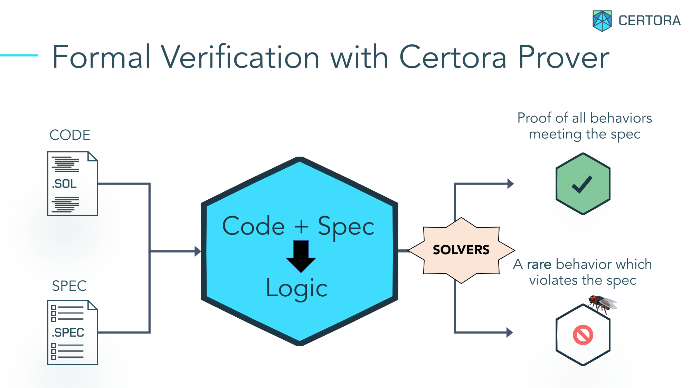

## Table of Contents

- [What is formal verification?](#what-is-formal-verification)
- [What is the Certora Prover?](#what-is-the-certora-prover)
- [What inputs is the contract checked against?](#what-inputs-is-the-contract-checked-against)
- [What is the biggest difficulty in formal verification?](#what-is-the-biggest-difficulty-in-formal-verification)
- [How I set up a contract](#how-i-set-up-a-contract)
  - [Two forms of every contract](#two-forms-of-every-contract)
  - [Linking two real contracts](#linking-two-real-contracts)
  - [Harnessing instead of editing the source](#harnessing-instead-of-editing-the-source)
  - [Excluding external functions](#excluding-external-functions)
  - [Summarizing external calls in CVL](#summarizing-external-calls-in-cvl)
  - [Modelling the tokens in CVL](#modelling-the-tokens-in-cvl)
  - [Summarizing internal calls in CVL](#summarizing-internal-calls-in-cvl)
  - [Mirroring storage into ghosts](#mirroring-storage-into-ghosts)
  - [The EVM environment](#the-evm-environment)
  - [Pinning one market](#pinning-one-market)
  - [Bounding the sets a property adds up](#bounding-the-sets-a-property-adds-up)
  - [Bounding every loop](#bounding-every-loop)
  - [Tagging every assumption](#tagging-every-assumption)
- [How I set up a valid state](#how-i-set-up-a-valid-state)
- [Rules and invariants](#rules-and-invariants)
- [What does a timeout mean?](#what-does-a-timeout-mean)
- [Rule categories](#rule-categories)
  - [Valid State](#valid-state)
  - [Variable Transitions](#variable-transitions)
  - [State Transitions](#state-transitions)
  - [High Level](#high-level)
  - [Unit Tests](#unit-tests)
  - [Accrue Interest](#accrue-interest)
  - [ERC4626](#erc4626)
  - [Config Trust Boundary](#config-trust-boundary)
  - [Reachability](#reachability)
  - [Reverts](#reverts)
  - [Access Control](#access-control)
  - [Reentrancy](#reentrancy)
  - [Oracle Outage](#oracle-outage)
- [Mutation testing](#mutation-testing)

### What is formal verification?

For comparison, start with fuzzing. A fuzzer starts a virtual node, deploys the contract
onto it, and then calls its external functions over and over with generated arguments,
looking after each call at what changed in storage and at what the call returned.

Formal verification (FV) does none of that. Nothing is deployed and nothing is executed. The
prover takes two inputs:

- the compiled bytecode of the contracts under verification
- a specification saying what must be true of them

It turns both into one mathematical model and proves that the specification holds for that
bytecode.



Source: Certora, [The Certora Verification Pipeline](https://docs.certora.com/en/latest/_downloads/7ef350bb9818a0b10467fa47e9e22877/09-pipeline.pdf), slide 5.

### What is the Certora Prover?

Broadly, the Certora FV is made of four parts.

- `certora-cli` a Python application. It compiles the contract code and sends it, together
  with the specification, either to Certora's remote servers to be run there, or to a prover
  installed locally.
- The prover itself, an [open-source application](https://github.com/Certora/CertoraProver) with pluggable SMT solvers. This is the
  part that does the work: it turns the bytecode and the specification into a mathematical
  model and looks for violations.
- Server infrastructure. Running the SMT solvers needs a lot of CPU and memory.
- The output. On Certora's servers the result is shown in a [dashboard](https://prover.certora.com/), in readable form:
  the execution trace behind a violation, and many other conveniences for debugging.

For the minimum, only the open-source prover is needed.

### What inputs is the contract checked against?

Start with what an isolated contract binary can even receive as input.

- the EVM environment: block data, transaction data and the message (`msg.sender`,
  `msg.value`, `tx.origin`, `block.number`, `block.timestamp`, and the rest)
- the storage the contract starts from
- what calls to external contracts return
- the arguments of its external functions

The prover checks all of them over the full range of values each one can hold (a `uint256`
argument stands for every value from `0` to `max_uint256` at the same time).

Much like a fuzzer, the prover also works through the contract's available external
functions. The difference is what happens before each call: the prover havocs every input
listed above, which reads as filling it with all possible values at once.

### What is the biggest difficulty in formal verification?

Working over the whole range of every possible input is the prover's superpower, and it is
also where the biggest difficulty comes from: **false positive** violations. This is when a rule
you wrote comes back violated, and not because of a real bug. The prover simply walked a path
the contract can never reach in real operation, and reported what it found there.

The problem is solved by narrowing the values, with the `require` keyword. It tells the prover
exactly how to constrain the inputs. There are two ways to go about it.

The first is to narrow head-on: run the rule, look at why it broke, add a constraint, run it
again, and repeat until it stops breaking. The narrowings pile up at the top of the rule, and by
the time the call finally happens the reader has lost track of what is still being checked
([source](https://github.com/Certora/silo-v2-cantina-fv/blob/bcdf28424d31ad44bd2ec3f8c5c019e71d5c44f4/certora-BenRai1/specs/silo/_oracles.spec#L284-L321)).

```solidity
rule callToDebtSolvencyOracleIfDebtSolvencyOracleNot0(env e){
    uint256 assets;
    address receiver;
    address owner;
    address anyOracle;
    address debtSilo = siloConfig.getDebtSilo(e, owner);
    address collateralSilo = siloConfig.borrowerCollateralSilo(e, owner);
    require(collateralSilo == silo0);
    require(debtSilo != collateralSilo);

    address debtSiloSolvencyOracle = siloConfig.getConfig(e, debtSilo).solvencyOracle;
    address collateralSiloSolvencyOracle = siloConfig.getConfig(e, collateralSilo).solvencyOracle;
    require(debtSiloSolvencyOracle != 0);
    require(collateralSiloSolvencyOracle == 0);

    //debtShare owner
    address debtShareToken = siloConfig.getConfig(e, debtSilo).debtShareToken;
    uint256 ownerBalanceDebtShareToken = debtShareToken.balanceOf(e, owner);
    require(ownerBalanceDebtShareToken != 0);

    //borrowerDebtAssets owner
    uint256 borrowerProtectedAssets;
    uint256 borrowerDebtAssets;
    uint256 borrowerCollateralAssets;
    (borrowerProtectedAssets, borrowerCollateralAssets, borrowerDebtAssets)=
        assetsBorrowerForLTVHarness(
            e,
            siloConfig.getConfig(e, collateralSilo),
            siloConfig.getConfig(e, debtSilo),
            owner,
            ISilo.OracleType.Solvency,
            ISilo.AccrueInterestInMemory.No
        );
    require(borrowerDebtAssets != 0);
    //to ensuer that there are still collateral assest left after withdraw
    require(borrowerProtectedAssets != 0);
    require(borrowerCollateralAssets != 0);
    require(borrowerProtectedAssets + borrowerCollateralAssets != 0);

    ...
```

The second way is the one I developed long ago and use by default. Before writing any rules I
state how the storage should behave, prove that claim with an invariant, and then use the proved
claim to set up the **valid state** for every rule that follows. What is left inside a rule is the
logic of the rule itself. The pile of hand-written requires is gone, replaced by one call
to `setupLidoLendValidState(e)`, and what those lines were assuming lives in invariants that were
proved once and are shared by every rule in the suite
([`LidoLend_state_transitions.spec`](../certora/specs/LidoLend/LidoLend_state_transitions.spec#L8-L19)).

```solidity
rule stLlBorrowGrowthIsFresh(env e, method f, calldataarg args)
    filtered { f -> !EXCLUDED_FUNCTION_LL(f) } {

    setupLidoLendValidState(e);
    mathint tbaBefore = ghostLlTotalBorrowAssets128;

    f(e, args);

    assert(ghostLlTotalBorrowAssets128 > tbaBefore
        => ghostLlLastUpdate128 == to_mathint(e.block.timestamp),
        "borrow assets grow only with fresh accrual");
}
```

### How I set up a contract

To cut down the false positives that have nothing to do with the logic being checked, I build
a **setup** for each contract. A setup is a set of assumptions and trade-offs, packaged behind
a single setup function.

A run is built around a **scene**: the contract under verification, plus whatever it needs of
its neighbours. Ten contracts in scope became twelve scenes: eight carry one contract, four are
about a pair ([`README.md`](../certora/README.md#properties)).

#### Two forms of every contract

A contract appears in a run in one of two forms: the real compiled bytecode, or a lighter CVL
version standing in for it. The contract being verified is always real; a neighbour is written
once as a CVL twin and reused by the runs that call it. GuardianSignals is real in its own run
([`valid_state.conf`](../certora/confs/GuardianSignals/valid_state.conf)) and a twin in the
controller run ([`GuardianSignals_cvl.spec`](../certora/specs/setup/GuardianSignals/GuardianSignals_cvl.spec#L7-L12)).

```solidity
methods {
    function _.getOpinion(LidoLendMarketController.Id id, address account) external with (env e)
        => guardianSignalsGetOpinionCVL(e, id, account) expect LidoLendMarketController.GuardiansOpinion;
    function _.isBanned(LidoLendMarketController.Id id, address account) external
        => guardianSignalsIsBannedCVL(id, account) expect bool;
}
```

The two forms of one contract never meet in a run: each declares the same marker ghost, so
importing both fails to compile as a duplicate declaration
([`LidoLend_cvl.spec`](../certora/specs/setup/LidoLend/LidoLend_cvl.spec#L15-L16)).

#### Linking two real contracts

Some claims are about the seam between two contracts, and neither contract alone can state them.
A joint scene compiles both and wires the address one holds for the other to the compiled
neighbour, so a call across the seam runs real bytecode instead of a twin
([`properties.conf`](../certora/confs/LidoLend_LinkedController/properties.conf#L9-L15)).

```json
    "link": [
        "LidoLendMarketController:LIDO_LEND=LidoLend"
    ],
    "parametric_contracts": [
        "LidoLend",
        "LidoLendMarketController"
    ],
```

The price is size. This is the heaviest scene of the suite, and the invariants only a pair can
state are also the ones the prover finds hardest to finish. So the four joint scenes bring the
neighbour to different degrees, and the report says which
([`README.md`](../certora/README.md#setup-scenes)).

#### Harnessing instead of editing the source

No file under `src/` is touched. Where a rule has to read a value the contract keeps internal, a
thin contract inherits from the audited one and adds one view, and the run verifies that harness
([`Erc4626ExitBookHarness.sol`](../certora/helpers/Erc4626ExitBookHarness.sol#L7-L13)).

```solidity
contract Erc4626ExitBookHarness is Erc4626ExitBook {
    constructor(address owner, uint256 maxLifetime_) Erc4626ExitBook(owner, maxLifetime_) {}

    function priorityFeeRateExt(uint256 id) external view returns (uint256) {
        return _priorityFeeRate(_book.requests[id]);
    }
}
```

Most contracts here need no harness. A storage hook reads a private field by name, and four of
the ten contracts pin their storage with `layout at`, which forbids a subclass, so they are
verified from the source itself
([`IrmRouter.spec`](../certora/specs/setup/Irm/IrmRouter/IrmRouter.spec#L1-L8)). Three more helpers
are not subclasses at all: one builds the `bytes` payload the controller hook decodes, one carries
a library on its own so its arithmetic can be decided without the controller behind it, and one is
an oracle whose price reverts on demand
([`helpers/`](../certora/helpers)).

#### Excluding external functions

An external function can be left out of the scene for several reasons.

- it does not change state, and parametric rules and invariants are about how state changes,
  so read-only functions are dropped everywhere
  ([`EXCLUDED_FUNCTION_LL`](../certora/specs/setup/LidoLend/LidoLend.spec#L35-L37))

```solidity
definition EXCLUDED_FUNCTION_LL(method f) returns bool =
    f.isView || f.isPure || f.isFallback
    ;
```

- the setup already pins what it would do, so it can only revert: the initializer, once the
  contract is pinned initialized, and market creation, once the one market is pinned created
  ([`LidoLend.spec`](../certora/specs/setup/LidoLend/LidoLend.spec#L17-L20))

```solidity
    // Always reverts here: setupLidoLend pins the contract initialized and the market created.
    function _Core.initialize(address) external => NONDET DELETE;
    function _Core.createMarket(LidoLend.MarketParams) external => NONDET DELETE;
    function _Core.createMarket(LidoLend.MarketParams, address, bool) external => NONDET DELETE;
```

- the prover handles it badly, or fails on it outright: an assembly `sload` loop that breaks the
  memory analysis of the whole scene, a signature check through `ecrecover`
  ([`LidoLend.spec`](../certora/specs/setup/LidoLend/LidoLend.spec#L22-L25))

```solidity
    // Scene cleanup: assembly sload loop + ecrecover (sig-path guard reviewed manually).
    function _Core.extSloads(bytes32[]) external returns (bytes32[]) => NONDET DELETE;
    function _Core.setAuthorizationWithSig(LidoLend.Authorization, LidoLend.Signature)
        external => NONDET DELETE;
```

- it needs a scene of its own: the guardian role mutators and the quorum scan are cut from the
  main guardian scene, and each has a conf of its own
  ([`GuardianSignals.spec`](../certora/specs/setup/GuardianSignals/GuardianSignals.spec#L7-L13))

```solidity
methods {
    // Scene cleanup: the cut quorum-scan entry has its own rules in GuardianSignals_frontier.spec.
    function GuardianSignals.grantRole(bytes32, address) external => NONDET DELETE;
    function GuardianSignals.revokeRole(bytes32, address) external => NONDET DELETE;
    function GuardianSignals.renounceRole(bytes32, address) external => NONDET DELETE;
    function GuardianSignals.syncQuorumFrontier() external => NONDET DELETE;
}
```

- the callee is outside the scene, so the call is assumed to do nothing: the borrower callbacks,
  tagged UNSAFE because a real callback could reenter the core
  ([`LidoLend.spec`](../certora/specs/setup/LidoLend/LidoLend.spec#L27-L32))

```solidity
    // UNSAFE: the borrower callbacks are summarized away, so what a real one moves is unanalyzed.
    function _.onMorphoSupply(uint256, bytes) external => NONDET;
    function _.onMorphoRepay(uint256, bytes) external => NONDET;
    function _.onMorphoSupplyCollateral(uint256, bytes) external => NONDET;
    function _.onMorphoLiquidate(uint256, bytes) external => NONDET;
    function _.onMorphoFlashLoan(uint256, bytes) external => NONDET;
```

#### Summarizing external calls in CVL

External calls can be summarized in CVL. Every extra contract added to the run raises how long
each rule takes, so a neighbour is answered by a few lines of spec language instead. Outside the oracle
outage rows no oracle is compiled: a ghost keyed by the called address answers `price()`, so a rule
reads a value the scene holds rather than a fresh draw on every call, and the two tags name what
is assumed of it ([`oracle.spec`](../certora/specs/setup/oracle.spec#L1-L12)).

```solidity
// Shared oracle stub: per-callee frozen price, read-consistent within a rule.

methods {
    // TRUSTED: the summary is total, so a reverting oracle is outside the scene
    function _.price() external => ghostOraclePrice256[calledContract] expect uint256;
}

persistent ghost mapping(address => uint256) ghostOraclePrice256 {
    init_state axiom forall address o. ghostOraclePrice256[o] == 0;
    // TRUSTED: governance-wired oracle; a sane price keeps collateral valuation in range
    axiom forall address o. ghostOraclePrice256[o] <= max_uint128;
}
```

#### Modelling the tokens in CVL

The loan and collateral tokens are ordinary ERC20s, and compiling a real token into every run
costs more than it is worth, so balances, allowances and supply live in CVL instead
([`erc20.spec`](../certora/specs/setup/erc20.spec#L7-L14)). The writing calls move the ghosts, so
a rule can still check what a transfer did. The price is an assumption: every token behaves as a
standard one, with no transfer fee and no rebasing.

```solidity
methods {
    function _.balanceOf(address account) external
        => balanceOfERC20CVL(calledContract, account) expect uint256 UNRESOLVED;
    // Backstop with no live caller: the only in-scope reader sits in the vault's DELETEd initializer.
    function _.decimals() external
        => ghostERC20Decimals8[calledContract] expect uint8 UNRESOLVED;
    function _.totalSupply() external
        => require_uint256(ghostERC20TotalSupply256[calledContract]) expect uint256 UNRESOLVED;
```

The vault is a token too. In its own scene its real share ledger runs, and its storage is mirrored
onto the same ghosts, so one model serves every token
([`LidoLendERC4626.spec`](../certora/specs/setup/LidoLendERC4626/LidoLendERC4626.spec#L132-L142)).

#### Summarizing internal calls in CVL

Internal calls are summarized too, when the prover cannot get through the real code: a
keccak-derived market id, shared so every scene derives the same id from the same parameters
([`marketParamsLib.spec`](../certora/specs/setup/marketParamsLib.spec#L24-L34)), transient storage
written in assembly
([`LidoLendMarketController_base.spec`](../certora/specs/setup/LidoLendMarketController/LidoLendMarketController_base.spec#L116-L122)),
and the exponential the adaptive curve prices through. That one becomes a ghost function of its
argument, which is faithful because the real function is pure, and only what the library
guarantees is assumed: a range, and the value at zero
([`adaptiveCurveMath.spec`](../certora/specs/setup/Irm/adaptiveCurveMath.spec#L18-L25)).

```solidity
// wExp is pure, so a ghost keyed on x is faithful; monotonicity is a grounding hazard, pinned per rule instead.
persistent ghost wExpGhostFn(mathint) returns mathint {
    // SAFE: ExpLib clips wExp into [0, WEXP_UPPER_VALUE].
    axiom forall mathint x.
        wExpGhostFn(x) >= 0 && wExpGhostFn(x) <= WEXP_UPPER_VALUE_CVL();
    // PROVED: ExpLib returns WAD at x = 0.
    axiom wExpGhostFn(0) == WAD_MATH();
}
```

#### Mirroring storage into ghosts

Every storage variable is mirrored into a CVL ghost variable through storage hooks.

- reading a storage variable becomes a much shorter expression
- getters, unlike ghosts, work badly inside quantifiers (`forall`)
  ([`Erc4626ExitBook_LinkedVaultCore.spec`](../certora/specs/setup/Erc4626ExitBook_LinkedVaultCore/Erc4626ExitBook_LinkedVaultCore.spec#L102-L108))
- a hook is a place to narrow the range a variable is allowed to take

The hooks come in pairs. The store hook writes the ghost; the load hook requires storage to agree
with it, which only keeps the two copies of one value together, so it is tagged SAFE
([`GuardianSignals_base.spec`](../certora/specs/setup/GuardianSignals/GuardianSignals_base.spec#L196-L206)).

```solidity
persistent ghost mapping(address => mathint) ghostGsHeartbeats40 {
    init_state axiom forall address g. ghostGsHeartbeats40[g] == 0;
    axiom forall address g. ghostGsHeartbeats40[g] >= 0 && ghostGsHeartbeats40[g] <= max_uint40;
}

hook Sload uint40 val _Signals._heartbeats[KEY address g] {
    require(ghostGsHeartbeats40[g] == to_mathint(val), "SAFE: ghostGsHeartbeats40 sync");
}
hook Sstore _Signals._heartbeats[KEY address g] uint40 val {
    ghostGsHeartbeats40[g] = to_mathint(val);
}
```

State kept in an ERC-7201 namespace has no name to hook, so the hook names the slot, one hook per
field at its byte offset
([`LidoLendERC4626.spec`](../certora/specs/setup/LidoLendERC4626/LidoLendERC4626.spec#L174-L185)).

#### The EVM environment

One shared function pins the environment for every scene: no ETH, since no verified entry point
is payable; a sender that is neither the zero address nor the contract itself; a clock inside
realistic bounds ([`setupEnv()`](../certora/specs/setup/env.spec#L6-L12)).

```solidity
function setupEnv(env e) {
    require(e.msg.value == 0, "SAFE: no ETH");
    require(e.msg.sender != 0 && e.msg.sender != currentContract, "SAFE: nonzero sender, not this contract");
    require(e.block.timestamp >= MIN_BLOCK_TIMESTAMP() && e.block.timestamp < MAX_BLOCK_TIMESTAMP(),
        "SAFE: realistic timestamp bounds");
    require(e.block.number != 0, "SAFE: non-zero block");
}
```

#### Pinning one market

A market id is only a mapping key. Almost no property reasons about two markets at once, yet every
extra key dimension costs the prover a great deal of work. So the core scene keeps one created
market: the mirrors behind the market row carry no id, and every call that names a market passes
through the id computation, where its parameters are pinned to that one row
([`LidoLend.spec`](../certora/specs/setup/LidoLend/LidoLend.spec#L78-L89)).

```solidity
// Every market call reaches the id computation, so the pin sits here
function marketParamsIdRowPinnedCVL(MarketParamsLib.MarketParams params)
    returns MarketParamsLib.Id {
    require(ghostLlLastUpdate128 == 0
        || (ghostLlLoanToken == params.loanToken
            && ghostLlCollateralToken == params.collateralToken
            && ghostLlOracle == params.oracle
            && ghostLlIrm == params.irm
            && ghostLlLltv256 == to_mathint(params.lltv)),
        "SAFE: the call's params describe the one created market");
    return summaryMarketParamsId(params);
}
```

The controller and the vault are one market by construction, since each is deployed for a single
market. Isolation between markets is proved where a second key is cheap, on the rate model scenes
([`IrmRouter_properties.spec`](../certora/specs/IrmRouter/IrmRouter_properties.spec#L95-L108)).

#### Bounding the sets a property adds up

To check that the shares on the books equal what the lenders hold, the sum has to run over every
holder. There can be any number of them, and the prover cannot add up a list of unknown length, so
the token model gives each token seven holders ([`erc20.spec`](../certora/specs/setup/erc20.spec#L5))
and the positions are summed over exactly those, plus the zero address
([`LL_SUPPLY_SHARES_SUM`](../certora/specs/setup/LidoLend/LidoLend.spec#L304-L312)). A bug that only
shows up with an eighth lender is not caught.

```solidity
definition LL_SUPPLY_SHARES_SUM() returns mathint =
    ghostLlSupplyShares256[ghostERC20AccountsValues[ghostLlLoanToken][0]]
    + ghostLlSupplyShares256[ghostERC20AccountsValues[ghostLlLoanToken][1]]
    + ghostLlSupplyShares256[ghostERC20AccountsValues[ghostLlLoanToken][2]]
    + ghostLlSupplyShares256[ghostERC20AccountsValues[ghostLlLoanToken][3]]
    + ghostLlSupplyShares256[ghostERC20AccountsValues[ghostLlLoanToken][4]]
    + ghostLlSupplyShares256[ghostERC20AccountsValues[ghostLlLoanToken][5]]
    + ghostLlSupplyShares256[ghostERC20AccountsValues[ghostLlLoanToken][6]]
    + ghostLlSupplyShares256[0];
```

The same cut is made wherever something is walked or summed: a settlement heap of seven nodes, a
guardian committee of three where the contract allows thirty two
([`GuardianSignals_base.spec`](../certora/specs/setup/GuardianSignals/GuardianSignals_base.spec#L79-L80)).
A key nothing iterates stays free.

#### Bounding every loop

Every loop is unrolled a fixed number of times, and the paths that would need more iterations
are assumed away ([`_base.conf`](../certora/confs/_base.conf)). Three is the default, the same
number the guardian sets are cut to; the core's own confs lower it to two, since the one loop in
its source is summarized away. This is the most honest gap in the method: a sweep that would run
more than three rounds is never explored.

```json
    "optimistic_loop": true,
    "loop_iter": "3",
```

The gap has a size. The vault's fallback exit sweeps the settlement queue up to a limit the caller
passes, and the shipped default is 150 ([`LidoLendERC4626.sol`](../src/LidoLendERC4626.sol#L39)).

#### Tagging every assumption

Every `require` carries a tag saying why the narrowing is allowed, so a reader can tell an
assumption that excludes nothing real from one that knowingly drops reachable states
([`erc20.spec`](../certora/specs/setup/erc20.spec#L97-L107)).

```solidity
function setupERC20() {
    require(ERC20_TOTAL_SUPPLY_SOLVENCY(),
        "SAFE: balances sum to total supply");
}

function balanceOfERC20CVL(address token, address account) returns uint256 {
    require(token != 0, "ASSERT: zero-address token has no code");
    require(ERC20_ACCOUNT_BOUNDS(token, account),
        "UNSAFE: balances only for the 7 modelled accounts");
    return require_uint256(ghostERC20Balances128[token][account]);
}
```

Six tags are in use, in two families. Four are narrowings, ordered by what they cost: SAFE
excludes no reachable state; SCOPE pins one flow, and what it leaves out is covered elsewhere or
immaterial; UNSAFE drops reachable states and says so; TRUSTED moves the cost onto a party outside
the scene, such as the deployer. Two are not assumptions at all: PROVED restates a fact proved elsewhere
([`LidoLendMarketController_core_view.spec`](../certora/specs/setup/LidoLendMarketController/LidoLendMarketController_core_view.spec#L5-L10)),
and ASSERT stands in for a revert the summarized code performs.

### How I set up a valid state

A storage variable almost always has values it will never hold in real life. The first job is
to rule those out, so the prover does not report a violation on a state the contract can never
reach.

The second job is not to go too far. If you rule out a state the contract can actually reach,
the prover still reports the rule as proved. It is now proved about a smaller world than the
real one, and the result looks exactly like a real proof.

So instead of assuming, I take one narrow claim about storage and prove it, as an invariant
([`LidoLend_valid_state.spec`](../certora/specs/LidoLend/LidoLend_valid_state.spec#L29-L32)).

```solidity
// LL-VS-01: A market's fee on accrued interest can never exceed the protocol's 25 percent cap.
invariant feeCapped(env e)
    ghostLlFee128 <= MAX_FEE_LL_CVL()
filtered { f -> !EXCLUDED_FUNCTION_LL(f) } { preserved with (env eFunc) { SETUP_LL(e, eFunc); } }
```

Once the claim is proved, any rule can pull it in with `requireInvariant` and tell the prover
that storage looks like that. Here the proved claims about the core are packed behind one name,
and that name is the whole precondition of most rules in the scene
([`setupLidoLendValidState`](../certora/specs/LidoLend/LidoLend_valid_state.spec#L19-L22)).
The difference from a plain `require` is the whole point: this is no longer our assumption, it
is a state that was proved.

```solidity
function setupLidoLendValidState(env e) {
    setupLidoLend(e);
    requireLidoLendInvariants(e);
}
```

Three details of the packaging are worth knowing.

- the pack is declared in one file and proved in another, because `use invariant` does not
  travel through an import, and a joint scene has to take the pack without the twin the single
  scene attaches ([`LidoLend_valid_state_run.spec`](../certora/specs/LidoLend/LidoLend_valid_state_run.spec#L1-L9))
- an invariant may not assume itself, so its `preserved` block calls the setup one level down,
  the scene pins without the pack
  ([`SETUP_LL`](../certora/specs/LidoLend/LidoLend_valid_state.spec#L24-L27))
- what deployment guarantees is not a storage law and cannot be an invariant: the contract
  initialized, the market created. Those stay plain requires, tagged TRUSTED, and that is the
  second job done on purpose
  ([`setupLidoLend`](../certora/specs/setup/LidoLend/LidoLend.spec#L62-L66))

By this point the false positives are behind us, and there is a valid state ready for every rule
that comes next.

### Rules and invariants

A specification has only two primitives: a rule and an invariant.

A rule has three blocks: a precondition, a call, and an assertion
([`LidoLend_state_transitions.spec`](../certora/specs/LidoLend/LidoLend_state_transitions.spec#L22-L32)).

```solidity
rule stLlNewDebtNeedsCollateral(env e, method f, calldataarg args, address u)
    filtered { f -> !EXCLUDED_FUNCTION_LL(f) } {

    setupLidoLendValidState(e);
    mathint bsBefore = ghostLlBorrowShares128[u];

    f(e, args);

    assert(ghostLlBorrowShares128[u] > bsBefore => ghostLlCollateral128[u] != 0,
        "borrow shares grow only against collateral");
}
```

The call above is `f`, not a named function. That makes the rule parametric: the prover runs it
once for every external function of the contract, and a function added to the contract later is
covered without touching the rule.

An invariant is the same thing packed tighter. The claim is assumed first, then any external
function is called, then the claim is checked again, and the prover also proves it in the state
the constructor leaves behind. The claim reads the block time in one environment while the call
runs in another, so the `preserved` block ties the two to the same block and sender before the
setup runs ([`LidoLend_valid_state.spec`](../certora/specs/LidoLend/LidoLend_valid_state.spec#L35-L37)).

```solidity
invariant lastUpdateNotInFuture(env e)
    ghostLlLastUpdate128 <= e.block.timestamp
filtered { f -> !EXCLUDED_FUNCTION_LL(f) } { preserved with (env eFunc) { SETUP_LL(e, eFunc); } }
```

Which one to write is one question. If the claim is about a state that must hold at every moment,
it is an invariant. If it is about how something is allowed to change, it is a rule.

Two more things every property here carries. Above it sits one comment line, the id and the sentence the
report table links to ([`LidoLend_valid_state.spec`](../certora/specs/LidoLend/LidoLend_valid_state.spec#L34)).
And a rule may end in `satisfy` instead of `assert`: one execution that reaches the condition,
where an assertion is a claim about all of them. Two of the categories below are built on it.

### What does a timeout mean?

A rule that runs out of its solver budget is reported as undecided: not proved, and not
violated. A small share of the properties end that way, most of them High Level rules on the
largest scenes, and the report keeps them in a column of their own instead of counting them as
proved ([`README.md`](../certora/README.md#properties)).

Such a rule is not left as dead weight. Every one of them still kills its mutant, and the prover
finds a violation far sooner than it proves there is none, so a rule that ran out of budget on
the real code but broke on the faulted code is taken as working. It is still weaker than a
proof, and the column says so.

### Rule categories

To keep the suite readable, every rule belongs to a category. The
[official Certora methodology](https://github.com/Certora/Tutorials/blob/ed1c14028ce75d729ba56b75d224a9991f299ea1/06.Lesson_ThinkingProperties/Categorizing_Properties.pdf)
defines five of them, and this suite adds eight more for questions those five never ask. A
parametric category is checked against every external function of the scene, including ones
added after the specification was written; the rest name the call they are about. On the busiest
single contract scenes the categories are split across spec files and confs, so a heavy category
rarely holds up a light one.

#### Valid State

Parametric: invariants that hold in every reachable state; once proven, other properties reuse
them as preconditions through `requireInvariant`. The body reads the mirrors of the contract's fields
([`LidoLend_valid_state.spec`](../certora/specs/LidoLend/LidoLend_valid_state.spec#L44-L47)).

```solidity
// LL-VS-04: A market never has more assets borrowed than supplied, so utilization stays at or below 100 percent.
invariant borrowLeSupplyAssets(env e)
    ghostLlTotalBorrowAssets128 <= ghostLlTotalSupplyAssets128
filtered { f -> !EXCLUDED_FUNCTION_LL(f) } { preserved with (env eFunc) { SETUP_LL(e, eFunc); } }
```

#### Variable Transitions

Parametric: one storage variable at a time. Snapshot it, run any external call, then assert it
moved only as its own law allows, or not at all: it never falls, it latches, it steps by one, it
lands in a permitted set
([`Erc4626ExitBook_LinkedVaultCore_properties.spec`](../certora/specs/Erc4626ExitBook_LinkedVaultCore/Erc4626ExitBook_LinkedVaultCore_properties.spec#L9-L20)).

```solidity
rule vtEeNextIdStepsByOne(env e, method f, calldataarg args)
    filtered { f -> !EXCLUDED_FUNCTION_EE(f) } {

    setupErc4626ExitBook(e);
    mathint nextIdBefore = ghostEeNextId256;

    f(e, args);

    mathint nextIdAfter = ghostEeNextId256;
    assert(nextIdAfter == nextIdBefore || nextIdAfter == nextIdBefore + 1,
        "nextId stays or advances by exactly one");
}
```

Most of these laws are proved from the bare scene setup, without the invariant pack, so they hold
over more starting states.

#### State Transitions

Parametric: the moves between valid states, stating what must move together and in what order.
Here the order is a clock: the throttle may rise only in a call that also restamps its decay
clock with the current time
([`LidoLendMarketController_transitions.spec`](../certora/specs/LidoLendMarketController/LidoLendMarketController_transitions.spec#L205-L216)).

```solidity
rule stMcInflowStampsSnapshot(env e, method f, calldataarg args)
    filtered { f -> !EXCLUDED_FUNCTION_MC(f) } {

    setupLidoLendMarketControllerValidState(e);
    mathint inflowBefore = ghostMcActInflow128;

    f(e, args);

    assert(ghostMcActInflow128 > inflowBefore
        => ghostMcActInflowUpdatedAt40 == to_mathint(e.block.timestamp),
        "an inflow increase refreshes the snapshot clock");
}
```

#### High Level

A whole operation, or a pair of them: what a call must leave untouched, which effects travel
together, and which of them reverse. Frame laws among them are stated parametrically. Here one
accrual is played, and the law is conservation: the lenders' pot grows by exactly what is added
to the borrowers' debt
([`LidoLend_high_level.spec`](../certora/specs/LidoLend/LidoLend_high_level.spec#L319-L329)).

```solidity
// LL-HL-18: Accrued interest credits suppliers exactly what it charges borrowers.
rule hlLlAccrueAddsEqualValue(env e, LidoLend.MarketParams mp) {
    setupLidoLendValidState(e);
    mathint supplyAssetsBefore = ghostLlTotalSupplyAssets128;
    mathint borrowAssetsBefore = ghostLlTotalBorrowAssets128;

    accrueInterest(e, mp);

    assert(ghostLlTotalSupplyAssets128 - supplyAssetsBefore
        == ghostLlTotalBorrowAssets128 - borrowAssetsBefore);
}
```

#### Unit Tests

The exact effect of one named call: the cell a setter writes, the entry an operation leaves
behind, the value a view derives
([`LidoLend_unit_tests.spec`](../certora/specs/LidoLend/LidoLend_unit_tests.spec#L7-L14)).

```solidity
// LL-UT-01: A transfer of ownership installs exactly the named new owner.
rule utLlSetOwnerSetsNewOwner(env e, address newOwner) {
    setupLidoLendValidState(e);

    setOwner(e, newOwner);

    assert(ghostLlOwner == newOwner, "setOwner installs the new owner");
}
```

#### Accrue Interest

Nothing in the core accrues interest on a timer. Every entry point whose accounting depends on
interest brings it up to date first, so calling `accrueInterest` beforehand must leave the same
storage behind. The rule saves the storage, runs both calls, replays the single call from the
saved storage, and compares the two results as wholes
(the body of [`LidoLend_accrue_interest.spec`](../certora/specs/LidoLend/LidoLend_accrue_interest.spec#L10-L21)).

```solidity
    setupEnv(e);

    storage init = lastStorage;

    accrueInterest(e, mp);
    supply(e, mp, assets, shares, onBehalf, data);
    storage afterBoth = lastStorage;

    supply(e, mp, assets, shares, onBehalf, data) at init;
    storage afterOne = lastStorage;

    assert(afterBoth == afterOne, "supply after explicit accrual must end in the same storage");
```

Both paths start from the same snapshot, so an odd starting state hits both alike, and no valid
state is assumed here.

#### ERC4626

EIP-4626 conformance: previews bound their live counterparts, the max functions never revert and
their answer can be taken, and conversions round toward the vault. Most rules quote the sentence
of the standard they prove, so the rule and the requirement can be compared without leaving the
file, and a rule that proves less than its quote says so
([`LidoLendERC4626_erc4626.spec`](../certora/specs/LidoLendERC4626/LidoLendERC4626_erc4626.spec#L104-L114)).

```solidity
// ERC4626-08: Quoting assets for a realistic number of shares never fails.
// "MUST NOT revert unless due to integer overflow caused by an unreasonably large input."
rule convertToAssetsNeverReverts(env e, uint256 shares) {

    setupLidoLendERC4626ValidState(e);
    require(shares < max_uint128, "SCOPE: sub-2^128 share input");

    convertToAssets@withrevert(e, shares);

    assert(!lastReverted, "convertToAssets MUST NOT revert for bounded input");
}
```

#### Config Trust Boundary

A rate model copies whatever its config reports, and only the config constructor ever checks
those numbers, so the scene trusts a config to answer inside the constructor's bands. This
category prices that trust: the config model is rebuilt without the band, and a `satisfy` asks
the prover for a run where an unvalidated config does damage. The witness it finds is designed
behaviour written down, not a finding
(the body of [`config_trust_boundary.spec`](../certora/specs/IrmConfigFactory/config_trust_boundary.spec#L70-L80)).

```solidity
    setupLinearKinkIrmUntrustedConfig(e);
    require(e.msg.sender == ghostLkiOwner, "SCOPE: an authorized applier");

    MarketParamsLib.Id id = summaryMarketParamsId(marketParams);

    _Lki.applyIrmConfig(e, marketParams, config);

    satisfy(ghostLkiBaseRate64[id] + ghostLkiSlope1_64[id] + ghostLkiSlope2_64[id]
        > MAX_BORROW_RATE_LKI_CVL(),
        "a config nobody validated can store a peak rate above the cap the IRM used to enforce");
}
```

#### Reachability

`satisfy` witnesses that each workflow can execute and take effect, so no property above is
proven over a scene where the mutators never fire. A narrowing that went too far makes every
call revert, and every rule then passes for the wrong reason; the witness is the cheapest guard
against it
([`LidoLendERC4626_reachability.spec`](../certora/specs/LidoLendERC4626/LidoLendERC4626_reachability.spec#L222-L232)).

```solidity
// VA-RC-17: A lender can deposit for shares and redeem them back for assets in the same transaction.
rule rcVaDepositThenRedeemIsReachable(env e, uint256 assets) {

    setupLidoLendERC4626ValidState(e);

    uint256 shares = deposit(e, assets, e.msg.sender);
    uint256 assetsBack = redeem(e, shares, e.msg.sender, e.msg.sender);

    satisfy(shares > 0 && assetsBack > 0,
        "a lender can deposit for shares and redeem them back in one round trip");
}
```

#### Reverts

Exactly when a call must fail and when it must not, so a caller is neither denied a legitimate
operation nor slipped past a guard. The call is made with `@withrevert`, which keeps the failing
executions in view, and `lastReverted` records the outcome. An iff closes the list of reasons;
most rules state one direction, because a call that also runs interest accrual can fail deep
inside it, and pinning every such reason away costs more than it is worth
([`LidoLend_reverts.spec`](../certora/specs/LidoLend/LidoLend_reverts.spec#L382-L391)).

```solidity
// LL-RV-29: Granting or revoking an authorization fails exactly when it would not change the current permission.
rule rvLlSetAuthorizationRevertsIff(env e, address authorized, bool newIsAuthorized) {
    setupLidoLendValidState(e);
    bool unchanged = newIsAuthorized == ghostLlIsAuthorized[e.msg.sender][authorized];

    setAuthorization@withrevert(e, authorized, newIsAuthorized);
    bool reverted = lastReverted;

    assert(reverted <=> unchanged, "setAuthorization reverts iff the flag is unchanged");
}
```

#### Access Control

Parametric: for each piece of state, the callers that may move it. Checking the modifier on each
function misses the function that has no modifier, so the rule is written the other way round:
watch one cell, let the prover pick any external call, and demand the authority if the cell moved
([`LinearKinkIrm_properties.spec`](../certora/specs/LinearKinkIrm/LinearKinkIrm_properties.spec#L441-L451)).

```solidity
rule acLkiOnlyOwnerModifiesOwner(env e, method f, calldataarg args)
    filtered { f -> !EXCLUDED_FUNCTION_LKI(f) } {

    setupLinearKinkIrm(e);
    address ownerBefore = ghostLkiOwner;

    f(e, args);

    assert(ghostLkiOwner != ownerBefore => e.msg.sender == ownerBefore,
        "only the current owner may change the owner");
}
```

#### Reentrancy

A controller hook hands control to another contract in the middle of a core call. The core raises a
latch while the hook runs, and every hooked action must fail while it is up, which one parametric
rule checks for all of them at once
(the body of [`LidoLend_reverts.spec`](../certora/specs/LidoLend/LidoLend_reverts.spec#L435-L443)).

```solidity
    setupLidoLendValidState(e);
    require(ghostLlMarketController != 0,
        "SCOPE: the acting market has a controller");
    bool lockHeld = _Core._hookInProgress;

    f@withrevert(e, args);
    bool reverted = lastReverted;

    assert(lockHeld => reverted, "every hooked action must fail while a hook is in flight");
```

A second set of rows keeps a ledger on the call and storage opcodes the core issues, and asserts that
no storage is touched after an untrusted call and that no delegatecall is made
([`LidoLend_reentrancy.spec`](../certora/specs/LidoLend/LidoLend_reentrancy.spec#L1-L2)).

#### Oracle Outage

An exit should keep working while the price feed is down. A price read reaches the oracle as a
staticcall, so a hook on that opcode counts the reads a call makes, and the rule asserts that a
lender withdrawal makes none
([`LidoLend_oracle_outage.spec`](../certora/specs/LidoLend/LidoLend_oracle_outage.spec#L59-L68)).

```solidity
// LL-OO-01: A lender withdrawal never reaches the market oracle on any of the core's own paths.
rule ooLlWithdrawNeverReadsTheOracle(env e, LidoLend.MarketParams mp, uint256 assets, uint256 shares,
    address onBehalf, address receiver) {

    setupOracleOutageLedger(mp);

    withdraw(e, mp, assets, shares, onBehalf, receiver);

    assert(ghostOoReads == 0, "a lender withdrawal never reads the market oracle");
}
```

In the core's own scene a reverting oracle stands in for a dead feed, and witnesses there show a
withdrawal and a repayment landing while every price call reverts.

### Mutation testing

A rule can be written so that it never fails and never finds anything. A narrowing that went too
far, or a rule that has gone vacuous, both look the same from the outside: a green line in the
report. So a green rule is not evidence on its own, and the rule itself has to be tested, by
breaking the contract on purpose and seeing whether the rule notices.

That deliberate break is a mutation: one fault, planted in one place, aimed at the rule named in
its header ([`mutations/LidoLend`](../certora/mutations/LidoLend/README.md#lidolend-20)). Here the
market fee ceiling is raised from `MAX_FEE`, which is 25 percent, to a full 100 percent, and the
`feeCapped` invariant from "How I set up a valid state" turns red.

```diff
         Id id = marketParams.id();
         require(market[id].lastUpdate != 0, ErrorsLib.MARKET_NOT_CREATED);
         require(newFee != market[id].fee, ErrorsLib.ALREADY_SET);
-        require(newFee <= MAX_FEE, ErrorsLib.MAX_FEE_EXCEEDED);
+        require(newFee <= WAD, ErrorsLib.MAX_FEE_EXCEEDED);
```

A mutation says two things at once. It shows the rule works, and it says out loud which bug the
rule was written to find. Every mutant is a whole copy of the source file with one focused edit,
under a header naming the rule, the conf and the file it replaces, so one command reproduces it:
it swaps the mutant over the real source, runs that rule, and puts the original file back
([`run_mutation.sh`](../certora/mutations/run_mutation.sh#L2-L9)). A kill reads as Violated or Sanity check failed, and
a `satisfy` witness that can no longer be met reads the same way.

```bash
./certora/mutations/run_mutation.sh LidoLend 20
```

The command runs from the `lend-markets` repository root with the submodules checked out, since the core is
compiled from its `lib/` mirror.

In this suite the test is not a spot check. Every property carries a mutant the prover killed,
and the Mutations column of the report links each to its entry. A few verdicts and kills are
taken in a lighter lane beside the rule's own conf, a twin that keeps the rule's name and folds a
part of the scene the rule does not speak about, and the report marks every such row
([`README.md`](../certora/README.md#narrowed-scenes)).
