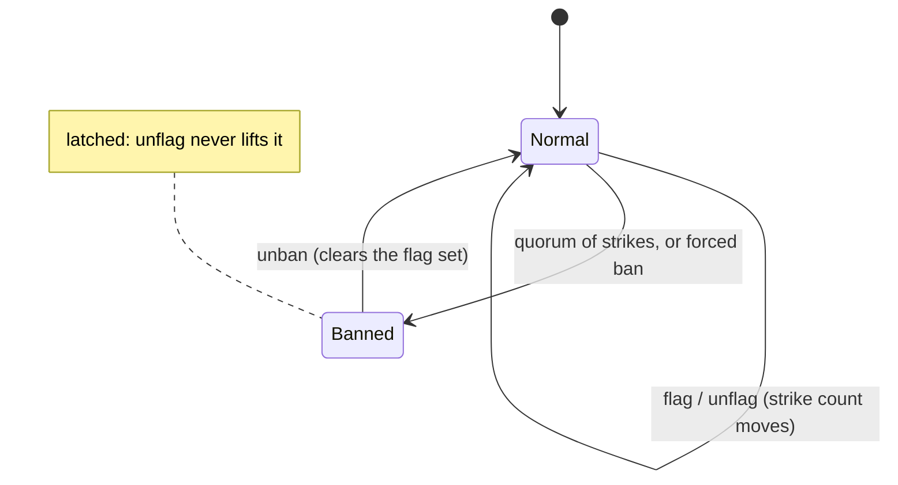
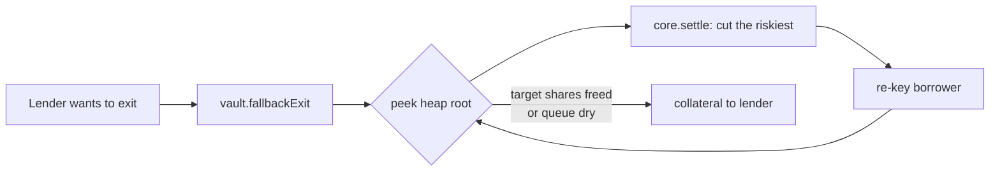
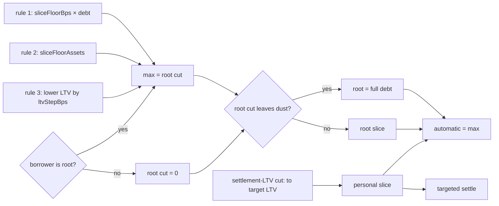

# Lido Lend Architecture

[Lido Lend](https://github.com/lidofinance/lido-lend/) is a Morpho Blue fork with an additional policy layer on top. Each market is isolated: its own loan asset, collateral, oracle, IRM, and LLTV. A market may bind a **controller** that gates user actions through hooks. A market with no controller behaves as vanilla Morpho.

A single `LidoLend` core hosts many markets, as in Morpho. To each market the Lido layer adds a **controller** (the policy layer) and may add one or more ERC-4626 **vaults** (tokenized lender positions). Markets stay risk-isolated: the core keys positions and accounting by market id, so one market cannot reach another's funds.

`GuardianSignals` is shared the same way — its signals are market-keyed, so one registry can back many markets, though a deployment may run several when markets want different guardian sets or quorums (the set and quorum are per registry). Neither is pinned to a single instance: a market that needs full isolation can get its own core and registry. 

- **[LidoLend](#lidolend-forked-core)** holds the canonical accounting (supply/borrow shares, collateral, interest).
- **[LidoLendMarketController](#lidolendmarketcontroller)** holds Lido policy: borrower gating, collateral activation, settlement queue, freeze/pause.
- **[GuardianSignals](#guardiansignals)** is the registry the controller reads for gating.
- **[LidoLendERC4626](#lidolenderc4626)** is a tokenized lender position and the entrypoint for lender settlement exits.
- **[RiskStewardDashboard](#riskstewarddashboard)** is the per-core risk-reduction console: appointed stewards ratchet a market's activation levers in the safe direction and can freeze that market.
- **[Exit books](#exit-books)** are the filler-served exit registry: lenders post exit requests, fillers close them from market liquidity for a Dutch-auction priority fee.

> [!NOTE]
> Each market's assets, oracle, and risk parameters live in [markets/](markets/), the privileged-role catalogue in [roles.md](roles.md), and the design rationale behind it all in the ADRs.

## Contracts

The contracts that make up a market, each with its role and a link to the full API reference.

### LidoLend (forked core)

The Morpho Blue fork that holds the canonical accounting for every market — supply and borrow shares, collateral, interest accrual, liquidation. One core hosts many markets, keyed by id, and — unlike permissionless Morpho — `createMarket` is owner-gated, so the DAO curates which markets exist. The fork adds four things the policy layer relies on:

- **Controller binding.** `createMarket(params, controller, enableSettlement)` binds one controller per market at creation, immutable afterwards. A market with no controller is vanilla Morpho.
- **Hooks.** With the action's amounts resolved but before the state change is applied, the core calls `controller.on(id, event, payload)` under a reentrancy lock. The hook may revert (aborting the action) but cannot rewrite the resolved amounts.
- **`settle`.** Cancels borrower debt against lender supply at the oracle price, with no liquidation incentive and **no borrower health check** — excluding bad-debt borrowers is the controller's duty. The caller anchors a partial or full cut on burned supply shares or canceled borrow shares. The wrapper chooses the borrow anchor only for an affordable full close; direct core callers may use either anchor for a partial cut. The core leaves borrower eligibility to the controller and bounds the actual spend by the lender's supply shares. Settlement remains a per-market opt-in.
- **Proxy.** `OssifiableProxy`, upgradeable until ossified.

`flashLoan` sits outside controller policy: it is token-global with no market id, no hook or reentrancy lock, not owner-gated, and uncollateralized — the core transfers the tokens out and pulls them back in the same call, reverting only on zero assets.

Full surface: [`FORK_NOTES.md`](../../lib/lido-lend/FORK_NOTES.md).

### LidoLendMarketController

The market's policy layer — the safeguards Lido adds on top of Morpho, which on its own checks only that collateral covers the debt. Through the core's hooks the controller protects lenders and the pool:

- **Collateral activation** — fresh collateral matures through a timer before it can back a loan, leaving a window to catch bad collateral before it is borrowed against.
- **Guardian signals** — an automated guardian system watches each market and reports accounts that look malicious. At a quorum, a flagged borrower (typically a hijacked account) is stopped from borrowing against lender funds.
- **Active-only borrow capacity** — fresh collateral can't be borrowed against until it matures, but it still counts toward solvency, so it shields the position from liquidation at once.
- **Freeze** — halts new borrows and debt-bearing collateral withdrawals.
- **Pause** — a last-resort circuit breaker that halts every hook in an emergency.

It also governs **settlement**: personal settlement-LTV cuts are available at any liquidity level, while root policy applies only to the queue root and is capped by the settling lender's illiquid supply tail. The wrapper orders automatic fallback riskiest-first; an authorized supplier may also target the current root through core `settle`, subject to the same controller policy. Limits are enforced after asset quotes are rounded into borrow shares, and all settlement is blocked when the queue root is bad debt.

Full surface: [API reference](api/lido-lend-market-controller.md).

### GuardianSignals

The shared registry of guardian opinions per `(market, account)` — how the controller learns which borrowers the guardians have flagged as malicious. It holds the guardian committee (a flat set, capped at `MAX_GUARDIANS_COUNT = 32`) and quorum, each account's strike count and flagged/banned status, and per-guardian liveness heartbeats. `MANAGER_ROLE` manages the set and quorum — `addGuardian`, `replaceGuardian`, `removeGuardian`, `setQuorum`. Replacement is atomic and preserves both guardian count and quorum, including at the 32-guardian cap. One registry can serve many markets, and a deployment runs several only when markets need different guardian sets or quorums.

Full surface: [API reference](api/guardian-signals.md).

### LidoLendERC4626

The tokenized lender position for one market — a standard ERC-4626 vault over the market's supply, freely transferable and ungated, plus the griefing-resistant fallback exit for when pool liquidity is short. `totalAssets` counts only the vault's own supply shares (`_managedSupplyShares`), so idle or donated loan tokens — and permissionless core `supply` credited to the vault address — stay inert, and a virtual-share decimals offset hardens the share price against inflation.

Full surface: [API reference](api/lido-lend-erc4626.md).

### RiskStewardDashboard

The per-core risk-reduction console. One instance serves every market of a core, resolving each market's controller by id. `STEWARD_ADMIN_ROLE` appoints and removes per-market stewards, who can call `freezeMarket` and three tighten-only activation levers — `increaseActivationDelays`, `increaseActivatingLock`, `revokeInstantActivation`. The activation levers read the market's current config, reject any change that loosens it, and write the full config back; freezing also only reduces available service. A steward cannot unfreeze a market.

Full surface: [API reference](api/risk-steward-dashboard.md).

### Exit books

The filler-served exit registry. A lender posts a request to exit a fixed slice of their supply, then any filler drains whatever liquidity the market has into it, earning a `PriorityRamp` priority fee that holds at `startRate` through `rampStart`, climbs linearly to the request's `endRate` by `rampEnd`, then holds at `endRate` to the deadline (a Dutch auction). Each rate is capped at the global `MAX_PRIORITY_FEE = 10%`. A large exit completes over time without the lender chasing liquidity transaction by transaction. At placement the book snapshots the full request's asset quote; partial fills receive cumulative portions of that quote, assigning any division remainder to the final fill. An abstract `ExitBookBase` (with `ExitBookLib`) holds the shared `fillExitRequest` / `cancelExitRequest` surface, and a concrete book binds it to a source with its own `placeExitRequest` — `Erc4626ExitBook` over a vault, `MorphoExitBook` over a market.

Full surface: [API reference](api/exit-book.md).

## Mechanics

Every market action runs through the controller — the core resolves the amounts, then calls `controller.on(id, event, payload)` before applying the state change. While the controller is paused every hook reverts, halting the market. Otherwise it applies its policy per action:

| Hook | Controller action |
|---|---|
| SupplyCollateral | sync activation, book the supplied collateral into the activation pipeline, re-key the settlement queue |
| WithdrawCollateral | freeze gate (only with open debt), sync activation, debit buckets, active-health check (with open debt), re-key |
| Borrow | freeze gate, guardian check (caller, onBehalf, receiver), active-only health check (dust-threshold floor folds into capacity) |
| Repay | re-key the borrower in the settlement queue |
| Liquidate | debit seized collateral from buckets, re-key |
| Settle | bad-debt gate, eligibility gate, slice bound, debit seized collateral, re-key |
| Supply / Withdraw / AccrueInterest | no policy (lender flows and interest) |

### Borrower gating

The core's only borrow check is solvency: collateral at LLTV must cover the debt. It cannot tell whether the collateral is legitimate or the account compromised — stolen collateral, or a hijacked account, clears the check exactly like an honest borrower. On its own the core would let the borrow through, and the attacker would vanish with the lender funds before anyone reacts.

The controller adds the missing judgment as two linked safeguards, keyed per `(market, account)`:
- **Collateral activation** runs on every market by default: fresh collateral sits in a timer before it can back a loan — a window for guardians to catch collateral that would put user funds at risk.
- **Guardian signals** fill that window: trusted watchers flag an account they judge malicious, and the verdict feeds back into the timer — flags lengthen it, and a quorum blocks borrowing outright.

### Collateral activation

Freshly supplied collateral cannot back a new borrow until it has matured through a timed gate. Activation runs on every collateral supply, sorting each borrower's collateral into three buckets:

- `dust` — collateral supplied below the activation minimum (`minActivationAmount`). It accumulates here until a supply lifts the total to or past the minimum, when the whole amount moves into `activating`. Freely withdrawable, and outside the timer.
- `activating` — in the timer, maturing toward `active`. An `activatingLockAmount` portion can be held back from withdrawal for `activatingLockDuration`.
- `active` — matured collateral, the only kind that backs a new loan, derived as `total` minus the un-matured buckets rather than stored on its own. Freely withdrawable.

All supplied collateral counts toward the core's solvency the moment it lands, whatever bucket it sits in — so a supply protects the position from liquidation at once. Only borrowing waits for `active`.


#### The maturation gate

Collateral in `activating` becomes `active` through a gate. How long that takes — and whether it happens at all — is set by four inputs:

- **Inflow delay** — recent supply volume sets the base timer.
- **Guardian strikes** — each one lengthens the timer; a quorum bans the account, which then never matures (see [Guardian signals](#guardian-signals)).
- **Liveness frontier** — a guardian quorum must scan past the unlock before a lot can mature (see [Guardian signals](#guardian-signals)).
- **Freeze** — maturation is suspended while the market is frozen (see [Freeze & pause](#freeze--pause)).

A supply routed through a trusted caller skips the gate entirely — instant activation matures it at supply, so the lot never enters `activating` (see [Instant activation](#instant-activation)).

A `maxGuardiansQuorumDelay` fallback matures a lot anyway if the committee stalls, so a slow watch cannot freeze maturation forever. Set to `0` it drops the scan requirement, and the lot matures on the timer alone.

> **Example.** The timer elapses but the quorum frontier's timestamp is still behind the supplied lot's `unlockTime`, so the lot waits. When a guardian heartbeats past it, the heartbeat advances the frontier in the same call so its timestamp clears `unlockTime`, and the next `syncActivation` matures it. If the committee stalls, the lot matures anyway once `maxGuardiansQuorumDelay` from its start has passed.

#### Inflow delay

The base wait is fixed when the collateral is supplied, computed from the market's recent inflow so address-splitting cannot dodge the throttle:

```
delay = minActivationDelay + (maxActivationDelay − minActivationDelay) × inflow / maxDelayInflow
        (clamped to maxActivationDelay when inflow ≥ maxDelayInflow)

unlockTime = activatingStart + delay + strikes × delayPerStrike
           + (activatingStart < suspectExpiry ? suspects × delayPerSuspect : 0)
```

`inflow` is the market's recent collateral inflow, capped at `maxDelayInflow` and decaying at a fixed rate (draining from the cap to zero over `maxActivationDelay`), plus the incoming lot. More recent volume → longer delay, giving guardians more time to vet the larger supplies that carry more risk for lenders.

All activating collateral shares one timer (`activatingStart`). A top-up that extends the deadline restarts it for the whole lot, so a top-up after `suspectExpiry` clears the suspect surcharge.


> **Example.** 
> - `minActivationDelay = 10 min` 
> - `maxActivationDelay = 2 h` 
> - `maxDelayInflow = 10 000`
>
> current decayed inflow `2 000`, supply `20`. Effective inflow `2 020`, so 
>
> `delay = 10 min + (120 − 10) min × 2020 / 10000 ≈ 32 min`. 
>
> With one strike and `delayPerStrike = 30 min`:
>
> `unlockTime = start + 32 min + 30 min`.

#### Instant activation

A supply whose caller is on the instant-activation allowlist matures at supply — `unlockTime = 0`, skipping both the timer and the gate. The allowlist is keyed on the supply caller, not the position owner, so a trusted router activating on behalf of users qualifies while the users themselves stay on the timer. Governance grants it mainly to looping contracts that help borrowers build leveraged positions: for these the delay would only hurt the looping UX without adding safety, since a loop position does not pull lender funds out of the market.

#### Withdrawal & holds

Voluntary withdrawal comes off the collateral in waterfall order: dust first, then `activating` above a configurable lock, then `active`. Only `dust` and `activating` are drained as stored buckets — `active` is the matured remainder, which the rest of the withdrawal simply reduces. The lock keeps an `activatingLockAmount` portion of maturing collateral unwithdrawable for `activatingLockDuration` from the lot's start — an anti-Sybil measure, so while it holds a borrower cannot pull a maturing position all the way back out. Once the duration elapses the locked portion becomes withdrawable even if the lot has not matured. A withdrawal that drops the `activating` remainder below `minActivationAmount` folds it back into `dust` and clears its timer, the mirror of a sub-threshold deposit staying dust. This demotion is skipped while a lock holds, since moving a locked remainder into freely-withdrawable dust would bypass the lock. Forced paths (liquidation, settle) pass lock 0 and reach all collateral. A same-tx supply then withdraw reverses its own inflow contribution (flash-loan undo, via transient storage).

A borrower with open debt cannot withdraw all of its collateral: a withdrawal must leave the remaining `active` covering the debt at LLTV. Active collateral below `minActivationAmount` backs no borrow at all, so a position can't be left stranded at a tiny high-LTV size at the head of the settlement queue — the capacity check folds that floor in rather than a separate revert. To pull everything out, repay the debt to zero first.

### Guardian signals

Guardians are off-chain services, run by trusted actors, that watch each market and flag accounts they judge malicious. The case they exist to catch: a hijacked account pushing stolen collateral toward a borrow. No guardian acts alone. Each flag is one **strike**, and a ban latches once enough strikes pile up.

A guardian is a single committee address. It can appoint one **delegate** with `setDelegate` — a hot key allowed to act on its behalf (only one at a time). Every signalling and liveness call names the guardian it acts for (`onBehalf`), and the caller must be that guardian or its current delegate. Flags, suspect reports, and heartbeats are all stored under the guardian, never the delegate. So if a delegate key is compromised, swapping it out keeps all the guardian's existing signals — no re-flagging needed. One guardian is one strike: a guardian and its own delegate flagging the same account still count as a single strike.

```
strikes == 0          Normal — clean, normal activation
0 < strikes < quorum  Normal — activation delay grows with the strike count
strikes >= quorum     Banned — borrowing blocked, collateral never matures
```

Below quorum an account is only slowed, not stopped. The extra delay buys reaction time and spares a possible false positive. An account counts as banned whenever its strikes meet the **current** quorum, so lowering the quorum can ban one whose existing strikes now reach it.

Reaching quorum **latches** the ban — it writes the banned flag into storage. A latched ban is sticky: retracting a flag can't lift it, because the retraction writes the latch first. So only `unban` clears it, and an attacker can't un-flag their way back in. One case is not yet latched: a ban that exists *only* because the quorum was lowered. Until a later flag, retraction, or prune writes the latch, raising the quorum back lifts it.

The ban blocks new borrowing, not exit — a banned borrower can still withdraw its own collateral.



Alongside strikes, a guardian can raise a softer **suspect** report. It never bans — it only lengthens the activation delay (`delayPerSuspect` per report). The delay reads a single per-account snapshot: a count of reports plus an expiry of `now + suspectWindow`. The snapshot is re-taken on every report or retraction, and counts only the reports still fresh at that moment. So a still-fresh earlier report is folded into the new snapshot and rides its longer expiry, while an already-expired one is dropped. A `prune` that removes a departed guardian's report re-takes the snapshot too, so that report stops counting right away.

Two override roles sit above the guardians, one per risk direction. `ACCESS_LIMITER_ROLE` can force a `ban` without waiting for a quorum, but has no holder at deployment. To restore access (a slower, more careful step), `ACCESS_RESTORER_ROLE` can `unban`; that also clears the flag set, so the guardians start their judgement over.

The controller reads everything about an account in one call: `getOpinion(market, account) → GuardiansOpinion{banned, strikeCount, suspectCount, suspectExpiryTimestamp, quorumFrontierTimestamp}`. It hands that to the activation lib, which does the delay math: `strikeCount × delayPerStrike`, plus `suspectCount × delayPerSuspect` for a lot whose activation started before `suspectExpiryTimestamp`. `banned` blocks borrowing and pins the unlock at infinity. `quorumFrontierTimestamp` is the liveness frontier that gates maturation, described next.

**Heartbeats.** Guardians also report how far they have scanned the chain, which shows whether the watch is keeping up. Each `heartbeat` carries `{number, hash, timestamp}`, and is accepted only if two checks pass:

- `hash` matches `blockhash(number)` — so the block is really on the canonical chain. A block scanned on a fork that later reorged out won't match, and is rejected.
- `timestamp` is in the past and not below the guardian's previous heartbeat — so a guardian can't backdate or fast-forward the frontier it feeds.

The frontier is the quorum-th highest reported timestamp: the point at least a quorum of guardians have all scanned past. A heartbeat that pushes this value up advances the frontier in the same call (a cheap check skips the work when it can't). `syncQuorumFrontier` recomputes it on demand as a fallback. The frontier only ever moves forward (monotonic), so swapping a guardian can't pull it back.

> **Example (frontier).** Five guardians, quorum 3, with last-scanned timestamps `{100, 95, 90, 80, 70}`. The 3rd-highest is `90`, so the frontier is `90` — at least a quorum have scanned up to that time. A later report below `90` can't lower it. The maturation gate checks the frontier against a lot's `unlockTime`: the lot matures once `90` has passed that unlock.

### Settlement queue

Settlement cancels borrower debt against lender shares and pays collateral at par. `fallbackExit` uses the queue **riskiest first** after draining free liquidity; the wrapper's targeted `settle` uses a caller-chosen borrower list and skips entries without a positive personal settlement-LTV slice. Core `settle` is public: an authorized supplier may directly target the current root under root policy or another borrower under positive personal policy.

A max-heap keys each borrower by risk:

```
key = borrowShares × 1e18 / rawCollateral      (higher = higher LTV = riskier)
```

The root is the riskiest position. Because the root is the maximum, a solvent root means no tracked position is bad debt — so the **bad-debt gate is an O(1) root check**. The core runs no borrower health check on `settle`, so this gate is the controller discharging that duty.



**Slice sizing.** A single cut is bounded by the slice — the largest limit any applicable rule grants — and runs at **par**: the seized collateral is the canceled debt converted at the oracle price, rounded down, so its value is at most the canceled debt and can be one unit less, slightly favoring the borrower. The borrower keeps its equity and loses only leverage. There is no liquidation penalty.

The queue root's absolute policy bound is the largest of three rules:

| Rule | Limit | Dominates when |
|---|---|---|
| 1 — debt fraction | `sliceFloorBps × debt` | mid LTV, large debt |
| 2 — absolute floor | `sliceFloorAssets` | small positions |
| 3 — LTV step | the cut that lowers the root's LTV by `ltvStepBps` | high LTV |

Taking the **max** lets the riskiest position de-lever in meaningful steps. Rule 3 self-adapts: a fixed LTV step is a large fraction of the debt near the liquidation threshold and a small one lower down, so it carries the cut where the debt concentrates while rules 1 and 2 floor the small and low-LTV tail. A cut sized to the *next-riskiest* borrower instead would collapse to nothing here, because borrowers in a single-pair leverage market cluster near a common LTV — the absolute rules sidestep that.

A borrower may also set a **settlement LTV**: a personal target LTV used to size its cut. A positive personal slice is required by the wrapper's targeted `settle` and remains available at any liquidity level. The personal asset allowance is sized only by that target and does not inherit the market's collateral-dust sweep. Ordinary up-rounding into borrow shares still applies, so a near-full personal allowance can reach the last borrow share. Only a queue-root asset slice that would strand collateral below `fullCutBelowCollateral` is promoted to the full debt by dust policy. `settlementFor` exposes both the personal quote and the prospective queue-root quote for the named borrower; the latter does not imply that the borrower is currently the root. `nextSettlementBorrower` atomically returns the current root and the larger personal or root-policy slice. The controller gates root-policy execution by the settling lender's illiquid tail, `max(lenderSupplyAssets - marketFreeLiquidity, 0)`.

**Controller execution rules.** Let:

- `P` be the personal target-LTV allowance in borrow shares, with no dust promotion;
- `R` be the effective root-policy allowance in borrow shares (`0` for a non-root);
- `C` be the actual borrow shares canceled by the core;
- `A` be the corresponding actual debt canceled in loan assets; and
- `T = max(supplierSupplyAssets - marketFreeLiquidity, 0)` be the settling supplier's lender tail.

The settle hook applies the following matrix in order; the bad-debt gate is market-wide and runs first:

| Borrower | Personal allowance | Requested cut | Additional condition | Result |
|---|---:|---:|---|---|
| Any | Any | Any | The queue root is bad debt | Revert `SettlementBadDebt` for every settlement path |
| Any | `P > 0` | `C <= P` | Any liquidity state | Allow as a personal-policy cut; do not apply the lender-tail gate |
| Non-root | `P = 0` | `C > 0` | — | Revert `SettlementExceedsAllowed` |
| Non-root | `P > 0` | `C > P` | — | Revert `SettlementExceedsAllowed` |
| Root | `P = 0` | `C <= R` | `A <= T` | Allow as a root-policy cut |
| Root | `P = 0` | `C <= R` | `A > T` | Revert `SettlementExceedsSettleableSupply` |
| Root | `P > 0` | `C <= P` | Any liquidity state | Allow as a personal-policy cut; do not apply the lender-tail gate |
| Root | `P > 0` | `P < C <= max(P, R)` | `A <= T` | Allow the excess as a root-policy cut |
| Root | `P > 0` | `P < C <= max(P, R)` | `A > T` | Revert `SettlementExceedsSettleableSupply` |
| Root | Any | `C > max(P, R)` | — | Revert `SettlementExceedsAllowed` |

`P`, `R`, and `C` are compared after the policy's asset quote is rounded up into borrow shares. The lender-tail branch instead compares the core's actual asset result `A` against `T`.

A full close uses the borrow anchor only when both policy and the remaining request budget can afford it; otherwise the vault uses a supply-anchored partial.



> **Root cut.** Root at LTV 92%, debt `1000`, policy `sliceFloorBps 5% · sliceFloorAssets 100 · ltvStepBps 1%`. Rule 1 = `50`, rule 2 = `100`, rule 3 ≈ `120` (a 1% LTV step is ~12% of the debt at this LTV). The cut is the nominal max, `120`. A root-policy execution must fit the lender's live illiquid tail after the quote is converted into borrow shares; a lender with an `80`-asset tail cannot execute the whole nominal cut.
>
> **Settlement LTV.** Debt `80`, collateral value `100` (LTV 80%), target `50%`.
> `slice = (80 − 0.5 × 100) / (1 − 0.5) = 60`. After the cut: debt `20`, collateral value `40`, LTV 50%.

**Known limits.**

- A fully de-levered borrower keeps its equity as free collateral but loses all its leverage (par, no penalty). For a queue root with debt under the absolute floor, or whose root-policy cut would leave collateral under `fullCutBelowCollateral`, policy requests a full-debt cut. It closes in one transaction only when the request's remaining core-share budget covers it; otherwise the vault applies a supply-anchored partial. A personal settlement-LTV quote is not promoted by this collateral-dust rule.
- A single transaction settles only a bounded number of borrowers (the fallback loop's iteration cap), so a lender pulling a large fraction of the pool partial-fills and repeats across transactions. Settlement preserves free loan-asset liquidity: supply assets and borrow assets fall by the same amount, which lowers utilization without releasing WETH. Reach per transaction depends on how debt is split across positions, not on any one policy value.
- If a chosen debt slice prices to zero collateral units, the core reverts `settlement slice too small`. Repay or otherwise remove that dust debt, then retry the exit.
- Policy is quoted in loan assets and rounded up into borrow shares. Actual canceled debt may exceed the nominal quote by one borrow-share conversion step, which can be worth more than one asset raw unit at an elevated borrow-share price; if that step reaches the last borrow share, even a personal quote is represented as a rounding full close. If root and personal quotes round to the same share count, the controller treats the cut as personal and does not enter the lender-tail branch.
- The lender-tail bound uses live transaction state. Withdrawing or borrowing market liquidity increases `lenderSupplyAssets - marketFreeLiquidity` in the same transaction and therefore increases the root allowance; restoring liquidity later does not retroactively undo the cut. Flash loans alone do not change accounting totals, but bundled liquidity-changing actions do. The design has no prior-block snapshot or cooldown.

### Tokenized lender layer & fallback exit

Lenders may hold freely transferable, ungated shares in one or more `LidoLendERC4626` wrappers bound to the same market. Each wrapper has a separate core supply position. The standard market deployment records one wrapper, while additional wrappers may be deployed over the same controller. `deposit`/`mint`/`withdraw`/`redeem` are standard, with the max views mirroring the controller's lender limits: `maxDeposit`/`maxMint` report the remaining supply-cap headroom (unlimited when uncapped), `maxWithdraw` reports the lesser of the owner's position value and free pool liquidity, and `maxRedeem` reports its conservative floor-converted share equivalent. All four drop to zero while the market is paused. `fallbackExit` can also consume shares on the final redeem rounding plateau that lie just above `maxRedeem` while representing no additional asset unit.

The wrapper exposes two settlement exits:

- `fallbackExit(shares, receiver, owner, maxIterations)` — two legs. The liquid leg services the request from free liquidity; if the request exceeds it, the leg drains the exact available amount. If shares remain, market free liquidity is zero and the settle leg applies the automatic `max(root, personal)` quote against the risk heap, riskiest-first, bounded by the remaining shares' pro-rata managed core-supply claim. When the cut exceeds the personal allowance, the controller requires the whole cut to fit the wrapper's live illiquid supply tail. Loan assets and seized collateral both go to `receiver`; queue or iteration exhaustion partial-fills, while controller and core errors revert the whole call. `maxIterations` caps the borrowers cut by the settle leg (`0` uses `DEFAULT_MAX_SETTLEMENT_ITERATIONS`, 150).
- `settle(shares, borrowers[], receiver, owner)` — a liquidity-neutral targeted exit. It does not redeem or reserve free liquidity and uses the requested shares' gross pro-rata managed core-supply claim as its budget. Entries without a positive personal settlement-LTV slice are skipped. The call reverts `NothingSettled` when the entire batch consumes no budget; budget exhaustion partial-fills.

Both burn lender shares against the value serviced, and the wrapper never custodies collateral — the liquid leg pays loan assets and the settle path pays seized collateral straight to the receiver. When cuts fall short of the target, the wrapper burns shares pro-rata to the managed core-supply shares actually consumed, rounded up against the exiting lender by less than one raw wrapper share.

### Freeze & pause

| State | Blocks | Allows | Trigger |
|---|---|---|---|
| Freeze | new borrows, collateral withdraw with open debt, maturation | repay, supply, debt-free withdraw subject to activation locks, liquidate, settle/fallback | per-market steward through `RiskStewardDashboard.freezeMarket`; delayed governance through `LidoLendOwner.unfreezeMarket` lifts it |
| Pause | every core action that invokes the market controller hook | non-hook surfaces such as flash loans, authorization changes, wrapper-share transfers, and controller administration | the per-core `CircuitBreaker`, for a bounded finite duration; expiry is automatic |

Freeze stops new risk while preserving exits. Pause is the stronger, temporary stop for hook-mediated market actions. A fast-depreciation or stale-oracle event requires pause because freeze leaves liquidation and both settlement paths available. Incident detection and follow-up are operational.

## Roles & governance

Mapped onto Lido governance (ADR 004, 006, 007, 016):

- **Upgrades and root role administration** — Lido Dual Governance (for stETH-exposed actions) or Voting.
- **Routine risk-increasing** (raise caps, loosen config) — EasyTrack motion factories with an objection window.
- **Risk-reducing and incident response** (freeze through the dashboard, tighten config, guardian flagging) — fast multisig / security committee.
- **Emergency pause** — one CircuitBreaker per core/factory, wired as the only controller pauser and bounded to a finite pause (GateSeal-style). No account receives `RESUMER_ROLE` initially; governance may grant it for an explicit early resume, otherwise recovery occurs when the pause expires.

The factory accepts no per-market role inputs: every controller starts with the same operational topology. The Lido DAO administers every controller and its proxy. The initial topology is `MANAGER_ROLE` → `LidoLendOwner` + `RiskStewardDashboard`; `PAUSER_ROLE` → CircuitBreaker; `FREEZER_ROLE` → RiskStewardDashboard; `UNFREEZER_ROLE` → LidoLendOwner; `RESUMER_ROLE` → nobody. Every GuardianSignals registry has the Lido DAO as its administrator and proxy admin, `MANAGER_ROLE` + `ACCESS_RESTORER_ROLE` → LidoLendOwner, and `ACCESS_LIMITER_ROLE` → nobody.

Additional ERC-4626 wrapper deployment accepts a controller bound to the same core and requested market id. Once the market exists in the core, that controller must also be the market's registered controller.

The current implementations expose no operational role that can seize, burn, or redirect user funds. Proxy admins remain broader upgrade trust assumptions until ossification. The full per-role catalogue (every privileged function → role → class → holder) is in [roles.md](roles.md).

## Threat model

Trust within the policy layer. Core-level actors — proxy admin, owner, oracle, IRM, tokens — are covered by the fork spec's Trust Assumptions.

| Actor | Trusted to | Not trusted to |
|---|---|---|
| Lender | — | (permissionless) |
| Borrower | — | bypass activation, borrow against immature collateral, inflate the borrow-share price to brick borrowing |
| Guardian | flag malicious accounts, report honest last-scanned blocks | single-handedly force a borrow block or move the liveness frontier (quorum required) |
| Committee / governance | force or lift a borrow block, or exempt accounts | move funds |
| Risk steward / committee | freeze through the dashboard, tighten config | unfreeze, loosen risk, move funds |
| Emergency-seal committee | pause every hook for a finite time | resume, change parameters, move funds |
| Governance | set parameters and roles within bounds | bypass timelocks for risk-increasing changes, take custody |

**Borrow-share-price invariant.** Rounding can strand borrow shares while total borrow assets approach zero, making the next borrow mint a disproportionate number of shares. Repeating that cycle can inflate the share counter toward its `uint128` bound and block later borrows. The controller caps the borrow-share rate at `MAX_BORROW_SHARE_RATE`: borrow, repay, and voluntary settlement may not move a healthy market above the cap, while operations that start above it may reduce the rate so a stranded state remains recoverable. Liquidation is exempt so forced risk reduction stays live.

**Supply-share-accounting invariant.** The core `supply` is permissionless and accepts any `onBehalf`, so a third party can credit supply shares to the vault address without receiving vault shares. Backing shares with the vault's full core position would let that credit inflate the share price and the settlement budgets — a `deposit` could mint zero shares, or a single share could command settle budget it never paid for. The vault instead backs shares with `_managedSupplyShares` (supply shares from its own operations only: `supply` in, `withdraw`/settlement burn out), used in `totalAssets` and both settlement budgets; the invariant `_managedSupplyShares <= coreSupplyShares` holds by construction, and a nonzero deposit that would mint zero shares reverts as defense in depth.

Each invariant here maps to a scenario or integration test in `test/`.

**Lender-tail boundary.** With positive free liquidity and multiple suppliers, a direct root-policy cut whose actual canceled assets equal the supplier's live illiquid tail succeeds, while a cut one asset raw unit larger reverts. The scenario also accrues interest first so both supply and borrow conversions are non-round (`SettlementTest.test_coreSettle_rootPolicy_enforcesExactLenderTailBoundary`).

## Markets

Both markets reuse the shared stack — controller, guardian signals, collateral activation, settlement queue, vault, freeze/pause — differing in the oracle, the liquidation path, and the risk parameters:

- **ETH / wstETH** — `WstEthRateOracle` (on-chain accounting rate, no market price). See [markets/eth-steth.md](markets/eth-steth.md).
- **USD / Treasuries** — a USDY NAV oracle, transfer-gated collateral.
