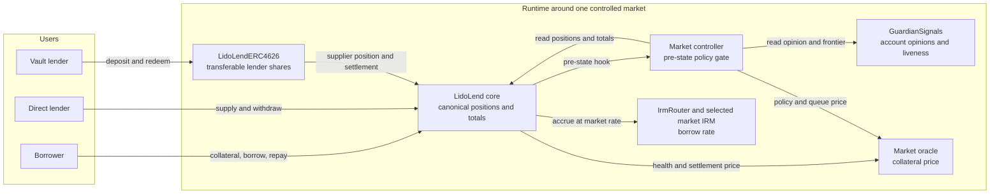
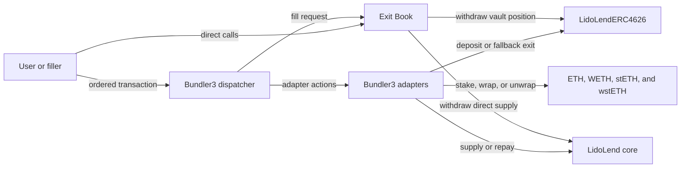
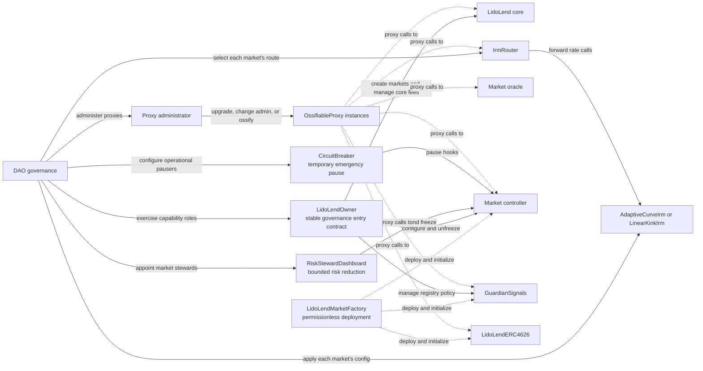
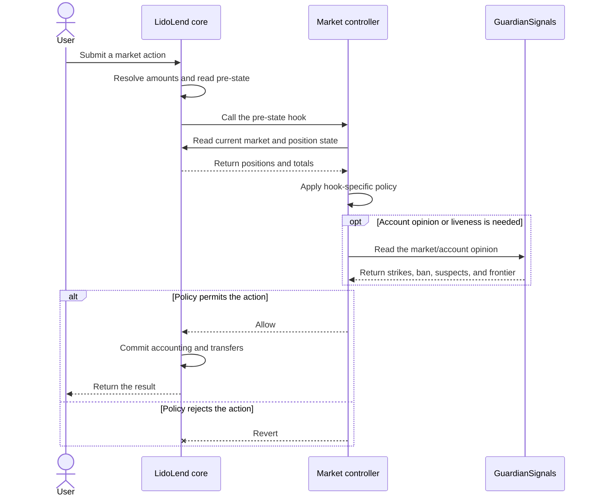

# Lido Lend Architecture

[Lido Lend](https://github.com/lidofinance/lido-lend/) is a lending protocol built on a fork of Morpho Blue. Lenders supply loan assets. Borrowers provide collateral and borrow those assets. Repayment returns loan assets to the market, and liquidators reduce debt when a position becomes unhealthy.

One shared `LidoLend` core stores the canonical accounting for every market. Each market selects its own loan token, collateral token, oracle, interest-rate model, and liquidation loan-to-value (LLTV). Positions and totals are keyed by market, but the accounting logic is shared. An optional controller applies Lido-specific policy before the core changes market state. Vaults, Exit Books, and Bundler3 add user workflows without becoming a second source of market accounting.

Start here, then follow the links to the mechanism guides and generated API pages:

- **[System maps](#system-maps)** show the runtime and governance relationships.
- **[Contracts](#contracts)** separates the market runtime, deployment/governance periphery, and optional user services.
- **[Runtime paths](#runtime-paths)** follows a controlled market action and introduces the borrower and lender flows.
- **[Mechanism guides](#mechanism-guides)** route into the detailed cross-contract state machines and formulas.
- **[System controls](#system-controls)**, [roles](#roles-and-governance), and [trust boundaries](#trust-boundaries) define the authority and assumptions around those flows.

> [!NOTE]
> The concrete [WETH / wstETH market](markets/eth-steth.md) describes market-specific assets, oracle assumptions, and parameters. Privileged actions are listed in [roles.md](roles.md).

## Terms used in this document

| Term | Meaning |
|---|---|
| Core | The shared `LidoLend` contract that stores market positions and totals and moves market tokens. |
| Market | One isolated lending pool identified by its tokens, oracle, interest-rate model, and LLTV. |
| Controller | A policy contract bound to one market. It can allow or revert hooked actions but cannot change their resolved amounts. |
| Hook | A call from the core to a market controller before the core commits an action. |
| IRM | Interest-rate model. It calculates the market's borrow rate. |
| LLTV | Liquidation loan-to-value. It is the debt-to-collateral limit used by the core health check. |
| ERC-4626 vault | A tokenized lender position whose shares represent a claim on the vault's managed core supply. |
| Free liquidity | Supplied loan assets that are not currently borrowed and can therefore be withdrawn. |
| WAD / BPS | Fixed-point denominators: `1e18` for WAD and `10_000` for basis points. |

## System maps

The first diagram shows the normal lending path for one controller-bound market. A controller-less market omits the controller and guardian branch, but still uses the fork-wide core rules.

Exit Books and Bundler3 are optional execution services. They compose calls around the same core and vault positions; they do not own market accounting.

Deployment and control are separate from the runtime accounting path. The factory creates initialized components bound to the intended market id, but it does not create the core market. Governance configures the market's IRM route and then creates the market through `LidoLendOwner`, immutably registering its controller.

## Contracts

This map covers deployed contracts and external runtime boundaries. Internal libraries, interfaces, and abstract base contracts are documented through the API of the concrete contracts that use them. Common structs and value types are collected in the generated [shared-types reference](api/shared-types.md).

### Market runtime

#### LidoLend (forked core)

The Morpho Blue fork that holds canonical supply, borrow, collateral, interest, and liquidation accounting for every market. The fork adds owner-gated market creation, immutable controller binding, pre-state policy hooks, and optional [lender settlement](lender-settlement.md) that cancels borrower debt against lender supply. The controller may allow or revert an action but cannot rewrite amounts already resolved by the core. Token-global `flashLoan` has no market id and therefore remains outside controller policy.

Full specification: [Lido Lend](https://github.com/lidofinance/lido-lend/blob/main/SPECIFICATION.md).

#### LidoLendMarketController

The per-market policy layer invoked by the core before state-changing actions. It tracks collateral activation, guardian signals, supply caps, freeze and pause state, and the settlement queue; together these rules decide whether the resolved core action may proceed.

Mechanics: [Market controller](market-controller.md). API: [LidoLendMarketController](api/lido-lend-market-controller.md).

#### GuardianSignals

The registry of guardian opinions and liveness reports that controllers consult when deciding whether collateral may mature and an account may borrow. Opinions are keyed by market and account, so one registry can serve several markets; separate registries provide different guardian sets, quorums, or operational isolation.

Mechanics: [Guardian signals](guardian-signals.md). API: [GuardianSignals](api/guardian-signals.md).

#### LidoLendERC4626

The tokenized lender position for one market: a standard, freely transferable ERC-4626 share over the vault's core supply position. When settlement is enabled for the market, it also exposes lender settlement exits for periods when free pool liquidity cannot satisfy a normal withdrawal. A market may have multiple wrappers, each backed by its own core supplier position; the standard component deployment creates one.

Mechanics: [Lender settlement](lender-settlement.md). API: [LidoLendERC4626](api/lido-lend-erc4626.md).

#### Market oracles

- `WstEthRateOracle` quotes wstETH in ETH from Lido's stETH-per-wstETH accounting rate and deliberately has no market-price component. API: [WstEthRateOracle](api/wst-eth-rate-oracle.md).
- `UsdyStableOracle` quotes USDY in a USD-stablecoin loan asset by combining the USDY redemption NAV with the stablecoin's Chainlink USD price. Its proxy storage binds the market-specific feed and decimal scale. API: [UsdyStableOracle](api/usdy-stable-oracle.md).

Market-specific assumptions and oracle choices are documented in [WETH / wstETH](markets/eth-steth.md).

### Deployment and governance periphery

#### LidoLendOwner

The direct, role-gated governance entry contract that holds the core's single `owner` authority. It gives governance one stable target while separating market creation, core fee management, controller policy and unfreezing, and guardian-registry management into independent roles; market-specific calls resolve the controller and registry through the core.

API: [LidoLendOwner](api/lido-lend-owner.md).

#### LidoLendMarketFactory

A permissionless, stateless component factory with fixed implementations and protocol dependencies. It deploys and validates controller, ERC-4626 wrapper, and guardian-registry proxies, initializes them, assigns their final roles, and removes its temporary permissions. It does not create the market in the core: that is a separate governance action through `LidoLendOwner` after the components have been deployed and validated.

API: [LidoLendMarketFactory](api/lido-lend-market-factory.md).

#### RiskStewardDashboard

The non-upgradeable, per-core contract for bounded risk reduction. Governance may assign one or more stewards to each market. A market steward may freeze that market or tighten a limited set of collateral-activation controls, but cannot loosen policy or unfreeze it.

API: [RiskStewardDashboard](api/risk-steward-dashboard.md).

#### Shared infrastructure

`OssifiableProxy` delegates calls to the core, IRM router, controllers, ERC-4626 wrappers, guardian registries, and market oracles. Its admin may upgrade the implementation, change the proxy admin, or irreversibly remove upgrade authority. Proxy administration is separate from core ownership and implementation-level roles even when governance assigns them to the same holder. API: [OssifiableProxy](api/ossifiable-proxy.md).

The interest-rate stack is a pinned [Lido Lend IRM](https://github.com/lidofinance/lido-lend-irm) dependency. A proxied `IrmRouter` routes each market to a selected IRM implementation. The shared, direct `AdaptiveCurveIrm` keeps each market's pointer to an immutable configuration and its adapting rate. An optional direct `LinearKinkIrm` keeps per-market kink parameters. The permissionless direct `IrmConfigFactory` deploys or reuses immutable configuration contracts for both models.

A separately deployed [CircuitBreaker](https://github.com/lidofinance/circuit-breaker) receives the sole initial `PAUSER_ROLE` on each controller. Its own policy must register the controller and an operational pauser before it can invoke that role. These external dependencies own their API documentation.

### Optional user periphery

#### Exit Books

`Erc4626ExitBook` and `MorphoExitBook` are non-custodial registries for asset-denominated exit requests over vault shares and direct core supply positions. The owner retains the position. A permissionless executor chooses how much of the request to fill and names a separate reward recipient. The book withdraws exactly the filled request amount.

If the source needs more liquidity, a filler may first deposit into the vault, supply to the market, repay debt, or use another source-native operation. A helper or `Bundler3` transaction can perform liquidity preparation and the fill atomically while enforcing its own capital and slippage limits. Appreciation remains in the lender's position. An optional owner limit caps the live share burn after a loss, and a priority fee that can rise over time rewards execution.

Specification: [Exit Books](exit-books.md). API: [Exit Books](api/exit-book.md).

#### Bundler3 adapters

The optional adapters compose Lido actions inside [Bundler3](https://github.com/morpho-org/bundler3) transactions and hold no market accounting or policy:

- `LidoLendVaultAdapter` exposes the vault's fallback exit to a bundle, fixes the burned position to the bundle initiator, and enforces caller-selected minimum payout and minimum shares burned.
- `EthereumGeneralAdapter1` is the upstream Ethereum general adapter with the MORPHO-token wrapper surface removed; it retains the ETH/stETH/wstETH staking and wrapping actions.

API: [Bundler3 adapters](api/bundler3-adapters.md).

## Runtime paths

Only hook-enabled actions in a controller-bound market enter the policy layer. The core first resolves the action against the current market state and then calls the controller before committing accounting or transfers. A controller-less market skips hook policy but retains the fork-wide core behavior. Token-global flash loans, authorization changes, vault-share transfers, and administrative calls do not use this market hook.

### Borrower path

All supplied collateral protects the core position from liquidation immediately, but fresh collateral does not necessarily support a new borrow. The controller separates collateral into dust, activating, and active amounts. Activation time depends on market inflow, guardian opinions, guardian liveness, and freeze state. A borrow must fit the active collateral and pass the controller's account, freeze, and borrow-share-rate checks.

The full hook matrix, collateral lifecycle, and safety invariants are in the [market-controller specification](market-controller.md). Guardian identity, quorum, ban, suspect, and liveness behavior are in the [Guardian Signals specification](guardian-signals.md).

### Lender path

A direct lender owns a core supply position; a vault lender owns ERC-4626 shares backed by the vault's managed core position. A normal withdrawal uses free loan-asset liquidity. When liquidity is tied up in loans, settlement can cancel borrower debt against an authorized lender's supply and pay the corresponding collateral instead. Queue policy and lender-side budgeting determine which debt may be settled and how much of the lender position is consumed.

The complete direct, targeted, and fallback flows are in [Settlement and lender exits](lender-settlement.md). Exit Books are a separate optional service: they coordinate a permissionless filler around an existing vault or direct supply position and are specified in [Exit Books](exit-books.md).

## Mechanism guides

Architecture is the entry point; the mechanism guides own the state machines and formulas that cross contract boundaries.

| Mechanism | What it explains | Primary contracts |
|---|---|---|
| [Market controller](market-controller.md) | hook policy, supply cap, collateral activation, freeze and pause, borrow-share-rate safety | `LidoLend`, `LidoLendMarketController` |
| [Guardian signals](guardian-signals.md) | delegates, strikes, suspect reports, ban latching, heartbeats, and quorum frontier | `GuardianSignals`, `LidoLendMarketController` |
| [Settlement and lender exits](lender-settlement.md) | risk queue, settlement amounts, supply-share budgets, vault fallback and targeted exits | `LidoLend`, `LidoLendMarketController`, `LidoLendERC4626` |
| [Exit Books](exit-books.md) | request lifecycle, exact-asset fills, external liquidity composition, share-burn protection, fees, and execution workflow | `Erc4626ExitBook`, `MorphoExitBook` |

## System controls

Freeze and pause operate at different layers. Neither changes canonical accounting by itself.

| State | Blocks | Remains available | Control path |
|---|---|---|---|
| Freeze | new borrows, collateral withdrawal with open debt, collateral maturation | repay, supply, debt-free withdrawal subject to activation locks, liquidate, settlement | a bounded risk steward freezes; governance unfreezes |
| Controller pause | every action that enters that controller's hook | flash loans, authorization changes, vault-share transfers, controller administration | CircuitBreaker pauses for a bounded period; an authorized resumer may end it earlier |
| Exit Book pause | placement and fills in that book | cancellation, reads, configuration, recovery, direct source use | the book's pause and resume roles |

Freeze stops new risk while preserving repayment and forced risk reduction. Controller pause is the stronger response when even liquidation or settlement must stop, such as during an oracle incident. Exit Book pause affects only the optional request service and never locks the owner's underlying source position.

## Roles and governance

Authority is split by capability so that routine operations do not inherit the core owner's or proxy administrator's full power:

- `LidoLendOwner` is the stable governance entry contract for market creation, core fees, controller policy, unfreezing, and guardian management. Its capabilities are assigned independently.
- The proxy administrator controls upgrades, admin transfer, and irreversible ossification. Proxy authority is distinct from core ownership and implementation roles.
- `RiskStewardDashboard` gives a per-market steward only bounded risk-reduction actions: tighten selected controls or freeze. It cannot loosen policy or unfreeze.
- `CircuitBreaker` supplies the controller's time-bounded emergency pause path.
- Guardian signalling, access restoration, Exit Book configuration, and Exit Book pause/resume use their own roles and do not confer custody over lender positions.

No routine operational role can seize or burn lender principal. An Exit Book fee manager can route only the configured service share of the priority fee. The exact function-to-role-to-holder matrix is in [roles.md](roles.md).

## Trust boundaries

Permissionless users are not trusted to choose safe or profitable actions. Contracts enforce the limits shown below. Privileged authorities and external dependencies require the stated assumptions.

| Actor or dependency | Enforced limit or required assumption |
|---|---|
| Lender and borrower | Core authorization and solvency checks apply. The controller prevents borrowing against inactive collateral, enforces bans, and limits borrow-share-rate growth. |
| Exit Book filler or helper | The book enforces the exact request debit, owner permission, share-burn protection, and payout conservation. The filler must enforce the capital and slippage limits of its external liquidity route. |
| Guardian or delegate | One guardian identity contributes at most one flag and one suspect report per account. Quorum is enforced onchain, but heartbeat timestamps are trusted reports. |
| Risk steward and emergency pauser | The dashboard exposes only bounded policy tightening and freeze. CircuitBreaker can pause controller hooks only for a bounded period. Neither authority can move user funds. |
| Governance and proxy admin | Trusted to follow the required governance delay and to select sound implementations, markets, roles, oracles, and IRMs. Proxy upgrades can change all contract guarantees. |
| Oracle, IRM, and tokens | Trusted to follow their documented interfaces and economic assumptions. Incorrect prices, rates, transfer behavior, or callbacks can stop or distort market actions. |

Mechanism-specific invariants and failure boundaries are kept beside the state machines they constrain:

- borrow-share-rate and collateral policy: [Market controller](market-controller.md);
- guardian quorum and liveness: [Guardian signals](guardian-signals.md);
- managed vault supply, settlement budgets, and settleable-supply bounds: [Settlement and lender exits](lender-settlement.md);
- request and payout conservation: [Exit Books](exit-books.md).

## Markets

Both market designs reuse the shared controller, guardian signals, collateral activation, vault, freeze, and pause mechanisms. Settlement is available per market but is enabled independently when the market is created. Their assets, oracle assumptions, transfer constraints, and risk parameters differ:

- **WETH / wstETH** — `WstEthRateOracle` (onchain accounting rate, no market-price component). See [markets/eth-steth.md](markets/eth-steth.md).
- **USD / Treasuries** — a USDY NAV oracle, transfer-gated collateral.
