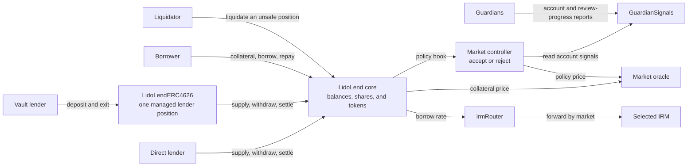

# Lido Lend Architecture

Lido Lend is an isolated-market lending protocol built on a fork of Morpho Blue. Each market lets lenders supply one loan token and lets borrowers borrow that token against one collateral token. Unsafe positions may be liquidated. If a successful liquidation leaves debt after collateral reaches zero, the core writes that debt off against suppliers.

The shared `LidoLend` core keeps the canonical market balances and accounting. The Lido-specific contracts add per-market policy, delayed collateral activation, guardian signals, tokenized lender vaults, and new lender exit paths. They do not maintain a second copy of market balances.

## One standard market at a glance

Each market selects a loan token, a collateral token, an oracle, an interest-rate model (`IRM`), and a liquidation loan-to-value (`LLTV`). The oracle values collateral in loan-token units. The IRM determines how debt and lender claims grow over time. LLTV is the borrowing limit used by the core health check.



The core is the source of truth for supply shares, borrow shares, collateral, market totals, and token custody. A direct lender owns a supply position in the core. A vault combines deposits into one core supply position and gives its depositors transferable ERC-4626 shares.

In a controller-bound market, the core calls the controller before most market actions. The controller applies the supply cap, collateral-activation rules, guardian signals, freeze and pause state, and settlement policy. It may allow the action or revert, but it cannot change the amounts calculated by the core. Binding a controller does not let that address spend user tokens or act for user accounts.

`GuardianSignals` stores guardian reports about accounts and how far the committee has reviewed protocol activity. The controller uses those reports to block new borrowing or delay collateral activation. `GuardianSignals` does not call the core or move tokens.

## Main user flows

### Borrowing and liquidation

1. A borrower transfers collateral to the core.
2. The core counts all of that collateral in its health check. The controller may require the collateral to complete an activation delay before it supports new borrowing.
3. Once controller policy and the core health check both pass, the borrower receives loan tokens and incurs borrow shares. Interest increases the loan-token value of those shares over time.
4. Repayment burns borrow shares. A borrower may withdraw collateral only while the remaining position passes both controller policy and the core health check.
5. When debt exceeds the market's LLTV-adjusted collateral value, anyone may liquidate the position. The liquidator repays debt and may receive collateral. The core applies an LLTV-dependent liquidation incentive factor when calculating any collateral payout. If a successful liquidation ends with no collateral and debt remains, the core writes the remaining debt off against suppliers.

Guardian reports do not seize collateral. They can delay activation or ban new borrowing. The full activation and guardian rules are in [Market Controller Policy](market-controller.md) and [Guardian Signals](guardian-signals.md).

### Lender positions and exits

A direct lender supplies loan tokens to the core and receives supply shares. A vault lender deposits loan tokens into `LidoLendERC4626`; the vault supplies them to the core and issues ERC-4626 shares to the depositor. In both cases, borrowers may use the supplied loan tokens, so the whole lender claim may not be immediately withdrawable.

| Exit path | What happens | Payout |
|---|---|---|
| Ordinary withdrawal | The core or vault burns lender shares and withdraws available loan tokens. The amount is limited by market liquidity. | Loan tokens |
| Settlement | The lender's supply claim and a borrower's debt are reduced together. The core transfers borrower collateral at the oracle price. Settlement uses no loan-token liquidity and adds no liquidation incentive. | Collateral |
| Vault fallback exit | The vault first withdraws available loan tokens. It may then settle the remaining lender claim against borrowers selected by controller policy. | Loan tokens, collateral, or both |
| Exit Book request | A lender publishes a loan-token withdrawal request backed by an existing vault or direct core position. Any account, including that lender, may later fill some or all of it. | The request receiver gets the filled amount minus the request's priority fee. |

The priority fee funds the execution reward. The filler chooses the address that receives that reward, and the book deducts any configured service cut before paying the reward.

An Exit Book is not a settlement mechanism. It never cancels borrower debt. The lender keeps its vault or core shares until a fill, and the book does not reserve or create liquidity. A fill cannot exceed the amount the source can withdraw at that time. The filler may wait, make an allowed partial fill, or prepare liquidity first.

A filler may prepare liquidity and fill the request in one transaction. `Bundler3` can execute those calls in a chosen order. Protocol adapters make sure protected actions use the bundle's original user. The Exit Book, vault, and core can also be called directly.

## Runtime policy and controls

### Controller hook

A typical controller-checked action follows this sequence:

1. A user calls the core.
2. The core performs initial checks, accrues interest where applicable, and calculates the amounts sent to the controller.
3. The controller reads its policy state and either returns or reverts.
4. If the controller returns, the core performs any remaining checks, applies the action to canonical accounting, and moves the required tokens.

The exact hook point differs by action; the [controller policy matrix](market-controller.md#policy-boundary) records what each hook observes.

Before a controller hook returns, the core rejects any other market action that would normally call a hook. This also applies when the other action targets a market without a controller. Actions without a market hook are not affected by controller pause.

### Freeze and pause

Market stewards act through `RiskStewardDashboard`. They can make collateral-activation rules stricter, remove an account's instant-activation permission, or freeze a market. They cannot make rules looser or unfreeze a market.

| Control | Purpose and effect |
|---|---|
| Market freeze | Stops new borrowing, collateral withdrawal while debt remains, and completion of collateral activation. Repayment, liquidation, settlement, and lender withdrawal remain available. Governance can unfreeze the market. |
| Controller pause | CircuitBreaker lets a registered emergency actor pause controller-checked actions for a limited period. This includes repayment, lender withdrawal, liquidation, settlement, and a direct call to accrue interest. Core functions that do not call the controller and vault-share transfers remain available. |
| Exit Book pause | Stops new requests and fills in that book. Owners can still cancel requests or use the underlying vault or core position directly. |

An action must pass every control layer that it uses. For example, an unpaused Exit Book cannot fill a request when the source withdrawal reaches a paused market controller.

## Market identity and shared scope

The core identifies a market by five `MarketParams` fields:

```text
marketId = keccak256(abi.encode(loanToken, collateralToken, oracle, irm, lltv))
```

Positions, collateral, and supply and borrow totals are isolated by `marketId`. Assets in one market do not back positions in another market.

The controller address and settlement enablement are not part of `MarketParams`. The core stores both when the market is created and exposes no later setter. A controller-less market skips Lido policy, and settlement can be enabled only when a controller is bound.

Accounting isolation does not make every dependency or permission market-specific:

- One core contract and owner serve all markets in that core.
- Core authorization is global. An operator authorized by one account may act for that account in every market held by the core, subject to each action's normal checks.
- Token custody is shared by token address. A token-wide failure can affect every market that uses that token.
- An oracle, IRM router or model, or `GuardianSignals` instance may serve several markets. A failure or privileged change can therefore affect every market that uses that component.
- `GuardianSignals` does not include the core address in its state keys. Reusing one instance across different cores can merge reports for identical market ids, so deployments should keep each instance within one core.

## Trust boundaries

| Dependency | What the system relies on |
|---|---|
| Controller | It can reject every controller-checked action. Binding it does not let that address spend user tokens or act for user accounts. |
| Guardians and delegates | A guardian may authorize a delegate address to report for it. Reports may ban new borrowing or delay collateral activation. Active delegates are unique and never guardian addresses, so one address cannot represent two identities. Quorum counts guardian identities. |
| Oracle | A wrong or stale value can allow unsafe borrowing, block actions, or misprice liquidation and settlement. |
| IRM and rate managers | The selected model and configuration determine interest accrual. A reverting, reentrant, or extreme-rate model can block or distort the market. |
| Loan and collateral tokens | Transfers must move the requested amount without fees, rebasing, arbitrary balance changes, or token callbacks into the protocol. Transfer restrictions may still reject a selected receiver. |
| Governance roles and proxy admin | Governance roles can change the settings assigned to them. A proxy admin can replace contract code until it permanently removes its own upgrade power, a step called ossification. |
| Bundler3 and adapters | Bundler3 can call arbitrary targets and must not receive token approvals or core authorization. Grant permissions only to protocol adapters that act for the bundle's original user. |
| Exit Book filler | The book enforces the lender's request and source withdrawal. It does not protect the filler from the capital cost, slippage, or profitability of separate liquidity preparation. |

## Market creation and later changes

A controller, vault, oracle, IRM setup, and `GuardianSignals` instance may exist before a core market. These contracts do not create the core's positions or accounting. The core owner creates the market after the required components are configured. Creation fixes the `MarketParams`, controller address, and settlement setting.

`LidoLendOwner` is the standard governance entry contract. In the standard setup, it owns the core and separately receives permissions on controllers and `GuardianSignals`. Moving core ownership to another address stops it from creating markets or setting core fees. Its controller and `GuardianSignals` permissions remain until governance revokes them.

`LidoLendMarketFactory` is an optional helper for deploying standard controllers, vaults, and `GuardianSignals` instances. In the standard flow, governance uses `LidoLendOwner` to perform the core-owner creation call. A core owner may also create a valid market without the factory.

Creation does not make market behavior immutable. Proxy admins may change contract code until ossification. Separate IRM roles may still change rate routing or configuration after the relevant proxy is ossified.

Exact role holders and governance paths are in [Privileged Roles](roles.md). Transaction order and deployment checks are in the [deployment runbook](../../script/DEPLOYMENT.md).

## Detailed specifications

| Topic | Owning document |
|---|---|
| Core accounting, liquidation, settlement, hooks, and fork changes | [Lido Lend core specification](https://github.com/lidofinance/lido-lend/blob/main/SPECIFICATION.md) |
| Controller checks, collateral activation, freeze, pause, and debt-rounding guard | [Market Controller Policy](market-controller.md) |
| Guardian membership, account reports, bans, and scan progress | [Guardian Signals](guardian-signals.md) |
| Direct and vault settlement, borrower selection, limits, and fallback exits | [Settlement and Lender Exits](lender-settlement.md) |
| Exit requests, fees, source positions, and filler workflow | [Exit Books](exit-books.md) |
| Privileged capabilities and intended holders | [Privileged Roles](roles.md) |
| IRM routing, configuration, and rate models | [Lido Lend IRM specification](https://github.com/lidofinance/lido-lend-irm/blob/main/SPECIFICATION.md) |
| NAV oracle: the price check around a trailing anchor, anchor updates, and staleness | [Trailing Anchor Oracle](trailing-anchor-oracle.md) |
| WETH/wstETH parameters and oracle assumptions | [WETH / wstETH](markets/eth-steth.md) |
| USDY-backed stablecoin markets | [USDY / Stablecoin Markets](markets/stables-usdy.md) |
| Functions, structs, events, errors, and getters | [Generated API reference](README.md#api-reference-generated) |
