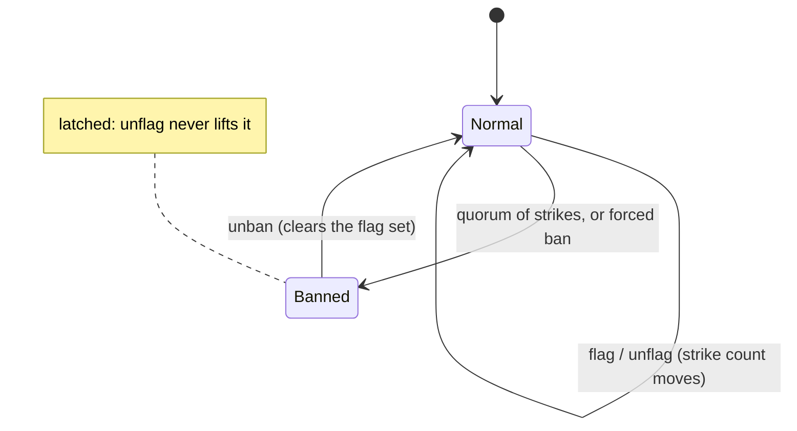
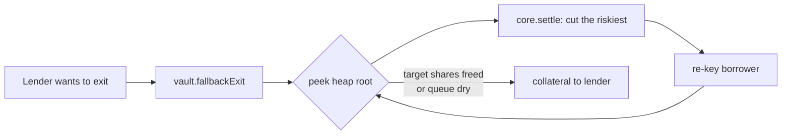
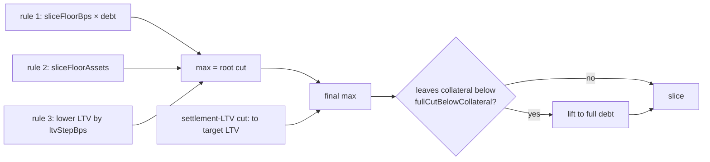

# Lido Lend Architecture

[Lido Lend](https://github.com/lidofinance/lido-lend/) is a Morpho Blue fork with an additional policy layer on top. Each market is isolated: its own loan asset, collateral, oracle, IRM, and LLTV. A market may bind a **controller** that gates user actions through hooks. A market with no controller behaves as vanilla Morpho.

A single `LidoLend` core hosts many markets, as in Morpho. To each market the Lido layer adds two pieces Morpho lacks — a **controller** (the policy layer) and an ERC-4626 **vault** (the tokenized lender position). Markets stay risk-isolated: the core keys positions and accounting by market id, so one market cannot reach another's funds. 

`GuardianSignals` is shared the same way — its signals are market-keyed, so one registry can back many markets, though a deployment may run several when markets want different guardian sets or quorums (the set and quorum are per registry). Neither is pinned to a single instance: a market that needs full isolation can get its own core and registry. 

- **[LidoLend](#lidolend-forked-core)** holds the canonical accounting (supply/borrow shares, collateral, interest).
- **[LidoLendMarketController](#lidolendmarketcontroller)** holds Lido policy: borrower gating, collateral activation, settlement queue, freeze/pause.
- **[GuardianSignals](#guardiansignals)** is the registry the controller reads for gating.
- **[LidoLendERC4626](#lidolenderc4626)** is the tokenized lender position and the fallback-exit entrypoint.
- **[RiskStewardDashboard](#riskstewarddashboard)** is the per-core tighten-only risk console: appointed stewards ratchet a market's activation levers in the safe direction.
- **[Exit books](#exit-books)** are the filler-served exit registry: lenders post exit requests, fillers close them from market liquidity for a Dutch-auction priority fee.

> [!NOTE]
> Each market's assets, oracle, and risk parameters live in [markets/](markets/), the privileged-role catalogue in [roles.md](roles.md), and the design rationale behind it all in the ADRs.


## Contracts

The contracts that make up a market, each with its role and a link to the full API reference.

### LidoLend (forked core)

The Morpho Blue fork that holds the canonical accounting for every market — supply and borrow shares, collateral, interest accrual, liquidation. One core hosts many markets, keyed by id, and — unlike permissionless Morpho — `createMarket` is owner-gated, so the DAO curates which markets exist. The fork adds four things the policy layer relies on:

- **Controller binding.** `createMarket(params, controller, enableSettlement)` binds one controller per market at creation, immutable afterwards. A market with no controller is vanilla Morpho.
- **Hooks.** With the action's amounts resolved but before the state change is applied, the core calls `controller.on(id, event, payload)` under a reentrancy lock. The hook may revert (aborting the action) but cannot rewrite the resolved amounts.
- **`settle`.** Cancels borrower debt against lender supply at the oracle price, with no liquidation incentive and **no borrower health check** — excluding bad-debt borrowers is the controller's duty. The cut is anchored on one of two share amounts — burned supply shares or canceled borrow shares, one set and the other zero — and a borrow-anchored cut closes a position to exactly zero debt with no dust. Settlement is a per-market opt-in: `settle` needs both a controller and `enableSettlement` set at creation, otherwise it reverts `SETTLEMENT_DISABLED`. This is the primitive behind the fallback exit and the settlement queue.
- **Proxy.** `OssifiableProxy`, upgradeable until ossified.

`flashLoan` sits outside controller policy: it is token-global with no market id, no hook or reentrancy lock, not owner-gated, and uncollateralized — the core transfers the tokens out and pulls them back in the same call, reverting only on zero assets.

Full surface: [`FORK_NOTES.md`](../../lib/lido-lend/FORK_NOTES.md).

### LidoLendMarketController

The market's policy layer — the safeguards Lido adds on top of Morpho, which on its own checks only that collateral covers the debt. Through the core's hooks the controller protects lenders and the pool:

- **Collateral activation** — fresh collateral matures through a timer before it can back a loan, leaving a window to catch bad collateral before it is borrowed against.
- **Guardian signals** — an automated guardian system watches each market and reports accounts that look malicious. At a quorum, a flagged borrower (typically a hijacked account) is stopped from borrowing against lender funds.
- **Active-only borrow capacity** — fresh collateral can't be borrowed against until it matures, but it still counts toward solvency, so it shields the position from liquidation at once.
- **Freeze** — halts new borrows and debt-bearing collateral withdrawals.
- **Pause** — a last-resort circuit breaker that halts every hook in an emergency.

It also governs **settlement**, how lenders exit an illiquid market: the controller orders the queue so the riskiest borrowers unwind first, bounds each cut, and blocks settlement when a tracked position is bad debt.

Full surface: [API reference](api/lido-lend-market-controller.md).

### GuardianSignals

The shared registry of guardian opinions per `(market, account)` — how the controller learns which borrowers the guardians have flagged as malicious. It holds the guardian set (capped at `MAX_GUARDIANS_COUNT = 32`) and quorum, each account's strike count and flagged/banned status, and per-guardian liveness heartbeats. `MANAGER_ROLE` manages the guardian set and quorum — `addGuardian`, `removeGuardian`, `setQuorum`. One registry can serve many markets, and a deployment runs several only when markets need different guardian sets or quorums.

Full surface: [API reference](api/guardian-signals.md).

### LidoLendERC4626

The tokenized lender position for one market — a standard ERC-4626 vault over the market's supply, freely transferable and ungated, plus the griefing-resistant fallback exit for when pool liquidity is short. `totalAssets` counts only the Morpho supply position, so idle or donated loan tokens stay inert, and a virtual-share decimals offset hardens the share price against inflation.

Full surface: [API reference](api/lido-lend-erc4626.md).

### RiskStewardDashboard

The per-core risk console. One instance configures every market of a core, resolving each market's controller by id. `STEWARD_ADMIN_ROLE` appoints and removes per-market stewards, who hold three tighten-only levers — `increaseActivationDelays`, `increaseActivatingLock`, `revokeInstantActivation`. Each lever reads the market's current activation config, rejects any change that loosens it, and writes the full config back, so a steward can only ratchet risk down.

Full surface: [API reference](api/risk-steward-dashboard.md).

### Exit books

The filler-served exit registry. A lender posts a request to exit a fixed slice of their supply, then any filler drains whatever liquidity the market has into it, earning a `PriorityRamp` priority fee that holds at `startRate` through `rampStart`, climbs linearly to the request's `endRate` by `rampEnd`, then holds at `endRate` to the deadline (a Dutch auction). Each rate is capped at the global `MAX_PRIORITY_FEE = 10%`. A large exit completes over time without the lender chasing liquidity transaction by transaction. An abstract `ExitBookBase` (with `ExitBookLib`) holds the shared `fillExitRequest` / `cancelExitRequest` surface, and a concrete book binds it to a source with its own `placeExitRequest` — `Erc4626ExitBook` over a vault, `MorphoExitBook` over a market.

Full surface: [API reference](api/exit-book.md).

## Mechanics

Every market action runs through the controller — the core resolves the amounts, then calls `controller.on(id, event, payload)` before applying the state change. While the controller is paused every hook reverts, halting the market. Otherwise it applies its policy per action:

| Hook | Controller action |
|---|---|
| SupplyCollateral | sync activation, book the supplied collateral into the activation pipeline, re-key the settlement queue |
| WithdrawCollateral | freeze gate (only with open debt), sync activation, debit buckets, active-health check (with open debt), re-key |
| Borrow | freeze gate, guardian check (caller, onBehalf, receiver), active-only health check (dust-threshold floor folds into capacity) |
| Repay | re-key the borrower in the settlement queue |
| Liquidate | debit seized collateral from buckets, re-key |
| Settle | bad-debt gate, eligibility gate, slice bound, debit seized collateral, re-key |
| Supply / Withdraw / AccrueInterest | no policy (lender flows and interest) |

### Borrower gating

The core's only borrow check is solvency: collateral at LLTV must cover the debt. It cannot tell whether the collateral is legitimate or the account compromised — stolen collateral, or a hijacked account, clears the check exactly like an honest borrower. On its own the core would let the borrow through, and the attacker would vanish with the lender funds before anyone reacts.

The controller adds the missing judgment as two linked safeguards, keyed per `(market, account)`:
- **Collateral activation** runs on every market by default: fresh collateral sits in a timer before it can back a loan — a window for guardians to catch collateral that would put user funds at risk.
- **Guardian signals** fill that window: trusted watchers flag an account they judge malicious, and the verdict feeds back into the timer — flags lengthen it, and a quorum blocks borrowing outright.

### Collateral activation

Freshly supplied collateral cannot back a new borrow until it has matured through a timed gate. Activation runs on every collateral supply, sorting each borrower's collateral into three buckets:

- `dust` — collateral supplied below the activation minimum (`minActivationAmount`). It accumulates here until a supply lifts the total to or past the minimum, when the whole amount moves into `activating`. Freely withdrawable, and outside the timer.
- `activating` — in the timer, maturing toward `active`. An `activatingLockAmount` portion can be held back from withdrawal for `activatingLockDuration`.
- `active` — matured collateral, the only kind that backs a new loan, derived as `total` minus the un-matured buckets rather than stored on its own. Freely withdrawable.

All supplied collateral counts toward the core's solvency the moment it lands, whatever bucket it sits in — so a supply protects the position from liquidation at once. Only borrowing waits for `active`.


#### The maturation gate

Collateral in `activating` becomes `active` through a gate. How long that takes — and whether it happens at all — is set by four inputs:

- **Inflow delay** — recent supply volume sets the base timer.
- **Guardian strikes** — each one lengthens the timer; a quorum bans the account, which then never matures (see [Guardian signals](#guardian-signals)).
- **Liveness frontier** — a guardian quorum must scan past the unlock before a lot can mature (see [Guardian signals](#guardian-signals)).
- **Freeze** — maturation is suspended while the market is frozen (see [Freeze & pause](#freeze--pause)).

A supply routed through a trusted caller skips the gate entirely — instant activation matures it at supply, so the lot never enters `activating` (see [Instant activation](#instant-activation)).

A `maxGuardiansQuorumDelay` fallback matures a lot anyway if the committee stalls, so a slow watch cannot freeze maturation forever. Set to `0` it drops the scan requirement, and the lot matures on the timer alone.

> **Example.** The timer elapses but the quorum frontier's timestamp is still behind the supplied lot's `unlockTime`, so the lot waits. When a guardian heartbeats past it and `syncQuorumBlock` advances the frontier so its timestamp clears `unlockTime`, the next `syncActivation` matures it. If the committee stalls, the lot matures anyway once `maxGuardiansQuorumDelay` from its start has passed.

#### Inflow delay

The base wait is fixed when the collateral is supplied, computed from the market's recent inflow so address-splitting cannot dodge the throttle:

```
delay = minActivationDelay + (maxActivationDelay − minActivationDelay) × inflow / maxDelayInflow
        (clamped to maxActivationDelay when inflow ≥ maxDelayInflow)

unlockTime = activatingStart + delay + strikes × delayPerStrike
           + (activatingStart < suspectExpiry ? suspects × delayPerSuspect : 0)
```

`inflow` is the market's recent collateral inflow, capped at `maxDelayInflow` and decaying at a fixed rate (draining from the cap to zero over `maxActivationDelay`), plus the incoming lot. More recent volume → longer delay, giving guardians more time to vet the larger supplies that carry more risk for lenders.

All activating collateral shares one timer (`activatingStart`). A top-up that extends the deadline restarts it for the whole lot, so a top-up after `suspectExpiry` clears the suspect surcharge.


> **Example.** 
> - `minActivationDelay = 10 min` 
> - `maxActivationDelay = 2 h` 
> - `maxDelayInflow = 10 000`
>
> current decayed inflow `2 000`, supply `20`. Effective inflow `2 020`, so 
>
> `delay = 10 min + (120 − 10) min × 2020 / 10000 ≈ 32 min`. 
>
> With one strike and `delayPerStrike = 30 min`:
>
> `unlockTime = start + 32 min + 30 min`.

#### Instant activation

A supply whose caller is on the instant-activation allowlist matures at supply — `unlockTime = 0`, skipping both the timer and the gate. The allowlist is keyed on the supply caller, not the position owner, so a trusted router activating on behalf of users qualifies while the users themselves stay on the timer. Governance grants it mainly to looping contracts that help borrowers build leveraged positions: for these the delay would only hurt the looping UX without adding safety, since a loop position does not pull lender funds out of the market.

#### Withdrawal & holds

Voluntary withdrawal comes off the collateral in waterfall order: dust first, then `activating` above a configurable lock, then `active`. Only `dust` and `activating` are drained as stored buckets — `active` is the matured remainder, which the rest of the withdrawal simply reduces. The lock keeps an `activatingLockAmount` portion of maturing collateral unwithdrawable for `activatingLockDuration` from the lot's start — an anti-Sybil measure, so while it holds a borrower cannot pull a maturing position all the way back out. Once the duration elapses the locked portion becomes withdrawable even if the lot has not matured. A withdrawal that drops the `activating` remainder below `minActivationAmount` folds it back into `dust` and clears its timer, the mirror of a sub-threshold deposit staying dust. This demotion is skipped while a lock holds, since moving a locked remainder into freely-withdrawable dust would bypass the lock. Forced paths (liquidation, settle) pass lock 0 and reach all collateral. A same-tx supply then withdraw reverses its own inflow contribution (flash-loan undo, via transient storage).

A borrower with open debt cannot withdraw all of its collateral: a withdrawal must leave the remaining `active` covering the debt at LLTV. Active collateral below `minActivationAmount` backs no borrow at all, so a position can't be left stranded at a tiny high-LTV size at the head of the settlement queue — the capacity check folds that floor in rather than a separate revert. To pull everything out, repay the debt to zero first.

### Guardian signals

Guardians are off-chain services run by trusted actors that watch each market and flag accounts they judge malicious — a hijacked account pushing stolen collateral toward a borrow is the case they exist to catch. No guardian acts alone: each flag is one **strike**, and an account's ban latches as strikes accumulate.

```
strikes == 0          Normal — clean, normal activation
0 < strikes < quorum  Normal — activation delay scaled up by the strike count
strikes >= quorum     Banned — borrowing hard-blocked, collateral never matures
```

Below quorum an account is only slowed, not stopped — the extra delay buys reaction time while sparing a possible false positive. An account is banned while its strikes meet the **current** quorum; reaching the quorum also latches the ban, so retracting a flag no longer lifts a latched ban and an attacker cannot un-flag their way back in. The ban blocks new borrowing, not exit — a banned borrower can still withdraw its own collateral.



Alongside strikes, a guardian can raise a softer **suspect** report: it never bans, only lengthening the activation delay (`delayPerSuspect` per report). The delay reads one per-account snapshot — a count plus an expiry `now + suspectWindow` — re-taken on each report or retraction, counting the reports still fresh at that moment. So a still-fresh earlier suspect is counted into the new snapshot and rides its extended expiry, while an already-expired one is left out. A `prune` does not re-take the snapshot, so a departed guardian's report stays counted until the next report or retraction.

Two override roles sit above the guardians, split by risk direction. The committee acts fast to reduce risk — `ACCESS_LIMITER_ROLE` forces a `ban` past the quorum. Governance moves slowly to increase it — `ACCESS_RESTORER_ROLE` `unban`s, clearing the flag set so guardians re-evaluate from scratch.

The controller reads `getOpinion(market, account) → GuardiansOpinion{banned, strikeCount, suspectCount, suspectExpiryTimestamp, quorumFrontierTimestamp}` and forwards it to the activation lib, which owns the delay math: `strikeCount × delayPerStrike`, plus `suspectCount × delayPerSuspect` for a lot whose activation started before `suspectExpiryTimestamp`. `banned` blocks borrowing (and pins the unlock at infinity); `quorumFrontierTimestamp` is the liveness frontier that gates maturation.

**Heartbeats.** Guardians also report how far they have scanned, which tells whether the watch is keeping up with the chain. Each `heartbeat` carries `{number, hash, timestamp}`, recorded only if `hash` matches `blockhash(number)` — so the reported block must be on the canonical chain. A block the guardian scanned on a fork that later reorged out no longer matches and is rejected. `syncQuorumBlock` then takes the quorum-th highest reported block as the frontier and ratchets it up — monotonic, so a guardian rotation cannot pull it back.

> **Example (frontier).** Five guardians, quorum 3, last-scanned blocks `{100, 95, 90, 80, 70}`. The 3rd-highest is `90`, so the frontier is block 90 — at least a quorum have scanned everything up to it. A later report below 90 cannot lower it. The maturation gate compares that block's recorded timestamp against a lot's `unlockTime`, so a lot matures once block 90's time has passed its unlock.

### Settlement queue

Lenders exit illiquid markets by settling borrowers — canceling their debt against the lender's shares and taking collateral. Borrowers are settled **riskiest first**.

A max-heap keys each borrower by risk:

```
key = borrowShares × 1e18 / rawCollateral      (higher = higher LTV = riskier)
```

The root is the riskiest position. Because the root is the maximum, a solvent root means no tracked position is bad debt — so the **bad-debt gate is an O(1) root check**. The core runs no borrower health check on `settle`, so this gate is the controller discharging that duty.



**Slice sizing.** A single cut is bounded by the slice — the largest limit any applicable rule grants — and runs at **par**: the seized collateral is the canceled debt converted at the oracle price, rounded down, so its value is at most the canceled debt and can be one unit less, slightly favoring the borrower. The borrower keeps its equity and loses only leverage. There is no liquidation penalty.

For the queue root, the bound is the largest of three rules:

| Rule | Limit | Dominates when |
|---|---|---|
| 1 — debt fraction | `sliceFloorBps × debt` | mid LTV, large debt |
| 2 — absolute floor | `sliceFloorAssets` | small positions |
| 3 — LTV step | the cut that lowers the root's LTV by `ltvStepBps` | high LTV |

Taking the **max** lets the riskiest position de-lever in meaningful steps. Rule 3 self-adapts: a fixed LTV step is a large fraction of the debt near the liquidation threshold and a small one lower down, so it carries the cut where the debt concentrates while rules 1 and 2 floor the small and low-LTV tail. A cut sized to the *next-riskiest* borrower instead would collapse to nothing here, because borrowers in a single-pair leverage market cluster near a common LTV — the absolute rules sidestep that.

A borrower may also opt into a **settlement LTV**: a personal target LTV the cut settles down to. The settlement-LTV cut and rule 3 share one closed form, `sliceToLtv`. The slice is the larger of the root cut and the settlement-LTV cut, then lifted to the full debt when the post-cut collateral would fall below `fullCutBelowCollateral` (so no unsettleable dust tail remains).



> **Root cut.** Root at LTV 92%, debt `1000`, policy `sliceFloorBps 5% · sliceFloorAssets 100 · ltvStepBps 1%`.
> Rule 1 = `50`, rule 2 = `100`, rule 3 ≈ `120` (a 1% LTV step is ~12% of the debt at this LTV). The cut is the
> max, `120` — about one LTV point off the root.
>
> **Settlement LTV.** Debt `80`, collateral value `100` (LTV 80%), target `50%`.
> `slice = (80 − 0.5 × 100) / (1 − 0.5) = 60`. After the cut: debt `20`, collateral value `40`, LTV 50%.

**Known limits.**

- A fully de-levered borrower keeps its equity as free collateral but loses all its leverage (par, no penalty). A small position — debt under the absolute floor, or a remainder that would fall under `fullCutBelowCollateral` — closes entirely in a single cut, which is abrupt for that borrower.
- A single transaction settles only a bounded number of borrowers (the fallback loop's iteration cap), so a lender pulling a large fraction of the pool partial-fills and repeats across transactions. A settle hands back collateral, not WETH, so it does not lower utilization — the reach per transaction depends on how the debt is split across positions, not on any one policy value.

### Tokenized lender layer & fallback exit

Lenders hold an ERC-4626 vault share (`LidoLendERC4626`), one vault per market, freely transferable and ungated. `deposit`/`mint`/`withdraw`/`redeem` are standard, with the max views mirroring the controller's lender limits: `maxDeposit`/`maxMint` report the remaining supply-cap headroom (unlimited when uncapped), `maxWithdraw`/`maxRedeem` the lesser of the owner's position value and the market's free pool liquidity, and all four drop to zero while the market is paused.

When liquidity is short, lenders use the settlement exit:

- `fallbackExit(shares, receiver, owner, maxIterations)` — two legs: first a normal redeem of whatever pool liquidity covers (paid out as loan assets), then a settle of the remainder against the risk heap, riskiest-first (paid out as seized collateral). Best-effort, no revert on a shortfall. `maxIterations` caps the borrowers the settle leg cuts (`0` = `DEFAULT_MAX_SETTLEMENT_ITERATIONS`, 150). Redeeming the liquid part first also closes a griefing vector — idle liquidity flows to the owner instead of blocking the settle.
- `settle(shares, borrowers[], receiver, owner)` — settles a caller-chosen borrower list in order, collateral only (no redeem leg).

Both burn lender shares against the cancelled debt, and the vault never custodies collateral — `fallbackExit`'s redeem leg pays loan assets, the settle path pays seized collateral straight to the receiver. When the cuts fall short of the target, the vault burns shares pro-rata to the supply-share budget actually consumed, rounded up so remaining holders are not diluted. `previewFallbackExit` reports the loan assets and core supply shares a given exit would consume.

### Freeze & pause

| State | Blocks | Allows | Trigger |
|---|---|---|---|
| Freeze | new borrows, collateral withdraw with open debt, maturation | repay, supply, debt-free withdraw, liquidate, settle/fallback | FREEZER |
| Pause | every hook (all mutating actions) | nothing | PAUSER, for a duration or indefinitely (`PAUSE_INFINITELY`) |

Freeze stops new risk while preserving exits. Pause is the stronger, temporary stop. For a fast-depreciation event (slashing, oracle compromise), the response is a freeze, followed by an operational incident response.

## Roles & governance

Mapped onto Lido governance (ADR 004, 006, 007, 016):

- **Upgrades and resume** — Lido Dual Governance (for stETH-exposed actions) or Voting.
- **Routine risk-increasing** (raise caps, loosen config) — EasyTrack motion factories with an objection window.
- **Risk-reducing and incident response** (freeze, tighten config, guardian flagging) — fast multisig / security committee.
- **Emergency pause** — a CircuitBreaker bounded to a finite pause (GateSeal-style); the DAO extends if needed.

No role can seize, burn, redirect, or trap user funds. The core is upgradeable until ossified. The full per-role catalogue (every privileged function → role → class → holder) is in [roles.md](roles.md).

## Threat model

Trust within the policy layer. Core-level actors — proxy admin, owner, oracle, IRM, tokens — are covered by the fork spec's Trust Assumptions.

| Actor | Trusted to | Not trusted to |
|---|---|---|
| Lender | — | (permissionless) |
| Borrower | — | bypass activation, borrow against immature collateral, inflate the borrow-share price to brick borrowing |
| Guardian | flag malicious accounts, report honest last-scanned blocks | single-handedly force a borrow block or move the liveness frontier (quorum required) |
| Committee / governance | force or lift a borrow block, or exempt accounts | move funds |
| Risk steward / committee | freeze, tighten config | loosen risk, move funds |
| Emergency-seal committee | pause every hook for a finite time | resume, change parameters, move funds |
| Governance | set parameters and roles within bounds | bypass timelocks for risk-increasing changes, take custody |

**Borrow-share-price invariant.** On a market whose total borrow assets are dust, a 1-wei borrow mints a slice of the whole outstanding share pool (`toSharesUp(1, TBA, TBS) ≈ TBS/TBA`). Repaying borrow assets to zero one share at a time and re-minting doubles the borrow-share supply each cheap cycle until it overflows `uint128` and every borrow reverts. The borrow hook fences this: while total borrow assets sit below `DUST_MARKET_MIN_BORROW`, a borrow must draw at least that much, so the market never enters the degenerate low-assets regime where a tiny borrow mints disproportionately. The floor sets the attack's cost — reaching the overflow takes on the order of `floor · log_floor(2^128)` transactions — for a payoff of only a temporary, recoverable borrow-DoS on an unused market, and leaves honest borrows on a market above the floor untouched.

Each invariant here maps to a scenario or integration test in `test/`.

## Markets

Both markets reuse the shared stack — controller, guardian signals, collateral activation, settlement queue, vault, freeze/pause — differing in the oracle, the liquidation path, and the risk parameters:

- **ETH / wstETH** — `WstEthRateOracle` (on-chain accounting rate, no market price). See [markets/eth-steth.md](markets/eth-steth.md).
- **USD / Treasuries** — a USDY NAV oracle, transfer-gated collateral.
