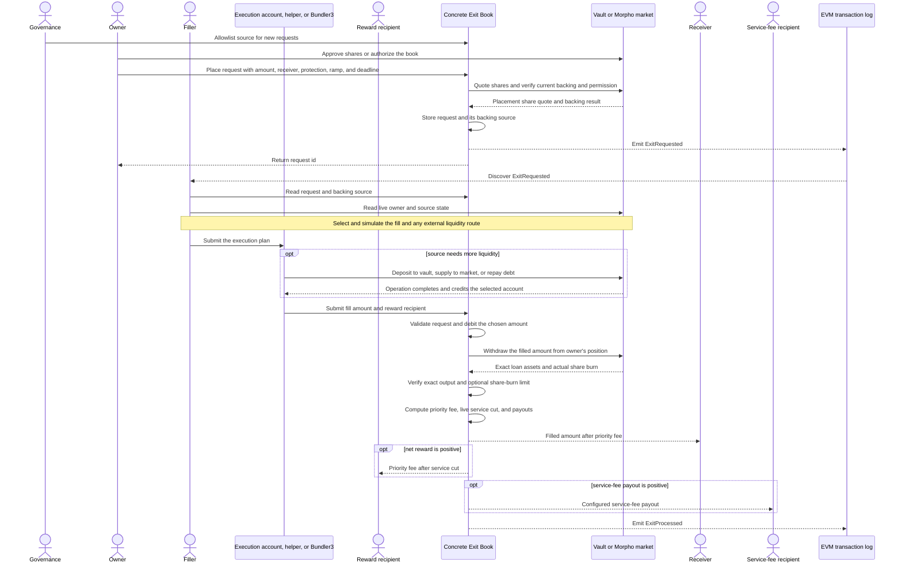
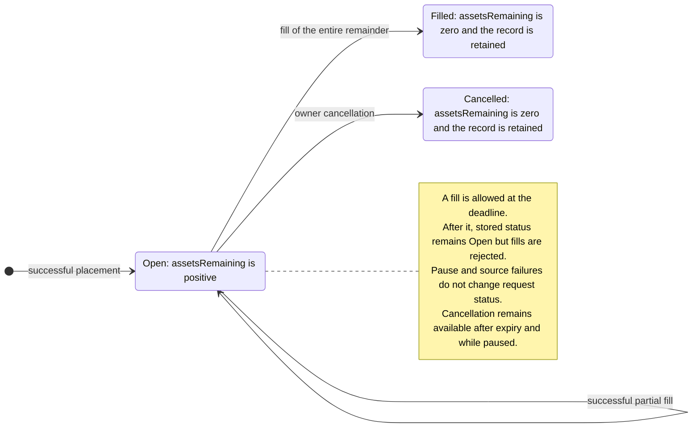

# Exit Books

## What problem Exit Books solve

An Exit Book operates on a source: either an ERC-4626 vault or a Morpho market. A lender position in that source is recorded in vault shares or Morpho supply shares, which represent a claim on an underlying loan asset such as USDC. The lender can own enough shares for an exit while the source is temporarily unable to return all of the underlying asset because some of its liquidity is in use.

An Exit Book lets the lender publish an asset-denominated exit request without transferring the source shares into the book. Another party, called a filler, finds the request and executes it directly or through a helper. Each successful fill withdraws exactly the asset amount removed from the request. If the source lacks liquidity, a filler can first make liquidity available through a source-native operation and then fill the request. A helper contract can execute both steps atomically.

The lender chooses a receiver and a priority-fee schedule. The receiver gets the filled amount minus the priority fee. The filler directs the rest of that fee to a reward recipient, after a configured service-fee cut. The fee rises over time as a Dutch auction, so a request can become more attractive to fillers without letting a filler withdraw more than the requested asset amount.

Because source withdrawal always equals the request debit, appreciation stays with the lender. If the source shares become more valuable between placement and execution, the fill burns fewer shares; it does not turn that appreciation into an additional filler reward. An optional share-burn limit protects the lender in the opposite direction.

The book is a permissionless execution registry. It stores requests and validates fills, but it does not rank requests, choose fill amounts, or run a filler bot. The owner keeps the source position until a fill withdraws from it.

## Actors

| Actor | Responsibility |
| --- | --- |
| Request owner, or lender | Owns the source shares, authorizes the book, creates the request, and may cancel it |
| Receiver | Receives the filled amount after the priority fee and may differ from the owner |
| Filler | Finds and prices requests, prepares source liquidity when needed, and submits a fill directly or through a helper |
| Executor | Calls the book. It may be the filler itself, a helper contract, or `Bundler3` |
| Reward recipient | Receives the filler's net priority-fee reward and may differ from the filler |
| Service-fee recipient | Receives the configured share of the priority fee |
| Governance roles | Allowlist sources, configure the service fee, pause or resume the books, and recover assets held by a book. Recovery is intended for accidental or unrelated balances |

The owner, receiver, executor, and reward recipient are independent addresses. The owner may fill its own request. A helper contract is the executor when it calls the book, while `rewardRecipient` can still direct the liquid reward to the filler, its treasury, or another account. Any position created while preparing liquidity belongs to the account chosen by that external operation; the Exit Book neither creates nor assigns it.

## Contracts and supported sources

The Exit Book layer has one shared implementation and two concrete books:

| Contract | Responsibility |
| --- | --- |
| `ExitBookBase` | Stores the common request registry and implements lifecycle, fill accounting, the fee auction, payouts, pause, and shared roles |
| `Erc4626ExitBook` | Connects requests to allowlisted ERC-4626 vaults |
| `MorphoExitBook` | Connects requests to allowlisted markets on one immutable Morpho deployment |
| `ExitBookLib` | Implements the append-only registry operations used by `ExitBookBase` |

Each deployed book has its own request-id sequence. A request id is meaningful only together with the book address. The concrete book stores the backing source separately for every request: `vaultOf(id)` for ERC-4626 and `marketParamsOf(id)` for Morpho.

The common request record stores the source's loan asset, but not the vault or Morpho market. The loan asset is the ERC-20 received from the source and split among the payout recipients. Source shares are the owner's position units burned by the source withdrawal.

## End-to-end flow

At fill time, the filler chooses how much of the request to close and the address that should receive its reward. The source withdrawal is not a separate choice: it is always the exact amount removed from the request. Preparing source liquidity, including all capital and slippage limits, is an external execution decision rather than an Exit Book rule.



## Request model

The stored record is the following Solidity structure. The concrete source is kept in a separate per-id mapping.

```solidity
enum ExitStatus {
    NotCreated,
    Open,
    Filled,
    Cancelled
}

struct Request {
    address owner;
    uint40 createdAt;
    uint40 deadline;
    address receiver;
    ExitStatus status;
    IERC20 asset;
    uint128 assetsRemaining;
    uint128 assetsTotal;
    uint128 minFillAssets;
    uint128 maxShareBurn;
    uint96 startRate;
    uint96 endRate;
    uint32 rampStart;
    uint32 rampEnd;
}
```

The fields encode the request amount, optional protection, fee schedule, and lifecycle:

- `assetsTotal` is the original request amount. `assetsRemaining` is reduced by successful fills.
- `minFillAssets` prevents uneconomically small partial fills. A fill of the entire remaining amount is always allowed, even when it is below the minimum.
- `maxShareBurn` is an optional owner protection against excessive live share burn. Zero disables it.
- `startRate`, `endRate`, `rampStart`, and `rampEnd` define the priority-fee Dutch auction.
- `createdAt`, `deadline`, and `status` define the request lifecycle.

The integer widths shown in the structure are storage bounds. Inputs that do not fit their stored type revert during placement. `minFillAssets` is first capped at `assetsTotal`, so an oversized input is safe when the capped value fits. Setting `minFillAssets` to `assetsTotal` makes the request full-fill-only.

### Lifecycle

`NotCreated` is the zero-value sentinel returned for an unknown id; requests never transition to it. Stored requests start as `Open` and finish as either `Filled` or `Cancelled`:



Expiry is derived rather than stored. A fill is allowed at `block.timestamp == deadline` and rejected after that timestamp, while the stored status remains `Open`. The owner may cancel an open request before or after expiry and while the book is paused. Cancellation moves no assets.

Ids begin at one, increase monotonically within one deployed book, and are never reused. Reading an unknown id returns a zeroed structure with `status == NotCreated`.

## Placing a request

The two concrete books expose source-specific placement functions:

```solidity
function placeExitRequest(
    IERC4626 vault,
    uint256 assets,
    address receiver,
    uint256 minFillAssets,
    uint256 maxShareBurn,
    PriorityRamp calldata ramp,
    uint256 deadline
) external returns (uint256 id); // Erc4626ExitBook

function placeExitRequest(
    Id marketId,
    uint256 assets,
    address receiver,
    uint256 minFillAssets,
    uint256 maxShareBurn,
    PriorityRamp calldata ramp,
    uint256 deadline
) external returns (uint256 id); // MorphoExitBook
```

Both require an allowlisted source, non-zero `assets`, a non-zero receiver, a valid priority-fee schedule, and a future deadline. Placement also calculates how many source shares a full withdrawal of `assets` requires at that moment:

```text
ERC-4626 requiredShares = vault.previewWithdraw(assets)

Morpho requiredShares = toSharesUp(
    assets,
    expectedTotalSupplyAssets,
    expectedTotalSupplyShares
)

toSharesUp(assets, totalAssets, totalShares)
    = ceil(assets * (totalShares + 1e6) / (totalAssets + 1))
```

Morpho's `1e6` virtual shares and one virtual asset are part of every conversion. The expected totals include pending interest and pending fee shares.

For ERC-4626, the owner must currently hold at least `requiredShares` vault shares and must have approved the book to use at least that many shares. For Morpho, the owner must hold at least `requiredShares` supply shares and must have enabled the book through Morpho authorization.

These are placement-time checks, not reservations. The ERC-4626 allowance and the Morpho authorization remain normal external permissions: the owner can revoke them, another operation can consume shares or allowance, and the same position can back overlapping requests. A later fill therefore relies on the live position and permission again. Placement also reserves no source liquidity.

### Priority-fee and deadline rules

Placement accepts the following fee ramp:

```solidity
struct PriorityRamp {
    uint256 startRate;
    uint256 endRate;
    uint256 rampStart;
    uint256 rampEnd;
}
```

Rates are `1e18`-scaled fractions. `rampStart` and `rampEnd` are seconds from request creation. The request must satisfy:

```text
startRate <= endRate <= MAX_PRIORITY_FEE (10%)
rampStart <= rampEnd
block.timestamp < deadline <= block.timestamp + MAX_REQUEST_LIFETIME
block.timestamp + rampEnd <= deadline
```

Equal ramp offsets create an instantaneous jump from `startRate` to `endRate` at that offset.

### Enabling share-burn protection

At placement, `requiredShares` is the current share cost of a full exit. It is used immediately for placement validation and is neither stored nor emitted. An owner that wants downside protection supplies `maxShareBurn`, the nominal full-request share budget from which each fill's rounded-up share limit is derived:

```text
maxShareBurn == 0            protection is disabled
maxShareBurn >= requiredShares  protection is enabled
```

A non-zero value below `requiredShares` is rejected because the full-fill protection limit would already be below the book's own placement estimate. For example, if the full withdrawal is quoted at 1,000 shares, a limit of 900 cannot cover that quote. Besides rejecting a request whose initial quote already violates its limit, this catches common share-unit mistakes, especially for Morpho supply shares.

The quote is only a placement snapshot. It neither reserves those shares nor controls how many shares a later fill burns. Live source state and `maxShareBurn`, when enabled, decide whether execution remains possible.

## Filling a request

After placement, offchain filler bots monitor `ExitRequested` events and reconcile them with the book's getters. A filler that finds an executable and profitable request calls:

```solidity
fillExitRequest(id, fillAssets, rewardRecipient)
```

The caller supplies:

| Value | Meaning |
| --- | --- |
| `fillAssets` | The exact amount removed from `assetsRemaining` and withdrawn from the owner's source position. It is also the basis of the priority fee |
| `rewardRecipient` | Non-zero address that receives the filler's net priority-fee reward |

The book enforces:

```text
0 < fillAssets <= assetsRemaining
fillAssets >= minFillAssets OR fillAssets == assetsRemaining
sourceWithdrawal = fillAssets
assetsRemainingAfter = assetsRemainingBefore - fillAssets
rewardRecipient != address(0)
```

The book records `msg.sender` as the executor even when `rewardRecipient` is different. This distinction lets a helper or `Bundler3` submit the fill without receiving the reward itself. The executor receives no payout merely for calling; the net filler reward goes entirely to `rewardRecipient`.

### Execution order

The book executes a fill in this order:

1. Require that the book is not paused and `rewardRecipient` is non-zero.
2. Require an existing, open, and unexpired request.
3. Validate `fillAssets` and the minimum-fill rule.
4. Reduce `assetsRemaining` by exactly `fillAssets` and mark the request `Filled` if the remainder becomes zero.
5. Withdraw exactly `fillAssets` from the owner's source position to the book. Measure the book's loan-asset balance immediately around the withdrawal and require an exact increase of `fillAssets`.
6. Check the actual source-reported share burn against the optional owner limit.
7. Transfer the receiver, reward-recipient, and service-fee payouts and emit `ExitProcessed`.

The request debit occurs before the withdrawal, following checks-effects-interactions. Measuring only the balance change caused by the source withdrawal prevents assets already held by the book from satisfying the exact output check.

## Preparing source liquidity

The Exit Book does not pull capital from the executor or decide how to make a source liquid. If the source can already withdraw `fillAssets`, the executor can call the book directly. Otherwise a helper contract can prepare liquidity and then call `fillExitRequest` in the same transaction. A successful fill can therefore be atomic with the liquidity operation without coupling the book to one route.

Common routes are:

| Route before the fill | Result |
| --- | --- |
| Deposit loan assets into the ERC-4626 vault | The deposit share recipient gets newly minted vault shares and the vault deploys the assets through its own strategy; `LidoLendERC4626` supplies them into its Morpho market |
| Supply loan assets directly to the Morpho market | The chosen `onBehalf` account gets Morpho supply shares; this can fund a direct request or a vault request backed by the same market |
| Repay a borrow in the Morpho market | The chosen borrower's debt falls and loan assets return to the market |

These routes have different economics. A deposit or supply creates a lender position, while a repayment reduces a borrower's debt. The helper decides whose position or debt changes and how the parties settle that value. It also owns all capital, approval, minimum-share, slippage, and profitability limits. None of those choices are inferred or enforced by the Exit Book.

A helper or a `Bundler3` transaction can sequence:

```text
source-native deposit, supply, or repay completes
-> fillExitRequest(id, fillAssets, rewardRecipient)
```

In the `Bundler3` case, adapter calls can prepare liquidity and the same transaction can then call the Exit Book directly; the fill does not require an Exit Book-specific adapter.

For all-or-nothing execution, a helper must propagate failures and every `Bundler3` call in the sequence must use `skipRevert = false`.

The resulting source position may belong to the filler, its helper, a treasury, or another address chosen by the liquidity operation. `rewardRecipient` independently chooses who receives the liquid priority-fee reward.

Morpho supply and repay callbacks are not a substitute for this sequence. The core invokes those callbacks before it pulls the supplied or repaid loan assets from the caller. A nested fill therefore cannot rely on those new tokens already being present. Complete the supply or repayment first, then call the Exit Book.

### Source withdrawals and controls

For `Erc4626ExitBook`, the book calls:

```solidity
vault.withdraw(fillAssets, address(book), owner)
```

For `MorphoExitBook`, it calls:

```solidity
MORPHO.withdraw(marketParams, fillAssets, 0, owner, address(book))
```

The source reports the actual owner shares burned, and the book independently measures the exact loan assets received. For ERC-4626 requests, `asset()` must remain the same token stored at placement.

The source remains authoritative for owner backing and permission, available liquidity, pause and hook policy, supply caps, vault limits, and token transfers. Preparing liquidity does not guarantee that the subsequent owner withdrawal will pass every source rule. In the Lido deployment, a controller pause makes both direct Morpho and vault operations revert; a market freeze still permits lender supply and withdrawal. See [architecture.md](architecture.md) for the controller and source controls.

## How the book limits share burn

Assets measure how much of the request is closed and paid. Shares measure how much of the owner's source position is consumed to obtain those assets. The book always withdraws exactly `fillAssets`, so appreciation changes the live share burn rather than increasing the source withdrawal.

When `maxShareBurn` is non-zero, each fill must satisfy:

```text
maxSharesForFill = ceil(maxShareBurn * fillAssets / assetsTotal)
sharesBurned <= maxSharesForFill
```

The limit scales the owner's nominal full-request share budget to the amount being filled and rounds that per-fill allowance up independently. Each fill therefore receives either the proportional floor or one additional raw share unit. With `assetsTotal = 3` and `maxShareBurn = 10`, three one-asset fills each get a limit of 4 share units; a single full fill gets a limit of 10.

> [!WARNING]
> Per-fill ceiling rounding is an accepted risk: `maxShareBurn` is not a strict cumulative cap for a split request. If `n` successful fills close the request, total burn is at most `maxShareBurn + n - 1` raw share units, or one extra unit per additional fill. Integrators must account for this allowance when setting exposure limits. A non-zero `minFillAssets` limits `n`; setting it to `assetsTotal` forces one fill and preserves a strict cap. The economic impact depends on the value of a raw share unit; low-resolution or unusually valuable share units require explicit allowlist review.

### What happens when the share price changes

- If shares appreciate, withdrawing the exact filled asset amount burns fewer shares. The unburned shares and all value they represent remain in the lender's source position.
- If shares lose value, the same asset withdrawal burns more shares. A request without `maxShareBurn` accepts that live cost; a protected request rejects a fill that exceeds its rounded-up per-fill limit.

For example, a lender starts with 1,000 shares worth 1 asset each and places a request for 100 assets. At execution, each share is worth 1.2 assets. Ignoring source rounding, an exact 100-asset withdrawal burns about 83.33 shares, not 100. With a 1% priority fee and no service fee, the receiver gets 99 assets, the reward recipient gets 1 asset, and the lender retains about 916.67 shares worth 1,100 assets. Assuming the receiver is the lender's account, the lender's total post-fill value is 1,199 assets: the only value paid for execution is the 1-asset priority fee. The 200 assets of appreciation were not transferred to the filler.

## Priority-fee auction and payouts

The owner uses a Dutch auction to make the request more attractive over time. The priority-fee rate starts at `startRate`, holds until `rampStart`, rises linearly, reaches `endRate` at `rampEnd`, and then remains there through the deadline:

```text
createdAt          createdAt + rampStart       createdAt + rampEnd          deadline
| startRate holds  | rate increases linearly   | endRate holds               |
```

For `elapsed = block.timestamp - createdAt`:

```text
priorityFeeRate = startRate   when elapsed < rampStart
priorityFeeRate = endRate     when elapsed >= rampEnd
priorityFeeRate = startRate
                + floor((endRate - startRate) * (elapsed - rampStart)
                        / (rampEnd - rampStart))   otherwise
```

When `rampStart == rampEnd`, the middle interval is empty and the rate jumps instantly. Both priority-fee rates are capped at 10%. The book's `serviceFee` and `feeRecipient` are read when the fill executes. The service fee is capped at 25% of the priority fee and must have a non-zero recipient when enabled. Either value can change after placement.

Rates use `WAD = 1e18` as the fixed-point denominator. Payments are:

```text
priorityFee    = floor(fillAssets * priorityFeeRate / WAD)
serviceCut     = floor(priorityFee * serviceFee / WAD)
receiverAssets = fillAssets - priorityFee
fillerReward   = priorityFee - serviceCut

receiverAssets + fillerReward + serviceCut = fillAssets
```

The priority fee is carved out of the filled request amount. `rewardRecipient` receives the entire net filler reward; the book does not split yield or any other source value into a separate payment.

### Fill after external liquidity preparation

Suppose the source can currently return 60 assets and a filler wants to close 100. A helper first supplies 40 loan assets directly to the same Morpho market for an account chosen by the filler. After that supply completes, the helper calls:

```text
fillAssets = 100
rewardRecipient = filler treasury
```

The supply and fill are one transaction, but the Exit Book knows nothing about the 40-asset supply or the Morpho shares it minted. The book only withdraws 100 assets from the lender. With a live priority-fee rate of 2% and a service fee of 25%, payments are:

```text
priorityFee = 2
serviceCut = 0.5
receiverAssets = 98
fillerReward = 1.5
```

The 98 receiver assets, 1.5 treasury reward, and 0.5 service cut sum to the exact 100-asset source withdrawal. The helper could instead have deposited through the vault or repaid debt; the fill accounting would be identical. Amounts are shown without token-unit rounding for readability.

## Operating a filler

The contracts do not select or execute requests automatically. A filler implementation needs to discover requests, build candidates from one coherent state snapshot, simulate them, and reconcile the result.

### Discover requests

Index `ExitRequested`, `ExitProcessed`, and `ExitCancelled`, then reconcile candidate ids with `getRequests(ids)` at a single block tag. A block tag is the exact block number or hash used for every read in one calculation. Using one prevents the inputs from silently describing different chain states. `getOwnerRequestIds` supports owner views, and scanning `[1, lastRequestId()]` in batches is a log-independent fallback.

For a cold start, read `MAX_REQUEST_LIFETIME()`, translate the cutoff timestamp to an earliest block, and search `ExitRequested` logs far enough back that no older request can remain fillable. Query in block ranges accepted by the RPC provider and include margins for block-boundary estimation, reorgs, and the chosen finality policy.

Resolve the source on the same book with `vaultOf(id)` or `marketParamsOf(id)`. Neither the common `Request` record nor `ExitRequested` contains it. Discard `NotCreated`, closed, expired, or paused requests.

At the same block tag, read:

| Source | Owner state | Source and execution state |
| --- | --- | --- |
| ERC-4626 | Vault-share balance and allowance to the book | `maxWithdraw(owner)`, vault and underlying-market controls, plus the state required by any chosen liquidity route |
| Morpho | Supply shares and book authorization | Expected totals, idle liquidity, market controls, plus the state required by any chosen liquidity route |

### Build a candidate

1. Choose `fillAssets` within the remainder and minimum-fill rule.
2. Determine whether the source can withdraw that amount. If it cannot, choose an external liquidity route and the account that should receive any position the route creates.
3. Estimate the share burn after the whole route. For ERC-4626, `previewWithdraw(fillAssets)` is a starting point, but a preceding vault deposit or direct market supply can change live state. Withdrawal fees and nonlinear vault rules can also make the preview insufficient. For Morpho, use `toSharesUp` with expected totals after any supply or repay, including pending interest and fee shares.
4. If `maxShareBurn` is enabled, compare the estimate with the fill's rounded-up limit defined above.
5. Apply the helper's own capital, approval, minimum-position, and slippage limits to every external operation.
6. Select a non-zero `rewardRecipient` controlled by the filler or its treasury.

Useful third-party backing filters are:

```text
ERC-4626 estimatedSharesBurned <= min(ownerShareBalance, ownerShareAllowanceToBook)
Morpho estimatedSharesBurned <= ownerSupplyShares
```

These are filters, not execution guarantees. The source operation and full-call simulation remain authoritative.

The Exit Book has no capital or slippage parameter because it performs no liquidity operation. A helper that supplies assets should check the returned or balance-delta shares against its own minimum. A helper that repays should bound the debt and assets affected. In either case, its capital budget should account for loan-asset balance, approvals, source headroom, and the value and liquidity of the resulting position.

### Price the candidate

Use the expected inclusion timestamp to calculate the priority-fee rate and payout formulas above. A practical profitability estimate includes:

```text
fillerReward
+ conservative value of any position or compensation created by the liquidity route
- capital spent by the route
- gas
- liquidity, share-price, and inclusion risk
```

For a self-fill, value the owner's net source position after the whole transaction rather than valuing a newly minted position in isolation. Stress the route at the helper's capital and slippage limits and the fee split at the highest live service fee the filler accepts. The Exit Book has no caller-provided minimum reward.

### Simulate, submit, and reconcile

Before submission:

1. Re-read the request and all owner, source, and execution-route state at one block tag.
2. Recalculate the amount constraints, expected burn, share protection, route effects, and payouts.
3. Check backing, permission, source controls, route-specific headroom, loan-asset balance, and approvals.
4. Simulate the complete transaction, ending with `fillExitRequest(id, fillAssets, rewardRecipient)`, from the actual executor address.
5. Submit only a successful and profitable simulation.

Requests may share owner backing, source liquidity, and filler capital. Simulate multi-request transactions in execution order and update all three budgets after every operation.

After inclusion, reconcile `ExitProcessed`:

```text
receiverAssets = filledAssets - fillerReward - serviceCut
```

The event also records `sharesBurned`, the live source-share cost of the exact withdrawal. Check it against the request's share-burn protection and the source withdrawal event. It cannot be reconstructed later from Exit Book state alone.

Event `filledAssets` must equal the submitted `fillAssets`; it is also the exact source withdrawal. The event identifies the `executor` and `rewardRecipient` separately. It does not report external liquidity operations, so those require source events, source state, or transaction tracing.

### Inclusion races

The simulation is only a snapshot. State may change before transaction inclusion:

| State change | Consequence |
| --- | --- |
| Another fill reduces the remainder below `fillAssets` | The request amount check fails |
| The owner cancels, the deadline passes, or governance pauses the book | The fill is no longer allowed |
| Source liquidity improves | A fixed external liquidity operation may commit more capital than the fill needs unless the helper adjusts it |
| Source liquidity worsens | The chosen route may no longer create enough liquidity for the withdrawal |
| Share price or source rounding changes | Actual share burn may exceed the owner protection limit |
| Backing, authorization, source policy, route headroom, or token approval changes | An external route or source withdrawal may fail |
| Governance changes the service fee | The live payout split changes, and no onchain minimum reward protects the filler |

## Governance, pause, and compatibility assumptions

The source allowlist gates only new placements. Delisting a source preserves its per-request metadata and does not block existing fills. The ERC-4626 allowlist rejects the zero vault. The Morpho allowlist requires an already-created market when enabling or disabling it and retains the market parameters for old requests.

Each deployed book has independent fee configuration, roles, and a pause flag. Pausing one book blocks its placements and fills, while cancellation, reads, configuration, recovery, and direct source access remain available. `pause()` and `resume()` are idempotent. Deadlines and priority-fee ramps continue advancing while paused.

Both books share one configured Risk Steward Committee as their sole initial `PAUSER_ROLE` holder. `RESUMER_ROLE` has no initial holder. Restoring a paused book therefore requires the Lido DAO Agent, as `DEFAULT_ADMIN_ROLE` holder, to grant a governance resumer before `resume()` can be called.

The supported loan asset transfers exact amounts and does not rebase. Neither the asset nor the source, including its hooks, may call back into or reenter the book during an operation. A malicious or non-conforming allowlisted source is outside the model.

The Morpho fee recipient must not own an open Morpho Exit Book request. Pending fee shares are not part of that account's stored position until accrual, so placement and offchain backing checks could otherwise understate its shares. The book does not enforce this restriction onchain. It is a continuing governance invariant rather than a one-time deployment check.

Exact role holders and privileges are documented in [roles.md](roles.md), deployment procedures in the [deployment runbook](../../script/DEPLOYMENT.md), and the complete callable surface in the generated [API reference](api/exit-book.md).
