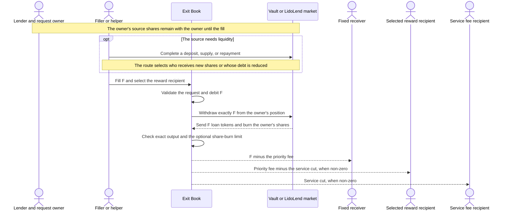

# Exit Books

In the standard deployment, a lender supplies loan tokens either to a `LidoLend` market or through a `LidoLendERC4626` vault. In return, the lender holds direct supply shares or vault shares. That market or vault is the request's **source**. When borrowers are using the available loan tokens, the lender may be unable to withdraw the desired amount immediately.

An Exit Book turns that withdrawal into a standing onchain offer. The lender states how many loan tokens they want to withdraw, where the proceeds must go, and how much of the withdrawal may be paid as a priority fee. The fee can rise over time to make a difficult exit more attractive to third parties.

Any account, including the lender, can act as a **filler** and choose when and how much of an open request to execute. If the source is already liquid, the filler can execute the request directly. Otherwise the filler may first add liquidity by depositing or supplying loan tokens, or by repaying debt. The filler decides whether the priority fee and the result of that preparation justify its capital, gas, and risk.

When a filler deposits or supplies its own tokens, the selected account receives new source shares while the original lender withdraws the filled amount. The priority fee compensates the filler for enabling the withdrawal and taking the route's cost and risk. A repayment route can instead reduce the selected borrower's debt.

The Exit Book records the offer and enforces each fill. It neither provides liquidity nor checks how the filler prepared it. Placing a request transfers no shares or loan tokens to the book, so the lender keeps the source shares until a fill. During a successful fill, the book asks the source to withdraw the chosen amount and the source burns the lender's shares. The book then splits the withdrawn tokens between the lender's fixed receiver, the filler-selected reward recipient, and the service-fee recipient.

## Books and participants

### Supported lender positions

The Exit Book layer uses two book contracts for two kinds of lender position:

| Book | Lender position | Source call made by a fill |
| --- | --- | --- |
| `Erc4626ExitBook` | Shares in a governance-allowlisted ERC-4626 vault | Withdraw exact loan assets from the vault |
| `MorphoExitBook` | Direct supply shares in an allowlisted market of the book's connected Morpho-compatible core | Withdraw exact loan assets from the market |

Both contracts inherit request accounting, fee distribution, pause, and cancellation logic from `ExitBookBase`; the abstract base is not deployed on its own.

The standard setup connects `MorphoExitBook` to `LidoLend` and uses `Erc4626ExitBook` for `LidoLendERC4626` vaults. The contracts do not verify those code identities: a Morpho book can be constructed with another compatible core, and governance can allowlist another compatible ERC-4626 vault. A Morpho book's core address is fixed at deployment; another core requires another book.

### Participants

The filler is the economic actor that selects and prices the fill. It may call the book directly or through a helper. The contract records its immediate caller as the **executor**, even when that caller is a helper acting for the filler.

The addresses involved in a request may differ:

- the **owner** is the lender who placed the request and owns the source shares; the owner may cancel it;
- the **receiver** is fixed by the owner and gets the filled amount after fees;
- the **reward recipient** is chosen for each fill and gets the priority fee after the service cut;
- the **service-fee recipient** gets the configured cut of that fee.

One address may perform several roles. Calling the book does not by itself entitle the executor to the reward; the fill names the reward recipient separately.

For a successful fill of `F` loan tokens, the value flow is:



## Request lifecycle

A request records the owner, receiver, loan token, original and remaining amounts, minimum partial fill, optional share-burn protection, fee ramp, and deadline. It starts `Open`. A partial fill keeps it open; filling the remainder marks it `Filled`; owner cancellation marks it `Cancelled`. The two final states are terminal, and requests are never deleted.

Expiry is not a stored state. A request remains `Open` after its deadline but can no longer be filled. A fill is allowed at the deadline itself. The owner may still cancel after expiry or while the book is paused, and cancellation moves no assets.

Placement and cancellation are non-custodial. Placement checks the owner's current position and permission, but it does not reserve shares, allowance, authorization, or source liquidity. The same position can therefore back several requests, and later owner actions can make any of them unfillable.

## Placement and backing

New requests require an allowlisted source, a positive asset amount, a non-zero receiver, and a future deadline within the maximum request lifetime fixed when the book is deployed. The ramp offsets are seconds from creation. A valid fee ramp satisfies `startRate <= endRate <= 10%` and `rampStart <= rampEnd`, and it must finish by the deadline. `minFillAssets` is capped at the request amount; setting it to the full amount makes the request full-fill-only.

Placement computes the current source-share cost of withdrawing the full requested amount:

```text
ERC-4626 quote = vault.previewWithdraw(assets)

Morpho quote = ceil(assets * (expectedTotalSupplyShares + 1e6)
                           / (expectedTotalSupplyAssets + 1))
```

The Morpho quote uses the supply totals that would exist after accruing pending interest and minting the resulting fee shares. Asset values in the formula are raw loan-token units, and share values are raw Morpho supply-share units. The formula's virtual offsets are one raw loan-token unit and `1e6` raw supply-share units.

The owner must currently satisfy the corresponding backing check:

- for ERC-4626, the owner needs at least the quoted vault shares and the same amount of allowance to the book;
- for Morpho, the owner needs at least the quoted supply shares and must authorize the book on the core. This authorization covers all of the owner's positions in that core, not one market. Revoking it blocks every open request that owner placed in the Morpho book.

The quote is a placement snapshot, not a reservation or an execution price. A later fill uses the live source state.

## Share-burn protection

The owner may limit how many source shares a fill can burn. This protects the owner if withdrawing the same asset amount later costs more shares than it did when the request was placed. `maxShareBurn = M` states the limit for the full request; zero disables the protection, and a non-zero value must cover the placement quote.

For a request with original amount `A`, a fill of `F` assets may burn at most:

```text
fillShareLimit = ceil(M * F / A)
reportedSharesBurned <= fillShareLimit
```

The ceiling matches sources that round the share cost of an exact-asset withdrawal up. At fixed source withdrawal rules, a higher asset value per share can reduce the actual burn and a lower value can increase it. Source-native withdrawal fees and nonlinear conversion rules remain part of the live burn.

A fill is rejected if the source reports a share burn above its limit.

> [!WARNING]
> **Per-fill rounding is not a cumulative cap.** If `n` fills close a request, their total permitted burn can reach `M + n - 1` raw share units. For example, with `A = 3` and `M = 10`, three one-asset fills each receive a limit of 4 and may burn 12 in total. For positive `minFillAssets = m`, `n` is at most `ceil(A / m)`; setting `m = A` forces one fill and makes `M` a strict total cap. Source allowlisting must account for this allowance when one raw source-share unit has material value.

Exact-asset withdrawal keeps source appreciation out of the filler reward: appreciation normally leaves more shares in the owner's position instead of increasing the asset amount withdrawn. The priority fee is always calculated from `F`, not from the value of the burned shares.

## Fill state machine

A fill chooses an exact asset amount `F` and a non-zero reward recipient. It must satisfy:

```text
0 < F <= assetsRemaining
F >= minFillAssets OR F == assetsRemaining
```

The second condition lets the final remainder close even when it is below the minimum partial fill. The book never reduces `F` to fit live liquidity or backing.

The fill executes in this order:

1. Check pause, request status, deadline, reward recipient, and fill amount.
2. Subtract `F` from the remaining request and mark it `Filled` when the remainder reaches zero.
3. Ask the source to withdraw exactly `F` from the owner's position to the book.
4. Measure the book's loan-asset balance change and require it to equal `F`; separately read the source-reported share burn and apply the optional limit.
5. Split `F` among the receiver, reward recipient, and service-fee recipient, then emit `ExitProcessed`.

Measuring the balance change means that only tokens received from this withdrawal satisfy the exact-output check. Tokens already held by the book do not count.

The source calls are:

| Book | Exact-asset withdrawal |
| --- | --- |
| ERC-4626 | `vault.withdraw(F, book, owner)` |
| Morpho | `core.withdraw(marketParams, F, 0, owner, book)` |

A fill does not bypass the source's own rules. At execution, the owner must still have enough shares and permission, and the source must be able to withdraw the exact amount. These checks are separate from the book's pause. For a Lido market, a controller pause blocks the withdrawal but not request placement; a market freeze does not block lender withdrawals. See [Architecture](architecture.md) for the shared control layers.

## Priority fee and payouts

With `WAD = 1e18`, the request's live priority-fee rate for `elapsed = block.timestamp - createdAt` is:

```text
rate = startRate                                      if elapsed < rampStart
rate = endRate                                        if elapsed >= rampEnd
rate = startRate
     + floor((endRate - startRate) * (elapsed - rampStart)
             / (rampEnd - rampStart))                 otherwise
```

When `rampStart == rampEnd`, the middle branch is unreachable and `endRate` applies from that offset.

At fill time, the book reads the current governance-configured service fee and recipient; the request does not lock them. The service fee is capped at 25% of the priority fee:

```text
priorityFee    = floor(F * rate / WAD)
serviceCut     = floor(priorityFee * serviceFee / WAD)
receiverAssets = F - priorityFee
fillerReward   = priorityFee - serviceCut

receiverAssets + fillerReward + serviceCut = F
```

Each fill uses its own amount, execution timestamp, and live service-fee configuration, so partial fills of one request can use different priority rates and payout splits. The fill call has no minimum-reward parameter.

## Preparing source liquidity

If the source withdrawal is already executable, the book can be filled directly. Otherwise a helper can first perform a source-native operation and then call the book in the same transaction. Common routes for the Lido vault and Morpho market are:

| Operation before fill | External result |
| --- | --- |
| Deposit loan assets into the vault | Mints vault shares to the selected recipient and increases assets managed by the vault |
| Supply loan assets to the Morpho market | Mints supply shares to the selected account |
| Repay Morpho debt | Reduces the selected borrower's debt and returns loan assets to the market |

Liquidity preparation is separate from the Exit Book request. The helper chooses who receives any new position and must enforce its own capital and slippage limits. It also chooses the fill's reward recipient separately.

Do not leave a new position or token balance in a public `Bundler3` or a shared adapter. Any user can submit a bundle that spends assets held by those contracts. Send new positions directly to an address controlled by the filler, and move any residual token balance out in the same transaction.

In a `Bundler3` bundle, every required preparation call and the fill use `skipRevert = false`. If the bundle skips a failed fill, earlier preparation can remain committed.

Morpho supply and repay callbacks run before the core receives the incoming loan tokens. A fill called from either callback cannot use those tokens; the supply or repayment must finish first.

## Filler workflow

A production filler needs to discover requests, evaluate each candidate against one coherent chain snapshot, simulate the complete execution route, and reconcile included transactions.

### Discovery and snapshot

Use one block number or hash for every state read used to evaluate a candidate. Index `ExitRequested`, `ExitProcessed`, and `ExitCancelled`, then reread candidate requests with `getRequests(ids)`. `getOwnerRequestIds` supports owner-specific discovery; scanning `[1, lastRequestId()]` in batches is a log-independent fallback.

Request ids are local to each deployed book, so tooling identifies a request by both the book address and its id. Neither the common request record nor `ExitRequested` identifies the source. Resolve it on the same book with `vaultOf(id)` or `marketParamsOf(id)`.

An initial event index only needs requests that can still be filled. Use `MAX_REQUEST_LIFETIME()` to derive the earliest relevant timestamp, map it to a block, and include margins for timestamp estimation, reorgs, and the filler's finality policy.

Ignore unknown, filled, cancelled, and expired requests; no request is executable while its book is paused.

For the standard `LidoLend` and `LidoLendERC4626` sources, read the owner and source state:

| Source | Owner state | Source and route state |
| --- | --- | --- |
| ERC-4626 | Vault-share balance and allowance to the book | `maxWithdraw(owner)`, `previewWithdraw`, source controls, and any state used by the selected liquidity route |
| Morpho | Supply shares and `core.isAuthorized(owner, book)` | `accountingFreeLiquidity = max(expectedTotalSupplyAssets - expectedTotalBorrowAssets, 0)`, core loan-token balance, controller pause, supply-cap state for a supply route, and borrower debt and [borrow-share-rate guard](market-controller.md#borrow-share-rate-transition-guard) state for a repay route |

Without liquidity preparation, an ERC-4626 fill must fit `maxWithdraw(owner)`. A Morpho fill must fit both `accountingFreeLiquidity` and the core's loan-token balance. These are candidate filters, not reservations; all source and controller checks still execute at inclusion.

### Candidate construction and pricing

For each candidate:

1. Choose `fillAssets` within the live remainder and the [minimum-fill rule](#fill-state-machine).
2. Determine whether the source can withdraw that amount. If not, select a [liquidity-preparation route](#preparing-source-liquidity) and the account that receives any position it creates.
3. Estimate the share burn against the state produced by the complete route. For ERC-4626, evaluate `previewWithdraw(fillAssets)` after the preceding route operations. For Morpho, use the expected post-route totals, including pending interest and fee shares.
4. Compare the estimate with the request's [per-fill share limit](#share-burn-protection), when enabled.
5. Apply the helper's balance, approval, capital, and slippage limits to every preparation operation. A supply route must bound assets spent per position share received. A Morpho repay must fix either loan assets or borrow shares and cap assets paid per share burned.
6. Compute the gross-reward floor as `floor(fillAssets * currentRate / WAD)` and price the service cut at its 25% cap. Tighter timestamp or service-fee bounds require an atomic helper check before the fill. Select a non-zero reward recipient controlled by the filler or its treasury.

Useful backing filters are:

```text
ERC-4626 estimatedSharesBurned <= min(ownerShareBalance, ownerShareAllowanceToBook)
Morpho estimatedSharesBurned <= projectedOwnerSupplySharesAfterAccrualAndRoute
       AND core.isAuthorized(owner, book)
```

If the owner is the core's current fee recipient, projected shares include fee shares minted by the first interest-accruing call in the route. For a direct fill, that call is the withdrawal. The pre-route stored position omits those pending fee shares.

For a third-party filler that neither owns the request nor receives its proceeds, express every term in the same valuation unit:

```text
expectedProfit = fillerReward
               + fillerValue(routeResult)
               - routeInputCapital
               - gas
```

`fillerValue(routeResult)` includes only value that accrues to the filler, such as owned shares or its own debt reduction. If the filler also owns the request or receives its proceeds, do not use this shortcut; value the change in all of its token balances and source positions over the complete transaction. Reject a candidate below the filler's required risk-adjusted return.

### Simulation, submission, and reconciliation

Before submission, refresh the request, owner, source, fee, and route state at one block tag. Simulate the complete top-level transaction from the real submitter, preserving the caller of each route operation, including the final `fillExitRequest`. The book records its immediate caller as the executor: a direct call from `Bundler3` records `Bundler3`, while a helper-mediated call records the helper. Submit only if the simulation succeeds and satisfies the filler's profitability and execution limits.

Requests can share owner backing, source liquidity, and filler capital. A multi-request transaction must simulate in execution order and update all three budgets after each operation.

State can change before inclusion:

| Change | Consequence |
| --- | --- |
| Another fill, cancellation, expiry, or book pause | The requested fill may no longer be valid |
| Less source liquidity or route capacity | Preparation or source withdrawal may fail |
| More source liquidity | A fixed preparation operation may commit unnecessary capital |
| Source pause or withdrawal-policy change | The source withdrawal may fail |
| Share price, source rounding, backing, authorization, or approvals | The source withdrawal or share-burn limit may fail |
| Priority-fee time or service fee | The payout and profitability change |

After inclusion, reconcile `ExitProcessed`. It records the executor, reward recipient, loan asset, exact filled assets, source-reported shares burned, filler reward, and service cut. Apply canonical lifecycle events to the local index and reread affected requests before pricing them again. Treat the result as provisional until the chosen finality threshold; after a reorg, roll back the affected event range and replay it. Derive the receiver amount as:

```text
receiverAssets = filledAssets - fillerReward - serviceCut
```

Compare the recorded share burn with the request's per-fill limit and the source withdrawal event. It cannot be reconstructed later from Exit Book state alone. External liquidity preparation is also outside the event, so reconcile it from source events, source state, or the transaction trace.

## Allowlisting, pause, and source trust

Allowlisting gates only new requests. Removing a vault or market from the allowlist does not alter the stored source or block fills of existing requests.

Each book has an independent pause flag. Pause blocks placement and fills, but not cancellation, reads, configuration, asset recovery, or direct source access. Deadlines and fee ramps continue advancing while paused. Pause has no automatic expiry; only a `RESUMER_ROLE` holder can clear it. [Roles](roles.md) documents the initial holder policy enforced by the production deployment scripts and the governance recovery path.

> [!WARNING]
> **The allowlist is a source trust boundary.** An allowed source must satisfy four assumptions:
>
> - it reports the shares it actually burns;
> - its loan token transfers exact amounts without fees or rebasing;
> - neither the source nor the token calls back into the book during a withdrawal;
> - an ERC-4626 vault keeps the same `asset()` after a request is placed.
>
> Otherwise the book can apply the wrong burn limit or payout, or allow a nested fill.

The generated [API reference](api/exit-book.md) contains the complete callable surface, errors, events, and stored fields. Deployment procedures are in the [deployment runbook](../../script/DEPLOYMENT.md).
