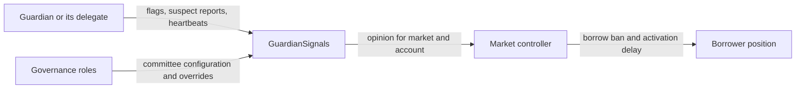
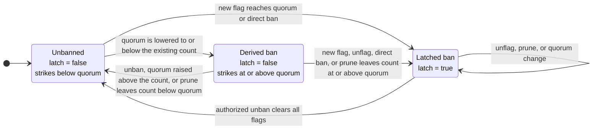

# Guardian Signals

`GuardianSignals` lets a committee add human or automated judgement to rules that the lending core cannot derive from balances alone. Its primary case is a compromised account preparing to borrow against collateral: the core can prove that the position is solvent, but it cannot tell whether the account or collateral is legitimate.

Guardians therefore publish two kinds of market-scoped opinion:

- a **flag** is a strike; enough distinct flags ban the account from borrowing;
- a **suspect report** is a weaker signal; it can lengthen collateral activation but cannot ban an account.

Guardians also publish **heartbeats** describing how far they have scanned the chain. The stored **quorum frontier** is the highest timestamp the registry has accepted from a quorum calculation. It can only increase, so it may differ from a frontier recalculated from the current committee. A controller uses the stored value to avoid maturing collateral before enough guardians have had an opportunity to inspect it.

The registry does not call the lending core or move user assets. A market controller reads it and enforces the opinion. See [Market controller](market-controller.md) for the activation and borrow rules, the [GuardianSignals API](api/guardian-signals.md) for the contract surface, and [Actors and roles](roles.md) for the authority assigned to committee-management and override roles.

## Place in the market

One registry represents one guardian committee. It may serve several markets because account signals are stored by `(marketId, account)`. The following configuration and liveness state are instead shared by every market using that registry:

- guardian membership and delegates;
- quorum;
- suspect window;
- guardian heartbeats;
- the quorum frontier.

A market needing a different committee, quorum, suspect window, or operational boundary uses a separate registry. The registry does not validate whether a supplied market id exists; only the controller bound to a real market gives that id operational meaning.



### What the controller reads

The controller obtains the account state in one call:

```solidity
getOpinion(marketId, account) -> GuardiansOpinion({
    banned,
    strikeCount,
    suspectCount,
    suspectExpiryTimestamp,
    quorumFrontierTimestamp
})
```

It consumes the fields as follows:

- `banned` is the effective ban, including both a persistent stored ban (the **latch**) and a flag count at or above the current quorum;
- `strikeCount` adds `strikeCount * delayPerStrike` to the account's collateral-activation delay;
- `suspectCount` adds `suspectCount * delayPerSuspect` to an activating collateral lot whose shared start time is before `suspectExpiryTimestamp`;
- `quorumFrontierTimestamp` is the stored monotonic frontier used by the activation gate.

For a borrow, the controller checks the caller, debt owner, and receiver for a ban. The debt owner's full opinion also feeds collateral activation. A ban blocks new borrowing and prevents the banned account's activating collateral from maturing; it does not seize assets or stop repayment and exit paths.

## Guardian identity and delegates

A guardian is one address in the registry's committee set. Each guardian may appoint one delegate, normally a separate operational signing key, with `setDelegate`. Only the guardian address can set or clear its own delegate.

Every signalling or heartbeat call names an `onBehalf` guardian. The caller must be either that guardian or its current delegate, and `onBehalf` must still belong to the committee. The registry stores the result under the guardian address, not the raw caller. Consequently:

- a guardian and its delegate cannot cast two votes;
- replacing a delegate preserves the guardian's flags, suspect reports, and heartbeat;
- rotating or clearing a delegate does not erase the guardian's recorded opinion;
- no caller can act on behalf of an address while that address is outside the guardian set.

A delegate has the guardian's full signalling and heartbeat authority while appointed. A compromised delegate can therefore add or retract that guardian's signals and publish heartbeats until the guardian replaces or clears it.

Repeated `flag` calls by the same guardian do not change state for that account. Repeating `suspect` refreshes that guardian's report time and creates a new aggregate suspect snapshot.

## Flags, strikes, and bans

Each distinct guardian flag on `(marketId, account)` contributes one strike. The registry's current quorum determines the effective status:

```text
effective ban = latched ban || strike count >= current quorum
```

The distinction between an **effective** ban and a **latched** ban matters when governance changes the quorum.

- A new flag that reaches quorum writes the latch immediately.
- A direct `ban` override writes the latch immediately without adding guardian flags.
- Lowering the quorum can make existing flags sufficient without writing the latch. This is a derived ban.
- Raising the quorum can lift a derived ban, but never a latched one.
- `unflag` first latches any ban already effective at the old strike count, then removes the guardian's flag. A guardian therefore cannot retract a flag to lift an effective ban.
- `unban` is the only operation that clears a latched ban. It also clears every guardian flag on the account, so the committee starts the flag decision again. It does not clear suspect reports.



### Quorum changes

The quorum must be non-zero and no greater than the current guardian count. Changing it does not scan accounts or write their ban latches; effective status is evaluated when an account is read.

This makes two boundary cases explicit:

- lowering the quorum can create a derived ban immediately;
- raising it can lift only a derived ban that no intervening action latched.

An account whose flag count meets the new lower quorum becomes latched on a later new flag, on `unflag` before the flag is removed, or on `prune` when the flags surviving that prune still meet quorum.

## Suspect reports

A suspect report is an activation-delay signal, not a ban. Each guardian has at most one raw report on an account, recorded with that guardian's latest report timestamp. The registry turns these raw reports into an aggregate snapshot so a controller can read one count and one expiry without iterating the committee.

The stored snapshot is:

```text
suspectCount            = reports still inside the suspect window at snapshot time
suspectReportedAt       = latest report timestamp among those active reports
suspectExpiryTimestamp  = suspectReportedAt + current suspectWindow
```

A raw report is active at the boundary: it counts while `reportedAt + suspectWindow >= block.timestamp` and is expired only after that sum is smaller than the current time.

The controller applies `suspectCount * delayPerSuspect` to a collateral lot when:

```text
activatingStart < suspectExpiryTimestamp
```

The comparison is against the lot's start, not the time at which the controller reads the opinion. A snapshot marks which activation lots receive its surcharge; the passage of wall-clock time does not remove that surcharge from a lot whose start already falls before the snapshot expiry.

### When the snapshot changes

Snapshot-producing actions recount the reports that are still active under the current suspect window. The snapshot keeps the latest report timestamp among those survivors; it does not use the time of the retraction or prune:

| Action | Raw-report update | Snapshot update |
|---|---|---|
| `suspect` | Prune raw reports whose individual window has elapsed, then add or refresh the named guardian at `block.timestamp` | Recount active raw reports; the new report is latest, so `suspectReportedAt = block.timestamp` |
| successful `unsuspect` | Prune individually expired reports, then remove the named guardian's live report | Recount active survivors and set `suspectReportedAt` to their latest stored report time |
| `prune` removes a departed guardian's suspect report | Remove every report on the account whose guardian is no longer in the committee | If at least one was removed, recount active survivors and set `suspectReportedAt` to their latest stored report time |
| read through `getOpinion` | No raw-report scan | Return the stored count and `suspectReportedAt + current suspectWindow` |

If `unsuspect` finds no report for the named guardian after its preliminary expired-report cleanup, it does not create a new snapshot or emit a clearance. That cleanup may still have removed expired raw reports belonging to any guardian.

A new or refreshed suspect report becomes the latest report and moves the aggregate expiry to its own timestamp plus the window. Older active reports included in that snapshot therefore share the newer expiry. Retraction and pruning do not refresh the surviving reports: with the window unchanged, they restore the common expiry to the latest stored timestamp among the reports that remain, and may shorten it when the latest report is removed.

Changing `suspectWindow` changes the computed expiry of every stored snapshot immediately because reads add the current window to the stored `suspectReportedAt`. It does not recompute the stored `suspectCount`; the next snapshot-producing action recounts raw reports under the new window.

### Example

Assume a one-hour suspect window:

1. Guardian A reports at `10:00`. The snapshot is `{count: 1, reportedAt: 10:00, expiry: 11:00}`.
2. Guardian B reports at `10:30`. A is still individually fresh, so the new snapshot is `{count: 2, reportedAt: 10:30, expiry: 11:30}`.
3. B retracts at `10:45`. A is still fresh at the recount. The resulting snapshot is `{count: 1, reportedAt: 10:00, expiry: 11:00}`.

B's report temporarily moved the aggregate horizon applied to both reports to `11:30`. Retracting B does not refresh A; it restores A's original `11:00` horizon. An activation lot started before `11:00` receives the remaining one-report surcharge.

## Guardian removal and permissionless pruning

Removing a guardian updates the bounded committee set immediately. It also clears that guardian's delegate and heartbeat. Removal does not iterate every market and account, so it does not delete the guardian's existing flags and suspect reports. Permissionless `prune(marketId, account)` is the direct membership-cleanup path for each affected pair. An `unban` can instead clear stale flags, while a later `suspect` or `unsuspect` call can remove raw suspect reports that have expired by then.

Before any per-account cleanup:

- a removed guardian's stored flag still contributes to `strikeCount` and effective ban evaluation;
- a removed guardian can remain represented in the stored suspect snapshot;
- while the removed guardian remains outside the committee, no caller can add, retract, or refresh signals on its behalf. Its former delegate may still act under a different current guardian identity if separately authorized.

For flags, `prune` first removes every flag whose guardian is no longer in the committee. It then handles the resulting status:

- a latched ban stays latched regardless of the surviving count;
- an unlatched account whose surviving flags still meet quorum becomes latched;
- a ban derived only from a lowered quorum lapses if pruning drops the surviving count below quorum.

For suspect reports, `prune` removes reports from departed guardians. If it removes at least one, it recounts active survivors and anchors the snapshot to their latest stored report time. With the window unchanged, pruning cannot extend the common expiry; removing the latest report can shorten it.

`replaceGuardian` performs removal and addition atomically, preserving committee size and quorum. The new guardian starts without a delegate or heartbeat. Replacement does not clear per-account signals belonging to the old guardian; they remain subject to the same per-account cleanup rules.

## Heartbeats and the quorum frontier

A heartbeat says how far one guardian reports having scanned the chain. It carries:

```solidity
BlockInfoWithHash({
    hash,
    number,
    timestamp
})
```

The guardian or its delegate submits the heartbeat on behalf of the guardian. The registry accepts it only when:

- `number` is not ahead of the current block;
- `hash` is non-zero and equals `blockhash(number)`;
- `timestamp` is not in the future;
- `timestamp` is not below that guardian's previous heartbeat timestamp.

Because the EVM returns a zero hash for the current block and for blocks outside its `blockhash` lookback, the non-zero hash rule also restricts usable proofs to blocks whose hashes the EVM can still retrieve.

The block number and hash prove that the named block is canonical within that lookup window. Only the guardian-reported timestamp is stored. The block number is retained in the event for off-chain consumers.

> [!WARNING]
> **Accepted guardian-timestamp trust.** The contract does not derive or verify the supplied timestamp against the block header. The future and regression checks bound each report, and quorum requires several guardian identities, but quorum does not prove that the reported timestamp belongs to the referenced block. A dishonest quorum can therefore advance the scan frontier without having scanned through that time.

### Frontier calculation

For the current guardian set, the candidate frontier is the quorum-th highest stored heartbeat timestamp: the greatest time that at least a quorum of guardians have all reported scanning past.

> **Example.** With five guardians, quorum three, and heartbeat timestamps `{100, 95, 90, 80, 70}`, the candidate frontier is `90`. At least three guardians have reported scanning through that time.

The stored frontier can only increase: recomputation writes a new value only when the candidate is greater. It never moves backward after a guardian removal, replacement, quorum change, or lower heartbeat. It therefore represents the highest frontier ever accepted, not necessarily the lower frontier calculated from the current committee after membership changes.

A heartbeat that can advance the stored frontier attempts the recomputation in the same call. Anyone may call `syncQuorumFrontier` to recompute it explicitly, including after membership or quorum changes for which that automatic recomputation is insufficient.

### How the controller uses the frontier

The frontier is one input to collateral maturation. A frozen market never matures a lot. When the market is not frozen and a lot's activation timer has elapsed, the controller allows it to mature when either:

- the stored quorum frontier has reached the lot's unlock time; or
- the fallback deadline `activatingStart + maxGuardiansQuorumDelay` has elapsed.

Both branches still require the lot's unlock time to have passed. Setting `maxGuardiansQuorumDelay` to zero removes the frontier wait, but not the activation timer itself.

> [!WARNING]
> **Accepted liveness trade-off.** After the configured fallback deadline, collateral may mature without any further frontier progress. Setting the fallback to zero removes the frontier wait entirely. This prevents guardian silence from locking ordinary collateral activation forever, but it weakens the scan requirement after the timeout. A ban still blocks maturation and borrowing.

The exact timer and fallback rules live in [Market controller](market-controller.md).

## Governance overrides

Three capabilities sit outside ordinary guardian signalling:

| Capability | Effect |
|---|---|
| committee manager | Add, replace, or remove guardians; set quorum and the registry-wide suspect window |
| access limiter | Directly latch a ban on any `(marketId, account)` without guardian quorum |
| access restorer | Clear the ban latch and all guardian flags for an account |

These powers do not move assets. Their holders, impact classes, and governance paths are specified in [Actors and roles](roles.md). A direct ban behaves like any other latched ban. A direct unban leaves suspect reports untouched, so their activation-delay effect may remain after borrowing access is restored.

## Security and liveness properties

- **One guardian, one signal.** A guardian and its delegate share the same identity. Each guardian contributes at most one flag and one suspect report to an account.
- **Quorum before ordinary ban.** No single ordinary flag bans unless the configured quorum is one. The direct access-limiter override is a separate privileged path.
- **A latched ban persists.** Guardian retractions, pruning, and quorum changes cannot lift a latched ban. Only the access-restorer path can do so.
- **Suspect never bans.** Suspect reports only feed the activation-delay count.
- **Frontier is monotonic.** Once accepted, a quorum frontier cannot be reduced through heartbeat or committee configuration.
- **Signals survive delegate rotation.** Replacing an operational signing key does not discard the guardian's opinion or heartbeat.
- **A delegate carries guardian authority.** Until rotated or cleared, it can add and retract that guardian's signals and submit its heartbeats.
- **Removal is not per-account cleanup.** Membership removal stops actions on behalf of that identity immediately but deliberately avoids an unbounded scan over stored accounts; permissionless `prune` provides targeted cleanup.
- **Guardian timestamps are trusted input.** Hash validation proves the block reference, while quorum and the no-future/no-regression checks bound—but do not independently attest—the reported scan timestamps.
- **Controller fallback provides scan liveness.** A market may allow activation after its configured fallback delay even when the guardian frontier stops advancing; bans continue to block maturation and borrowing.

## Related references

- [Architecture](architecture.md) for the registry's place in the market runtime.
- [Market controller](market-controller.md) for the policy that consumes guardian opinions and the quorum frontier.
- [Privileged roles](roles.md) for guardian-management and override authority.
- [GuardianSignals API](api/guardian-signals.md) for the contract surface.
