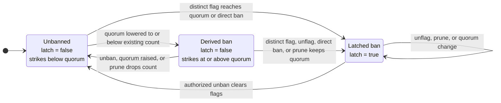

# Guardian Signals

`GuardianSignals` stores guardian reports that market controllers use to restrict borrowing and collateral activation. The registry does not call the lending core or move tokens.

Guardians publish three kinds of report:

- a **flag** adds one strike; enough distinct guardian identities ban the account;
- a **suspect report** can add activation delay but never bans; and
- a **heartbeat** reports how far the guardian says it has reviewed protocol activity.

The registry combines current heartbeat timestamps into a candidate **quorum frontier** and stores only forward progress. Controllers use the stored frontier when deciding whether collateral may become active.

## Registry scope

One registry represents one guardian committee and may serve several markets.

| State | Scope |
|---|---|
| Flags and suspect reports | One `(marketId, account)` |
| Guardian membership and delegates | Whole registry |
| Quorum and suspect window | Whole registry |
| Heartbeats and stored quorum frontier | Whole registry |

Because heartbeats are shared, guardians must review every market whose controller uses the registry. A market that needs an independent committee, configuration, or scan frontier uses a separate registry.

The registry stores account reports under `marketId` without a core address. Reusing one registry across different cores can therefore merge reports when their market ids match. Deployments should keep each registry within one core.

The current committee is capped at 32 guardians, which bounds recomputation over current heartbeats. The suspect window may be zero and cannot exceed 30 days. `GuardianSignals` does not validate market ids; it stores reports under the id supplied by the caller.

### Controller opinion

For one `(marketId, account)`, `getOpinion` returns the fields below. An **activating lot** is collateral waiting on one controller activation timer; its full lifecycle is specified in [Market Controller Policy](market-controller.md#collateral-activation).

| Field | Controller effect |
|---|---|
| `banned` | Blocks borrowing and prevents an activating lot from maturing |
| `strikeCount` | Adds `strikeCount * delayPerStrike` to the lot's activation delay |
| `suspectCount`, `suspectExpiryTimestamp` | Add `suspectCount * delayPerSuspect` when the lot started before the snapshot expiry |
| `quorumFrontierTimestamp` | Gates maturation after the activation delay has passed |

A borrow checks the caller, debt owner, and receiver for a ban. The debt owner's other opinion fields affect only collateral activation.

A ban does not directly gate repayment, liquidation, settlement, or a debt-free collateral withdrawal. It does prevent maturation. If an activation lock is still live, the unmatured collateral can therefore delay a debt-free withdrawal until the lock expires.

## Guardian identities and authority

A guardian is one address in the committee. It may appoint one delegate. Only the guardian can change that delegate directly; removing or replacing the guardian clears it. Signalling and heartbeat calls name an `onBehalf` guardian, and the caller must be that guardian or its current delegate.

Reports and heartbeats are stored under the guardian identity. Replacing a delegate therefore preserves the guardian's existing state. Each guardian identity contributes at most one flag and one suspect report per `(marketId, account)`.

Active delegate addresses are unique. `setDelegate` rejects a non-zero delegate that is a guardian or that any guardian currently uses, including the caller's own current delegate, so one signing address cannot represent two committee identities.

Membership changes enforce the same rule: `addGuardian` and `replaceGuardian` reject a new guardian that is currently some guardian's delegate. Replacing a guardian with its own delegate is allowed, because the removal clears the pairing before the new seat is added.

The committee manager changes membership, quorum, and the suspect window. Separate authorities can directly latch a ban or clear a ban and its flags. Exact role holders and governance paths are listed in [Privileged Roles](roles.md#guardiansignals).

## Flags, strikes, and bans

Each distinct guardian flag contributes one strike:

```text
effective ban = latched ban || strikeCount >= current quorum
```

A **latched ban** stays in force until an authorized unban. It is written when a new flag reaches quorum or when the access limiter bans the account directly.

A **derived ban** exists when the current flags meet a newly lowered quorum, but no latch has been written. Raising quorum can lift only this kind of ban.

A guardian cannot retract an account out of an effective ban. Before `unflag` removes anything, it writes the latch if the account is already banned. This also happens when the named guardian has no flag to remove.

Permissionless pruning removes flags left by former guardians. If the remaining flags still meet quorum, pruning writes the latch; otherwise an unlatched derived ban ends. Only the access restorer can clear a latch. It also clears every flag for the account, but leaves suspect reports unchanged.



Quorum must remain between one and the current guardian count. Changing it does not scan accounts or write ban latches. Lowering it can create derived bans; raising it can lift them. A later flag, `unflag`, or `prune` can turn a derived ban into a latched ban.

## Suspect reports

A suspect report can delay collateral activation, but cannot ban an account. Each guardian has at most one report per account.

The controller does not scan those reports. It reads a cached snapshot containing:

```text
suspectCount           = reports still active when the snapshot was rebuilt
suspectReportedAt      = latest timestamp among those reports
suspectExpiryTimestamp = suspectReportedAt + current suspectWindow
```

A report is still active when `reportedAt + suspectWindow == block.timestamp`; it expires after that point. The controller applies the snapshot to an activating lot when:

```text
activatingStart < suspectExpiryTimestamp
```

The lot's start time decides whether the extra delay applies. Once it applies, waiting for the report to expire does not shorten that lot's delay.

A zero suspect window does not disable reports: a report at time `t` can still affect a lot started before `t`. Setting the controller's `delayPerSuspect` to zero removes the added delay.

### Snapshot updates

| Action | What changes |
|---|---|
| `suspect` | Removes expired reports, adds or refreshes one report, and rebuilds the snapshot |
| `unsuspect` | Removes expired reports and the named live report, if any, then rebuilds from the survivors when anything was removed |
| `prune` removes a former guardian's report | Rebuilds from the remaining current guardians |
| `getOpinion` | Performs no cleanup; returns the cached count with an expiry calculated from the current window |

Refreshing one report can extend the snapshot expiry for every report counted with it. Removing the newest report can move the expiry back to the next-newest report; surviving reports keep their original timestamps.

Changing `suspectWindow` immediately changes the expiry returned from the cached `suspectReportedAt`, but does not recount the cached `suspectCount`. The next snapshot rebuild uses the new window.

### Example

With a one-hour window:

1. Guardian A reports at `10:00`: `{count: 1, expiry: 11:00}`.
2. Guardian B reports at `10:30`: A is still active, so the snapshot becomes `{count: 2, expiry: 11:30}`.
3. B retracts at `10:45`: A remains, and the snapshot returns to `{count: 1, expiry: 11:00}`.

B temporarily extends the shared expiry, but does not change A's report timestamp.

## Guardian removal and permissionless pruning

Removing a guardian revokes its authority immediately and clears its delegate and heartbeat. It cannot reduce the current committee below quorum. Removal does not scan all markets and accounts, so the guardian's flags and suspect reports remain stored. Flags continue to count until pruning or `unban`; suspect effects follow the cached-snapshot rules above.

Anyone may call `prune(marketId, account)` for an identified affected pair. There is no onchain list of all affected pairs, so operators must identify them from events or external indexing. Pruning removes signals authored by addresses outside the current committee; it never clears a latched ban.

Re-adding a former guardian before pruning does not start its per-account state from zero. Its old signals remain associated with that identity, and membership pruning no longer treats them as departed-guardian entries. `replaceGuardian` atomically preserves committee size and quorum. It clears the outgoing guardian's delegate and heartbeat, but does not clear per-account signals already stored under either address.

> [!WARNING]
> **The 32-guardian cap does not bound historical signal sets.** Repeated rotations can grow one account's stored flag or suspect set beyond 32. Pruning, suspect snapshot updates, and `unban` scan or clear the whole stored set, with no paginated cleanup. Enough unpruned history can make those calls exceed the block gas limit. Affected accounts should be pruned as guardians rotate.

## Heartbeats and the quorum frontier

Heartbeats let guardians report how far they have reviewed protocol activity. For current guardians, the live frontier candidate is the quorum-th highest stored heartbeat timestamp.

> **Example.** With five guardians, quorum three, and timestamps `{100, 95, 90, 80, 70}`, the candidate is `90`.

The registry stores the highest candidate ever recorded. This **stored quorum frontier** never moves backward after a guardian removal, replacement, quorum change, or lower live candidate.

### How the controller uses the frontier

The controller first calculates an activating lot's `unlockTime` from its start time, base delay, and current guardian surcharges. The lot can mature only when all of the following are true:

- the market is not frozen and the borrower is not banned;
- `block.timestamp >= unlockTime`; and
- the stored frontier has reached `unlockTime`, or the lot's fallback deadline has passed.

The fallback deadline is `activatingStart + maxGuardiansQuorumDelay`. Setting that delay to zero removes only the frontier wait.

> [!WARNING]
> **Accepted liveness trade-off.** The fallback prevents guardian silence from locking activation forever, but permits maturation without new scan evidence after the deadline.

`GuardianSignals` itself is not frozen or paused. Reports, configuration, and frontier progress continue while a controller is stopped. The next relevant controller hook reads the current registry state. The full activation state machine is in [Market Controller Policy](market-controller.md#collateral-activation).

### Frontier updates

A heartbeat recomputes the candidate only when that guardian moves from at or below the stored frontier to above it. Membership and quorum changes do not recompute it. Anyone may call `syncQuorumFrontier` to recompute explicitly; it raises the stored frontier only when the candidate is higher.

Lowering quorum raises or preserves the live candidate because fewer guardian identities are required. Raising quorum lowers or preserves it. Neither change recomputes the stored value. Removing or replacing a guardian clears that identity's heartbeat, but also leaves the stored frontier unchanged.

### Heartbeat validation

A heartbeat contains a block hash, block number, and guardian-supplied scan timestamp. The registry accepts it only when:

- the number is not in the future;
- the nonzero hash equals `blockhash(number)`;
- the timestamp is not in the future; and
- the timestamp is not below that guardian's currently stored heartbeat.

The EVM returns zero for the current block and for blocks outside the `blockhash` lookback window, so neither can provide an accepted proof. Number and hash authenticate the referenced block within that window; they do not authenticate the supplied timestamp. Only the timestamp is stored, while the block number remains in the event.

> [!WARNING]
> **Accepted guardian-timestamp trust.** The frontier uses the guardian-supplied timestamp without checking it against the block header. A party controlling the configured quorum of guardian identities can therefore advance the frontier without having scanned through that time. Quorum may be one, and delegate uniqueness separates only addresses: one operator may still hold the keys behind several identities.

## Related references

- [Architecture](architecture.md) for the registry's place in the market runtime.
- [Market controller](market-controller.md) for the policy that consumes guardian opinions and the quorum frontier.
- [Privileged roles](roles.md) for guardian-management and override authority.
- [GuardianSignals API](api/guardian-signals.md) for the contract surface.
