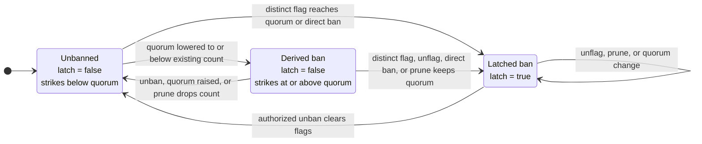

# Guardian Signals

`GuardianSignals` records guardian judgement that a market controller uses for account bans and collateral activation. The registry does not call the lending core or move assets; controllers read its state and enforce the result.

Guardians publish three signals:

- a **flag** adds one strike; enough distinct guardian identities ban the account;
- a **suspect report** can add collateral-activation delay but cannot ban; and
- a **heartbeat** reports how far a guardian has scanned the chain.

Account signals are market-scoped. Committee membership, quorum, suspect-window configuration, heartbeats, and the resulting **quorum frontier** belong to the registry as a whole.

## Place in the market

One registry represents one guardian committee and may serve several markets. Flags and suspect reports are stored by `(marketId, account)`, while every bound market shares:

- guardian membership and delegates;
- one quorum for both flags and heartbeats;
- one suspect window; and
- one set of heartbeats and one quorum frontier.

A heartbeat is not market-scoped. Its timestamp contributes to the frontier consumed by every controller bound to the registry, so the committee's scan coverage must include all of those markets. A market that needs an independent committee, configuration, or scan frontier uses a separate registry.

The current committee is capped at 32 guardians, which bounds frontier recomputation over current heartbeats. The suspect window may be zero and cannot exceed 30 days. The registry accepts any market id; only a controller bound to an existing market gives that id operational effect.

### What the controller reads

For one `(marketId, account)`, `getOpinion` returns the fields below. The delay multipliers are current market-controller configuration.

| Field | Controller use |
|---|---|
| `banned` | Blocks borrowing and prevents the account's activating collateral from maturing |
| `strikeCount` | Adds `strikeCount * delayPerStrike` to activation |
| `suspectCount`, `suspectExpiryTimestamp` | Add `suspectCount * delayPerSuspect` to a lot started before the snapshot expiry |
| `quorumFrontierTimestamp` | Gates collateral maturation |

A borrow checks the caller, debt owner, and receiver for a ban. The debt owner's strike, suspect-snapshot, and frontier fields also feed collateral activation. A ban does not seize assets or block repayment, liquidation, settlement, or debt-free exit paths.

## Guardian identity and delegates

A guardian is one address in the committee set. It may appoint one delegate, and only the guardian can replace or clear that delegate. Signalling and heartbeat calls name an `onBehalf` guardian; the caller must be that current guardian or its current delegate. State is stored under the guardian identity, so delegate rotation preserves its flags, suspect reports, and heartbeat.

Each guardian identity contributes at most one flag and one suspect report per `(marketId, account)`. The registry does not require delegate addresses to be unique: one signing address may represent several guardians and submit a distinct signal or heartbeat for each. Quorum therefore counts guardian identities, not independent callers or signing keys. Its security assumptions rely on committee members using independent keys.

## Flags, strikes, and bans

Each distinct guardian flag contributes one strike:

```text
effective ban = latched ban || strikeCount >= current quorum
```

A distinct flag that reaches quorum writes the latch. A direct access-limiter ban also writes it without adding flags. Lowering quorum can instead create a **derived ban** without writing the latch; raising quorum can lift that derived ban.

An `unflag` first latches any ban effective before the removal, even if that call removes no flag. A guardian therefore cannot retract out of an effective ban. Permissionless pruning applies the same rule after removing departed guardians' flags: it latches the ban if the survivors still meet quorum, or lets an unlatched derived ban lapse if they do not. Only the access-restorer path clears a latch; it also clears all flags but leaves suspect reports intact.



### Quorum changes

Quorum must satisfy `1 <= quorum <= guardianCount`. It controls both the flag threshold and the rank of the heartbeat frontier:

- lowering quorum can create derived bans and raises or preserves the live frontier candidate because fewer guardian identities are required;
- raising quorum can lift derived bans and lowers or preserves the live candidate, but it cannot lower the stored frontier.

Changing quorum does not scan accounts or write ban latches. A later flag, unflag, or prune can latch a derived ban. Frontier recomputation after a quorum change is described below.

## Suspect reports

A suspect report is an activation-delay signal. Each guardian has at most one raw report per account, timestamped at its most recent submission. The registry snapshots these reports so controllers can read one count and expiry without scanning the reporter set:

```text
suspectCount            = reports active under the current window at snapshot time
suspectReportedAt       = latest timestamp among those reports
suspectExpiryTimestamp  = suspectReportedAt + current suspectWindow
```

A raw report counts at the boundary where `reportedAt + suspectWindow == block.timestamp`; it expires only after that time. The controller applies the snapshot when:

```text
activatingStart < suspectExpiryTimestamp
```

The lot's start time, not the later read time, decides whether the surcharge applies. Once selected, the passage of time does not remove the surcharge from that lot. A zero suspect window therefore does not disable reporting: a report at time `t` can still affect lots started before `t`. Setting `delayPerSuspect` to zero is what makes the numerical surcharge zero.

### Snapshot lifecycle

| Action | Raw reports | Stored snapshot |
|---|---|---|
| `suspect` | Remove expired reports, then add or refresh the named guardian | Recount active reports and anchor to the new report time |
| successful `unsuspect` | Remove expired reports and the named live report | Recount survivors and anchor to their latest stored report time |
| `prune` removes a departed guardian's report | Remove reports whose authors are outside the committee | Recount survivors only when at least one such report was removed |
| `getOpinion` | No scan or cleanup | Return the stored count and add the current window to the stored anchor |

Refresh can extend the shared snapshot horizon for every report counted in it. Retraction or pruning does not refresh survivors; removing the latest report can move the horizon back to an older report.

Changing `suspectWindow` immediately changes the expiry computed from the stored anchor, but does not recount `suspectCount`. The next snapshot-producing action recounts under the new window.

> [!WARNING]
> **A snapshot can outlive its raw reports.** A no-op `unsuspect` can remove expired raw reports and return without rebuilding the snapshot. The raw set may then be empty while the stored count remains nonzero; increasing the suspect window can extend that historical snapshot and apply it to later-started lots.

### Example

With a one-hour window:

1. Guardian A reports at `10:00`: `{count: 1, expiry: 11:00}`.
2. Guardian B reports at `10:30`: A is still active, so the snapshot becomes `{count: 2, expiry: 11:30}`.
3. B retracts at `10:45`: A remains, and the snapshot returns to `{count: 1, expiry: 11:00}`.

B temporarily extends the shared horizon but does not refresh A permanently.

## Guardian removal and permissionless pruning

Removing a guardian revokes its authority immediately and clears its delegate and heartbeat. It cannot reduce the current committee below quorum. Removal does not scan all markets and accounts, so the guardian's flags and suspect reports remain stored and continue to affect opinions until cleaned up.

Anyone may call `prune(marketId, account)` for an identified affected pair. There is no onchain list of all affected pairs, so operators must identify them from events or external indexing. Pruning removes signals authored by addresses outside the current committee; it never clears a latched ban.

Re-adding a former guardian before pruning does not start its per-account state from zero. Its old signals remain associated with that identity, and membership pruning no longer treats them as departed-guardian entries. `replaceGuardian` atomically preserves committee size and quorum. It clears the outgoing guardian's delegate and heartbeat, but does not clear per-account signals already stored under either address.

> [!WARNING]
> **The 32-guardian cap does not bound historical signal sets.** Repeated rotations can grow one account's stored flag or suspect set beyond 32. Pruning, suspect snapshot updates, and `unban` scan or clear the whole stored set, with no paginated cleanup; enough unpruned history can make those calls exceed block gas. Affected accounts should be pruned as guardians rotate.

## Heartbeats and the quorum frontier

A heartbeat contains a reported block hash, number, and scan timestamp. The registry accepts it only when:

- the number is not in the future;
- the nonzero hash equals `blockhash(number)`;
- the timestamp is not in the future; and
- the timestamp does not regress for that guardian.

The EVM returns zero for the current block and for blocks outside the `blockhash` lookback window, so neither can provide an accepted proof. Number and hash authenticate the referenced block within that window; they do not authenticate the supplied timestamp. Only the timestamp is stored, while the block number remains in the event.

> [!WARNING]
> **Accepted guardian-timestamp trust.** The frontier uses the guardian-supplied timestamp without checking it against the block header. A caller controlling the configured quorum of guardian identities can therefore advance the frontier without having scanned through that time. Quorum may be one, and several identities may share one delegate key.

### Frontier calculation

For current guardians, the candidate frontier is the quorum-th highest stored heartbeat timestamp.

> **Example.** With five guardians, quorum three, and timestamps `{100, 95, 90, 80, 70}`, the candidate is `90`.

The stored frontier is a monotonic historical maximum. It never moves backward after a guardian removal, replacement, quorum change, or lower live candidate, so it may be higher than a value recalculated from the current committee.

A heartbeat that can raise the stored frontier recomputes it in the same call. Membership and quorum changes do not recompute it. Anyone may call `syncQuorumFrontier` to perform that calculation explicitly; it can raise the stored value but never lower it.

### How the controller uses the frontier

When the market is not frozen, a lot may mature only after `unlockTime = activatingStart + storedBaseDelay + current guardian surcharges`, and after either the stored frontier reaches `unlockTime` or the fallback deadline `activatingStart + maxGuardiansQuorumDelay` passes. A ban still blocks maturation. Setting the fallback to zero removes only the frontier wait.

> [!WARNING]
> **Accepted liveness trade-off.** The fallback prevents guardian silence from locking activation forever, but permits maturation without new scan evidence after the deadline.

`GuardianSignals` itself is not frozen or paused: reports, configuration, and frontier progress continue while a controller is stopped. The next relevant hook reads the then-current registry state. The full activation state machine is in [Market controller](market-controller.md).

## Governance overrides

The committee manager changes membership, quorum, and the registry-wide suspect window. The access limiter can directly latch a ban without quorum. The access restorer clears the latch and every flag, but leaves suspect reports and their activation effect intact. Role holders and governance paths are listed in [Actors and roles](roles.md).

## Related references

- [Architecture](architecture.md) for the registry's place in the market runtime.
- [Market controller](market-controller.md) for the policy that consumes guardian opinions and the quorum frontier.
- [Privileged roles](roles.md) for guardian-management and override authority.
- [GuardianSignals API](api/guardian-signals.md) for the contract surface.
