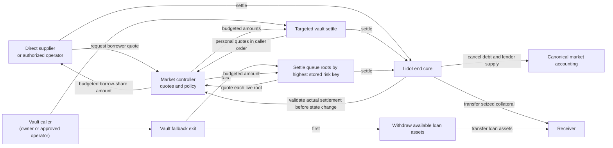
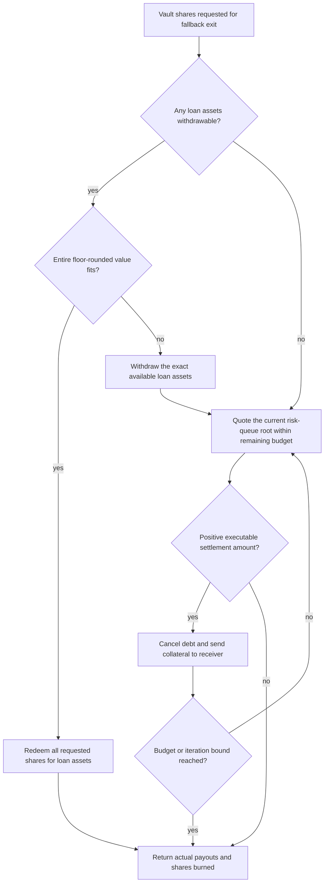

# Settlement and Lender Exits

Lenders normally exit by withdrawing loan assets from the market's free liquidity. That path cannot satisfy a large exit when most supplied assets are currently borrowed. Settlement provides a second form of repayment: it cancels a borrower's debt against an authorized lender's supply and transfers collateral of the same oracle value to a chosen receiver, subject to rounding. No liquidation incentive is added.

Settlement does not create loan-token liquidity. It reduces market supply and debt together, removes the corresponding collateral from the borrower, and pays that collateral directly to the receiver. A lender can use it through one of three entry paths:

- **direct core settlement** for an authorized direct supplier;
- **targeted vault settlement** against a caller-ordered borrower list; or
- **vault fallback exit**, which pays from free loan-token liquidity first and then settles the remaining claim against the risk queue.

This is distinct from an [Exit Book](exit-books.md). Settlement changes the composition of a lender position from market supply to borrower collateral. An Exit Book instead coordinates a permissionless filler around an existing vault or direct supply position.

## Terms used in this document

| Term | Meaning |
|---|---|
| Settlement slice | One self-consistent settlement amount expressed as borrow shares, predicted supply shares, and remaining borrow shares. |
| Supply-share budget | The maximum core supply shares that one quote may consume. |
| Personal allowance | The settlement amount permitted by the borrower's own target LTV. |
| Root-policy allowance | The settlement amount permitted for the current highest-risk borrower in the queue. |
| Free liquidity | Market supply assets that are not currently borrowed. |
| Settleable supply | The part of one supplier's position above current free liquidity. Root-policy settlement cannot consume more than this amount. |

## Components and actors

| Component or actor | Responsibility |
|---|---|
| Direct supplier | Owns core supply shares and may authorize another caller to act for that position. |
| Vault share owner | Owns ERC-4626 shares backed by the vault's managed core supply position. |
| Receiver | Receives loan assets from a liquid withdrawal and collateral from settlement; may differ from the position owner. |
| Borrower | Owns the debt and collateral being reduced. A personal settlement target is set only by that borrower. |
| LidoLend core | Accrues interest, converts the requested borrow shares into debt and supply amounts, updates canonical accounting, and transfers collateral. |
| Market controller | Maintains the risk queue, constructs budgeted policy quotes, blocks bad-debt settlement, and validates the exact core result. |
| LidoLendERC4626 | Converts a vault-share request into a managed core-supply budget and coordinates the liquid withdrawal and settlement steps. |

Settlement must have been enabled when the market was created; that choice cannot be changed later. The core also requires the caller to own or be authorized over the supplier position whose supply shares will be burned.



## Core settlement accounting

The core accepts an exact number of **borrow shares** as the settlement anchor. After accruing interest it derives the other amounts from the live market totals. Its settlement call is:

```solidity
settle(marketParams, borrowShares, onBehalf, borrower, receiver)
```

`onBehalf` is the supplier position whose supply shares pay for the settlement. The derived amounts are:

```text
borrowAssetsCanceled = assets represented by borrowShares, rounded up
supplySharesBurned    = shares representing borrowAssetsCanceled on the supply side, rounded up
collateralSeized      = collateral worth the borrow shares rounded down, then converted at the oracle price,
                        rounded down again
```

Core share conversions include Morpho's fixed buffer of one virtual asset and `1e6` virtual shares. That buffer is why the final conversion boundaries below do not behave like simple division of the visible totals.

Passing the borrower's entire borrow-share balance closes that debt position exactly. The up-rounded debt amount can exceed the remaining total borrow assets by one raw unit at the final boundary, so the core floors the market total at zero when applying the settlement.

The core rejects a zero borrow-share input or receiver, a settlement larger than the borrower's debt, a derived supply burn larger than the supplier's position, and a seizure that is zero or exceeds the borrower's collateral.

The collateral calculation intentionally rounds in the other direction. The borrow-share value used for collateral is at most one raw loan-asset unit below the up-rounded canceled debt; conversion into whole collateral units can add a further oracle-rounding gap. The borrower therefore never pays a rounding premium to the lender, and there is no liquidation bonus.

Before changing balances, the core sends the resolved supply burn, debt cancellation, and collateral seizure to the market controller. If policy allows the settlement, the core:

1. burns the derived supply shares from the authorized supplier;
2. reduces total supply assets by the canceled debt assets;
3. burns the requested borrow shares and reduces total borrow assets;
4. removes the priced collateral from the borrower; and
5. transfers that collateral directly to the receiver.

The core deliberately performs no borrower-health check for settlement. The controller's queue and bad-debt rules are the policy boundary that makes the operation safe.

## Risk queue and bad-debt gate

The controller tracks borrowers that have both debt and nonzero raw collateral in a max-heap. A max-heap is a queue whose first item has the largest key. The ordering key is:

```text
riskKey = borrowShares * 1e18 / rawCollateral
```

`rawCollateral` is the collateral-token balance before oracle conversion, and the integer division rounds down. All borrowers in a market share the same conversion rate from borrow shares to debt and the same collateral price, so a larger key means a larger loan-to-value ratio (LTV). The heap root has the largest stored key. Because the key is rounded down, different exact ratios can have the same key, and equal-key borrowers are not ordered by exact LTV. The core calls the controller before applying each position change; the controller projects the resulting position and updates or removes that borrower's queue entry.

Before authorizing any settlement, the controller checks the root for bad debt. If the root's debt value exceeds its collateral value, every settlement path reverts. This is a constant-time check of the selected root, not a scan of all tracked borrowers.

> [!WARNING]
> **Accepted root-only bad-debt detection risk.** A solvent root does not prove that every other tracked borrower is solvent. The rounded risk key can give two different positions the same key, and the separate rounding used to value debt and collateral can make a lower-key borrower insolvent at raw-unit boundaries. We treat this as a remote boundary case because it requires both bad debt, which is expected to be exceptional in the WETH/wstETH market and the USD/Treasuries market, and unfavorable raw-unit rounding. Lender settlement is not the recovery path for this state. Ordinary unhealthy positions and bad-debt realization remain on the Morpho liquidation path described in ADR 013.

## Two settlement policies

The controller computes a **personal allowance** for any borrower and a **root-policy allowance** that can be executed only against the live heap root. Both begin as loan-asset amounts, are capped by the borrower's debt, and are converted into the exact borrow-share amount passed to the core.

### Personal settlement target

A borrower may select a target post-settlement LTV below 100%. A zero target disables the personal policy. When the position is above a positive target, the nominal loan-asset amount is:

```text
personalSliceAssets =
    (debtAssets * 1e18 - targetLtv * collateralValue)
    / (1e18 - targetLtv)
```

Here `debtAssets` is the borrower's share debt rounded up, while `collateralValue` prices its entire raw collateral balance rounded down; activating collateral and activation dust are included. The final division rounds down.

The result is zero when debt or priced collateral value is zero, no target is set, or the current LTV is already at or below the target. A positive personal allowance is available regardless of queue position and current market liquidity. It opts the borrower into settlement by any supplier whose core position is properly authorized; it does not select a particular lender or receiver. The personal allowance is not promoted by the queue's collateral-dust rule.

> **Example.** Debt is 80 loan assets, collateral value is 100, and the target is 50%. The formula returns a settlement amount of 60. Ignoring token-unit rounding, settlement leaves debt of 20 and collateral value of 40, which is 50% LTV.

### Queue-root policy

The root policy requires no borrower opt-in, but it applies only while that borrower is the live heap root. Its nominal allowance is the largest of three controls:

| Rule | Loan-asset allowance |
|---|---|
| Debt fraction | `floor(debtAssets * sliceFloorBps / 10_000)` |
| Absolute floor | `sliceFloorAssets` |
| LTV step | the settlement amount that lowers the current LTV by `ltvStepBps / 10_000` |

The current LTV, configured step, and final LTV-step amount all use integer division rounded down.

The maximum is capped at the borrower's debt. If a positive root-policy amount would leave raw collateral below `fullCutBelowCollateral`, the nominal root allowance becomes the full debt. A zero root-policy amount is not promoted solely because the borrower's existing collateral is below the threshold. This dust rule applies only to the root policy; it does not alter a borrower's personal target. `sliceFloorBps` and `ltvStepBps` cannot exceed 100%, and setting `fullCutBelowCollateral` to zero disables the rule.

> **Example.** A root has debt of 1,000 loan assets at 92% LTV. With `sliceFloorBps = 500` (5%), `sliceFloorAssets = 100`, and `ltvStepBps = 100` (one percentage point), the terms produce 50 from the debt fraction, 100 from the absolute floor, and approximately 120 from the LTV step. The nominal root-policy amount is 120. The supply-share budget and settleable-supply limit can still reduce or reject it.

## Budgeted quotes

Policy decides the nominal settlement amount; the settling supplier decides how many core supply shares it can spend. The controller combines both inputs into one self-consistent quote.

For a positive nominal asset amount, the controller first rounds the amount up into borrow shares. An amount that spans the whole debt is capped at the borrower's exact share balance. When the caller supplies a nonzero `budgetSupplyShares`, the controller also computes the maximum borrow shares that budget can fund:

```text
affordableBorrowShares =
    assets represented by budgetSupplyShares, rounded down,
    converted to borrow shares, rounded down

quotedBorrowShares = min(policyBorrowShares, affordableBorrowShares)
quotedSupplyShares = debt assets represented by quotedBorrowShares, rounded up,
                     converted to supply shares, rounded up
```

Each candidate is returned in one self-consistent record:

```solidity
struct SettlementSlice {
    uint256 supplyShares; // predicted core supply burn
    uint256 borrowShares; // exact amount to pass to core.settle
    uint256 remainingBorrowShares; // borrower debt shares after settlement
}
```

`remainingBorrowShares == 0` marks a full close for a nonzero candidate. An unavailable candidate has all three fields set to zero.

At the market snapshot used for the quote, the opposing rounding directions guarantee that the core's derived supply burn does not exceed the supplied budget. If the budget funds no borrow share, the quote is empty.

Passing a zero budget asks for the policy quote without budget reduction and is useful for inspection. An executor should quote against its live supply-share budget and revalidate a quote that is not consumed immediately. Zero is a sentinel only at the controller view: a vault request whose pro-rata supply budget rounds to zero reverts before requesting a quote.

The controller exposes two views over this calculation:

- `settlementFor(borrower, budgetSupplyShares)` contains independently budgeted personal and prospective root-policy settlements; the prospective root-policy result does not assert that this borrower is currently the root;
- `nextSettlementBorrower(budgetSupplyShares)` returns the live root and whichever of its personal or root-policy allowances is larger, budgeted to the supplied core shares. An empty queue returns the zero address and an empty slice.

Quotes simulate pending interest at the time of the read. The vault consumes each quote immediately, in the same transaction and timestamp, before any other market action. A quote read for a later direct-core transaction is state-dependent: elapsed interest or another transaction can change debt, supply, the queue root, oracle price, settlement policy, personal target, or the settling position before inclusion.

## Controller execution rules

The hook validates the core's exact borrow-share cancellation and its live converted asset amounts. The decision is compact:

1. If the queue root is bad debt, reject every settlement.
2. If the actual canceled borrow shares fit the target borrower's personal allowance, allow the settlement whether or not the borrower is the root. The settleable-supply limit does not apply.
3. Otherwise require the borrower to be the live root and the cancellation to fit the larger of the personal and root-policy allowances.
4. When a settlement exceeds the personal allowance and therefore relies on root policy, require the core's entire actual canceled debt amount to fit the supplier's live settleable supply.

The policy limits are converted to borrow shares before comparison. If personal and root-policy asset limits round to the same borrow-share amount, the settlement fits the personal limit and the settleable-supply check does not apply.

Settleable supply is:

```text
supplierSupplyAssets  = supplier's live core supply value, rounded down
marketFreeLiquidity   = max(totalSupplyAssets - totalBorrowAssets, 0)
settleableSupplyAssets = max(supplierSupplyAssets - marketFreeLiquidity, 0)
```

This prevents root policy from converting the part of a supplier position that could instead leave as loan assets. A personal settlement target is the borrower's own authorization and therefore does not use this limit. At the exact boundary, a root-policy settlement equal to the settleable supply succeeds; one raw loan-asset unit more reverts.

Every successful settlement also passes the controller's borrow-share-rate transition guard: a market within the ceiling cannot be pushed above it, while a pre-existing breach remains settleable for cleanup. The controller removes seized collateral from the borrower's activation buckets before the core reduces raw collateral. Settlement is a forced path: freeze, guardian bans, and activation locks do not block it. A controller pause blocks it because every hook is paused.

## Direct core settlement

A direct supplier, or an operator authorized over that supplier's core position, can read a budgeted controller quote, select its quoted borrow-share amount, and call the core for a chosen borrower and receiver. The core burns supply from that supplier and transfers collateral directly to the receiver. The quote is a view result, not an onchain reservation or authorization token.

The caller must not infer authorization from a prospective root quote alone. At execution the controller re-checks the live root, personal allowance, bad-debt state, settleable supply, and exact rounded settlement. A stale or oversized request reverts.

## Vault accounting boundary

`LidoLendERC4626` represents one market supplier position. Vault shares are freely transferable and their asset value is backed only by **managed supply shares**: core supply shares created or consumed by the vault's own deposit, withdrawal, and settlement operations.

Core supply is permissionless and accepts an arbitrary `onBehalf`. Without separate managed accounting, a third party could credit core shares to the vault address without receiving vault shares, changing the wrapper price and settlement budgets. The vault therefore excludes such external credits from `totalAssets` and from both exit budgets. Loan tokens sent directly to the vault are likewise not counted as backing.

The invariant is:

```text
managedSupplyShares <= actual core supply shares held by the vault
```

A nonzero deposit reverts if it would mint either zero vault shares or zero managed core supply shares. The ERC-4626 virtual-share offset is fixed at initialization as `max(18 - loanTokenDecimals, 0)`.

For either settlement entrypoint, a request for `requestedVaultShares` receives this core budget:

```text
settlingSupplyShares =
    floor(managedSupplyShares * requestedVaultShares / totalVaultShareSupply)
```

The vault spends only that budget and later removes the consumed core shares from managed accounting.

Both vault exits require nonzero requested shares, a nonzero receiver, and a request no larger than the owner's current vault-share balance. Targeted settlement additionally requires a nonempty borrower list.

## Targeted vault settlement

```solidity
settle(shares, borrowers, receiver, owner)
```

Targeted settlement is liquidity-neutral: it does not withdraw or reserve free loan assets. The caller supplies an ordered borrower list. For each borrower, the vault asks the controller for the **personal** settlement budgeted to the remaining supply shares and sends the resulting borrow-share amount unchanged to the core.

Borrowers with no positive personal settlement consume nothing. Iteration stops when the budget is exhausted or the list ends. If no core supply share is consumed across the entire list, the call reverts instead of silently burning nothing.

The receiver gets only seized collateral; the returned loan-asset amount is zero. If settlement consumes the full core budget, the vault burns all requested vault shares. If it consumes only part, the vault burns the same proportion of the request, rounded up so remaining holders are not diluted:

```text
vaultSharesBurned =
    ceil(requestedVaultShares * consumedSupplyShares / settlingSupplyShares)
```

The owner and caller may differ. In that case the caller must have sufficient vault-share allowance for the amount actually burned. A successful call emits `Settled` with the actual shares burned, collateral seized, and debt canceled.

## Vault fallback exit

```solidity
fallbackExit(shares, receiver, owner, maxIterations)
```

Fallback exit combines two payout steps in one transaction. An approved caller may act for `owner`; allowance is spent only for the shares each step actually burns.

### 1. Liquid loan-asset withdrawal

The vault reads how many loan assets its core position can currently withdraw. If the entire floor-rounded value of the requested vault shares fits, it redeems that whole request. Otherwise it withdraws the exact available loan-asset amount, ensuring that share rounding does not strand a small liquid balance. The vault forwards the withdrawn loan assets to the receiver in the same call.

If the liquid withdrawal services the whole request, the call returns without settlement.

### 2. Queue settlement

For the remaining vault shares, the vault computes the pro-rata managed supply budget and repeatedly requests the live queue root's larger personal-or-root settlement, already reduced to the remaining budget. Each successful core settlement transfers collateral to the same receiver, consumes budget, and updates the root's queue entry before the next iteration.

The loop stops when:

- the remaining budget is exhausted;
- the queue produces no executable positive settlement; or
- the caller's iteration bound is reached.

A zero iteration input selects the contract's default bound of 150 settlement attempts. The bound counts loop iterations, not distinct borrowers: a partial settlement can leave the same borrower at the root for another attempt. Queue or iteration exhaustion returns a partial fill when the call has made progress. The vault burns shares for the liquid withdrawal plus the pro-rata shares serviced by settlement. If neither step burns any share, the call reverts.



The return value `sharesBurned` covers both steps. The `FallbackExit` event is emitted only when the call reaches queue settlement, and its `sharesBurned` field covers that step alone. The standard ERC-4626 `Withdraw` event describes the liquid withdrawal. The other return values report the actual loan assets, collateral, and debt canceled.

## Rounding and boundary behavior

- **Budget safety.** Budget-to-borrow conversion rounds down, while the core's derived supply burn rounds up from the resulting borrow shares. Against the same market snapshot, the final burn remains within budget.
- **Borrower-favorable collateral rounding.** The up- and down-rounded borrow-share values differ by at most one raw loan-asset unit. Flooring the result to whole collateral units can add a further oracle-value gap.
- **Policy-to-share rounding.** A loan-asset policy limit rounds up to borrow shares. The core's value for that final share step can put actual canceled debt above the nominal asset limit by more than one raw loan-asset unit when the assets-per-borrow-share value is high.
- **Full close.** A policy settlement that reaches the last borrow share is represented as a full close. A budget that cannot fund it receives a smaller, self-consistent partial quote.
- **Vault-share burn.** Partial settlement rounds the vault-share burn up by less than one raw vault share, preventing value dilution of holders who remain.
- **Liquid withdrawal rounding boundary.** If the requested shares' floor-rounded value fits current withdrawal capacity, `fallbackExit` burns that exact request. It can therefore service shares just above the conservative `maxRedeem` result when those extra shares represent no additional loan-asset unit.
- **Collateral dust.** If a positive debt settlement prices to zero collateral units, the core rejects it. Repay or otherwise remove that debt dust before retrying.
- **Zero supply-share budget.** A targeted request, or the remainder after a fallback liquid withdrawal, reverts if its pro-rata managed position rounds down to zero core supply shares.
- **Final virtual-share boundary.** At a fully utilized final-exit boundary, a complete vault exit can leave zero-value core supply shares alongside at most one raw loan-asset unit in total borrow assets.
- **Live settleable supply.** Withdrawal or borrowing earlier in the same transaction can change free liquidity and therefore how much root-policy settlement can execute. There is no prior-block snapshot or cooldown.
- **Bounded progress.** A fallback transaction executes only a bounded number of settlement attempts. Large exits may need repeated calls, and one borrower can consume more than one attempt.

## Controls and trust assumptions

- Freeze itself does not block settlement or fallback exits. Controller pause blocks both because they invoke market hooks; ordinary vault-share transfers and authorization changes remain outside those hooks.
- Every settlement step requires a usable live oracle price. A fallback exit served entirely by its liquid withdrawal does not read the oracle. Settlement never bypasses collateral-token transfer restrictions; a transfer-gated collateral token can reject the receiver.
- Queue ordering and views are live, not reservations. Callers must tolerate another transaction changing the root or exhausting a position before inclusion.
- Core and vault authorization are independent. A caller acting for another direct supplier or vault owner needs the corresponding live authorization or allowance.
- Settlement assumes standard non-callback token behavior and the protocol's usual oracle, core, controller, and proxy trust boundaries. Exact holders of privileged configuration roles are listed in [Roles](roles.md).

## Verification targets

The settlement test suites must cover these properties rather than only individual function branches:

- the heap root retains a maximum stored risk key after every position-changing hook, including when several borrowers have equal keys;
- a bad-debt root blocks direct and targeted settlement, and any fallback exit that reaches queue settlement;
- personal settlement works outside the root, while root-policy excess is constrained by the exact live settleable supply;
- a controller quote consumed against the same market snapshot never makes the core burn more supply shares than its nonzero input budget;
- targeted settlement withdraws no loan assets and burns vault shares only for consumed managed supply;
- fallback exit withdraws exact available liquidity before queue settlement, respects its settlement-attempt bound, and reports partial progress with distinct total-return and settlement-event share counts;
- permissionless supply credited directly to the vault does not change its managed assets or settlement budget;
- the borrow-share-rate transition rule is enforced, a zero-collateral-unit settlement reverts, an unaffordable full close becomes a budgeted partial settlement, and a final full-pool exit leaves no more than the documented virtual-share residue.

## Related references

- [Architecture](architecture.md) — system topology and runtime boundaries.
- [Market controller](market-controller.md) — hook lifecycle, collateral activation, freeze/pause, and share-rate guard.
- [LidoLendERC4626 API](api/lido-lend-erc4626.md) — generated vault surface.
- [LidoLendMarketController API](api/lido-lend-market-controller.md) — generated queue, quote, and policy surface.
- [Lido Lend core specification](https://github.com/lidofinance/lido-lend/blob/main/SPECIFICATION.md) — canonical core accounting and trust assumptions.
