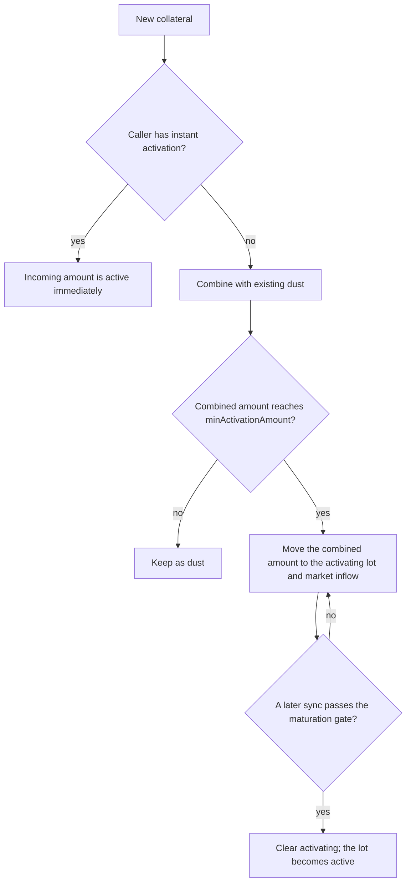

# Market Controller Policy

`LidoLendMarketController` is the policy layer for one Lido Lend market. The core remains the source of truth for balances, shares, interest, solvency, and token transfers. The controller keeps separate policy state and either allows a core action or reverts the transaction; it cannot change the amounts resolved by the core or take custody of funds.

The controller adds:

- a lender supply cap;
- delayed collateral activation and guardian-based borrow gating;
- freeze and pause controls;
- borrower ordering and eligibility for lender settlement; and
- a guard against rounding-driven borrow-share inflation.

Settlement policy is specified in [Settlement and lender exits](lender-settlement.md). Guardian identities, reports, bans, and liveness are specified in [Guardian Signals](guardian-signals.md). This document explains how the controller applies both subsystems to core actions.

## Policy boundary

Each controller accepts hooks only from the Lido Lend core and only for its bound market. Most balance-changing actions accrue interest and resolve their asset and share amounts before the hook, but have not yet applied the requested action's accounting. Collateral supply skips accrual. An explicit interest-accrual call invokes the hook before accrual. A later controller, core, callback, or token-transfer revert rolls back the entire call, including prior accrual and controller state changes.

After caller, market, and pause validation, the action-specific policy is:

| Core action | Controller policy |
|---|---|
| Supply loan assets | Enforce the supply cap against accrued supply plus the incoming assets. |
| Withdraw loan assets | No additional action-specific policy. |
| Borrow | Enforce freeze, bans, active-collateral capacity, and the borrow-share-rate guard; synchronize activation and the settlement queue. |
| Repay | Enforce the borrow-share-rate transition guard and synchronize the settlement queue. |
| Supply collateral | Synchronize existing activation, classify the deposit, and update the settlement queue. |
| Withdraw collateral | Enforce freeze, activation, lock, and active-collateral rules; update the settlement queue. |
| Liquidate | Reduce activation balances and update the settlement queue. The borrow-share-rate guard does not apply. |
| Accrue interest | No additional action-specific policy. |
| Settle | Enforce the borrow-share-rate transition, bad-debt, eligibility, policy-limit, and lender-tail gates; reduce activation balances and update the queue. |

An unknown future hook reverts. “No additional policy” means only that the controller adds no action-specific check; the core's accounting, authorization, liquidity, and solvency rules still apply.

### Lender supply cap

The cap is an admission limit for lender supply; zero means uncapped. A supply is checked against the post-accrual market total plus the incoming assets. Interest may carry the total above the cap because accrual remains live. Lowering the cap below the current total does not remove supply; it blocks further supply until the total falls below the cap. Withdrawals remain available.

## Borrower gating

The core tests solvency against the borrower's full collateral balance. The controller separately tracks which collateral has completed the activation policy. Fresh collateral enters the core immediately and protects the position from liquidation, but inactive collateral is excluded from the controller's borrow capacity.

For current market totals, the controller computes:

```text
debtAssets = ceil(borrowShares * (totalBorrowAssets + 1)
                                / (totalBorrowShares + 1e6))

collateralValue = floor(activeCollateral * oraclePrice / 1e36)

borrowCapacity = 0                                      when activeCollateral < minActivationAmount
borrowCapacity = floor(collateralValue * LLTV / 1e18)  otherwise
```

Existing debt is therefore rounded up, while collateral value and LLTV capacity are rounded down. A collateral withdrawal with open debt must leave `debtAssets <= borrowCapacity`. A borrow checks `current debtAssets + resolved borrow assets <= borrowCapacity`.

> [!WARNING]
> **Known active-collateral rounding gap.** After the controller accepts a borrow, the core recomputes the borrower's debt from post-borrow shares and market totals. That value can round above the controller's `current debt + resolved assets` estimate. Inactive collateral can therefore back the difference, for which the controller enforces no separate bound. Closing this implementation gap requires both checks to project the same post-borrow debt.

A borrow also fails when the caller, debt owner, or loan receiver is banned. Guardian flags and the stored suspect snapshot can extend the debt owner's activation delay when their configured surcharge is nonzero; only a ban directly blocks borrowing.

A debt-free borrower bypasses the withdrawal health check, although an activation lock can still hold part of an activating lot.

## Collateral activation

The controller divides a borrower's collateral into three balances:

| Balance | Meaning |
|---|---|
| `dust` | Inactive collateral without a timer. It may come from a sub-threshold supply or from demotion of a small activating remainder. |
| `activating` | Inactive collateral in the activation timer. A portion may be locked against voluntary withdrawal. |
| `active` | The remainder of the core collateral balance. It contributes to borrow capacity only when the total active amount reaches `minActivationAmount`. |

Only `dust` and `activating` are stored by the activation subsystem:

```text
active = core collateral - dust - activating
```

The buckets can coexist. All activating collateral for one borrower shares one start time and stored base delay; this document calls it an **activating lot**.



### Classifying a collateral supply

A normal supply first combines the incoming amount with existing dust. A combined amount below `minActivationAmount` remains dust and does not start or change the timer. Once it reaches the threshold, the whole amount moves to `activating` and is added to market inflow.

An instant supply bypasses dust, the timer, and the inflow throttle. It does not change dust or activating collateral left after the pre-supply maturation check. A small instant supply is active but still provides no borrow capacity until total active collateral reaches `minActivationAmount`.

Instant activation is keyed by the call's sender, not the collateral owner. The manager can enable any address, and the controller does not verify that the address restricts access. Each enabled caller must therefore enforce the intended routing policy itself; a permissionless helper would let any user bypass activation.

A normal top-up that reaches `minActivationAmount` joins the existing activating lot. It replaces the lot's start and base delay only when its newly quoted deadline is later, so a top-up may postpone activation but cannot bring it forward.

### Base delay and market inflow

The base delay depends on recent non-instant collateral inflow across the market. `maxDelayInflow` and the accumulator use raw collateral-token units. For a threshold-crossing supply, `effectiveInflow` includes the new amount and any dust released into it:

```text
baseDelay = minActivationDelay
          + floor((maxActivationDelay - minActivationDelay)
                  * effectiveInflow / maxDelayInflow)

baseDelay = maxActivationDelay when effectiveInflow >= maxDelayInflow
```

Before a new contribution, stored inflow decays as:

```text
decay = floor(maxDelayInflow * elapsed / maxActivationDelay)
decayedInflow = max(storedInflow - decay, 0)
```

Splitting a deposit across addresses does not reset this market-wide accumulator. A lot keeps the base delay quoted when it starts or when a later top-up extends its deadline.

The decay formula always uses the current configuration. Changing `maxDelayInflow` or `maxActivationDelay` therefore reinterprets the existing inflow snapshot. Lowering the cap does not immediately clamp the stored value; a later threshold-crossing normal supply rewrites and clamps it.

Within one transaction, a voluntary withdrawal or forced seizure reverses only activating inflow contributed by the same borrower in that transaction. It cannot erase an earlier transaction's baseline or another borrower's contribution.

### Maturation gate

Activation is lazy. Collateral-supply, collateral-withdrawal, and borrow hooks try to mature an existing lot; time passing alone does not update balances.

At each sync, the controller reads the borrower's ban, strike count, stored suspect snapshot, and quorum frontier from [Guardian Signals](guardian-signals.md). The unlock time is:

```text
unlockTime = activatingStart + storedBaseDelay
           + strikeCount * delayPerStrike
           + suspectCount * delayPerSuspect
             when activatingStart < suspectExpiryTimestamp
```

A top-up that restarts the lot at or after the stored suspect snapshot's expiry removes that snapshot's surcharge. A banned borrower has no finite unlock time. Otherwise the lot matures only when:

1. `block.timestamp >= unlockTime`;
2. the quorum frontier has reached `unlockTime`, or `block.timestamp >= activatingStart + maxGuardiansQuorumDelay`; and
3. the market is not frozen.

Setting `maxGuardiansQuorumDelay` to zero removes the frontier wait, not the full activation delay. A nonzero value must exceed `maxActivationDelay` and cannot exceed seven days. Freeze does not change the deadline; an otherwise ready lot may mature on the first sync after unfreeze.

> [!NOTE]
> The fallback may permit maturation without new guardian frontier progress. This is an accepted liveness trade-off described in [Guardian Signals](guardian-signals.md#how-the-controller-uses-the-frontier).

### Voluntary withdrawals and forced collateral reductions

A voluntary collateral withdrawal first runs the maturation sync, then consumes:

1. dust;
2. activating collateral above the current lock floor; and
3. active collateral.

For `activatingLockDuration` from the lot's start, up to `activatingLockAmount` remains in `activating` and cannot be withdrawn voluntarily. Active collateral may still be withdrawn while that floor remains intact; the lock itself causes a revert only if the requested amount would cross it. Freeze, active-collateral health, and core checks still apply. Once the lock expires, the amount is withdrawable even if the lot has not matured.

With no lock floor, a withdrawal that leaves a nonzero activating amount but a total inactive remainder below the current `minActivationAmount` moves the activating remainder to dust and clears its timer. Demotion is skipped while a lock applies because dust is freely withdrawable.

Liquidation and settlement are forced reductions. They do not mature the lot first and ignore the voluntary lock. They consume dust, then activating, then active collateral, and apply the same sub-threshold demotion with a zero lock floor. Freeze and guardian bans do not block these paths.

### Configuration changes

Configuration changes do not move collateral between buckets. A lot keeps its start and base delay, while current values govern the minimum amount, withdrawal lock, guardian surcharges, quorum fallback, and inflow decay. Changes can therefore affect existing positions immediately without rewriting their activation balances.

## Freeze and pause

| State | Blocks | Still permits |
|---|---|---|
| Freeze | Borrowing; debt-bearing collateral withdrawal; maturation from activating to active. | Loan-asset supply and withdrawal, collateral supply, repay, liquidation, settlement, and debt-free collateral withdrawal subject to the activation lock. |
| Pause | Every core action that invokes the controller, including repayment, liquidation, settlement, and explicit interest accrual. | Core calls without a market hook, including flash loans and authorization changes; ERC-4626 vault-share transfers; controller administration. |

Freeze keeps debt reduction and lender exits live, so it is insufficient when liquidation or settlement is itself unsafe, for example with a stale oracle. Classification and instant activation continue while frozen, but borrowing and maturation remain blocked.

Pause is the controller-wide stop. It prevents pending interest from being committed while paused, but does not forgive it: after resume, the next accrual covers the full elapsed interval. A finite pause expires automatically; an indefinite pause requires an authorized resume. Authorities and intended holders are listed in [Roles](roles.md).

## Borrow-share-rate transition guard

Near zero total borrow assets, rounding can leave borrow shares behind. Repeating that boundary can make later debt mint disproportionate shares. The guard compares raw market totals with the core's virtual offsets:

```text
totalBorrowShares + 1e6 <= 1e7 * (totalBorrowAssets + 1)
```

The core's natural empty-market ratio is `1e6` virtual shares per raw loan-asset unit; the guard permits up to ten times that ratio.

This is a transition guard, not a permanent market invariant:

- every borrow must leave the market within the ceiling, and a share-based borrow resolving to zero assets reverts;
- repay and settlement may not cross from at or below the ceiling to above it;
- when the market already starts above the ceiling, repay and settlement bypass the guard even if that call worsens the ratio; and
- liquidation is exempt and may move the market above the ceiling.

Rounding in debt reduction can lower total assets faster than total shares. If pre-hook accrual leaves the market above the ceiling, every borrow reverts because borrow conversion cannot reduce the ratio. Positive interest or another permitted transition may restore it; a zero-asset market cannot recover through interest.

## Related specifications

- [Architecture](architecture.md) — system topology and common trust boundaries.
- [Guardian Signals](guardian-signals.md) — guardian opinions and liveness.
- [Settlement and lender exits](lender-settlement.md) — queue policy and vault settlement paths.
- [Controller API](api/lido-lend-market-controller.md) — functions, types, events, and errors.
- [Roles](roles.md) — privileged actions and intended holders.
