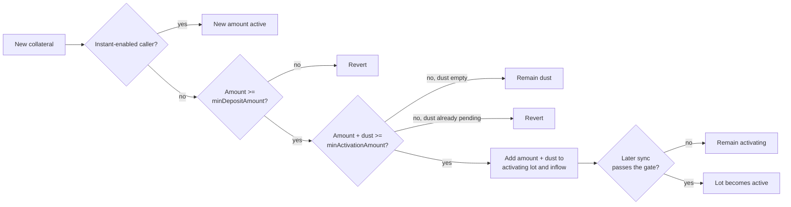

# Market Controller Policy

`LidoLendMarketController` is the policy layer for one Lido Lend market. The core remains the source of truth for balances, shares, interest, solvency, and token transfers. The controller keeps separate policy state and either allows a core action or reverts. It cannot change the amounts resolved by the core. Binding a controller does not let that address spend user tokens or act for user accounts.

The controller adds:

- a lender supply cap;
- delayed collateral activation and guardian-based borrow gating;
- freeze and pause controls;
- borrower ordering and eligibility for lender settlement; and
- a guard against rounding-driven borrow-share inflation.

Settlement policy is specified in [Settlement and lender exits](lender-settlement.md). Guardian identities, reports, bans, and liveness are specified in [Guardian Signals](guardian-signals.md). This document explains how the controller applies both subsystems to core actions.

## Policy boundary

Each controller accepts hooks only from the Lido Lend core and only for its bound market. It also rejects every hook while paused. Before most hooks, the core accrues interest and converts the request into the exact asset and share amounts that the action will use. The requested action has not yet changed accounting. Collateral supply skips accrual, while an explicit interest-accrual call invokes the hook before accrual.

After these shared checks, the controller adds the action-specific rules below. The core applies its own accounting, authorization, liquidity, and solvency checks separately.

| Core action | Additional controller rule |
|---|---|
| Supply loan assets | Enforce the supply cap against accrued supply plus the incoming assets. |
| Withdraw loan assets | None. |
| Borrow | Enforce freeze, bans, active-collateral capacity, and the borrow-share-rate guard; synchronize activation and the settlement queue. |
| Repay | Enforce the borrow-share-rate transition guard and synchronize the settlement queue. |
| Supply collateral | Synchronize existing activation, classify the deposit, and update the settlement queue. |
| Withdraw collateral | Enforce freeze, activation, lock, and active-collateral rules; update the settlement queue. |
| Liquidate | Reduce activation balances and update the settlement queue. The borrow-share-rate guard does not apply. |
| Accrue interest | None. |
| Settle | Enforce the borrow-share-rate transition, bad-debt, eligibility, policy-limit, and lender-tail gates; reduce activation balances and update the queue. |

An unknown future hook reverts.

### Lender supply cap

The cap is an admission limit for lender supply; zero means uncapped. A supply is checked against the post-accrual market total plus the incoming assets. Interest may carry the total above the cap because accrual remains live. Lowering the cap below the current total does not remove supply; it blocks further supply until the total falls below the cap. Withdrawals remain available.

## Borrower gating

The core tests solvency against the borrower's full collateral balance. The controller separately tracks which collateral has completed the activation policy. Fresh collateral enters the core immediately and protects the position from liquidation, but inactive collateral is excluded from the controller's borrow capacity.

For current market totals, the controller computes:

```text
debtAssets = ceil(borrowShares * (totalBorrowAssets + 1)
                                / (totalBorrowShares + 1e6))

collateralValue = floor(activeCollateral * oraclePrice / 1e36)

borrowCapacity = 0                                      when activeCollateral < minActivationAmount
borrowCapacity = floor(collateralValue * LLTV / 1e18)  otherwise
```

Existing debt is therefore rounded up, while collateral value and LLTV capacity are rounded down. A collateral withdrawal with open debt must leave `debtAssets <= borrowCapacity`.

A caller may specify a borrow as a loan-token amount or as a number of borrow shares. The core calculates the other value before the hook. If `borrowAssets` is the exact loan-token amount that the core will transfer, the controller requires:

```text
debtAssets + borrowAssets <= borrowCapacity
```

> [!NOTE]
> **Post-borrow rounding may use inactive collateral.** The controller checks current debt plus `borrowAssets`. The core then recomputes debt from the updated borrower shares and market totals. Rounding can make the second value higher.
>
> For a borrow specified in shares, the difference is at most one smallest loan-token unit. For a borrow specified in assets, there is no unconditional one-unit bound: the difference can exceed one unit when one borrow share is worth more than one smallest loan-token unit. The core checks the recomputed debt against the borrower's full collateral at the market's LLTV. Inactive collateral may cover the rounding difference, but a borrow that fails this full-collateral check still reverts.

A borrow also fails when the caller, debt owner, or loan receiver is banned. Guardian flags and the stored suspect snapshot can extend the debt owner's activation delay when their configured surcharge is nonzero; only a ban directly blocks borrowing.

A debt-free borrower bypasses the withdrawal health check, although an activation lock can still block a voluntary withdrawal outright while it applies.

## Collateral activation

The controller divides a borrower's collateral into three balances:

| Balance | Meaning |
|---|---|
| `dust` | Inactive collateral without a timer. It may come from a sub-threshold supply over an empty dust bucket; at most one unresolved dust lot exists per borrower. |
| `activating` | Inactive collateral in the activation timer. An activation lock, while it applies, blocks its voluntary withdrawal outright. |
| `active` | The remainder of the core collateral balance. It contributes to borrow capacity only when the total active amount reaches `minActivationAmount`. |

Only `dust` and `activating` are stored by the activation subsystem:

```text
active = core collateral - dust - activating
```

The buckets can coexist. All activating collateral for one borrower shares one start time and stored base delay; this document calls it an **activating lot**. A collateral-supply hook first synchronizes any existing lot, then classifies the new amount as follows:



### Classifying a collateral supply

A normal supply below `minDepositAmount` reverts. The floor cannot exceed `minActivationAmount`; 0 disables it. With dust pending, a normal supply must lift `dust + amount` to `minActivationAmount` or it reverts, so one threshold crossing contains at most two normal supplies: the dust supply and the resolving supply. Because anyone may supply on behalf of a borrower, a third party's dust supply forces the borrower's next supply to resolve it (or the borrower withdraws the dust in full). Later crossings can add more funders to the same activating lot.

> [!NOTE]
> **A stranger can front-run a borrower's own supply with unwanted dust.** Because collateral supply has no owner check on the caller, an attacker can donate a sub-threshold amount to a victim ahead of the victim's own deposit. The pending dust then forces the victim's next normal supply to resolve it to the threshold, instead of landing at whatever size the victim intended. The victim is never trapped: the donated dust remains withdrawable in full under the ordinary rules below, so they can clear it before supplying again if they would rather not resolve it — though ejecting the dust requires clearing the whole inactive balance, which an active lock window can block while the victim also holds an activating lot; resizing the next supply to `minActivationAmount - dust` is the unconditional resolution.

An accepted supply then combines the incoming amount with existing dust. A combined amount below `minActivationAmount` remains dust and does not start or change the timer. Once it reaches the threshold, the whole amount moves to `activating` and is added to market inflow.

An instant supply bypasses the floor, dust, the timer, and the inflow throttle. It does not change dust or activating collateral left after the pre-supply maturation check. A small instant supply is active but still provides no borrow capacity until total active collateral reaches `minActivationAmount`.

Instant activation is keyed by the call's sender, not the collateral owner. The manager can enable any address, and the controller does not verify that the address restricts access. Each enabled caller must therefore enforce the intended routing policy itself; a permissionless helper would let any user bypass activation.

A normal top-up that reaches `minActivationAmount` joins the existing activating lot. It replaces the lot's start and base delay only when its newly quoted deadline is later, so a top-up may postpone activation but cannot bring it forward.

### Base delay and market inflow

The base delay depends on recent non-instant collateral inflow across the market. `maxDelayInflow` and the accumulator use raw collateral-token units. For a threshold-crossing supply, `effectiveInflow` includes the new amount and any dust released into it:

```text
baseDelay = minActivationDelay
          + floor((maxActivationDelay - minActivationDelay)
                  * effectiveInflow / maxDelayInflow)

baseDelay = maxActivationDelay when effectiveInflow >= maxDelayInflow
```

Before a new contribution, stored inflow decays as shown below, where `elapsed` is the time since the inflow snapshot was last updated:

```text
decay = floor(maxDelayInflow * elapsed / maxActivationDelay)
decayedInflow = max(storedInflow - decay, 0)
```

Splitting a deposit across addresses does not reset this market-wide accumulator. A lot keeps the base delay quoted when it starts or when a later top-up extends its deadline.

The decay formula always uses the current configuration. Changing `maxDelayInflow` or `maxActivationDelay` therefore reinterprets the existing inflow snapshot. Lowering the cap does not immediately clamp the stored value; a later threshold-crossing normal supply rewrites and clamps it.

To keep an add-then-remove sequence from inflating future activation delays, the controller records each borrower's inflow contribution during the transaction. If that borrower's collateral is later withdrawn, liquidated, or settled in the same transaction, the controller subtracts at most that recorded contribution. Older inflow and other borrowers' contributions remain unchanged.

### Maturation gate

Activation is lazy. Collateral-supply, collateral-withdrawal, and borrow hooks try to mature an existing lot; time passing alone does not update balances.

At each sync, the controller reads the borrower's ban, strike count, stored suspect snapshot, and quorum frontier from [Guardian Signals](guardian-signals.md). The unlock time is:

```text
unlockTime = activatingStart + storedBaseDelay
           + strikeCount * delayPerStrike
           + suspectCount * delayPerSuspect
             when activatingStart < suspectExpiryTimestamp
```

A top-up that restarts the lot at or after the stored suspect snapshot's expiry removes that snapshot's surcharge. A banned borrower has no finite unlock time. Otherwise the lot matures only when:

1. `block.timestamp >= unlockTime`;
2. the quorum frontier has reached `unlockTime`, or `block.timestamp >= activatingStart + maxGuardiansQuorumDelay`; and
3. the market is not frozen.

Setting `maxGuardiansQuorumDelay` to zero removes the frontier wait, not the full activation delay. A nonzero value must exceed `maxActivationDelay` and cannot exceed seven days. Freeze does not change the deadline; an otherwise ready lot may mature on the first sync after unfreeze.

> [!NOTE]
> The fallback may permit maturation without new guardian frontier progress. This is an accepted liveness trade-off described in [Guardian Signals](guardian-signals.md#how-the-controller-uses-the-frontier).

### Voluntary withdrawals and forced collateral reductions

A voluntary collateral withdrawal first runs the maturation sync. If the borrower then has no inactive collateral, the withdrawal consumes active collateral only, subject to freeze, health, and core checks. Otherwise the inactive balance (dust plus the activating lot) leaves all-or-nothing:

1. while the lot is inside `activatingLockDuration` of its start, every such withdrawal reverts (the lock binds only while the position holds a nonzero activating balance — a dust-only position can still clear during the window);
2. after the lock window (or with the lock disabled), the requested amount must cover the whole inactive balance; the withdrawal clears both buckets, stops the timer, and takes any remainder from active.

A voluntary withdrawal never partially reduces dust or activating collateral, and nothing is ever demoted to dust.

Liquidation and settlement are forced reductions. They do not mature the lot first and ignore the voluntary lock. They consume active collateral, then dust, then activating. A surviving activating remainder — of any size — keeps its existing start and base delay; maturity, not seizure, decides when it activates. Activation policy never caps or resizes a forced reduction; the core determines eligibility and amounts, and the controller only reclassifies what remains.

### Configuration changes

Configuration changes do not move collateral between buckets. A lot keeps its start and base delay, while current values govern the minimum amount, withdrawal lock, guardian surcharges, quorum fallback, and inflow decay. Changes can therefore affect existing positions immediately without rewriting their activation balances. Since `activatingLockDuration` alone gates the lock, moving it to or from zero enables or disables the lock outright; changing it between two nonzero values only changes how long an already-locked lot stays locked.

## Freeze and pause

| State | Blocks | Still permits |
|---|---|---|
| Freeze | Borrowing; debt-bearing collateral withdrawal; maturation from activating to active. | Loan-asset supply and withdrawal, collateral supply, repay, liquidation, settlement, and debt-free collateral withdrawal subject to the activation lock. |
| Pause | Every core action that invokes the controller, including repayment, liquidation, settlement, and explicit interest accrual. | Core calls without a market hook, including flash loans and authorization changes; ERC-4626 vault-share transfers; controller administration. |

Freeze keeps debt reduction and lender exits available. Use pause when market turbulence or another incident makes liquidation or settlement unsafe. Classification and instant activation continue while frozen, but borrowing and maturation remain blocked.

Because freeze defers maturation, a debt-free borrower whose activation delay has fully elapsed still cannot mature the lot while frozen, so it stays inactive and the all-or-nothing withdrawal rule still governs it: the borrower can exit only by clearing the whole inactive balance, not part of it. This never traps funds — the withdrawal itself is not blocked, only forced to clear everything inactive at once — and an activation lock does not compound it: `activatingLockDuration` is capped at seven days regardless of freeze, so it always expires on its own.

Pause blocks every market action that invokes the controller. It does not stop the interest clock: a later successful accrual covers the time since the market's last update. A finite pause expires automatically; an indefinite pause requires an authorized resume. Authorities and intended holders are listed in [Roles](roles.md).

## Borrow-share-rate transition guard

Debt is recorded in both assets and shares. Near an empty debt book, repayment can reduce `totalBorrowAssets` to zero while some `totalBorrowShares` remain. Those remaining shares make the shares-to-assets ratio unusually high, so a small later borrow can mint an unusually large number of new shares. Without a limit, repeating this borrow-and-near-full-repay cycle could overflow the `uint128` field that stores the share total and prevent new debt from being recorded.

The guard limits this distortion by comparing raw market totals with the core's virtual offsets:

```text
totalBorrowShares + 1e6 <= 1e7 * (totalBorrowAssets + 1)
```

The core's natural empty-market ratio is `1e6` virtual shares per raw loan-asset unit; the guard permits up to ten times that ratio.

This is a transition guard, not a permanent market invariant:

- every borrow must leave the market within the ceiling, and a share-based borrow resolving to zero assets reverts;
- repay and settlement may not move a market from at or below the ceiling to above it;
- when the market already starts above the ceiling, repay and settlement remain available for cleanup even if that particular call worsens the ratio; and
- liquidation is exempt and may move the market above the ceiling.

If pre-hook accrual leaves the market above the ceiling, every borrow reverts. Interest can lower the ratio only while `totalBorrowAssets` is nonzero. When the asset total is zero, exact-share repayment can remove the stranded shares.

## Related specifications

- [Architecture](architecture.md) — system topology and common trust boundaries.
- [Guardian Signals](guardian-signals.md) — guardian opinions and liveness.
- [Settlement and lender exits](lender-settlement.md) — queue policy and vault settlement paths.
- [Controller API](api/lido-lend-market-controller.md) — functions, types, events, and errors.
- [Roles](roles.md) — privileged actions and intended holders.
