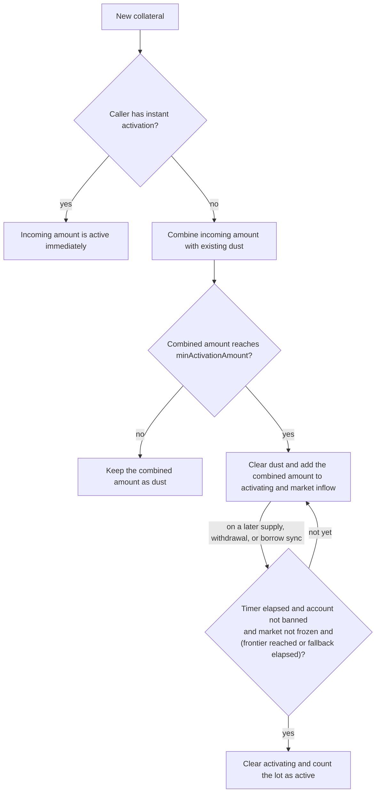

# Market Controller Policy

`LidoLendMarketController` is the policy layer for one Lido Lend market. The core remains the source of truth for supply, debt, collateral, interest, solvency, and token transfers. Before the core commits a market action, it gives the controller the resolved amounts and the current market state. The controller may update its own policy state and either allow the action or revert the whole transaction; it cannot rewrite the core's amounts or take custody of funds.

The controller adds policy protections that the core accounting does not provide on its own:

- a market-wide lender supply cap;
- delayed collateral activation and guardian-based borrow gating;
- freeze and pause controls;
- borrower ordering and eligibility for lender settlement; and
- a ceiling on rounding-driven borrow-share inflation.

Settlement policy is specified in [Settlement and lender exits](lender-settlement.md). Guardian identities, bans, suspect reports, and liveness are specified in [Guardian Signals](guardian-signals.md). This document explains how the controller consumes those subsystems.

## Policy boundary

Each controller is bound to one market and accepts hooks only from the Lido Lend core for that market. The core calls the hook after resolving the action's asset and share amounts but before applying its state change. Controller state changes made during the hook and the subsequent core action are atomic: a later revert rolls both back.

Every hook first passes the controller-wide pause check. Once resumed, the action-specific policy is:

| Core action | Controller policy |
|---|---|
| Supply loan assets | Enforce the supply cap against the accrued market total plus the resolved incoming assets. |
| Withdraw loan assets | No additional action-specific policy. Core liquidity and authorization checks still apply. |
| Borrow | Reject a freeze, a zero-asset borrow, an excessive post-borrow share rate, or a banned caller, borrower, or receiver; mature any ready collateral; require the resulting active collateral to cover post-borrow debt; update the borrower's settlement-queue position. |
| Repay | Prevent a healthy borrow-share rate from crossing its ceiling; update or remove the borrower in the settlement queue after the repayment. |
| Supply collateral | Mature any ready activating amount; classify the new collateral as dust, activating, or instantly active; update the borrower's settlement-queue position. |
| Withdraw collateral | For a debt-bearing position, reject a freeze; mature any ready activating amount; apply the voluntary withdrawal order and activation lock; require remaining active collateral to cover remaining debt; update the borrower's settlement-queue position. |
| Liquidate | Reduce the activation balances without an activation lock and update the post-liquidation queue position. Liquidation is exempt from the borrow-share-rate ceiling. |
| Accrue interest | No additional action-specific policy. |
| Settle | Enforce the borrow-share-rate transition, bad-debt gate, borrower eligibility, settlement limit, and settleable-supply limit; reduce the activation balances; update the queue position. See [Settlement and lender exits](lender-settlement.md). |

An unrecognized future hook reverts. “No additional policy” does not bypass the core: its accounting, authorization, liquidity, and solvency rules still run normally.

### Lender supply cap

The cap is an admission limit for lender supply; a value of zero means uncapped. For a supply, the controller compares the cap with the already-accrued total supplied loan assets plus the incoming assets. Interest can carry the market total above the cap because interest accrual itself remains live. Lowering the cap below the current total does not remove existing supply; it prevents further supply until the total falls below the cap. The cap does not block lender withdrawals.

## Borrower gating

The core tests solvency against the borrower's full collateral balance. It cannot distinguish previously activated collateral from a fresh deposit or tell whether an account has been compromised. The controller therefore keeps an additional activation state for each `(market, borrower)` and permits new debt only against **active** collateral.

Fresh collateral still enters the core immediately. All of it counts toward core solvency and can protect existing debt from liquidation. For new borrowing, however, only the active portion provides capacity; activation state also governs the withdrawal rules below. The controller computes borrow capacity as zero when active collateral is below `minActivationAmount`. At or above that threshold, capacity is the active collateral's oracle value multiplied by the market liquidation loan-to-value limit (LLTV).

A borrow also fails when the caller, the debt owner, or the loan receiver is banned. Soft guardian signals do not directly block borrowing: they lengthen the debt owner's activation time. The source and lifecycle of those signals are described in [Guardian Signals](guardian-signals.md).

With open debt, a voluntary collateral withdrawal must leave enough active collateral to cover the remaining debt. A debt-free borrower bypasses that health test, although an activation lock can still hold part of an activating lot.

## Collateral activation

The controller partitions each borrower's raw core collateral into three conceptual balances:

| Balance | Meaning |
|---|---|
| `dust` | Untimed collateral placed in the dust bucket by the supply-classification rules. It is withdrawable but cannot support a borrow. |
| `activating` | Collateral inside the activation timer. It cannot support a borrow yet and may be partly locked against voluntary withdrawal. |
| `active` | Matured or instantly activated collateral. It can support a borrow and is not subject to the activation lock. |

Only `dust` and `activating` are stored by the activation subsystem. Active collateral is derived as:

```text
active = raw core collateral - dust - activating
```

Changing the activation configuration does not reclassify existing buckets. Lowering `minActivationAmount` can therefore leave old dust at or above the new threshold until a later normal supply processes it. Raising the threshold can leave an already-timed activating lot below the new threshold; that lot still follows its existing activation path.

The balances are buckets, not mutually exclusive account states: an account can have active collateral together with dust and an activating amount. All collateral in the activating balance shares one start time and one deadline; this document calls it an **activating lot**. New collateral follows this path:



### Classifying a collateral supply

For a normal, non-instant supply, the incoming collateral is first combined with the borrower's existing dust.

- If `incoming collateral + existing dust < minActivationAmount`, the combined amount remains dust. This threshold does not start or change the activation timer.
- Once the combined amount reaches the threshold, a normal supply clears the dust balance and moves the entire combined amount into `activating`. It also adds that amount to the market inflow used to quote the base delay.

An instant supply bypasses that dust and threshold path entirely. After the normal pre-supply maturation check, its incoming amount becomes active immediately, regardless of size, and does not enter either inactive bucket or the inflow throttle. The instant credit itself does not change any dust or activating amount that remains after that check. Because borrow capacity is still zero while the borrower's **total active** collateral is below `minActivationAmount`, a small instant supply can be active without yet supporting a borrow.

Instant activation is keyed by the call's sender, not by the borrower receiving the collateral. It is intended for access-controlled routers whose flows do not benefit from the reaction window, not for permissionless helpers.

All of a borrower's activating collateral shares one timer. A later normal supply that reaches the threshold joins the existing lot. It restarts the stored base deadline only when the newly quoted deadline would be later, so a top-up can postpone activation but cannot bring it forward. A restart also moves `activatingStart` to the current timestamp; if that is at or after the current suspect snapshot's expiry, that snapshot no longer adds its surcharge to the restarted lot.

### Base delay and market inflow

The base delay depends on recent non-instant collateral inflow across the whole market, not only on the borrower, so splitting a deposit across addresses does not avoid the throttle. For a threshold-crossing supply, effective inflow is the decayed market inflow plus the new activating amount, including any dust released into that amount. The accumulator is capped at `maxDelayInflow`.

```text
baseDelay = minActivationDelay
          + (maxActivationDelay - minActivationDelay)
          * effectiveInflow / maxDelayInflow

baseDelay = maxActivationDelay when effectiveInflow >= maxDelayInflow
```

The proportional term uses integer division rounded down to whole seconds.

The market inflow decays linearly: an accumulator at `maxDelayInflow` reaches zero after `maxActivationDelay` without another contribution. More recent volume therefore produces a longer reaction window, up to the configured cap. The delay stored for an existing lot is fixed when that lot starts or its deadline is extended; later inflow decay affects only the delay quoted for a later supply.

Within one transaction, a voluntary withdrawal or forced seizure reverses only the activating inflow contributed by that borrower in the same transaction. It cannot erase another borrower's contribution or the decayed baseline.

### Maturation gate

Activation is lazy. Collateral-supply, voluntary collateral-withdrawal, and borrow hooks first try to mature the borrower's existing lot. Merely passing the timestamp does not write a new balance.

The lot's unlock time combines its stored base delay with the current guardian opinion:

```text
unlockTime = activatingStart + storedBaseDelay
           + strikeCount * delayPerStrike
           + suspectCount * delayPerSuspect
             when activatingStart < suspectExpiryTimestamp
```

A banned borrower has no finite unlock time. Otherwise the lot matures only when all applicable conditions hold:

1. the current timestamp has reached `unlockTime`;
2. the guardian quorum frontier has reached `unlockTime`, or the liveness fallback measured from `activatingStart` has elapsed; and
3. the market is not frozen.

Setting `maxGuardiansQuorumDelay` to zero removes the frontier requirement but not the activation timer. A nonzero fallback prevents stalled guardians from holding collateral indefinitely; configuration requires it to be greater than `maxActivationDelay` and no greater than seven days. Freeze does not rewrite the deadline; it only prevents the state transition while frozen, so an otherwise ready lot may mature on the first sync after unfreeze.

> [!NOTE]
> The fallback deliberately permits maturation without new guardian frontier progress after its deadline. [Guardian Signals](guardian-signals.md#how-the-controller-uses-the-frontier) describes this accepted liveness trade-off and its limits.

### Voluntary withdrawals and forced collateral reductions

A voluntary collateral withdrawal first performs the maturation sync. It then consumes collateral in this order:

1. dust;
2. activating collateral above the current lock floor; and
3. active collateral for any remainder.

For `activatingLockDuration` from the lot's start, up to `activatingLockAmount` stays in `activating` and cannot be removed voluntarily. If the requested withdrawal would have to cross that floor, the action reverts. Once the lock expires, that portion becomes withdrawable even if the lot has not matured.

When no lock floor applies, a voluntary withdrawal that leaves a nonzero activating balance and a **total inactive remainder** (`dust + activating`) below `minActivationAmount` moves the activating portion into dust and clears its timer. The same demotion is deliberately skipped while a nonzero lock floor holds: converting locked collateral into freely withdrawable dust would bypass the lock.

Liquidation and settlement reduce collateral without the voluntary-withdrawal rules. Their hooks do not first mature the lot, and they ignore the voluntary lock floor. They consume dust, then activating collateral, then active collateral. Their lock floor is zero, so they apply the same demotion rule: when a surviving inactive remainder is below the threshold, its activating portion moves to dust and its timer is cleared. Neither a freeze nor a guardian ban blocks these risk-reducing paths.

## Freeze and pause

Freeze and pause serve different incident scopes:

| State | Blocks | Still permits |
|---|---|---|
| Freeze | Every borrow; collateral withdrawal by a borrower with open debt; transition from activating to active. | Loan-asset supply and withdrawal, collateral supply, repay, liquidation, settlement, and debt-free collateral withdrawal subject to any activation lock. |
| Pause | Every core action that invokes this controller, including repayment, liquidation, settlement, and interest accrual. | Core surfaces without a market hook, such as flash loans and authorization changes; wrapper-share transfers; controller administration. |

Freeze stops new risk while preserving debt reduction and lender exit mechanisms. Because it leaves liquidation and settlement live, it is not sufficient when those paths themselves are unsafe, for example during a stale-oracle incident. Freeze prevents a timed lot from maturing, but does not disable the classification of a threshold-crossing normal supply or the immediate activation of an instant supply. Borrowing remains blocked regardless.

Pause is the stronger controller-wide stop. A finite pause expires automatically, although an authorized resume may end it earlier. An indefinite pause does not expire and requires an authorized resume. The exact authorities and intended holders are listed in [Roles](roles.md).

## Borrow-share-rate invariant

Asset/share rounding can leave borrow shares behind as total borrow assets approach zero. Repeating that boundary can inflate the number of shares minted for later debt and eventually make ordinary borrowing unavailable. The controller therefore enforces:

```text
totalBorrowShares + virtualBorrowShares
    <= MAX_BORROW_SHARE_RATE * (totalBorrowAssets + virtualBorrowAssets)
```

The ceiling is ten times the virtual-buffer ratio used by the core. Enforcement preserves recovery paths:

- a borrow must leave the post-borrow market within the ceiling, and a borrow resolving to zero assets is rejected;
- when a market starts within the ceiling, repay and settlement may not move it above the ceiling;
- when a market already starts above the ceiling, repay and settlement are not blocked by this transition check, so the stranded state remains recoverable; and
- liquidation is exempt, so forced risk reduction stays available.

## Related specifications

- [Architecture](architecture.md) — system topology and trust boundaries.
- [Guardian Signals](guardian-signals.md) — guardian actors, opinions, quorum, and liveness frontier.
- [Settlement and lender exits](lender-settlement.md) — queue policy and vault settlement paths.
- [Controller API](api/lido-lend-market-controller.md) — generated external functions, types, events, and errors.
- [Roles](roles.md) — privileged actions and intended holders.
