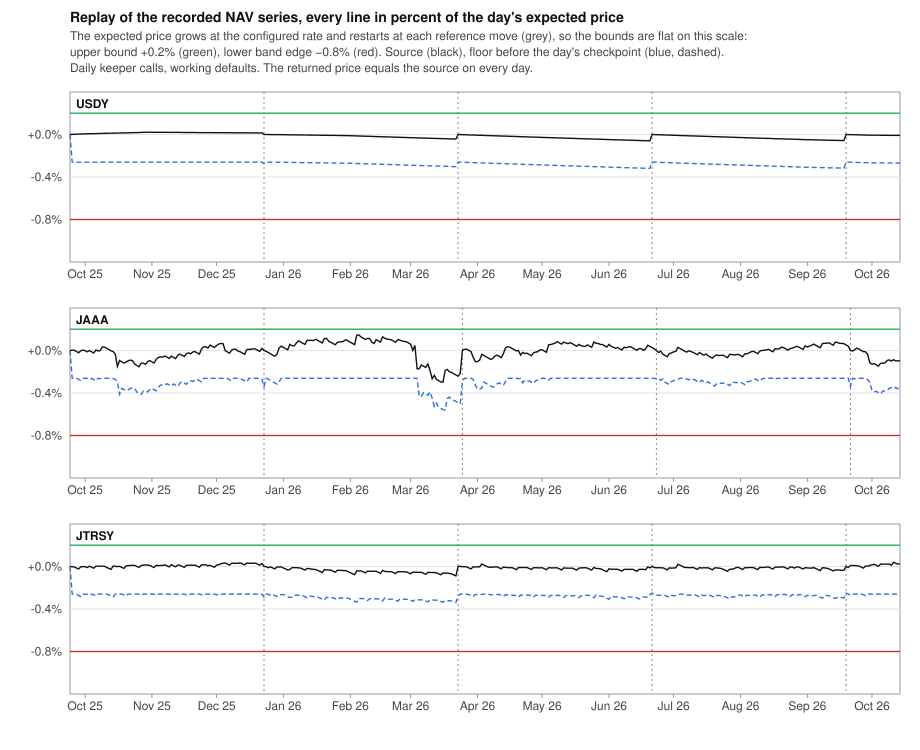

# NAV Oracle

The NAV oracle prices a collateral whose value is an issuer-published net asset value (USDY, JTRSY, JAAA, the deRWA notes, ERC-4626 vault shares) in a USD stablecoin loan token. It takes one loan token as one unit of the NAV's currency and reads the stablecoin's Chainlink feed only as a kill switch. The design goal is lenders first: the oracle may undervalue collateral for a while, and it never lets a market run on a price further above an honest source than the configured corridor allows.

The oracle is a value or a revert. Nothing in the core, the controller or the vault knows about its rules, and nothing in it knows about markets, LLTV or the Circuit Breaker. Its parameters are sized against the market's bad-debt frame off chain, and the market pause is the Circuit Breaker on the controller.

## Contracts and the core boundary

`NavOracleBase` holds every rule. Four adapters override only `_readSource()`, which returns the NAV with 18 decimals in the NAV's currency.

| Adapter | Source call | Scaling to 18 decimals |
|---|---|---|
| `UsdyOracle` | Ondo `USDYOracleWrapper.getPrice()` | none, the getter returns 18 decimals |
| `CentrifugeOracle` | `Spoke.pricePoolPerShare(poolId, scId, false)` | none, the Spoke returns D18 |
| `ChainlinkNavOracle` | `latestRoundData()` answer, reverting on a non-positive answer | `answer × 10^(18 − feedDecimals)`, feeds above 18 decimals refused at construction |
| `Erc4626Oracle` | `convertToAssets(10^shareDecimals)` | `assets × 10^(18 − assetDecimals)`, assets above 18 decimals refused at construction |

The source NAV becomes the core's 1e36 domain through one immutable, `PRICE_SCALE = 10^(36 + loanDecimals − collateralDecimals − 18)`, so `sourcePrice = nav × PRICE_SCALE`. A token pair that leaves no room for the convention, `collateralDecimals > 18 + loanDecimals`, is refused at construction. For USDY (18 decimals) in a USDC market (6 decimals) a NAV of 1.15 returns `1.15e24`, which is 1.15 USDC base units per USDY base unit scaled by 1e36. `Erc4626Oracle` takes the vault share as the collateral token and does not require the vault's asset to be the loan token, so sUSDS in a USDC market prices one USDS as one USDC.

Each oracle sits behind an `OssifiableProxy`. The source, the loan and collateral tokens, the loan token's Chainlink USD feed and `PRICE_SCALE` are constructor immutables, so one implementation serves one market. All four adapters keep their storage in the namespace `lido.lend.storage.NavOracle`, so the proxy can move from one adapter to another without losing the stored prices and parameters.

The core and the controller call `price()` in every borrow, debt-bearing collateral withdrawal, liquidation and settlement, and in the controller's position and settlement quotes. A revert from `price()` therefore stops exactly the price-dependent paths.

| Path | Reads the price | During a revert |
|---|---|---|
| `borrow` | controller Borrow hook, then the core health check | stops |
| `withdrawCollateral` with open debt | controller WithdrawCollateral hook, then the core health check | stops |
| `liquidate` | core health check and seizure conversion | stops |
| `settle`, direct or through the vault, and a `fallbackExit` that needs a settlement leg | vault quote, core seizure divisor, controller Settle hook | stops |
| controller quotes `positionOf`, `settlementLtv`, `hasBadDebt`, `nextSettlementBorrower`, `settlementFor` | view | stop |
| `repay` | no | keeps working |
| loan-asset supply, deposit and withdrawal from free liquidity | no | keeps working |
| `supplyCollateral` | no | keeps working |
| `withdrawCollateral` without debt | no, the core skips the health check | keeps working |

## State and definitions

| Stored value | Meaning |
|---|---|
| `referencePrice`, `referencePriceSetAt` | the price the expected path grows from and when it was set |
| `checkpointPrice`, `checkpointAt` | the price the floor falls from and when it was set |
| `protectedGrowthTolerance` | the largest growth tolerance debt may still have been taken under |
| `NavOracleCheckParams` | `yearlyGrowthRate`, `growthTolerance`, `maxFallPerInterval`, `maxDrawdown`, `maxOvershoot`, `maxLoanTokenDeviation`, `minPriceRatio` (WAD fractions), `maxBorrowRate` (WAD per second), `fallInterval`, `referenceInterval` (seconds) |

Every value below is computed at read time from the stored values and `block.timestamp`. All products are WAD fixed point and round down.

```text
sourcePrice    = nav × PRICE_SCALE
expectedPrice  = referencePrice × (1 + yearlyGrowthRate × (now − referencePriceSetAt) / 365 days)
upperBound     = expectedPrice × (1 + growthTolerance)
band           = [expectedPrice × (1 − maxDrawdown), expectedPrice × (1 + maxOvershoot)]
n              = floor((now − checkpointAt) / fallInterval)
floor          = checkpointPrice × (1 − n × maxFallPerInterval), and 0 once n × maxFallPerInterval ≥ 1
```

The expected price is a line, not a bound: it is where an honest NAV should sit given the price accepted at `referencePriceSetAt` and the configured yield. The upper bound clamps from above. The floor is a rate limit on the way down, anchored to a price the source actually showed. The band is where the oracle stops trusting the source at all.

`initialize(admin, params)` grants `DEFAULT_ADMIN_ROLE` to `admin`, validates and stores the parameters, and sets both the reference and the checkpoint to the live source price at the current time. `CONFIG_ROLE` starts without holders and the admin grants it.

## Price rule

`price()` reverts in three cases.

1. The loan token's feed answer is further than `maxLoanTokenDeviation` from 1 USD (`LoanTokenOffPeg`). This check runs first.
2. The source call reverts, with the source's own error, or returns zero (`SourceReturnedZero`).
3. The source price is outside the band (`PriceOutOfBounds`). Both edges belong to the band.

Otherwise `price()` returns `min(upperBound, max(sourcePrice, floor))`. A source above the upper bound is held at the bound. A source under the floor is held at the floor. A source between them is returned as is. The floor never exceeds the upper bound, because every write that sets the checkpoint keeps it at or under the expected price of its time, the expected price only grows with time, and the upper bound never sits under the expected price.

Below the band the oracle reverts instead of holding, because a held price above the real one is the harm the design avoids. New borrowing at LLTV against collateral worth less is bad debt at once, settlement pays exiting lenders in overvalued collateral, and liquidators do not act while the oracle price exceeds the real price by more than the liquidation incentive. Above the band the oracle also reverts, as a signal that the source is broken or hostile, even though a clamp there would be safe for lenders. A revert ends by itself when the source returns inside the band, or through the DAO acceptance below.

## Floor and `checkpoint()`

The floor falls from the checkpoint by `maxFallPerInterval` of the checkpoint price per whole `fallInterval`, with time alone and without any call. A source under the floor therefore reaches the price one step per interval whether anyone calls or not. The floor is a rate limit, not a lower clamp: once the steps add up to the whole price the floor is zero and the price is the source.

`checkpoint()` is open to anyone once `fallInterval` has passed since `checkpointAt`. It runs the three revert checks of `price()`, is refused while the source sits under the floor (`SourceBelowFloor`), and sets the checkpoint to `min(sourcePrice, expectedPrice)` at the current time. The floor trails an honest source and never climbs above the expected path, so a print above the path is never recorded and its reversal is held by nothing but the path. Refusing a checkpoint under the floor means a call can never lift a held price or restart a fall in progress.

`checkpoint()` never changes `price()`. Before the call the source is at or above the floor, so the price is `min(upperBound, sourcePrice)`. After it the floor equals `min(sourcePrice, expectedPrice)`, which is at or under the source, so the price is the same.

The floor protects borrowers, not lenders. With a checkpoint every interval, a false fall from the path passes at most one step per interval, which gives the pauser committee one `fallInterval` to pause the market through the Circuit Breaker before a second step lands. Lender safety does not depend on the floor or on the checkpoint keeper, it comes from the width of the corridor between the upper bound and the band's lower edge.

## Open reference move

`moveReferencePrice()` is open to anyone once `referenceInterval` has passed since `referencePriceSetAt`. It runs the three revert checks of `price()` and requires `expectedPrice × (1 − growthTolerance) ≤ sourcePrice` (`SourceBelowGrowthTolerance`) and `floor ≤ sourcePrice ≤ upperBound` (`SourceOutsideFloorAndBound`). It then sets the reference to the source price at the current time.

The move never changes the price and never touches the checkpoint. Before it the source sits between the floor and the upper bound, so the price is the source. After it the expected price is the source, the band is centred on it, the floor is unchanged and at or under it, and the new upper bound is above it, so the price is still the source.

The move corrects the drift between the configured and the realized yield without a governance action. It can lock in a fall of at most one `growthTolerance` per `referenceInterval`, because the source it accepts sits no lower than `expectedPrice × (1 − growthTolerance)` and the next move waits a full interval. A frozen source cannot be re-anchored once the path has grown more than one tolerance above it, which the calibration rule `yearlyGrowthRate × referenceInterval / 365 days > growthTolerance` guarantees by the time a move is allowed again.

## DAO acceptance

`acceptCurrentPrice(lowest, highest)` is `CONFIG_ROLE` only. It reads the source once, without the band, the clamp or the peg check, requires `lowest ≤ highest` (`InvalidAcceptRange`) and the source inside `[lowest, highest]` (`SourceOutsideAcceptRange`), and sets both the reference and the checkpoint to the source price at the current time. The price then equals the source at once.

It is the only way out of a band revert and the way to admit a rise above the upper bound or a fall faster than the floor. The range is the one the DAO reviewed when it submitted the motion, so a source that moved during the motion's delay cannot be accepted by mistake.

## Parameter changes and the protected tolerance

Every setter is `CONFIG_ROLE` only and stores the new parameters through one validator.

| Setter | Parameters |
|---|---|
| `setGrowthLimit` | `yearlyGrowthRate`, `growthTolerance` |
| `setFallLimit` | `maxFallPerInterval`, `fallInterval` |
| `setRevertBand` | `maxDrawdown`, `maxOvershoot`, `referenceInterval` |
| `setMarketLimits` | `minPriceRatio`, `maxBorrowRate` |
| `setLoanTokenPegCheck` | `maxLoanTokenDeviation` |
| `releaseGrowthTolerance` | `protectedGrowthTolerance` only |

The validator refuses a parameter set unless all of the following hold.

| Condition | Error | Reason |
|---|---|---|
| `fallInterval > 0` and `0 < maxFallPerInterval < 1` | `InvalidFallLimit` | the floor needs a step and an interval and must survive one interval |
| `maxDrawdown < 1` | `InvalidRevertBand` | the band's lower edge must stay above zero |
| `maxOvershoot > growthTolerance` | `InvalidRevertBand` | the band's top must sit above the upper bound, or an honest clamp would revert |
| `referenceInterval ≥ max(fallInterval, ceil((maxDrawdown + growthTolerance) / maxFallPerInterval) × fallInterval)` | `ReferenceIntervalTooShort` | between two reference moves the floor can cross the whole corridor in whole steps, so a held price reaches the source before the next move can lower the path again |
| `maxLoanTokenDeviation < 1` | `InvalidLoanTokenDeviation` | the peg band must stay above zero |
| `minPriceRatio > 0` | `InvalidMinPriceRatio` | the ratio check needs a target |
| `(1 − maxDrawdown) × (1 − growthTolerance) / (1 + protectedGrowthTolerance) ≥ minPriceRatio × (1 + heldInterest)`, the ratio rounded down and its minimum rounded up | `PriceRatioBelowMinimum` | the corridor ratio below |

The corridor ratio is the lowest price the rules can return across one reference move over the highest price they could have returned before it. A reference move can lower the path to `(1 − growthTolerance)` of the expected price, and the band then lets the price fall to `(1 − maxDrawdown)` of the new path. Debt may have been taken at `(1 + protectedGrowthTolerance)` of the old path. A position admitted at LLTV stays above the write-off boundary as long as this ratio is at least `LLTV × LIF` times the growth of its debt until it is liquidated. The configurator enters `LLTV × LIF` as `minPriceRatio` because the oracle does not know the market. A `growthTolerance` at or above one fails this check, so the validator needs no separate bound on it.

The debt grows while the floor holds the price above the source, because a liquidation may only pay once the floor reaches the source. That is the case while the loan token trades at a premium inside the peg deviation, which eats into the liquidation incentive, or when the liquidator's own costs exceed what remains of it. The hold lasts at most one corridor crossing, `ceil((maxDrawdown + growthTolerance) / maxFallPerInterval) × fallInterval`, the time the floor takes to fall from the old path to the band's lower edge after a reference move. `heldInterest` is the interest the core accrues on one unit of debt over that crossing at `maxBorrowRate`, the highest borrow rate per second the market's interest rate model can charge, with the core's own three-term compounding. The validator computes the crossing from the parameters being set, so a wider drawdown, a larger tolerance, a smaller step or a longer interval is checked against the interest it lets accrue.

`protectedGrowthTolerance` rises with `growthTolerance` inside the validator and falls only through `releaseGrowthTolerance(released)`, which accepts a value no lower than the current `growthTolerance` and no higher than the current protected one (`InvalidReleasedTolerance`). Debt taken under an old upper bound stays open across any later sequence of changes, so lowering the tolerance and then widening the drawdown in a second motion is refused until the configurator states with a release that the old room is no longer needed. A release only raises the corridor ratio, so it needs no ratio check.

Every parameter change keeps the expected price and the floor where they were at the time of the change.

- A changed `yearlyGrowthRate` moves the reference to the current expected price at the current time. The expected price is unchanged at that moment and grows at the new rate afterwards, and `referenceInterval` restarts for the open move.
- A changed `maxFallPerInterval` or `fallInterval` moves the checkpoint to the current floor at the current time. The floor is unchanged at that moment and falls with the new step and interval afterwards, and the first new step lands one full new interval later.
- A changed `growthTolerance` moves the upper bound at once in the same direction. A lower tolerance lowers a clamped price to the new bound, which is intended. A higher one raises a clamped price up to the new bound or the source.
- A changed `minPriceRatio` or `maxBorrowRate` moves nothing and only tightens or loosens the validator.
- A changed `maxDrawdown`, `maxOvershoot` or `maxLoanTokenDeviation` moves a revert boundary. Whenever `price()` returns a value both before and after such a change, the value is the same.

## Loan token peg policy

The quote leg is pinned at one loan token per USD. The loan token's Chainlink USD feed never enters the price and serves only as a kill switch. While the feed's latest answer is outside `[1 − maxLoanTokenDeviation, 1 + maxLoanTokenDeviation]` USD, edges inclusive, `price()`, `checkpoint()` and `moveReferencePrice()` revert with `LoanTokenOffPeg`. The purpose is settlement and borrowing at par. With the quote pinned, a settlement during a depeg to `f` pays an exiting lender collateral worth `1 / f − 1` more than the claim at the borrowers' expense, and a premium `p` admits borrowing against collateral worth `1 / p` of its price.

The check reads only the answer word of `latestRoundData()` and ignores the round's age, since a round going stale does not mean the peg came back. Chainlink stops the USDC/USD and USDT/USD feeds at their last answer while the market trades above their 1.05 USD cap, so a feed frozen off peg keeps the oracle reverting until an in-band round prints or the configurator widens the deviation. A feed call that reverts, returns fewer than 160 bytes or answers zero or less is ignored, so the feed cannot stop the oracle by failing, and the oracle then degrades to the plain pin. Only the answer word is decoded, so values outside their types in the other four fields do not matter.

`acceptCurrentPrice` does not run the peg check, so the DAO can clear a band revert during a depeg.

## Invariants

Each invariant holds after any sequence of source moves, time, open calls and configurator calls. The last column names the suite that asserts it.

| # | Invariant | Asserted in |
|---|---|---|
| I1 | `floor ≤ expectedPrice` | `test/invariant/NavOracle.invariant.t.sol` `invariant_floorNotAboveExpectedPrice` |
| I2 | `expectedPrice ≤ upperBound` | `invariant_expectedPriceNotAboveUpperBound` |
| I3 | `checkpoint()` and `moveReferencePrice()` never change `price()` | `invariant_openCallsKeepPrice`, `test/unit/NavOracleBase.t.sol` `testFuzz_checkpoint_keepsPrice`, `testFuzz_moveReferencePrice_keepsPrice` |
| I4 | a parameter change never changes a returned `price()`, except a changed `growthTolerance` moving a clamped price with the upper bound | `invariant_parameterChangesKeepPrice`, `testFuzz_setGrowthLimit_keepsExpectedPrice`, `testFuzz_setFallLimit_keepsFloor` |
| I5 | `(1 − maxDrawdown)(1 − growthTolerance) / (1 + protectedGrowthTolerance) ≥ minPriceRatio × (1 + heldInterest)` | `invariant_corridorRatioCoversProtectedTolerance`, `testFuzz_corridorRatio_matchesValidator` |
| I6 | `protectedGrowthTolerance ≥ growthTolerance` | `invariant_protectedToleranceCoversTolerance` |
| I7 | when `price()` returns, `expectedPrice × (1 − maxDrawdown) ≤ price() ≤ upperBound` | `invariant_priceWithinDrawdownAndUpperBound` |
| I8 | when `price()` returns, it equals `min(upperBound, max(sourcePrice, floor))` recomputed from the stored state | `invariant_priceMatchesRule`, `testFuzz_price_matchesRule` |
| I9 | a reference move lowers the path by at most one `growthTolerance`, and a second move needs a full `referenceInterval` | `test/scenario/NavOracleCorridor.t.sol` `test_moveThenCheckpoint_locksInAtMostOneTolerance` |
| I10 | a revert stops borrow, debt-bearing collateral withdrawal, liquidation and settlement, and leaves repay, loan supply and withdrawal, collateral supply and debt-free collateral withdrawal working | `test/scenario/NavOracleMarket.t.sol` `test_bandRevert_stopsPricedPathsOnly` |
| I11 | the recorded USDY, JAAA and JTRSY series never revert under the working defaults | `test/scenario/NavOracleReplay.t.sol` |
| I12 | debt admitted at LLTV under the upper bound, held by the floor for one crossing at `maxBorrowRate`, is repaid in full from the collateral at the liquidation incentive | `test/scenario/NavOracleMarket.t.sol` `test_floorHoldAtMaxBorrowRate_writesNothingOff` |

## Calibration

The calibration targets markets at 98% LLTV. The core's liquidation incentive factor is `LIF = 1 / (1 − 0.3 × (1 − LLTV)) = 1.006036`, so a position at LLTV is written off against lenders once the collateral loses `1 − LLTV × LIF = 1.408%` of the price it was admitted at. Everything that can overvalue collateral lives inside that room, together with the interest debt accrues while the floor holds the price, and `minPriceRatio = LLTV × LIF = 70 / 71 = 0.985915492957746479`, rounded up. The working defaults size the corridor for a market whose interest rate model charges at most 16% a year, `maxBorrowRate = 5073566717` per second, which the market's curve carries as its `max_borrow_rate`. A one-day step of 0.25% under a 0.2% tolerance then allows a drawdown of at most 0.8%: the corridor crossing is four days, the interest over it 0.1755%, and the minimum ratio 0.987646 against a corridor ratio of 0.988040. A drawdown above 0.8% lengthens the crossing to five days and needs a ratio of 0.988079, which no drawdown above 0.796% reaches.

The parameters follow five rules, and the validator enforces the corridor ratio with its interest allowance on top of them.

1. `growthTolerance ≤ maxFallPerInterval`. A fall from a source inside the tolerance down to the path then lands within one step.
2. `fallInterval` is the pauser committee's reaction time, not the source's cadence.
3. `|yearlyGrowthRate − realized yield| × referenceInterval / 365 days < growthTolerance`. Otherwise the drift between two moves exceeds the tolerance, the open move is refused, and the drift ends in a clamp or a band revert that the DAO must clear.
4. `yearlyGrowthRate × referenceInterval / 365 days > growthTolerance`. Otherwise a frozen source can be re-anchored on every interval and never reaches the band.
5. `maxBorrowRate` is at least the highest rate the market's interest rate model can charge: its `max_borrow_rate`, or the curve's top, `max_rate_at_target × curve_steepness`, without one. The oracle cannot see the interest rate model, so raising the curve's ceiling first raises `maxBorrowRate` through `setMarketLimits`, and acceptance checks the pair at launch.

The working defaults below are the values the replay and the scenario suites run with. The realized yields are measured over 2025-09-24 to 2026-10-14 from the fixtures in `test/fixtures/nav-oracle/` (USDY from Ondo's ranges, JAAA and JTRSY from the LlamaGuard phase-3 aggregators).

| Parameter | USDY | JAAA | JTRSY | Derivation |
|---|---|---|---|---|
| `yearlyGrowthRate` | 3.75% | 4.25% | 3.5% | realized 3.65%, 4.20%, 3.46% plus a small margin, and Ondo's October 2026 range for USDY. Rule 3 allows a realized yield within ±0.811% per year of the rate. |
| `growthTolerance` | 0.2% | 0.2% | 0.2% | the largest replay excursion above the path is +0.021%, +0.147% and +0.040%, so an honest source is never clamped. Every basis point here comes off `maxDrawdown`. |
| `maxFallPerInterval` | 0.25% | 0.25% | 0.25% | at least the tolerance (rule 1) and above the largest recorded daily fall, −0.208% for JAAA on 2026-03-04, so a legitimate day passes in one step |
| `fallInterval` | 1 day | 1 day | 1 day | pauser committee reaction time (rule 2), an operating assumption |
| `maxDrawdown` | 0.8% | 0.8% | 0.8% | the largest the validator accepts at the other defaults and a 16% ceiling, and above the deepest replay excursion under the path, −0.060%, −0.299% and −0.089% |
| `maxOvershoot` | 3% | 3% | 3% | above the tolerance, as the validator requires, and above the +0.755% catch-up the public JTRSY NAVLink feed printed after its 65-day freeze |
| `referenceInterval` | 90 days | 90 days | 90 days | at least the 4-day corridor crossing, `ceil(1.0% / 0.25%) × 1 day`. Rule 4 holds with 0.925%, 1.048% and 0.863% of path growth per interval against the 0.2% tolerance. |
| `maxLoanTokenDeviation` | 0.5% | 0.5% | 0.5% | the USDC/USD and USDT/USD answers sat outside ±0.5% for 67.0 h and 72.5 h of 2 065 days, the longest stretches 49.9 h and 41.5 h |
| `minPriceRatio` | 0.985915492957746479 | same | same | `LLTV × LIF` at 98% LLTV, rounded up |
| `maxBorrowRate` | 5073566717 per second | same | same | 16% a year, the `max_borrow_rate` the market's curve carries (rule 5) |

With these values the corridor ratio is `0.992 × 0.998 / 1.002 = 0.988040`, 0.040% above the minimum with the interest allowance. A frozen source leaves the band `maxDrawdown / ((1 − maxDrawdown) × yearlyGrowthRate)` of a year after the last reference move, 78.5, 69.3 and 84.1 days, always before the next move is allowed. Counted from the start of the freeze it takes at most `(growthTolerance + maxDrawdown / (1 − maxDrawdown)) / yearlyGrowthRate` of a year, 98.0, 86.4 and 105.0 days, because a move inside the first `growthTolerance / yearlyGrowthRate` of the freeze can still re-anchor on the frozen value. Rule 3 makes the rate a monthly operating concern for USDY, whose monthly Ondo rate ranged from 3.55% to 5.35% over the oracle's life: a sustained Ondo rate above 4.56% or below 2.94% blocks the open move at 3.75% until the configurator follows it.

The figure replays the three recorded series through these rules with a keeper that calls `moveReferencePrice()` and then `checkpoint()` once a day. No day reverts, the floor never holds a price, no price is clamped, and the reference moves on days 90, 180, 270 and 360 for USDY and JTRSY and on days 90, 182, 272 and 362 for JAAA, whose March 2026 dip held the source more than one tolerance under the path for two days. Every line in the figure is drawn relative to the expected price of its day. The expected price itself grows at the configured rate and is re-anchored on the reference moves, so on this scale the upper bound and the band's lower edge are flat at +0.2% and −0.8%, the source's slope between two moves is the gap between its realized yield and the configured rate, and each move puts the source back on the path.



## Operations

**Checkpoint keeper.** A keeper calls `checkpoint()` once per `fallInterval`. Nothing breaks without it: the floor keeps falling from the last checkpoint and reaches zero after `1 / maxFallPerInterval` intervals, 400 days at the defaults, the price follows the source inside the clamp and the band, and lender safety is unchanged. What is lost is the borrower protection: once the floor sits below the source by more than one step, a false fall inside the band passes in one read instead of one step per interval, and positions near the liquidation threshold are liquidated before the pauser committee can act.

**Reference move.** The same keeper calls `moveReferencePrice()` once `referenceInterval` has passed and keeps calling it daily until it succeeds. Anyone may call it. A move that stays refused means the realized yield has left the rate's rule-3 window or the source is moving abnormally, and the configurator follows with `setGrowthLimit` or `acceptCurrentPrice`.

**Monitoring.** Off-chain monitoring owns source freshness, which the oracle does not check. It watches the following conditions and alerts the pauser committee or the configurator.

- A frozen or stopped source: USDY changes every calendar day, the Centrifuge share prices change on every US business day, so a value unchanged past its cadence, an Ondo schedule without a range for the coming month, or a reverting source is an incident.
- A blocked reference move: `moveReferencePrice()` refused for more than a few days after `referenceInterval` has passed.
- A long clamp: the source above the upper bound for more than a day, which is either a rate set too low or a hostile print.
- A held price: the source under the floor, which is either a real loss being passed step by step or a false fall that the pauser committee pauses.
- A pending band revert: the source within a fraction of the tolerance of either band edge, and for a frozen source the date its path crosses `maxDrawdown`.
- An off-peg loan token feed, which reverts the oracle until an in-band answer prints.
- The market's borrow-rate ceiling against `maxBorrowRate`, which must never fall behind it.

**Clearing a band revert.** The configurator reviews the source, chooses a range around the value it accepts, and submits `acceptCurrentPrice(lowest, highest)` through EasyTrack or a DAO vote. The motion fails harmlessly if the source left the range during the delay.

## Threat model

| Actor | Trusted for | Not trusted for | What the oracle does about it |
|---|---|---|---|
| Collateral issuer or source writer (Ondo's Safes, Centrifuge's hub managers, a NAV feed's DON, a vault) | publishing an honest NAV at its cadence | never erring, freezing, pausing or being compromised | clamps a rise at the tolerance above the path, rate-limits a fall with the floor, reverts outside the band, and lets an open move lock in at most one tolerance per reference interval |
| Loan token feed vendor (Chainlink) | not fabricating an answer | freshness, continuity, answering at all, printing above its 1.05 USD cap | reads the answer as a kill switch only, ignores a failing feed, and never prices with it |
| Stablecoin market | being the loan token lenders chose | staying at 1 USD | pins the quote at 1 and reverts while the feed is outside the peg deviation |
| `CONFIG_ROLE` holders (EasyTrack executor, DAO Agent) | choosing parameters and the accepted range after review | nothing beyond that | the validator bounds every parameter set by the corridor ratio against the protected tolerance, every change keeps the price except a tolerance change on a clamped price, and acceptance takes only a source value inside the range given |
| `DEFAULT_ADMIN_ROLE` and proxy admin (DAO Agent) | granting roles and upgrading logic | nothing beyond that | outside the oracle's rules |
| Any caller of `checkpoint()` and `moveReferencePrice()` | nothing | timing, calling or not calling | neither call can change the price, a move locks in at most one tolerance per interval, the floor falls with time without calls, and not calling only weakens the borrower protection of the floor |
| Interest rate model manager (EVMScriptExecutor) | keeping the market's borrow-rate ceiling at or under the oracle's `maxBorrowRate` | nothing beyond that | the oracle cannot see the interest rate model, so acceptance checks the pair at launch and monitoring after it |
| Pauser committee | pausing the market through the Circuit Breaker within one `fallInterval` | nothing beyond that | gives it one step per interval to react to a false fall |
| Borrower, liquidator, exiting lender | nothing | exploiting a transient mispricing | returns no value above the upper bound or below the band, and reverts every price-dependent path outside it |

A hostile source has two bounded levers. It can hold the price at the upper bound, adding at most `growthTolerance` of borrow capacity above the path. It can sit at `expectedPrice × (1 − growthTolerance)` on the day a move opens and lower the path by one tolerance per interval, which is the stated drift budget, and the band catches a source that drifts faster. A false fall inside the band liquidates borrowers at the false price once the floor reaches it, which costs them the liquidation incentive and costs lenders nothing.
