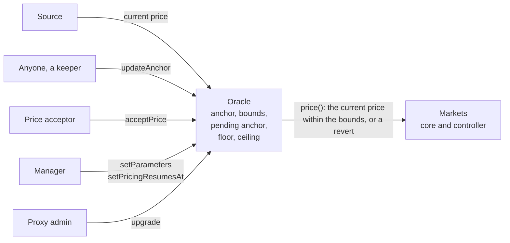
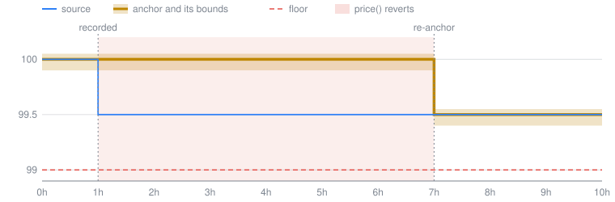
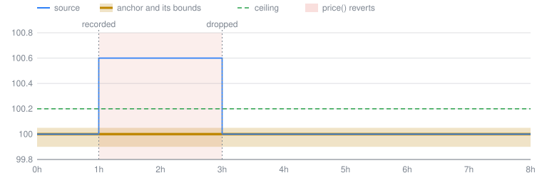
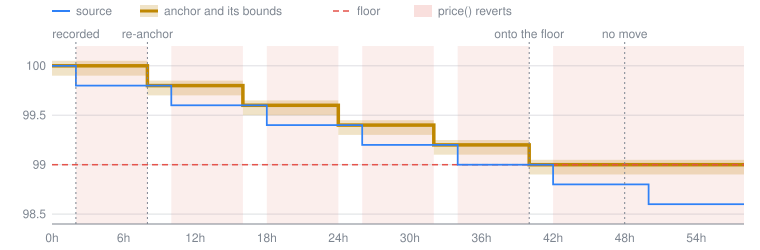
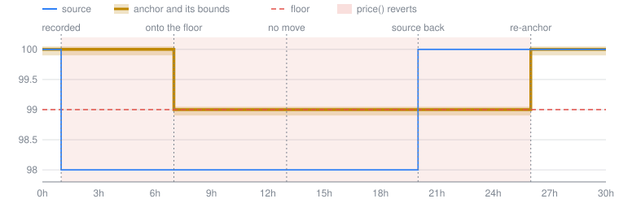
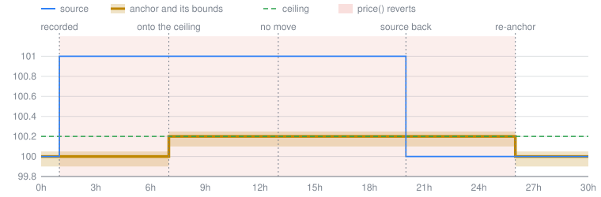
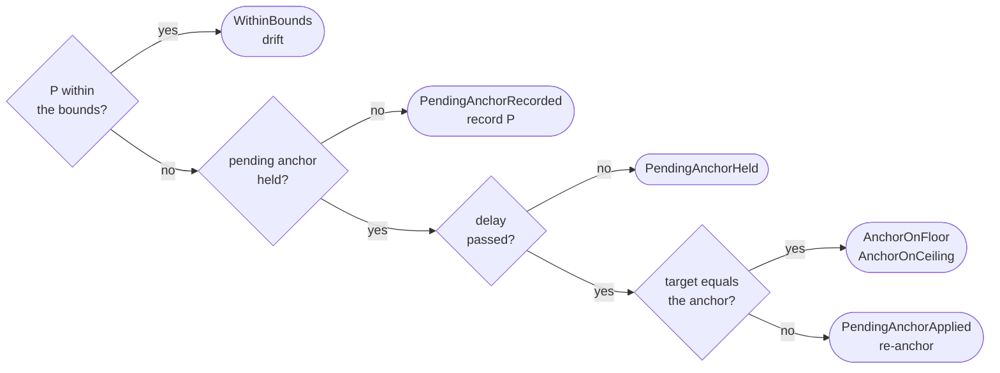
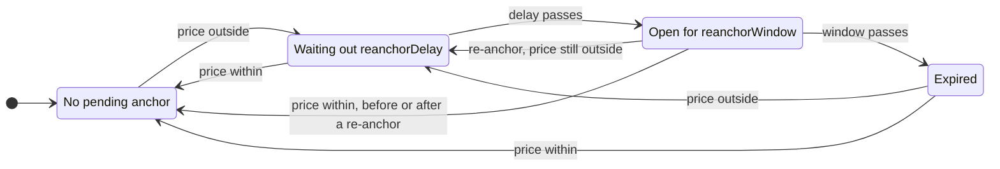

# Trailing Anchor Oracle

Review status: slop

The Trailing Anchor Oracle prices a market's collateral from a single price source and protects the market from a faulty or compromised value of that source. It returns the current price only near a stored **anchor** that trails the source, and a larger move becomes the price only after it has been public for a delay:

- `price()` returns the source's current price only while it is within the **bounds**, a narrow range around the anchor. Otherwise, or while the manager has suspended pricing, it reverts, and the market actions that need a price stop.
- Anyone can call `updateAnchor()`, and a bot calls it periodically. While the price is within the bounds, the update moves the anchor toward it at no more than yearly **speeds**: a **drift**.
- An update records a price outside the bounds as a **pending anchor**. If the price stays outside for `reanchorDelay`, a later update moves the anchor toward it: a **re-anchor**. Until then `price()` reverts, which gives the markets time to stop before the move becomes their price.
- The **floor** and the **ceiling**, the two lines, limit how far a wrong source can move the anchor. No update takes it below the floor, `maxAnchorBelowMark` under `highWaterMark`, and no re-anchor takes it above the ceiling, `maxAnchorAboveMark` over that mark. `highWaterMark` is the first anchor or the last accepted price, and only drifts raise it.
- Past these lines, or before the delay, the anchor moves only by the price acceptor's `acceptPrice`, which sets it to the current price. The manager can instead widen the bounds, which lets the price through without moving the anchor, or the lines, which a re-anchor reaches only after a new delay.

Two things it does not stop. A wrong value within the bounds is returned at once. A wrong value that rises slowly, inside the bounds at every update, drags the anchor up at the rise speed, and the price with it; only monitoring catches that. [What a faulty source can do](#what-a-faulty-source-can-do) gives how far each can go.



## Scope

In scope are `TrailingAnchorOracleBase`, which holds the rules and implements the core's `IOracle`, and its two adapters, which supply the current price: `UsdyNavOracle` reads USDY's redemption value from Ondo's USDY oracle, and `CentrifugeNavOracle` a share class's price from its Centrifuge Spoke ([Adapters](#adapters)).

Out of scope: who holds the roles, in [Privileged Roles](roles.md), and the markets' freeze and pause, in [Market controller](market-controller.md).

## How it works

### Bounds around the anchor

```text
lowerBound = floor(anchorPrice × (1e18 − maxPriceBelowAnchor) / 1e18)
upperBound = floor(anchorPrice × (1e18 + maxPriceAboveAnchor) / 1e18)
```

Inside them, edges included, `price()` returns the current price. Outside them it reverts until the source comes back, the anchor moves or the manager widens the bounds.

### How the anchor moves

| Current price `P` | What happens to the anchor | Limit |
|---|---|---|
| within the bounds | an update moves it toward `P`: a **drift** | `maxAnchorRisePerYear` up and `maxAnchorFallPerYear` down a year, counted since the anchor was last set; down not below the floor |
| outside the bounds | an update records `P` as the pending anchor; later updates hold it while `P` stays outside on its side | — |
| outside, on the pending anchor's side, from `reanchorDelay` after it was recorded until `reanchorWindow` later | an update moves it onto the pending anchor or `P`, whichever is nearer: a **re-anchor** | the delay; down not below the floor, up not above the ceiling |
| anywhere | the price acceptor moves it onto `P` with `acceptPrice` | the range the acceptor passes; the floor and the ceiling restart there |

### The floor and the ceiling

`highWaterMark`, here `H`, is the anchor `initialize` seeded or the last accepted price. Between acceptances only a drift up raises it: onto the new anchor when that passes `H`, or by the drift's step while the anchor already sits above `H`. A re-anchor never moves it, and it never falls by itself. The floor and the ceiling hang off it:

```text
floorPrice   = H − floor(H × maxAnchorBelowMark / 1e18)
ceilingPrice = H + floor(H × maxAnchorAboveMark / 1e18)
```

The floor binds on the way down, once an update would take the anchor more than `maxAnchorBelowMark` below `H`. The ceiling binds on the way up, once a re-anchor would take it more than `maxAnchorAboveMark` above `H`; a drift is not held by it, since a drift raises `H` as it goes. Because re-anchors do not move `H`, each line caps the total of all re-anchors on its side, not each one. Were a re-anchor to raise `H`, each one the ceiling stopped would lift the ceiling by `maxAnchorAboveMark`, and a source held above the bounds would climb by as much every delay.

A line's bounds are the bounds around an anchor that sits on it. From `A` = `H` = 100, in % of the seed, with a floor 1% under `H`, a ceiling 0.2% over it, bounds of +0.05% and −0.1% and speeds of 6% and 1% a year, the floor is 99 with bounds from 98.901 to 99.0495, and the ceiling is 100.2 with bounds from 100.0998 to 100.2501:

| Change of the source | Anchor after it |
|---|---|
| a 0.1% rise that stays past the delay | 100.1, as without the ceiling; `H` stays 100 |
| a rise within the bounds at 6% a year | follows by drift, with `H`, the floor and the ceiling |
| a fall within the bounds at 1% a year | follows by drift for about a year, to 99, where it stays |
| growth to 104 by drift, then a fall to 100 | 102.96, the floor under `H` = 104 |

### Examples

The examples use illustrative values, not any market's: bounds of +0.05% and −0.1%, speeds of 6% and 1% a year, a floor 1% under `H`, a ceiling 0.2% over it, a 6-hour delay and a 1-day window. A keeper calls `updateAnchor()` every hour, and prices are in % of the seed. The charts plot the oracle's state after each hour's update.

**Example 1: a real fall within the floor lands after one delay.** The source falls 0.5% at 1h. The update at 1h records it as the pending anchor, the updates from 2h to 6h hold it, and the update at 7h moves the anchor onto it. `price()` reverts from 1h to 7h.



**Example 2: a wrong value that clears up within the delay never becomes the price.** The source jumps 0.6% at 1h and comes back at 3h. The update at 3h finds it within the bounds and drops the pending anchor. Had it stayed past the delay, it would have moved the anchor only onto the ceiling, as in example 5.



**Example 3: a walk down stops at the floor.** The source steps down by 0.2 every 8 hours from 2h. Each step lands after a delay until the anchor reaches the floor, 99, at 40h. The step at 42h takes the source below the floor's bounds: once its delay passes, the updates leave the anchor on the floor, and `price()` reverts until the source returns or the price acceptor or the manager acts.



**Example 4: a deep wrong fall stops at the floor, and the price comes back with the source.** The source falls 2% at 1h. At 7h the re-anchor goes only onto the floor and records the price again, and from 13h the updates change nothing. At 20h the source comes back to 100, above the floor's bounds: the update records it on the other side, and the re-anchor at 26h makes it the price. Had the fall been real, `acceptPrice` would have priced it with no delay in the contract.



**Example 5: a wrong jump up stops at the ceiling, and the price comes back with the source.** Example 4 mirrored: the source jumps 1% at 1h, the re-anchor at 7h goes only onto the ceiling, 100.2, and the source's return at 20h lands at 26h.



## Parameters

| Parameter | Type | Allowed values | Purpose |
|---|---|---|---|
| `maxPriceAboveAnchor` | `uint64`, WAD fraction | `0 < x < 1e18` | upper bound above the anchor |
| `maxPriceBelowAnchor` | `uint64`, WAD fraction | `0 < x < 1e18` | lower bound below the anchor |
| `maxAnchorRisePerYear` | `uint64`, WAD fraction a year | `0 ≤ x ≤ 1e18` | how fast a drift may raise the anchor; zero stops it |
| `maxAnchorFallPerYear` | `uint64`, WAD fraction a year | `0 ≤ x ≤ 1e18` | how fast a drift may lower the anchor; zero stops it |
| `maxAnchorBelowMark` | `uint64`, WAD fraction | `0 ≤ x < 1e18` | how far below `highWaterMark` updates may take the anchor; zero stops every update from lowering it below that |
| `maxAnchorAboveMark` | `uint64`, WAD fraction | `0 ≤ x < 1e18` | how far above `highWaterMark` a re-anchor may take the anchor; zero stops every re-anchor from raising it above that |
| `reanchorDelay` | `uint40`, seconds | `x ≥ MIN_REANCHOR_DELAY` (1 hour) and `x × maxAnchorRisePerYear ≤ maxPriceAboveAnchor × 365 days` | how long a pending anchor waits before a re-anchor |
| `reanchorWindow` | `uint40`, seconds | `x > 0` | how long after the delay a re-anchor may come before the pending anchor expires |

## Price check

`price()` applies these steps in order and reverts at the first one that fails:

1. **Suspension.** It reverts with `PricingSuspended(pricingResumesAt)` while `block.timestamp < pricingResumesAt`, without reading the source.
2. **Source read.** A revert in the source propagates unchanged.
3. **Zero.** It reverts with `ZeroPrice` on a zero current price.
4. **Bounds.** It reverts with `PriceOutOfBounds(currentPrice, lowerBound, upperBound)` outside the bounds.
5. **Result.** It returns `currentPrice × PRICE_SCALE` ([Units and scaling](#units-and-scaling)); only a current price above `type(uint256).max / PRICE_SCALE` overflows here.

`price()` never reads the pending anchor, the floor or the ceiling: they act only through the anchor that updates set.

## Anchor updates

`updateAnchor()` runs in any block, also while `price()` reverts or pricing is suspended. It reverts only when the source reverts or returns zero, or when its arithmetic overflows at prices near the `uint256` limit. Otherwise it takes the first case that applies, returns its `UpdateOutcome`, and emits `AnchorUpdated(outcome, currentPrice)` after the events of the state it changed:



The re-anchor's target equals the anchor only when the anchor sits on or past the line it moves toward: `AnchorOnFloor` for a pending anchor below, `AnchorOnCeiling` for one above.

### Pending anchor lifecycle



Each arrow is an update or the time passing. "Price within" and "price outside" are what an update reads, against the new bounds after a re-anchor. A price outside on the other side of the anchor replaces the pending anchor and restarts the wait. In the open state with the anchor on or past its line, an update moves nothing, and the pending anchor stays until the window passes.

### Rules

With `A` the anchor price and `H` = `highWaterMark`, no update sets the anchor below `low`, and no re-anchor sets it above `high`:

```text
low  = min(floorPrice, A)
high = max(ceilingPrice, A)
```

The `min` and the `max` keep each line from moving an anchor already past it, as after the manager narrows `maxAnchorBelowMark` or `maxAnchorAboveMark`. A drift up from `A` to `A′` sets `H = max(H, A′ − max(A − H, 0))`. Besides drifts only `initialize` and `acceptPrice` change `H`.

**Drift.** With `t = block.timestamp − anchorAt`:

```text
reachLow       = max(A − min(floor(A × maxAnchorFallPerYear × t / (1e18 × 365 days)), A), low)
reachHigh      = A + floor(A × maxAnchorRisePerYear × t / (1e18 × 365 days))
newAnchorPrice = min(max(P, reachLow), reachHigh)
```

It writes the anchor, with `AnchorSet(newAnchorPrice, block.timestamp, false)`, only when the value changes, and emits `PendingAnchorCleared` only when it drops a pending anchor. The outcome is `WithinBounds` either way.

**Hold.** A pending anchor is held while `pendingAnchorAt ≠ 0`, `block.timestamp ≤ pendingAnchorAt + reanchorDelay + reanchorWindow`, and `P` sits on its side of the anchor: above it for a pending anchor above, below it for one below.

**Re-anchor.** The target:

```text
target = min(pendingAnchorPrice, P, high)   for a pending anchor above A
target = max(pendingAnchorPrice, P, low)    for a pending anchor below A
```

When the target equals `A`, nothing changes. Otherwise the anchor moves onto the target with `AnchorSet`. The pending anchor is then dropped when `P` is within the new bounds, or replaced by `P` with `PendingAnchorSet` when it is not, so a move that goes on waits another delay.

**Record.** The current price becomes the pending anchor, `pendingAnchorPrice = P` and `pendingAnchorAt = block.timestamp`, with `PendingAnchorSet`. This replaces an expired pending anchor or one on the other side.

What follows:

- A drift counts the time since the anchor was last set, so frequent updates change its pace only by compounding, and nothing compounds within one block. It moves toward a price within the bounds, so a long rest builds a reach of at most one bound.
- The hold is sampled only when an update runs. A price that clears up and returns to the same side between two updates keeps the pending anchor, and one that leaves the bounds and comes back between them leaves no trace.

## Setup and privileged actions

`initialize(admin, parameters)` stores the parameters as `setParameters` does, seeds the anchor and `highWaterMark` from the current price with `AnchorSet(price, block.timestamp, true)`, and grants `DEFAULT_ADMIN_ROLE` to `admin`. No action writes a zero anchor, and no caller chooses the price: each reads the source.

**`acceptPrice(minPrice, maxPrice)`**, for `PRICE_ACCEPTOR_ROLE`, moves the anchor onto the current price at any distance, past the floor or the ceiling included. It sets `highWaterMark` to that price, drops the pending anchor and emits `AnchorSet(price, block.timestamp, true)`.

- It reverts with `UnexpectedPrice(currentPrice, minPrice, maxPrice)` when the current price is outside `[minPrice, maxPrice]`, so a price that moved after the acceptor's check is refused. The range is its only binding: it has no deadline.
- A reverting source makes it revert with the source's error, and a zero current price inside the range with `ZeroPrice`.

**`setParameters(parameters)`**, for `MANAGER_ROLE`, sets all eight parameters at once and drops the pending anchor, which restarts the delay of a waiting move even with unchanged values. The anchor and `highWaterMark` stay. It reverts with `InvalidParameters`, as `initialize` does, when a value is outside its range in [Parameters](#parameters). Each change applies in the same transaction:

- a tighter bound can make `price()` revert at once, and a wider one let a price through with no pending anchor;
- a new speed applies to the time since the anchor was last set, so a higher one lets the next drift go further, up to one bound;
- a wider `maxAnchorBelowMark` lowers the floor for the next update, and a narrower one leaves an anchor already below the new floor where it is;
- a wider `maxAnchorAboveMark` raises the ceiling for the next re-anchor, and a narrower one leaves an anchor already above the new ceiling where it is.

**`setPricingResumesAt(resumesAt)`**, for `MANAGER_ROLE`, makes `price()` revert until `resumesAt`. It reverts with `InvalidPricingResumesAt(resumesAt)` when that is more than `MAX_PRICING_SUSPENSION` (7 days) after the call. A time not in the future lifts the suspension, and each call overwrites the last, so repeated calls can keep pricing suspended. Updates and acceptances run during a suspension, so the anchor at its end may differ from the one at its start.

## What a faulty source can do

The limits below hold while the parameters stay as they were at the last seed or acceptance.

Between re-anchors, the price `price()` returns stays within these limits, up to a wei of rounding, for a time `T` after the last seed, acceptance or re-anchor set `anchor0`:

```text
currentPrice ≤ anchor0 × (1 + maxPriceAboveAnchor / 1e18) × e^(maxAnchorRisePerYear × T / (1e18 × 365 days))
currentPrice ≥ anchor0 × (1 − maxPriceBelowAnchor / 1e18) × (1 − maxAnchorFallPerYear × T / (1e18 × 365 days))
```

The upper limit is the bound times the rise speed compounded continuously, which frequent updates approach. At the examples' values a source that keeps to the edge of the bounds moves the price by at most +0.54% or −0.18% in 30 days, and +6.24% or −1.10% in a year. Upward that is a creep no update stops. Over a flat real price at a 98% LLTV, it reaches 1.43% in about 83 days, where a position borrowed at LLTV at the inflated price can be liquidated only at a loss to suppliers, and 2.04% in about 120, where that position is insolvent at the real price. Over an asset with a yield, the gap grows only at `maxAnchorRisePerYear` less the yield. A monitor that compares the anchor's rise with the asset's yield must catch the creep well before.

Through re-anchors:

- **Upward**, re-anchors stop at the ceiling, so however many delays pass, short of an acceptance, `currentPrice ≤ ceilingPrice × (1 + maxPriceAboveAnchor / 1e18)`: 0.25% over `H` at the examples' values. Only drifts raise `H`, so past that the price gains only the creep above.
- **Downward**, drift and re-anchors stop at the floor, so however many delays pass, short of an acceptance, `currentPrice ≥ floorPrice × (1 − maxPriceBelowAnchor / 1e18)`: 1.1% under `H` at the examples' values.

## Market impact

While `price()` reverts, the priced actions revert: borrowing, collateral withdrawal from a position with debt, liquidation and settlement, and with settlement the lender exits that need it. So do the controller views `nextSettlementBorrower`, `settlementFor` and `positionOf`, `settlementLtv` for a borrower with a settlement target, and `hasBadDebt` while the settlement queue is not empty. Supply, lender withdrawals from free liquidity, repayment, collateral top-ups and debt-free collateral withdrawal keep working. A pricing suspension has the same effect, and an oracle that serves several markets stops all of them at once.

A freeze stops borrowing but leaves liquidation and settlement running, and a pause stops every hooked action ([Market controller](market-controller.md)). Updates go on under both, so a pending anchor can re-anchor meanwhile.

> [!WARNING]
> **A move past the bounds stops the price for a delay and then lands, upward at most on the ceiling and downward at most on the floor.**
> - On a real fall, liquidations wait at least `reanchorDelay`. Lenders can withdraw free liquidity meanwhile at a share price that does not yet count the bad debt the later liquidations realize. A real fall past the floor's bounds, or a real rise past the ceiling's, waits for the price acceptor or the manager, and the priced actions with it.
> - A faulty value that stays past the delay is priced the same way, up to its line. Upward, one past the ceiling's bounds keeps the price reverting, and one up to their top becomes the price: at most `maxAnchorAboveMark` and the upper bound over `H`, which [the sizing rule](#choosing-values) covers. A freeze within the delay stops borrowing against it but not settlement, which then short-pays exiting lenders by up to that much. The re-anchor does not move `H`; the drifts that follow the value raise `H`, and the floor with it, by at most `maxPriceAboveAnchor` of the ceiling.
> - Against a downward one above the floor's lower bound, once it has landed, only a pause or a pricing suspension stops liquidation and settlement, and it must hold until the source is fixed or the proxy admin upgrades the oracle to a working source.

## Choosing values

The values must suit the market with the highest LLTV among those that read the oracle.

| Parameter | At least | At most |
|---|---|---|
| `maxPriceAboveAnchor`, `maxPriceBelowAnchor` | the largest honest move between two source values, plus how far the anchor lags a source faster than the speeds | the move the markets can take with no delay, and the sizing rule below |
| `maxAnchorRisePerYear` | the asset's highest honest yield | close to that yield: it is the speed of a faulty creep |
| `maxAnchorFallPerYear` | the fastest honest decline to follow without a stop | under `maxPriceBelowAnchor × 365 days / (reanchorDelay + the keeper's interval)` |
| `maxAnchorBelowMark` | the deepest honest fall from a high | the sizing rule below |
| `maxAnchorAboveMark` | the largest honest rise over `highWaterMark` that drifts do not follow | the sizing rule below |
| `reanchorDelay` | the time to pause the markets | how long the markets can go without liquidations, and under `maxPriceAboveAnchor × 365 days / maxAnchorRisePerYear` less the keeper's interval |
| `reanchorWindow` | the keeper's interval | a few keeper intervals: until the window ends, a pending anchor that an unseen return left can stand in for a later move's delay |

Below the "At least" column, honest moves stop the price: a move past the bounds for a delay; a yield or a decline faster than the speeds each time the anchor's lag passes a bound; a fall past the floor or a rise past the ceiling until the price acceptor or the manager acts; and an expired pending anchor for another delay. The contract checks only the delay against the rise speed, without the keeper's interval. Past either speed's limit, a source that keeps moving at that speed after a move past the bound lands short of every re-anchor and keeps the price stopped while it moves and for up to two delays after.

The sizing rule keeps a position borrowed at LLTV against the highest price the oracle returns, `ceilingPrice × (1 + maxPriceAboveAnchor)`, covering its debt and incentive in a full liquidation at the lowest one, `floorPrice × (1 − maxPriceBelowAnchor)`, with the parameters as plain fractions:

```text
(1 − maxAnchorBelowMark) × (1 − maxPriceBelowAnchor) ≥ LLTV × LIF × (1 + maxAnchorAboveMark) × (1 + maxPriceAboveAnchor)
LIF = min(1.15, 1 / (1 − 0.3 × (1 − LLTV)))
```

`LIF` is the core's liquidation incentive factor. `maxAnchorBelowMark` and `maxAnchorAboveMark` share one budget: at the examples' bounds and a 98% LLTV, a floor 1% under `H` leaves a ceiling at most 0.26% over it, and a 0.2% ceiling a floor at most 1.06% under it; with ±0.3% bounds at 92%, a 4% floor leaves 1.23%. The rule holds however the source grew before, since a position opens only at a price the oracle returned and `H` never falls without an acceptance. A narrower `maxAnchorBelowMark` or `maxAnchorAboveMark` leaves an anchor already past its new line where it is, and a position opened under wider bounds keeps its debt, so the rule must hold for the widest values of all four parameters set since the last acceptance. Interest that accrues while a market waits on a line eats into it, so keep some slack under the limit.

## Invariants

The invariants hold for one storage namespace behind its proxy, from its `initialize` on, while the proxy runs the adapter it was initialized with, as specified here. An upgrade to any other implementation can break any of them.

| # | Invariant |
|---|---|
| I1 | `price()` returns only when pricing is not suspended and the current price is non-zero and inside the bounds, and then exactly `currentPrice × PRICE_SCALE`; otherwise it reverts with the error of the first failed step |
| I2 | The stored parameters always satisfy the constraints in [Parameters](#parameters) |
| I3 | `anchorAt ≤ block.timestamp` and `pendingAnchorAt ≤ block.timestamp` |
| I4 | `anchorPrice` is never zero |
| I5 | `pendingAnchorPrice` and `pendingAnchorAt` are both zero or both non-zero, and a recorded pending anchor lies outside the bounds around the anchor |
| I6 | A drift moves the anchor toward a current price within the bounds, never past it, by at most `anchorPrice × maxAnchorRisePerYear × t / (1e18 × 365 days)` up or `anchorPrice × maxAnchorFallPerYear × t / (1e18 × 365 days)` down, each rounded down, where `t` is the time since the anchor was last set, `block.timestamp − anchorAt` |
| I7 | A re-anchor moves the anchor onto the pending anchor or the current price, whichever is nearer it, or onto the floor or the ceiling when that is nearer still, only with a pending anchor recorded at least `reanchorDelay` before and unexpired, and the current price outside the bounds on its side |
| I8 | Short of `acceptPrice`, the anchor moves only by I6 and I7 |
| I9 | An update never stops or changes a price `price()` returned just before it. Short of an upgrade, no call to the oracle changes the value `price()` returns, only whether it returns: the value is the source's |
| I10 | A suspension never ends more than `MAX_PRICING_SUSPENSION` after the call that set it |
| I11 | `acceptPrice` moves the anchor only to a current price inside the range its caller passed |
| I12 | Each adapter keeps its state in its own namespace, in the layout in [Interfaces and stored data](#interfaces-and-stored-data) |
| I13 | No update sets the anchor below `min(floorPrice, anchor before the update)` |
| I14 | `highWaterMark` changes only in `initialize` and `acceptPrice`, which set it to the price, and in a drift up from `A` to `A′`, which sets it to `max(H, A′ − max(A − H, 0))` |
| I15 | Every `updateAnchor()` that does not revert returns the outcome of the case it took and emits it in exactly one `AnchorUpdated`, its last event |
| I16 | Every update keeps `max(A′ − H′, 0) ≤ max(floor(H′ × maxAnchorAboveMark / 1e18), max(A − H, 0))`, with `A` and `H` the anchor and `highWaterMark` before it and `A′` and `H′` after |

## Trust model

`initialize` has no caller check. The proxy must be initialized in the call that deploys it; otherwise whoever calls `initialize` first becomes the admin and sets the parameters. `initialize` grants only `DEFAULT_ADMIN_ROLE`; the admin then grants `MANAGER_ROLE` and `PRICE_ACCEPTOR_ROLE`.

| Actor | Can | Trusted not to |
|---|---|---|
| Price source | set the current price | report a wrong price inside the bounds, revert, or keep a wrong value outside them for a delay: [What a faulty source can do](#what-a-faulty-source-can-do) |
| Anyone | call `updateAnchor()` and `price()`, and so pick when an update runs | nothing: an update takes only the source's own value and chooses only when a drift, a record or a re-anchor happens |
| Keeper | call `updateAnchor()` after each change of the source and in each window | stop updating: drifts and re-anchors need updates, and short of the price acceptor and the manager, only an update drops a pending anchor a passing wrong value left |
| Block proposer | choose which block includes an update, and so the time it reads | nothing for safety: the time moves only the speeds' reach, a pending anchor's delay and window, and the end of a suspension, by as long as a proposer can hold an update back |
| `PRICE_ACCEPTOR_ROLE` | move the anchor to the current source price at any distance, past the floor or the ceiling included, inside a range it passes, at once, restarting `highWaterMark` there | pass a range it has not checked |
| `MANAGER_ROLE` | set the bounds, `maxAnchorBelowMark` and `maxAnchorAboveMark` up to just under 100%, the speeds up to 100% a year, the delay down to an hour and the window, each at once; drop the pending anchor with any `setParameters` call, again and again; suspend pricing for up to 7 days per call, again and again, or lift the suspension | loosen the parameters until the checks mean nothing; or tighten them, suspend pricing or drop pending anchors again and again to stop the markets or keep a real move off the price |
| `DEFAULT_ADMIN_ROLE` | grant and revoke the roles | grant them to unvetted holders |
| Market freezer and pauser | freeze or pause each market that reads the oracle | act slower than `reanchorDelay` |
| Monitor, off-chain | watch `PendingAnchorSet`, `AnchorUpdated`, `price()` reverts and the anchor's moves | miss a pending anchor, whose delay counts from the record whether anyone saw it or not, or a creep at the rise speed, which no check in the contract stops |
| Proxy admin | upgrade to any implementation, which can return any price; transfer the proxy administration; ossify the proxy | point the oracle at an unvetted source or another token pair |

What the code does not check:

- **Source age.** The oracle does not read when the source last updated, and an anchor never goes stale. A source that stops changing stays priced; a monitor and the markets' freeze have to catch it.
- **Source binding.** Nothing ties the source to the tokens: the base reads `loanToken` and `collateralToken` only for their decimals, and `CentrifugeNavOracle` does not check `poolId` and `scId` against the collateral.
- **Seed.** `initialize` takes the source's value as the anchor with no range, unlike `acceptPrice`, so a wrong value at deployment becomes the anchor.
- **Market value.** The price is the source's value. A secondary-market discount of the collateral token, or limits on redeeming it, are not reflected.

## Interfaces and stored data

### Entry points

The [API reference](api/trailing-anchor-oracle.md) gives every signature, with a getter for each stored value. `updateAnchor()` returns the `UpdateOutcome` it took, so a keeper can read it with `eth_call` first. No view returns the current price without the checks.

### Events

- `AnchorSet(anchorPrice, anchorAt, accepted)` on every anchor write: `accepted` is true for the seed and `acceptPrice`, and false for a drift (`WithinBounds`) or a re-anchor (`PendingAnchorApplied`).
- `PendingAnchorSet(pendingAnchorPrice, pendingAnchorAt)` whenever an update records a pending anchor, a replacement included.
- `PendingAnchorCleared()` whenever a pending anchor is dropped: by an update, `acceptPrice` or `setParameters`. An expiry emits nothing.
- `AnchorUpdated(outcome, currentPrice)` on every `updateAnchor()` that does not revert, after the events above, with `outcome` indexed so a monitor can filter on it, for example on `AnchorOnFloor` or `AnchorOnCeiling`. The outcomes are numbered in their order from 0: `WithinBounds`, `PendingAnchorRecorded`, `PendingAnchorHeld`, `PendingAnchorApplied`, `AnchorOnFloor`, `AnchorOnCeiling`.
- `ParametersSet(parameters)` on every `setParameters` call, unchanged values included, and in `initialize`; `PricingResumesAtSet(resumesAt)` on every call to `setPricingResumesAt`.

`price()` emits nothing, so a price outside the bounds shows only after an update records it. A monitor works out a pending anchor's window from `pendingAnchorAt` and the parameters.

### Units and scaling

| Value | Unit |
|---|---|
| current price, `anchorPrice`, `pendingAnchorPrice`, `highWaterMark`, bounds, floor, ceiling, the acceptance range, and the prices in errors and events | loan-token currency per collateral token, with `PRICE_DECIMALS` = 18 decimals |
| `maxPriceAboveAnchor`, `maxPriceBelowAnchor` | fraction of the anchor price, WAD |
| `maxAnchorBelowMark`, `maxAnchorAboveMark` | fraction of `highWaterMark`, WAD |
| `maxAnchorRisePerYear`, `maxAnchorFallPerYear` | fraction of the anchor price per 365-day year, WAD |
| `reanchorDelay`, `reanchorWindow` | seconds |
| `anchorAt`, `pendingAnchorAt`, `pricingResumesAt` | Unix time, seconds |
| `price()` | loan-token units per collateral-token unit, scaled by 1e36 |

```text
PRICE_SCALE = 10^(36 + loanDecimals − collateralDecimals − 18)
price()     = currentPrice × PRICE_SCALE
```

The constructor reverts with `UnsupportedDecimals` when `36 + loanDecimals < collateralDecimals + 18`. For USDY (18 decimals) against USDC (6 decimals), `PRICE_SCALE = 1e6`, and a current price of `1.15e18` is returned as `1.15e24`.

### Adapters

| Contract | Constructor | Source call | Current price |
|---|---|---|---|
| `UsdyNavOracle` | `(source, loanToken, collateralToken)` | Ondo's USDY oracle, `getPrice()` | USDY redemption value in USD, 18 decimals |
| `CentrifugeNavOracle` | `(spoke, poolId, scId, loanToken, collateralToken)` | Spoke `pricePoolPerShare(poolId, scId, false)` | share-class price in the pool currency, 18 decimals |

`ZeroAddress` refuses a zero token, source or Spoke in a constructor, and a zero `admin` in `initialize`. `CentrifugeNavOracle` passes `checkValidity = false`, so the Spoke's own limit on the age of its price is never enforced.

Both adapters return the source's value as is: one loan token counts as one unit of the source's currency, and nothing checks the loan token's own price.

### Storage

Each adapter stores its state at `erc7201("lido.lend.storage.<ContractName>")`, in six slots, with packed fields from the low bits up. The base is `0x122c02b6c23a425b38bb372a8ef92bda1cb6c1f0f92387327be1d4669516e800` for `UsdyNavOracle` and `0xadd8a162807c0a5c641cbb443f3a5adf7735f0856ce3d3f8789bb5d6d97ba000` for `CentrifugeNavOracle`.

| Slot | Fields, with bits |
|---|---|
| base + 0 | `maxPriceAboveAnchor` (`uint64`, 0–63), `maxPriceBelowAnchor` (`uint64`, 64–127), `anchorAt` (`uint40`, 128–167), `pricingResumesAt` (`uint40`, 168–207) |
| base + 1 | `anchorPrice` (`uint256`) |
| base + 2 | `maxAnchorRisePerYear` (`uint64`, 0–63), `maxAnchorFallPerYear` (`uint64`, 64–127), `reanchorDelay` (`uint40`, 128–167), `reanchorWindow` (`uint40`, 168–207), `pendingAnchorAt` (`uint40`, 208–247) |
| base + 3 | `pendingAnchorPrice` (`uint256`) |
| base + 4 | `maxAnchorBelowMark` (`uint64`, 0–63), `maxAnchorAboveMark` (`uint64`, 64–127) |
| base + 5 | `highWaterMark` (`uint256`) |

Roles and the initializer flag live in OpenZeppelin's own namespaces (`openzeppelin.storage.AccessControl`, `openzeppelin.storage.AccessControlEnumerable` and `openzeppelin.storage.Initializable`), which every implementation behind the same proxy shares.

### Upgrades

The implementation's constructor disables initializers and fixes the immutables: `PRICE_SCALE`, the source address and the adapter's own constants. An upgrade to another implementation with the same storage namespace keeps the anchor, `highWaterMark`, the pending anchor, the suspension and the parameters, whatever its immutables: one bound to another source starts from the old anchor and any pending anchor the old source left, and one that changes the layout misreads them.

An upgrade must keep the adapter's namespace. An implementation with another one, such as the other adapter, reads empty storage, and that case is not supported.

## Related references

- [Architecture](architecture.md) for where the oracle sits in the market runtime.
- [Market controller](market-controller.md) and [Lender settlement](lender-settlement.md) for the controller paths that read the price, and the freeze and pause.
- [Privileged roles](roles.md) for the oracle's roles and the proxy admin of oracle proxies.
- [API reference](api/trailing-anchor-oracle.md) for every function, event, error and state variable.
