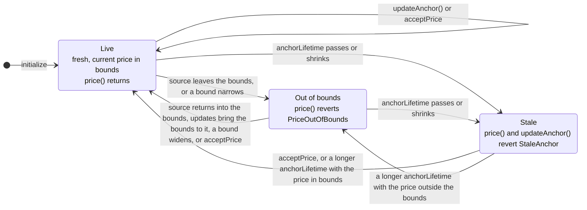

# Trailing Anchor Oracle

Review status: slop

`TrailingAnchorOracleBase` is the Morpho `IOracle` for collateral priced by one issuer contract, such as a fund's NAV. `UsdyNavOracle` and `CentrifugeNavOracle` bind it to their sources.

An issuer-published price can go wrong: the source can be faulty or compromised, or the issuer can stop publishing. A fixed price band, such as the immutable one in `UsdyStableOracle`, has to stay wide enough to hold all the accrual over the oracle's life, so a wrong price inside it still passes. This oracle checks the price against a narrow band around a stored **anchor** price that trails the source. The band limits how far the price can move at once; the anchor's speed limits how fast the band itself can follow a source that keeps moving. `price()` returns the source's live price only while that price stays within the band and the anchor is no older than its lifetime. Otherwise it reverts, and the market actions that need a price stop.

Anyone can move the anchor toward a new source value, by at most `maxAnchorRise` up or `maxAnchorFall` down a year for the time since it last moved. A faster move, or a stale anchor, needs the price acceptor or the manager.

## Scope

In scope are the base's rules and the source read of each adapter. Out of scope:

- deployment, and the role holders of a particular market;
- the keeper that calls `updateAnchor()`: it runs outside the contracts, and the oracle's liveness depends on it;
- the parameter values of a particular market;
- the loan token's own value: one loan token is taken as one unit of the source's currency, and no stablecoin feed is applied, unlike `UsdyStableOracle`.

## Adapters

Each adapter binds a source in its constructor and implements `_currentPrice()`:

| Contract | Source call | Current price |
|---|---|---|
| `UsdyNavOracle` | Ondo price getter `getPrice()` | USDY redemption value in USD, 18 decimals |
| `CentrifugeNavOracle` | Spoke `pricePoolPerShare(poolId, scId, false)` | share-class price in the pool currency, 18 decimals |

`CentrifugeNavOracle` calls the Spoke with `checkValidity = false`, so it does not ask the Spoke to check the age of its price; the deployed pools leave that age unbounded.

## Units and scaling

| Value | Unit |
|---|---|
| Current price, `anchorPrice`, `sourcePrice`, bounds, the acceptance range, and the price arguments of the errors and of `AnchorSet` | loan-token currency per collateral token, with `PRICE_DECIMALS` = 18 decimals |
| `maxPriceIncrease`, `maxPriceDecrease` | fraction of the anchor price, WAD |
| `maxAnchorRise`, `maxAnchorFall` | fraction of the anchor price per 365-day year, WAD |
| `price()` | Morpho's oracle price: loan-token units per collateral-token unit, scaled by 1e36 |

```text
PRICE_SCALE = 10^(36 + loanDecimals − collateralDecimals − 18)
price()     = currentPrice × PRICE_SCALE
```

The constructor reverts with `UnsupportedDecimals` when `36 + loanDecimals < collateralDecimals + 18`. For USDY (18 decimals) against USDC (6 decimals), `PRICE_SCALE = 1e6`, and a current price of `1.15e18` is returned as `1.15e24`.

## Price check

The bounds sit around the anchor price, rounded down, with both edges included:

```text
lowerBound = floor(anchorPrice × (1e18 − maxPriceDecrease) / 1e18)
upperBound = floor(anchorPrice × (1e18 + maxPriceIncrease) / 1e18)
```

`price()` applies these steps in order and reverts at the first one that fails:

1. **Freshness.** It reverts with `StaleAnchor(anchorAt, anchorLifetime)` when `block.timestamp − anchorAt > anchorLifetime`. An anchor exactly `anchorLifetime` old is still fresh. A stale oracle does not read the source.
2. **Source read.** It reads the current price from the adapter. A revert in the source propagates unchanged.
3. **Zero.** It reverts with `ZeroPrice` when the current price is zero.
4. **Bounds.** It reverts with `PriceOutOfBounds(currentPrice, lowerBound, upperBound)` when the current price is outside the bounds.
5. **Result.** It returns `currentPrice × PRICE_SCALE`.

Between anchor moves the returned price follows the source anywhere inside the bounds, in both directions.

## Anchor updates

`updateAnchor()` is open to anyone, in any block, also while `price()` reverts on the bounds. It applies these steps in order and reverts at the first one that fails:

1. **Freshness.** It reverts with `StaleAnchor(anchorAt, anchorLifetime)` on a stale anchor, before reading the source.
2. **Source read.** A revert in the source propagates unchanged.
3. **Zero.** It reverts with `ZeroPrice` when the current price is zero.
4. **New value.** It reverts with `SourceUnchanged(currentPrice)` when the current price equals `sourcePrice`, the current price the anchor last moved on.
5. **Move.** It clamps the current price to the anchor's reach:

   ```text
   t              = block.timestamp − anchorAt
   lowest         = anchorPrice − floor(anchorPrice × maxAnchorFall × t / (1e18 × 365 days))
   highest        = anchorPrice + floor(anchorPrice × maxAnchorRise × t / (1e18 × 365 days))
   newAnchorPrice = min(max(currentPrice, lowest), highest)
   ```

   It reverts with `AnchorUnchanged(currentPrice)` when `newAnchorPrice` equals `anchorPrice`: the current price is the anchor, the update comes in the block the anchor last moved, or the reach toward the source rounds to zero, as it does at a zero speed.
6. **Write.** It stores `anchorPrice = newAnchorPrice`, `anchorAt = block.timestamp` and `sourcePrice = currentPrice`, and emits `AnchorSet(newAnchorPrice, anchorAt, false)`.

What follows from these rules:

- The bounds are the one-time allowance and the speeds the sustained one. A source that keeps sitting at the upper bound, wherever the anchor has moved it, gains the bound once and then only the rise speed.
- An update counts only the time since the anchor last moved, so more frequent updates change the anchor's pace only through compounding, which speeds a rise and slows a fall, and nothing compounds within one block. A source far outside the bounds moves the anchor no faster than the speeds allow.
- `t` never passes `anchorLifetime`, because a stale anchor is refused. One update therefore moves the anchor by at most one lifetime of the speeds.
- An update needs a new source value. A source that stops changing moves the anchor at most once more, and the oracle goes stale `anchorLifetime` after that move, even while the anchor still trails the source.
- A source that changes faster than the speeds leaves the anchor behind. The lag stays until later updates close it, which happens only when the source takes new values.

## Anchor lifecycle

| Action | Caller | Requires | Effect | `AnchorSet.accepted` |
|---|---|---|---|---|
| `initialize` | through the proxy, once | a non-zero `admin`, valid parameters, non-zero current price | seeds the anchor and `sourcePrice` from the current price and grants `DEFAULT_ADMIN_ROLE` to `admin` | `true` |
| `updateAnchor()` | anyone | a fresh anchor, a non-zero current price other than `sourcePrice`, and a non-zero move | moves the anchor toward the current price, within its reach | `false` |
| `acceptPrice(minPrice, maxPrice)` | `PRICE_ACCEPTOR_ROLE` | `minPrice ≤ current price ≤ maxPrice`, non-zero current price | moves the anchor to the current price at any distance from the old one | `true` |

Every anchor write stores `anchorAt = block.timestamp` and the current price it read as `sourcePrice`. No caller chooses the price: all three actions read the source. No anchor is ever zero: each action refuses a zero current price, through one of its earlier checks or with `ZeroPrice`.

- `acceptPrice` reverts with `UnexpectedPrice(currentPrice, minPrice, maxPrice)` when the current price is outside the range; the range includes both edges.
- `acceptPrice` has no freshness, change or speed requirement. It revives a stale anchor, and accepting an unchanged price restarts the lifetime and the time the next update counts.
- The manager lengthening `anchorLifetime` past the anchor's age also revives a stale anchor. The lifetime always stays below `MAX_ANCHOR_LIFETIME` (30 days).



A zero or reverting source makes `price()` revert in every state.

## Parameters

`MANAGER_ROLE` sets all five parameters. Each change applies in the same transaction and leaves the anchor unchanged.

| Parameter | Type | Allowed values | Purpose |
|---|---|---|---|
| `maxPriceIncrease` | `uint64`, WAD fraction | `0 < x < 1e18` | upper bound above the anchor: the one-time rise |
| `maxPriceDecrease` | `uint64`, WAD fraction | `0 < x < 1e18` | lower bound below the anchor: the one-time fall |
| `anchorLifetime` | `uint40`, seconds | `0 < x < MAX_ANCHOR_LIFETIME` (30 days) | how long the anchor stays fresh after it moves, which also caps the time one update counts |
| `maxAnchorRise` | `uint64`, WAD fraction a year | `0 ≤ x ≤ 1e18` | how fast updates may raise the anchor; zero stops them raising it |
| `maxAnchorFall` | `uint64`, WAD fraction a year | `0 ≤ x ≤ 1e18` | how fast updates may lower the anchor; zero stops them lowering it |

Tightening a bound or shortening the lifetime can make `price()` revert in the same block. Widening a bound or lengthening the lifetime can let a price through without `acceptPrice`. A new speed also applies to the time since the anchor last moved, so raising it lets the next update move the anchor further at once. A zero speed refuses every update toward its side, so a source that moves that way leaves the anchor where it is, and the oracle goes stale a lifetime after the anchor's last move, however promptly a keeper calls.

### How far a source can move the price

Without `acceptPrice` and with the parameters unchanged, the current price that `price()` returns, before `PRICE_SCALE`, stays within these limits, up to a wei of rounding, for a time `T` after the last seed or acceptance:

```text
currentPrice ≤ anchor0 × (1 + maxPriceIncrease / 1e18) × e^(maxAnchorRise × T / (1e18 × 365 days))
currentPrice ≥ anchor0 × (1 − maxPriceDecrease / 1e18) × (1 − maxAnchorFall × T / (1e18 × 365 days))
```

`anchor0` is the anchor that seed or acceptance set. The upper limit is the one-time bound times the rise speed compounded continuously, which frequent updates approach; updates once a day compound slightly less. The lower limit is reached by a single update within a lifetime, less a wei from rounding the lower bound down; over many updates the anchor falls less, to about `anchor0 × e^(−maxAnchorFall × T / (1e18 × 365 days))`. With `maxPriceIncrease` at 5 bps and `maxAnchorRise` at 6% a year, a source that steps up at every chance raises the price by about 0.55% in 30 days and 6.2% in a year.

### Choosing values

- `maxAnchorRise` must exceed the highest yield the asset may honestly reach; otherwise the anchor falls behind an honest source and the price leaves the bounds. It is also the speed at which a compromised source creeps, so it should stay close to that yield. Size it against the market's LLTV: a position borrowed at the LLTV against a price inflated by `1/(LLTV × LIF) − 1`, with `LIF` the liquidation incentive factor, can be liquidated only at a loss to suppliers, and by `1/LLTV − 1` it is insolvent at the real price. At a 98% LLTV these are about 1.43% and 2.04%, and a source creeping over a flat real NAV with a 5 bps bound and a 6% rise speed reaches them after about 83 and 120 days.
- `maxAnchorFall` must exceed the fastest honest decline the market should follow without the acceptor. A faster honest fall leaves the bounds once the lag passes `maxPriceDecrease`, and liquidations stop with the price.
- The bounds must cover the largest honest move of the source between two of its values, plus the largest lag the speeds leave behind the honest source; that lag stays bounded only if the speeds exceed the source's sustained rate of change. A tighter bound makes `price()` revert on honest changes until updates catch up while the source keeps changing, or the acceptor or the manager acts.
- `anchorLifetime` must exceed the longest honest gap between two source values plus the time a keeper takes to update after a change. Otherwise an honest pause makes the oracle stale, and only the acceptor or the manager revives it.
- The lifetime also bounds how long a frozen value is priced. The update that reads the source's last value comes at most a lifetime after the anchor's move before it, and the oracle goes stale a lifetime after that update. So, unless the acceptor or the manager acts, a value is priced for at most two lifetimes after the source took it.

## Market impact

The core reads `price()` in `borrow`, in `withdrawCollateral` when the position has debt, in `liquidate` and in `settle`. `supply`, `withdraw`, `repay` and `supplyCollateral` do not read it. The controller reads it in its borrow and settlement hooks, in its collateral-withdrawal hook when the position has debt, in the views `nextSettlementBorrower`, `settlementFor` and `positionOf` always, and in `settlementLtv` and `hasBadDebt` when they need a price.

While `price()` reverts, borrowing, debt-bearing collateral withdrawal, liquidation and settlement revert, and so do those views whenever they read it. Repayment, supply, collateral top-ups, debt-free collateral withdrawal and lender withdrawals from free liquidity keep working; lender exits that need settlement do not.

An oracle may serve several markets. A revert then stops all of them, and the oracle's values must suit the market with the highest LLTV.

> [!WARNING]
> **Liquidations stop with the price.** If the collateral's real value falls by more than `maxPriceDecrease` in one source step, or faster than `maxAnchorFall` until the lag passes `maxPriceDecrease`, `price()` reverts instead of following it. Positions that became unhealthy cannot be liquidated until updates bring the bounds down at `maxAnchorFall`, the price acceptor accepts the new price, or the manager widens `maxPriceDecrease` or raises `maxAnchorFall`, and bad debt can grow meanwhile. When nobody updates within a lifetime of the anchor's last move, the price stops too, until the acceptor accepts a price or the manager lengthens the lifetime. The two bounds and the two speeds are separate so that each market can weigh this against over-valuation: a wide decrease bound and a fast fall speed keep liquidations running on real drops, and a narrow increase bound and a slow rise speed limit how far and how fast a faulty source can raise borrowing power.

## Invariants

The invariants hold for one adapter contract behind its proxy, from its `initialize` on. An upgrade to an adapter contract the proxy has not run before breaks I2 and I4 until the recovery in [Interfaces and stored data](#interfaces-and-stored-data) is done.

| # | Invariant |
|---|---|
| I1 | `price()` returns only when the anchor is fresh and the current price is non-zero and inside the bounds, and then returns exactly `currentPrice × PRICE_SCALE`; otherwise it reverts with the error of the first failed step |
| I2 | The stored parameters always satisfy the constraints in [Parameters](#parameters) |
| I3 | `anchorAt ≤ block.timestamp` |
| I4 | `anchorPrice` is never zero |
| I5 | An update moves the anchor by at most `anchorPrice × maxAnchorRise × t / (1e18 × 365 days)` up or `anchorPrice × maxAnchorFall × t / (1e18 × 365 days)` down, each rounded down, where `t` is the time since the anchor last moved; an update in the block the anchor moved cannot move it |
| I6 | An update reverts on a stale anchor |
| I7 | Since the source last took a new value, at most one update has moved the anchor |
| I8 | Updates and parameter changes never change a returned price; they only decide whether it is returned |
| I9 | Since the last seed or acceptance, the anchor stays within the reach of I5 compounded over the updates, each with the speeds in force and the time it counted |
| I10 | `acceptPrice` moves the anchor only to a current price inside the range its caller passed |
| I11 | `sourcePrice` is the current price the last anchor write read |
| I12 | Each adapter keeps its state in its own namespace, in the layout in [Interfaces and stored data](#interfaces-and-stored-data) |
| I13 | An upgrade to an adapter contract the proxy has not run before fails closed, once any implementation behind the proxy has initialized |
| I14 | While `price()` reverts, the core's priced actions revert and the others keep working |

## Trust model

`initialize` has no caller check. The proxy must be initialized in the call that deploys it; otherwise whoever calls `initialize` first becomes the admin and sets the parameters. `initialize` grants only `DEFAULT_ADMIN_ROLE`, and the admin then grants `MANAGER_ROLE` and `PRICE_ACCEPTOR_ROLE`.

| Actor | Can | Trusted not to |
|---|---|---|
| Price source | set the current price | report a wrong price inside the bounds, revert, or jump out of the bounds: the oracle returns any in-bounds value and lets the anchor follow it at the speeds, and a revert or an out-of-bounds jump stops the priced actions |
| Anyone, including a keeper | call `updateAnchor()` and `price()` | nothing for safety: an update takes only the source's own value and moves the anchor at most at the speeds; liveness depends on someone updating after each change of the source, within a lifetime of the last move |
| Block proposer | set `block.timestamp` within the chain's allowed drift | nothing for safety: a few seconds of drift move an update's reach by the speeds times those seconds |
| `PRICE_ACCEPTOR_ROLE` | move the anchor to the current source price at any distance, inside a range it passes, also on a stale anchor, and restart the lifetime at any time | pass a range it has not checked, or keep a frozen source alive by re-accepting it |
| `MANAGER_ROLE` | set the bounds up to just under 100%, the lifetime up to just under 30 days and the speeds up to 100% a year, each applying at once | loosen the parameters until the checks mean nothing, or tighten them to stop the market |
| `DEFAULT_ADMIN_ROLE` | grant and revoke the roles | grant them to unvetted holders |
| Proxy admin | upgrade to any implementation, which can return any price; transfer the proxy administration; ossify the proxy | point the oracle at another source or token pair |

Short of an upgrade, only the acceptor and the manager can let through a price that moved faster than the bounds and speeds allow, or revive a stale anchor.

If an acceptance executes some time after its holder's check, the source may move meanwhile. The range refuses a move past it, so the holder sets it wide enough for the moves it expects, such as accrual.

What the code does not check:

- **Source age.** The oracle does not read when the source last updated; it learns of a change only when an update reads a new value. Freshness counts from the anchor's last move, so a source that keeps changing on its own never goes stale this way, even after its issuer stops publishing.
- **Update timing.** The first update after a change of the source counts all the time since the anchor last moved. Whoever calls it picks the moment, so a wrong value that the source corrects later can take the reach built up since the last move, and the correction gets only the time since.
- **Market value.** The price is the issuer's NAV. A secondary-market discount of the collateral token, or limits on redeeming it, are not reflected.

## Interfaces and stored data

Entry points:

- `initialize(admin, maxPriceIncrease, maxPriceDecrease, anchorLifetime, maxAnchorRise, maxAnchorFall)`, once, through the proxy.
- `price()`, read by Morpho and the controller.
- `updateAnchor()`, open to anyone.
- `acceptPrice(minPrice, maxPrice)`, for the price acceptor, with the range in `PRICE_DECIMALS` units.
- `setMaxPriceIncrease`, `setMaxPriceDecrease`, `setAnchorLifetime`, `setMaxAnchorRise` and `setMaxAnchorFall`, for the manager.
- Views: `anchorPrice`, `anchorAt`, `sourcePrice`, the five parameters, `PRICE_SCALE`, `MAX_ANCHOR_LIFETIME`, and each adapter's immutables, such as `SOURCE` or `SPOKE`. No view returns the current price or the bounds.
- The adapter constructors: `UsdyNavOracle(source, loanToken, collateralToken)` and `CentrifugeNavOracle(spoke, poolId, scId, loanToken, collateralToken)`.

Events:

- `AnchorSet(anchorPrice, anchorAt, accepted)` on every anchor write. `accepted = true` comes from the seed in `initialize` and from `acceptPrice`, `false` from `updateAnchor()`. The event does not carry the source price; `sourcePrice()` returns it.
- `MaxPriceIncreaseSet`, `MaxPriceDecreaseSet`, `AnchorLifetimeSet`, `MaxAnchorRiseSet` and `MaxAnchorFallSet` on parameter changes.
- An out-of-bounds or stale oracle emits nothing, and neither does a refused update. A monitor has to read the source itself and compare it with the bounds around `anchorPrice`, or call `price()` and decode its revert, and compare the anchor's age with `anchorLifetime`.

Each adapter stores its state at `erc7201("lido.lend.storage.<ContractName>")`, in four slots:

| Slot | Fields |
|---|---|
| base + 0 | `maxPriceIncrease` (`uint64`), `maxPriceDecrease` (`uint64`), `anchorLifetime` (`uint40`), `anchorAt` (`uint40`) |
| base + 1 | `anchorPrice` (`uint256`) |
| base + 2 | `maxAnchorRise` (`uint64`), `maxAnchorFall` (`uint64`) |
| base + 3 | `sourcePrice` (`uint256`) |

`price()` reads the first two slots. Roles and the initializer flag live in OpenZeppelin's own namespaces (`openzeppelin.storage.AccessControl`, `openzeppelin.storage.AccessControlEnumerable` and `openzeppelin.storage.Initializable`), which every implementation behind the same proxy shares.

The implementation's constructor disables initializers and fixes the immutables: `PRICE_SCALE`, the source address and the adapter's own constants. An upgrade to another implementation of the same adapter contract keeps the anchor and the parameters, whatever its immutables: one bound to another source starts from the old anchor. An upgrade to an adapter contract the proxy has not run before reads an empty namespace and fails closed:

- `anchorAt` and `anchorLifetime` read as zero, so `price()` and `updateAnchor()` revert with `StaleAnchor`;
- `initialize` cannot run again, because the initializer flag is shared;
- recovery takes the manager setting the lifetime, both bounds and both speeds, and then the acceptor calling `acceptPrice`.

An upgrade back to an adapter contract the proxy ran before finds that adapter's old anchor and parameters. A proxy that ran another kind of oracle before keeps that oracle's initializer flag and roles: with the flag set it may have no role holders to recover with, and with the flag never set anyone can call `initialize` after the upgrade, unless the upgrade calls it in the same transaction.

## Related references

- [Architecture](architecture.md) for where the oracle sits in the market runtime.
- [Market controller](market-controller.md) and [Lender settlement](lender-settlement.md) for the controller paths that read the price.
- [Privileged roles](roles.md) for the proxy admin of oracle proxies.
